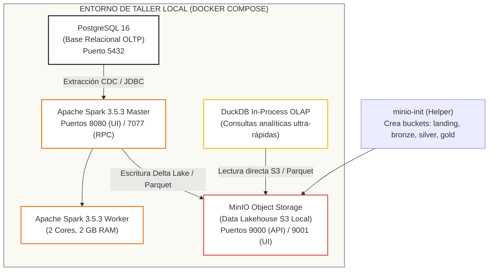

# Cómo ser un Data Engineer
### *Repositorio Acompañante Oficial · Suite de Laboratorio, Código y Datasets*

[](https://github.com/Luis-galvis/como-ser-un-data-engineer/actions/workflows/ci.yml)
[](https://www.python.org/)
[](https://docs.docker.com/compose/)
[](tests/)
[](LICENSE)

Este repositorio contiene el **código fuente reproducible, la infraestructura local en Docker, los scripts de ejercicios, los datasets oficiales y la suite de pruebas** que acompañan los talleres prácticos del libro **«Cómo ser un Data Engineer»** por Luis Galvis.

> 📖 **Nota sobre el libro:**  
> El texto completo del libro, explicaciones conceptuales, guías de diseño y casos de estudio se adquieren de forma independiente. Este repositorio está concebido exclusivamente como el **taller técnico práctico** que el lector clona para ejecutar los laboratorios en su propia computadora.

---

## 🏛️ Arquitectura del Laboratorio Local

El laboratorio recrea una plataforma moderna de ingeniería de datos en una sola máquina mediante Docker Compose, sin costos en la nube:



---

## 🚀 Inicio Rápido del Taller (3 Comandos)

### 1. Clonar el repositorio y configurar variables de entorno
```bash
git clone https://github.com/Luis-galvis/como-ser-un-data-engineer.git
cd como-ser-un-data-engineer
cp .env.example .env
```

### 2. Levantar los servicios del laboratorio local
```bash
docker compose up -d
```
* Consola Web de MinIO: [http://localhost:9001](http://localhost:9001) (Usuario: `admin_minio`, Contraseña: `minio_secret_key_2026`)
* Web UI de Spark Master: [http://localhost:8080](http://localhost:8080)
* PostgreSQL: `localhost:5432` (Base: `data_engineer_db`)

### 3. Instalar dependencias y ejecutar suite de pruebas
```bash
# Con uv (recomendado):
uv pip install -e ".[dev]"
python scripts/generar_datos.py
pytest -v tests/

# O con pip estándar:
pip install -e ".[dev]"
python scripts/generar_datos.py
pytest -v tests/
```

---

## 📊 Datasets Oficiales Incluidos

El script [`scripts/generar_datos.py`](scripts/generar_datos.py) genera de manera determinista y con semilla fija (`seed=42`) los 8 conjuntos de datos requeridos por los ejercicios del libro:

1. `data/ventas.parquet`: 10.000 transacciones analíticas para agregaciones y métricas.
2. `data/clientes.parquet`: Catálogo dimensional de clientes para esquemas en estrella y SCD2.
3. `data/eventos_telemetria.json`: Eventos semiestructurados anidados con IPs y dispositivos.
4. `data/interacciones.parquet`: 25.000 eventos de clickstream para joins masivos.
5. `data/usuarios.parquet`: Datos de usuarios con PII para gobernanza y Ley 1581 / GDPR.
6. `data/pedidos.parquet`: 20.000 pedidos relacionales para pruebas de índices B-Tree en PostgreSQL.
7. `data/eventos_anuales.parquet`: 50.000 registros multianuales para particionamiento temporal.
8. `data/transacciones_sesgadas.parquet`: 100.000 registros con distribución sesgada (Zipf/Pareto) para provocar *Data Skew* y diagnosticar *Shuffle Spill* en Spark UI.

Adicionalmente, se incluye el estudio de mercado empírico verificado:
* [`data/estudio_mercado_50_ofertas_2026.csv`](data/estudio_mercado_50_ofertas_2026.csv): 50 ofertas laborales analizadas en Q1 2026 (Colombia, LATAM y Remoto USD).

---

## 🧪 Integración Continua (CI/CD)

Cada cambio en este repositorio ejecuta automáticamente el flujo de GitHub Actions ([`.github/workflows/ci.yml`](.github/workflows/ci.yml)) en Ubuntu con versiones fijadas de paquetes:
* Linting estricto con `ruff`.
* Generación reproducible de los datasets con `scripts/generar_datos.py`.
* Suite de pruebas con `pytest` validando la integridad del estudio de mercado, consultas DuckDB en memoria, contratos de datos con Pydantic y lógica de idempotencia.

---

## ⚖️ Aviso Legal y Disclaimer

Los scripts y configuraciones se ofrecen bajo la [Licencia MIT](LICENSE).  
Los ejemplos tributarios (PILA, IBC, retenciones) tienen fines estrictamente pedagógicos y no constituyen asesoría tributaria ni financiera.
