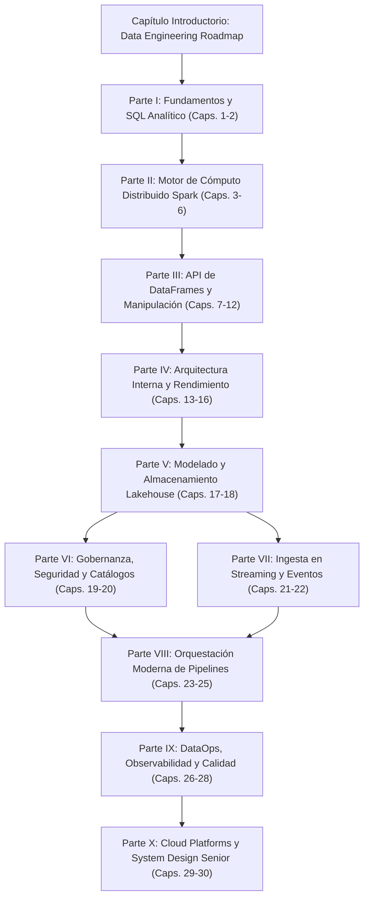

# 📑 RESUMEN ESTRUCTURAL PARA REVISIÓN EDITORIAL
> **Libro:** Cómo ser un Data Engineer  
> **Subtítulo:** Una mirada a fondo de los fundamentos y los procesos prácticos para llegar de cero a Data Engineer  
> **Autor:** Luis Galvis | **Año:** 2026 | **Idioma:** es-CO  
> **Paleta Editorial:** Tinta azulada (`#1b2030`), Gris pizarra (`#4a5160`), Papel marfil (`#fbf9f4`)  

---

## 🧭 Mapa Pedagógico Reordenado (De Cero a Senior)

---

## 🌟 Capítulo Introductorio: La Brújula Profesional

### 📖 Capítulo 0: Data Engineering Roadmap y Panorama de la Profesión
- **Notas fuente de Obsidian:** `[[Data Engineering Roadmap]]`
- **Resumen editorial:** Define las competencias troncales del ingeniero de datos moderno, la distinción entre analista y data engineer, y la ruta de aprendizaje desde fundamentos hasta arquitecturas complejas.
- **Estado:** Completo como marco de referencia para todo el libro.

---

## 🏛️ Parte I: Fundamentos y SQL Analítico
*Bases relacionales, manipulación tabular y agregaciones de negocio.*

### 📖 Capítulo 1: Fundamentos de SQL y Computación Analítica
- **Notas fuente de Obsidian:** `[[SQL]]`
- **Resumen editorial:** Enfoque declarativo vs imperativo, álgebra relacional y diferencias entre OLTP y OLAP en entornos analíticos.
- **Huecos / Duplicados:** Vincular con funciones de ventana avanzadas.

### 📖 Capítulo 2: Agrupaciones de Datos y Funciones de Agregación
- **Notas fuente de Obsidian:** `[[AGRUPACIONES DE DATOS Y FUNCIONES DE AGREGACION]]`
- **Resumen editorial:** Métricas agregadas con `groupBy`, `sum`, `avg`, `count` y el impacto del intercambio de particiones en red.
- **Huecos / Duplicados:** Normalización sintáctica a camelCase (`groupBy`).

---

## 🏛️ Parte II: El Motor de Cómputo Distribuido: Apache Spark
*Evolución histórica, arquitectura física de clúster y abstracciones de memoria.*

### 📖 Capítulo 3: De Hadoop y MapReduce al Cómputo en Memoria
- **Notas fuente de Obsidian:** `[[Hadoop]]`, `[[MapReduce]]`, `[[Spark]]`, `[[Apache Spark]]`
- **Resumen editorial:** El cuello de botella de E/S en disco de MapReduce y la revolución de la computación distribuida en RAM con Spark.
- **Huecos / Duplicados:** Fusión de las notas históricas `Spark.md` y `Apache Spark.md`.

### 📖 Capítulo 4: Arquitectura de Clúster: Driver, Workers y Ejecutores
- **Notas fuente de Obsidian:** `[[Cluster Computing]]`, `[[Cluster Manager]]`, `[[Driver Program]]`, `[[Worker Node]]`, `[[Ejecutores]]`, `[[Ejecutor]]`
- **Resumen editorial:** Coordinación entre Driver Program, Cluster Manager (YARN, K8s, Standalone) y los procesos JVM en los Worker Nodes.
- **Huecos / Duplicados:** Fusión de `Ejecutor.md` y `Ejecutores.md`. Desacople de enlace saliente a `PATH CARRER`.

### 📖 Capítulo 5: Entorno de Configuración y SparkSession
- **Notas fuente de Obsidian:** `[[PySpark]]`, `[[spark session]]`, `[[conf spark]]`, `[[SparkConf]]`
- **Resumen editorial:** Patrón Builder para inicializar SparkSession, paso de parámetros de paralelismo y carga de configuraciones JSON.
- **Huecos / Duplicados:** Fusión de `conf spark.md` y `SparkConf.md`.

### 📖 Capítulo 6: Abstracciones de Cómputo: De RDDs a DataFrames
- **Notas fuente de Obsidian:** `[[RDD]]`
- **Resumen editorial:** Concepto de Resilient Distributed Dataset, inmutabilidad, particiones lógicas y linaje de transformaciones.
- **Huecos / Duplicados:** Conectar con la evolución hacia APIs de alto nivel.

---

## 🏛️ Parte III: API de DataFrames y Manipulación de Datos
*Ingesta, tipado riguroso, transformaciones de esquemas y uniones distribuidas.*

### 📖 Capítulo 7: Ingesta y Carga de Archivos con PySpark
- **Notas fuente de Obsidian:** `[[como abrir archivos y cargar en pyspark]]`
- **Resumen editorial:** Ingesta mediante `spark.read`, paso de opciones de parseo, delimitadores y aplicación de esquemas estrictos.
- **Huecos / Duplicados:** Preparar transición a formatos columnares.

### 📖 Capítulo 8: Formatos de Archivo: Parquet, ORC y Avro `[FALTA]`
- **Notas fuente de Obsidian:** `[FALTA]` (No existe nota dedicada en el vault).
- **Resumen editorial:** Comparativa de almacenamiento columnar (Parquet) vs orientado a filas (Avro), compresión Snappy y estadísticas a nivel de bloque.
- **Huecos / Duplicados:** `[FALTA]` Requiere redacción técnica marcada como `[AÑADIDO]`.

### 📖 Capítulo 9: Tipos de Datos y Casting Riguroso en Memoria
- **Notas fuente de Obsidian:** `[[Tipos de Datos y Casting en Spark]]`
- **Resumen editorial:** Catálogo de tipos en PySpark (`StructType`, `IntegerType`, `DecimalType`), precisión financiera y prevención de nulos silenciosos.
- **Huecos / Duplicados:** Sólido y enriquecido con alegoría aduanera.

### 📖 Capítulo 10: Filtrado y Expresiones Condicionales
- **Notas fuente de Obsidian:** `[[Filter]]`, `[[Filter y Condicionales en DataFrames]]`
- **Resumen editorial:** Sintaxis `filter()` y `where()`, operadores bitwise (`&`, `|`, `~`), sentencias `when().otherwise()` y Predicate Pushdown.
- **Huecos / Duplicados:** Fusión de `Filter.md` y `Filter y Condicionales en DataFrames.md`.

### 📖 Capítulo 11: Transformaciones de Columnas y Operaciones con Esquemas
- **Notas fuente de Obsidian:** `[[with column y withcolum rename]]`, `[[Funciones de Transformación en PySpark]]`, `[[dataframes]]`
- **Resumen editorial:** Creación y renombrado de columnas, funciones de cadenas y fechas, manejo de arrays y explosión con `explode()`.
- **Huecos / Duplicados:** Corrección sintáctica de métodos en minúsculas y strings sin cerrar.

### 📖 Capítulo 12: Joins Distribuidos y Estrategias de Cruce `[FALTA]`
- **Notas fuente de Obsidian:** `[FALTA]` (No existe nota dedicada en el vault).
- **Resumen editorial:** Estrategias de join en cómputo distribuido: Broadcast Hash Join, Shuffle Sort-Merge Join y Shuffle Hash Join.
- **Huecos / Duplicados:** `[FALTA]` Requiere redacción técnica marcada como `[AÑADIDO]`.

---

## 🏛️ Parte IV: Arquitectura Interna y Rendimiento (Internals)
*Mecanismos bajo el capó: grafos dirigidos, optimización de árbol y gestión de memoria.*

### 📖 Capítulo 13: Evaluación Perezosa (Lazy Evaluation) y el Grafo DAG
- **Notas fuente de Obsidian:** `[[lazy evaluation]]`, `[[DAG]]`, `[[Acción]]`
- **Resumen editorial:** Distinción rigurosa entre Transformaciones (estrechas y amplias) y Acciones terminales (`collect`, `count`, `save`).
- **Huecos / Duplicados:** Incorporar la alegoría del chef y la comanda de pedidos.

### 📖 Capítulo 14: El Optimizador Catalyst y Spark SQL
- **Notas fuente de Obsidian:** `[[Spark SQL]]`, `[[Spark SQL y Catalyst Optimizer]]`
- **Resumen editorial:** Fases del motor Catalyst: árbol sin resolver, análisis de catálogo, optimización de reglas (RBO) y costos (CBO), y generación de código físico con Tungsten.
- **Huecos / Duplicados:** Fusión de las dos notas de Catalyst.

### 📖 Capítulo 15: Gestión de Memoria RAM y Estrategias de Caché
- **Notas fuente de Obsidian:** `[[Memoria RAM]]`, `[[Cache]]`, `[[Spark Memory Management]]`
- **Resumen editorial:** Desglose del pool de memoria de Spark: Execution Memory vs Storage Memory, y niveles de persistencia (`MEMORY_ONLY`, `MEMORY_AND_DISK`).
- **Huecos / Duplicados:** Unificación de notas atómicas.

### 📖 Capítulo 16: Particionado, Shuffling y Mitigación de Data Skew
- **Notas fuente de Obsidian:** `[[Partitioning y Shuffling en Spark]]`, `[[shuffle]]`
- **Resumen editorial:** El costo del shuffle en red, repartition vs coalesce, y técnicas de salting para balancear particiones sesgadas (skew).
- **Huecos / Duplicados:** Fusión de `shuffle.md` con la nota principal de particionado.

---

## 🏛️ Parte V: Modelado y Almacenamiento Lakehouse
*Inversión pedagógica: de la arquitectura analítica medallón a los fundamentos de Delta Lake.*

### 📖 Capítulo 17: Arquitectura Medallón y Modelado Dimensional
- **Notas fuente de Obsidian:** `[[Medallion Architecture]]`, `[[Modelado Dimensional en Lakehouse]]`, `[[Dimensional Modeling]]`, `[[Data Modeling Patterns]]`
- **Resumen editorial:** Flujo por capas Bronze (crudo), Silver (limpio y enriquecido) y Gold (modelado Kimball de estrellas/copos de nieve para negocio).
- **Huecos / Duplicados:** Fusión de notas de modelado dimensional.

### 📖 Capítulo 18: Arquitectura de Lakehouse y Transacciones ACID con Delta Lake
- **Notas fuente de Obsidian:** `[[Delta Lake]]`
- **Resumen editorial:** Cómo Delta Lake añade el registro de transacciones `_delta_log` sobre Parquet para garantizar atomicidad, time travel y operaciones `MERGE`.
- **Huecos / Duplicados:** Consolidación de casos de uso de CDC y rollback.

---

## 🏛️ Parte VI: Gobernanza, Seguridad y Catálogos de Datos

### 📖 Capítulo 19: Gobernanza, Linaje y Unity Catalog
- **Notas fuente de Obsidian:** `[[Unity Catalog]]`, `[[Data Lineage and Governance]]`
- **Resumen editorial:** Control de acceso centralizado (RBAC/ABAC), auditoría, linaje de datos columna a columna y seguridad federada.
- **Huecos / Duplicados:** Establecer estándares de protección de datos personales.

### 📖 Capítulo 20: Catalogación y Descubrimiento de Datos
- **Notas fuente de Obsidian:** `[[Data Cataloging]]`
- **Resumen editorial:** Metadatos técnicos, operativos y de negocio para habilitar autoservicio analítico seguro.
- **Huecos / Duplicados:** Conectar con herramientas del ecosistema cloud.

---

## 🏛️ Parte VII: Ingesta en Tiempo Real y Streaming

### 📖 Capítulo 21: Fundamentos de Streaming y Apache Kafka
- **Notas fuente de Obsidian:** `[[Streaming]]`, `[[Apache Kafka]]`
- **Resumen editorial:** Mensajería de eventos distribuidos: topics, particiones, offsets y garantías de entrega (at-least-once, exactly-once).
- **Huecos / Duplicados:** Explicar el desacople productor-consumidor.

### 📖 Capítulo 22: Spark Structured Streaming y Change Data Capture (CDC)
- **Notas fuente de Obsidian:** `[[Spark Structured Streaming]]`, `[[Change Data Capture (CDC)]]`, `[[Ingesta Batch vs Streaming y CDC]]`, `[[Streaming Data Quality Patterns]]`, `[[Data Quality en Streaming con Delta Lake]]`
- **Resumen editorial:** Procesamiento continuo con micro-batches, watermarking para datos tardíos, checkpointing para tolerancia a fallos y captura incremental con Debezium/Delta.
- **Huecos / Duplicados:** Integrar las notas de calidad de datos en streaming.

---

## 🏛️ Parte VIII: Orquestación Moderna de Pipelines

### 📖 Capítulo 23: Orquestación de Pipelines: Apache Airflow y Azure Data Factory
- **Notas fuente de Obsidian:** `[[Apache Airflow]]`, `[[Azure Data Factory]]`, `[[Apache Airflow vs Azure Data Factory]]`, `[[Orquestación de Pipelines Hybrid]]`
- **Resumen editorial:** DAGs como código en Python (Airflow) vs orquestación serverless cloud (ADF). Patrones híbridos de disparo y monitoreo.
- **Huecos / Duplicados:** Fusión de notas comparativas de orquestadores.

### 📖 Capítulo 24: Transformación Modular con dbt e Idempotencia
- **Notas fuente de Obsidian:** `[[dbt]]`, `[[ETL Pipelines]]`, `[[Anatomía de un Pipeline de Datos Moderno]]`, `[[Idempotencia en Data Pipelines]]`
- **Resumen editorial:** Modelado declarativo SQL con control de versiones en dbt y diseño de pipelines idempotentes a prueba de reejecuciones.
- **Huecos / Duplicados:** Consolidación de principios de arquitectura ETL/ELT.

### 📖 Capítulo 25: Infraestructura como Código (IaC) con Terraform
- **Notas fuente de Obsidian:** `[[Terraform for Data Engineering]]`
- **Resumen editorial:** Provisión declarativa de clústeres, storage accounts y catálogos mediante HCL, gestión de estados y buenas prácticas de seguridad.
- **Huecos / Duplicados:** Vincular con reproducibilidad de entornos.

---

## 🏛️ Parte IX: DataOps, Observabilidad y Calidad de Datos

### 📖 Capítulo 26: CI/CD y Portabilidad de Pipelines de Datos
- **Notas fuente de Obsidian:** `[[CI-CD for Data Pipelines]]`, `[[DataOps y CI-CD para Data Engineering]]`, `[[Portabilidad de Pipelines Spark]]`
- **Resumen editorial:** Automatización de pruebas unitarias con pytest, linting, empaquetado de artefactos y desacople de dependencias específicas de proveedor.
- **Huecos / Duplicados:** Fusión de notas de integración continua.

### 📖 Capítulo 27: Observabilidad, Monitoreo y Logging
- **Notas fuente de Obsidian:** `[[Data Observability]]`, `[[Spark Logging and Monitoring]]`
- **Resumen editorial:** Los 5 pilares de observabilidad (frescura, distribución, volumen, esquema, linaje), métricas de ejecutores en Spark y alertas proactivas.
- **Huecos / Duplicados:** Unificación de notas de observabilidad y logging.

### 📖 Capítulo 28: Data Quality y Validación Automatizada con Great Expectations
- **Notas fuente de Obsidian:** `[[Data Quality]]`, `[[Data Quality Framework]]`, `[[Integración de Data Quality en ETL]]`, `[[Great Expectations]]`
- **Resumen editorial:** Diseño de compuertas de calidad de datos (assertions), definición de Expectations en Python y circuit breakers para detener pipelines corruptos.
- **Huecos / Duplicados:** Ubicación definitiva en el Capítulo 28 como componente culminante de confiabilidad.

---

## 🏛️ Parte X: Cloud Data Platforms, System Design y Nivel Senior

### 📖 Capítulo 29: Cloud Data Architecture y Optimización de Costos
- **Notas fuente de Obsidian:** `[[Cloud Computing]]`, `[[Databricks]]`, `[[Cloud Cost Optimization in Spark]]`, `[[Graph Processing]]`, `[[Machine Learning]]`, `[[SSIS]]`
- **Resumen editorial:** Servicios administrados (Databricks, EMR, Synapse), autoescalado, instancias spot, optimización de shuffle y modernización de legacy SSIS.
- **Huecos / Duplicados:** Fusión de notas del ecosistema cloud y cómputo especializado.

### 📖 Capítulo 30: System Design para Data Engineers y Preparación Senior
- **Notas fuente de Obsidian:** `[[Data Engineer Interview Guide y System Design]]`
- **Resumen editorial:** Metodología paso a paso para diseñar sistemas de datos a escala petabyte: estimación de volumetría, SLA/SLO, selección de componentes y liderazgo técnico.
- **Huecos / Duplicados:** Cierre maestro del libro con casos prácticos de arquitectura.
