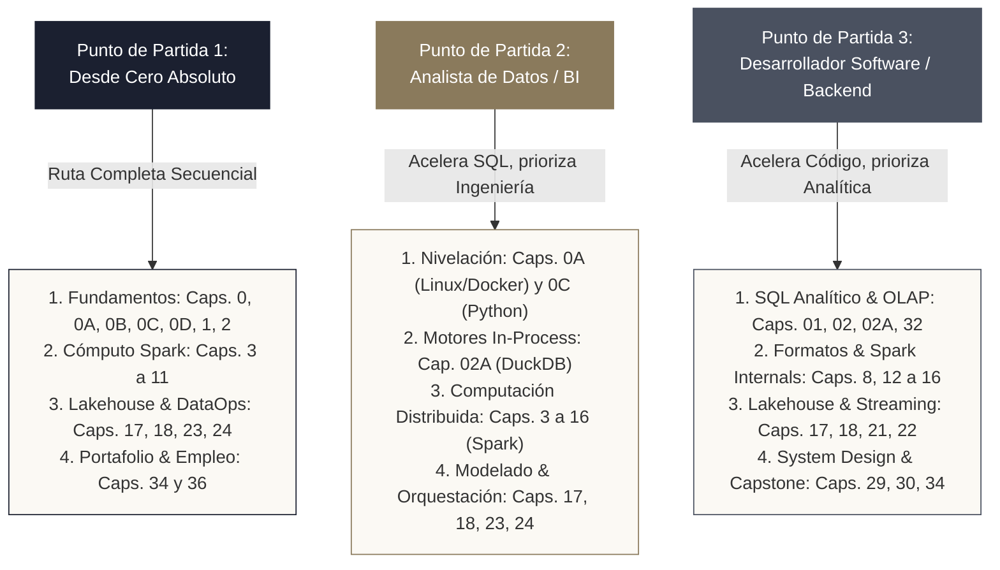
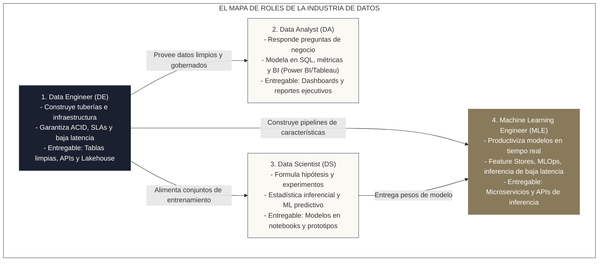
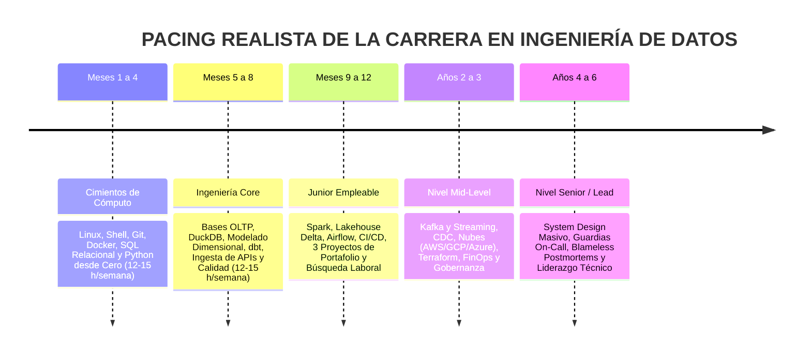

<!-- NOTAS FUENTE ORIGINALES DE OBSIDIAN: [[Data Engineering Roadmap]] -->

# Capítulo 0: Data Engineering Roadmap y Panorama de la Profesión

> *"El rol del Data Engineer no es simplemente escribir consultas SQL; es diseñar sistemas de distribución robustos, resilientes e idempotentes capaces de mover y transformar petabytes con latencia predecible."*

---

## 0.0 Intuición Inicial: El Acueducto Invisible de los Datos

Imagina abrir el grifo de tu cocina y recibir agua potable limpia, a presión constante y sin interrupciones. No piensas en los kilómetros de tuberías subterráneas, las plantas de tratamiento químico, los tanques de decantación ni las bombas de presión que evitan que la red colapse.

En una empresa contemporánea, el analista de negocio y los tableros de Power BI son como ese grifo: esperan abrir una herramienta analítica y observar números limpios, coherentes y actualizados al segundo. Sin embargo, detrás de esa interfaz existe un torrente de datos caótico: bases de datos transaccionales saturadas, archivos JSON semiestructurados con formatos rotos, registros de clientes duplicados y millones de eventos por segundo llegando desde aplicaciones móviles.

**El Ingeniero de Datos (Data Engineer) es el profesional que diseña, construye, monitorea y repara esa gigantesca red de acueductos digitales.** Su misión no es contemplar el agua en el vaso, sino garantizar que la información fluya desde los sistemas de origen hacia los destinos analíticos de forma pura, oportuna y sin inundar los sistemas operativos. Si un pipeline falla a las 3:00 de la madrugada, es el Data Engineer quien recibe la alerta y subsana el problema antes de que los tomadores de decisiones inicien su jornada laboral.

> **Repositorio Oficial de Laboratorio en GitHub:**  
> Todo el código fuente, los entornos de Docker Compose, los scripts de generación de datos y las soluciones completas a los ejercicios de esta obra se encuentran alojados y mantenidos en el repositorio oficial de código abierto:  
> **[https://github.com/luisgalvis/como-ser-un-data-engineer](https://github.com/luisgalvis/como-ser-un-data-engineer)**  
> *(Consulte el [Capítulo 0D](file:///c:/Users/lgalv/Desktop/obsidian/libro/capitulos/00d-entorno-de-laboratorio-y-datasets.md) para las instrucciones detalladas de clonación y despliegue local).*

---

## Objetivos de Aprendizaje
Al finalizar este capítulo, el lector será capaz de:
* Comprender la evolución y fronteras del rol de Data Engineer frente a analistas de datos, científicos de datos e ingenieros de machine learning.
* Identificar las tres rutas de lectura recomendadas según su punto de partida técnico (desde cero absoluto, analista en transición o programador backend).
* Distinguir qué capítulos constituyen el **Núcleo de Empleabilidad** para obtener un primer trabajo frente a los módulos recomendados y avanzados.
* Conocer la jerarquía física de memoria, los fundamentos web HTTP/APIs y la estadística operativa mínima necesaria para la disciplina.
* Trazar un plan de estudio deliberado de 9 a 12 meses con dedicación horaria honesta y una estrategia pragmática de certificaciones oficiales.

---

## Rutas de Lectura según tu Punto de Partida

Para maximizar el aprovechamiento de esta obra, identifique su perfil inicial y siga la secuencia curricular adaptada a sus fortalezas previas:



### Cuestionario de Auto-Diagnóstico Inicial: ¿Dónde me encuentro hoy?

Responda con honestidad a las siguientes 10 preguntas para confirmar cuál es su ruta de estudio óptima:

1. ¿Sabe clonar un repositorio con Git, crear ramas (*branches*) y resolver conflictos básicos en terminal? `[ ] Sí  [ ] No`
2. ¿Puede escribir un archivo `docker-compose.yml` y levantar servicios aislados (como PostgreSQL o MinIO) en su máquina? `[ ] Sí  [ ] No`
3. ¿Escribe funciones en Python con tipado estático (`typing`), manejo estructurado de excepciones y pruebas en `pytest`? `[ ] Sí  [ ] No`
4. ¿Ha consumido APIs REST con librerías HTTP gestionando respuestas con paginación por cursor y códigos de estado (200, 429, 500)? `[ ] Sí  [ ] No`
5. ¿Domina consultas SQL complejas empleando Expresiones de Tabla Comunes (CTEs) y funciones de ventana (`ROW_NUMBER`, `LEAD`, `LAG`)? `[ ] Sí  [ ] No`
6. ¿Comprende la diferencia fundamental entre una base relacional normalizada en 3NF y un esquema analítico en estrella de Kimball? `[ ] Sí  [ ] No`
7. ¿Ha ejecutado transformaciones sobre DataFrames de Apache Spark (PySpark) y analizado planes de ejecución en la interfaz Spark UI? `[ ] Sí  [ ] No`
8. ¿Conoce los mecanismos de consistencia transaccional ACID y control de versiones (*Time Travel*) de Delta Lake o Apache Iceberg? `[ ] Sí  [ ] No`
9. ¿Ha programado y orquestado flujos de trabajo (*DAGs*) productivos en Apache Airflow bajo el paradigma TaskFlow? `[ ] Sí  [ ] No`
10. ¿Ha modelado canalizaciones de transformación en dbt aplicando pruebas automáticas de unicidad y no-nulos? `[ ] Sí  [ ] No`

#### Interpretación de Resultados:
* **0 a 3 respuestas afirmativas:** **Ruta 1 (Cero Absoluto).** Su prioridad es avanzar de forma estrictamente lineal por los capítulos marcados como `[NÚCLEO EMPLEABILIDAD]`, sin saltarse los fundamentos de terminal, Linux, Python básico y SQL inicial.
* **4 a 6 respuestas afirmativas (con fortaleza en SQL/BI):** **Ruta 2 (Analista en Transición).** Puede avanzar rápido en SQL básico y centrar el 80% de su energía en Python modular, Docker, computación distribuida con Spark y orquestación con Airflow.
* **4 a 6 respuestas afirmativas (con fortaleza en código/DevOps):** **Ruta 3 (Desarrollador Backend en Transición).** Puede obviar la sintaxis básica de Python y terminal. Su foco crítico debe ser el SQL analítico avanzado, el modelado dimensional de Kimball, el tuning de memoria en Spark y la arquitectura Lakehouse.
* **7 o más respuestas afirmativas:** Diríjase de inmediato a las partes de optimización física avanzada (Partes V a X), al Proyecto Integrador Capstone y al Apéndice B para preparar entrevistas de nivel Mid-Level o Senior.

---

### Clasificación de Capítulos por Nivel de Prioridad
A lo largo del libro, cada capítulo incluye una insignia editorial que delimita su alcance curricular:
* `[NÚCLEO EMPLEABILIDAD]`: Temas indispensables para superar entrevistas técnicas junior y desempeñarse en el primer trabajo (Linux, Git, Docker, Python, SQL, DuckDB, Spark básico, Delta Lake, Airflow, dbt y los Proyectos de Portafolio).
* `[RECOMENDADO]`: Herramientas que diferencian su perfil y aceleran la transición a puestos intermedios (Kafka, Terraform, Great Expectations, nubes públicas AWS/Azure/GCP, Databricks y Snowflake).
* `[AVANZADO]`: Conceptos de optimización física profunda, arquitectura distribuida y liderazgo técnico (Catalyst, Shuffling a fondo, Data Vault 2.0, Flink, MLOps, RAG y System Design senior).

---

### Profundiza: El Fundamento Formal de los Sistemas de Datos
> **Definición 0.1 (Ingeniería de Datos como Disciplina de Sistemas Distribuidos)**  
> La ingeniería de datos contemporánea es la rama de la ingeniería de software responsable del diseño, implementación, escalabilidad y observabilidad de plataformas para la recolección, transformación, almacenamiento y gobierno de activos de información a gran escala.
> 
> Su objetivo fundamental es garantizar que los datos fluyan desde sistemas operacionales heterogéneos hacia capas analíticas con alta disponibilidad, latencia predecible, consistencia transaccional (semántica ACID) e integridad estructural verificable.

---

## 0.1 El Mapa de Roles de la Industria Analítica

Para evitar la habitual confusión en las ofertas de empleo, delimitamos formalmente las fronteras entre los cuatro roles principales del ecosistema:



* **Data Engineer (DE):** Arquitecto y constructor de las plataformas. Si el pipeline se detiene a la medianoche, si los datos contienen duplicados o si la consulta tarda 4 horas en vez de 3 minutos, es su responsabilidad directa.
* **Data Analyst (DA):** Traduce datos limpios a decisiones corporativas. Depende de que el DE le entregue dimensiones conformadas y tablas de hechos agregadas en la capa Gold.
* **Data Scientist (DS):** Descubre patrones probabilísticos y correlaciones para predecir comportamientos futuros.
* **Machine Learning Engineer (MLE):** Toma el modelo matemático validado por el científico y lo despliega como un microservicio escalable con monitoreo de deriva (*drift*).

---

## 0.2 Fundamentos Previos: Computadores, Redes y Estadística Mínima

Antes de manipular millones de registros en clústeres distribuidos, todo ingeniero debe comprender las restricciones físicas impuestas por el hardware y la red.

### 1. La Jerarquía de Memoria y la Física de la Latencia
En sistemas de datos, el tiempo requerido para acceder a un dato delimita el rendimiento máximo de cualquier algoritmo. A continuación se presentan las latencias de hardware normalizadas a escala humana (suponiendo que un ciclo de CPU equivalga a 1 segundo):

| Nivel de Memoria / Operación | Latencia Física Real | Tiempo Equivalente Humano |
| :--- | :--- | :--- |
| **Ciclo de reloj de CPU (Registros)** | 0.3 ns | 1 segundo |
| **Caché L1** | 0.9 ns | 3 segundos |
| **Caché L2** | 2.8 ns | 9 segundos |
| **Caché L3** | 12.9 ns | 43 segundos |
| **Memoria RAM Principal** | 100 ns | 5.5 minutos |
| **Lectura de Disco SSD NVMe (Bloque 4 KB)** | 10.000 ns (10 µs) | 9.2 horas |
| **Lectura de Disco Duro Magnético (HDD Seek)** | 10.000.000 ns (10 ms) | 1.05 años |
| **Transferencia en Red LAN (Mismo Datacenter)** | 500.000 ns (0.5 ms) | 19.3 días |
| **Llamada de Red WAN (Transcontinental)** | 60.000.000 ns (60 ms) | 6.3 años |

> **Lección Fundamental de Ingeniería:** Acceder a la memoria RAM es aproximadamente **100.000 veces más veloz** que buscar en un disco magnético, y transferir datos por la red es la operación más costosa de un clúster. Cuando Spark ejecuta un *Shuffle*, debe serializar datos en memoria, escribirlos a disco local y transmitirlos por la red a otros nodos. **Optimizar un pipeline consiste esencialmente en evitar transferencias de red y serializaciones innecesarias.**

### 2. Fundamentos de la Web: HTTP, REST y APIs
Gran parte de la ingesta de datos transaccionales se produce consumiendo interfaces de programación de aplicaciones (**APIs REST**) sobre el protocolo **HTTP/HTTPS**:
* **Métodos HTTP:** `GET` (lectura idempotente), `POST` (creación no idempotente), `PUT` (reemplazo idempotente), `PATCH` (modificación parcial).
* **Códigos de Estado Críticos en Pipelines:**
  * `200 OK` / `201 Created`: Solicitud exitosa.
  * `400 Bad Request` / `422 Unprocessable`: Datos con formato o contrato inválido (error en el payload).
  * `401 Unauthorized` / `403 Forbidden`: Problemas de token o permisos de acceso.
  * `429 Too Many Requests`: Se ha excedido la cuota de peticiones (*Rate Limit*). Requiere retroceso exponencial con variación aleatoria (*Exponential Backoff con Jitter*).
  * `500 Internal Error` / `502 Bad Gateway` / `503 Service Unavailable`: Falla transitoria del servidor de origen (permite reintentos automáticos).
* **Formato JSON:** El estándar dominante en eventos web. Formato semiestructurado con tipado débil que requiere validación estricta de esquemas antes de incorporarse al almacenamiento columnar.

### 3. Estadística Mínima para el Data Engineer
El Data Engineer no formula modelos econométricos, pero debe dominar tres conceptos estadísticos indispensables para no corromper datos de negocio ni diseñar alertas erróneas:
1. **La Trampa de la Media frente a la Mediana:**  
   En distribuciones con asimetría severa (*skewness* o colas pesadas, como duración de consultas o volumen de compras), la media aritmética se ve fuertemente distorsionada por valores atípicos (*outliers*). En ingeniería de datos, **los acuerdos de nivel de servicio (SLAs) nunca se miden por el promedio, sino mediante percentiles**.
2. **Percentiles Operativos ($p50, p95, p99$):**  
   * $p50$ (Mediana): El 50% de las ejecuciones concluyen por debajo de este umbral.
   * $p95$ y $p99$: El 95% o 99% de las ejecuciones terminan en este límite. El percentil 99 expone el peor escenario sufrido por los usuarios en momentos de saturación.
3. **Detección de Anomalías Volumétricas:**  
   Para detectar caídas abruptas en la ingesta o duplicaciones accidentales, se monitorean la **Desviación Estándar ($\sigma$)** y el **Rango Intercuartílico ($IQR = Q_3 - Q_1$)**. Si el volumen diario de registros se desvía en más de $3\sigma$ respecto al promedio móvil mensual, el pipeline debe emitir una alerta preventiva antes de consolidar la capa Silver.

---

## 0.3 Pacing Profesional Realista: De Cero a Empleabilidad

Prometer que una persona sin formación técnica previa alcanzará el nivel de "Senior Data Engineer" en 12 meses es una afirmación irreal. La ingeniería de sistemas distribuidos exige asimilar abstracciones complejas, depurar fallos en memoria y acumular experiencia ante incidentes reales.

El camino profesional honesto y probado en la industria se estructura en tres hitos:



### Plan de Estudio Mensual con Entregables Semanales (Hito 1: Junior Empleable)
Dedicación sugerida: **12 a 15 horas semanales** de estudio deliberado y práctica en laboratorio. Cada mes concluye con entregables verificables en código:

| Mes | Eje Temático y Capítulos | Entregables Semanales Requeridos |
| :--- | :--- | :--- |
| **Mes 1** | **Cimientos de Entorno y Linux**<br>Cap. 00A (Linux/Docker/Git) | • **Semana 1:** Terminal Linux configurada con `zsh`/`bash`, scripts shell con pipes (`grep`, `awk`, `sed`) y control de versiones con Git (ramas, commits convencionales).<br>• **Semana 2:** Contenerización con Docker: Dockerfile multi-stage, volumes y redes bridge.<br>• **Semana 3:** Orquestación multicontenedor con `docker compose` levantando Postgres y MinIO con variables de entorno en `.env`.<br>• **Semana 4:** Entregable Mes 1: Repositorio con un pipeline en Shell/Docker que descarga un dataset público, valida checksum SHA-256 y lo carga en PostgreSQL. |
| **Mes 2** | **Bases Relacionales y Python Moderno**<br>Cap. 00B (OLTP) y 00C (Python Cero) | • **Semana 5:** Modelado relacional normalizado (3NF), índices B-Tree, constraints (`CHECK`, `FK`) y análisis de `EXPLAIN ANALYZE` en PostgreSQL.<br>• **Semana 6:** Python moderno: entorno virtual aislado con `uv`, tipado estático estricto (`mypy`), estructuras inmutables y decoradores.<br>• **Semana 7:** Manejo de datos estructurados: parseo robusto de JSON con Pydantic v2, lectura de CSVs y llamadas HTTP con `httpx` implementando backoff exponencial.<br>• **Semana 8:** Entregable Mes 2: Paquete Python probado con `pytest` al 90% de cobertura que extrae datos de una API pública con paginación y valida esquemas con Pydantic. |
| **Mes 3** | **SQL Analítico Avanzado y DuckDB**<br>Cap. 01, 02 y 02A (DuckDB) | • **Semana 9:** SQL declarativo: agregaciones avanzadas (`GROUPING SETS`, `ROLLUP`, `CUBE`) y expresiones de tabla comunes (`WITH RECURSIVE`).<br>• **Semana 10:** Funciones de ventana analíticas: `ROW_NUMBER()` para deduplicación, `RANK()`, `DENSE_RANK()`, `LEAD()`, `LAG()` y marcos móviles (`ROWS BETWEEN`).<br>• **Semana 11:** Motor in-process DuckDB: lectura directa de Parquet, inferencia de esquemas, exportación columnar y persistencia de catálogo local.<br>• **Semana 12:** Entregable Mes 3: Script analítico en DuckDB + SQL que procesa 5 millones de registros de e-commerce en menos de 2 segundos generando un reporte de cohortes de retención. |
| **Mes 4** | **Estructuras de Datos y APIs para DE**<br>Cap. 02B (Estructuras de Datos) | • **Semana 13:** Algoritmos clave en DE: hashing, sets y diccionarios para uniones $O(N)$ en memoria sin bibliotecas pesadas.<br>• **Semana 14:** Generadores y streams en Python: procesamiento perezoso (*lazy evaluation*) con `yield` para procesar archivos de 10 GB en máquinas con 2 GB de RAM.<br>• **Semana 15:** Concurrencia controlada con `asyncio` y `ThreadPoolExecutor` para descargas paralelas masivas respetando límites de tasa (*rate limits*).<br>• **Semana 16:** Entregable Mes 4: Extractor asíncrono con pool de hilos que descarga 50.000 registros mediante lotes de 100 sin desbordar memoria ni recibir errores 429. |
| **Mes 5** | **Fundamentos de Spark y Arquitectura**<br>Cap. 03 a 06 (Arquitectura Clúster) | • **Semana 17:** Arquitectura distribuida: Driver, Cluster Manager, Executors, memoria JVM (Storage vs. Execution memory) y ciclo de vida de jobs.<br>• **Semana 18:** RDDs y evaluación perezosa: transformaciones estrechas vs. anchas (*Narrow vs. Wide dependencies*) y costo físico del Shuffle.<br>• **Semana 19:** Entorno PySpark local con Docker Compose: configuración de master/workers e interacción con PySpark CLI.<br>• **Semana 20:** Entregable Mes 5: Benchmark comparativo de rendimiento entre un job con shuffle masivo (`groupByKey`) frente a una reducción local (`reduceByKey`). |
| **Mes 6** | **PySpark DataFrames y Formatos Columnar**<br>Cap. 07 a 12 (Ingesta y Joins) | • **Semana 21:** Formato Apache Parquet: compresión Snappy/Zstandard, estadísticas de columnas (*min/max pushdown*) y particionamiento físico.<br>• **Semana 22:** DataFrames API: transformaciones optimizadas por Catalyst Optimizer y Tungsten Engine.<br>• **Semana 23:** Joins distribuidos: Shuffle Hash Join, Sort Merge Join y optimización con Broadcast Join (`broadcast()`).<br>• **Semana 24:** Entregable Mes 6: Pipeline en PySpark que ingesta logs crudos, aplica broadcast join con una tabla dimensional y persiste en Parquet particionado por fecha. |
| **Mes 7** | **Lakehouse, Delta Lake y Modelado**<br>Cap. 17 (Medallón) y 18 (Delta Lake) | • **Semana 25:** Arquitectura Medallón: definición formal de capas Bronze (crudo), Silver (conformado/limpio) y Gold (agregado de negocio).<br>• **Semana 26:** Modelado dimensional Kimball: tablas de hechos (*Facts*), dimensiones conformadas, claves subrogadas y dimensiones que cambian lentamente (SCD Tipo 1 y 2).<br>• **Semana 27:** Delta Lake transaccional: registro `_delta_log`, ACID con `MERGE INTO`, Time Travel y optimización física con `OPTIMIZE` y `Z-ORDER`.<br>• **Semana 28:** Entregable Mes 7: Pipeline Lakehouse completo Bronze $\to$ Silver $\to$ Gold implementando SCD Tipo 2 idempotente con `MERGE INTO` en Delta Lake. |
| **Mes 8** | **Orquestación con Airflow y Modelado con dbt**<br>Cap. 23, 23A (Airflow) y 24 (dbt) | • **Semana 29:** Apache Airflow: arquitectura (Scheduler, Webserver, Triggerer, Workers), operadores básicos y diseño de DAGs idempotentes.<br>• **Semana 30:** Manejo avanzado de dependencias: `TaskGroups`, reintentos automáticos, SLAs, conexiones seguras y variables en Airflow.<br>• **Semana 31:** dbt Core: estructura de proyecto, modelos staging, intermediate y marts; documentación interactiva y linaje automático.<br>• **Semana 32:** Entregable Mes 8: DAG de Airflow orquestando un proyecto dbt que ejecuta tests de unicidad y no-nulidad antes de actualizar los marts de analítica. |
| **Mes 9** | **DataOps, Calidad y Contratos**<br>Cap. 26, 26A (CI/CD) y 28 (GX/Contratos) | • **Semana 33:** Contratos de datos (*Data Contracts*): definición de especificaciones semánticas y cuarentena de registros inválidos (*Dead-Letter Queue*).<br>• **Semana 34:** Validación automatizada con Great Expectations / Soda / Pydantic Contracts: assertions de negocio y generación de reportes de calidad.<br>• **Semana 35:** CI/CD para datos: GitHub Actions ejecutando linters (`ruff`, `sqlfluff`) y pruebas unitarias con Testcontainers en cada Pull Request.<br>• **Semana 36:** Entregable Mes 9: Pipeline con GitHub Action que bloquea el merge si los esquemas de datos entrantes violan el contrato establecido. |
| **Mes 10** | **Infraestructura Cloud Básica e IaC**<br>Cap. 13 (AWS), 25 (Terraform) | • **Semana 37:** Fundamentos de AWS para datos: S3, IAM (principio de menor privilegio), Glue Data Catalog y Athena.<br>• **Semana 38:** Infraestructura como Código: aprovisionamiento de buckets S3, roles IAM y bases de datos con Terraform modular.<br>• **Semana 39:** Gestión de costos (FinOps): alertas de presupuesto de $5 USD en AWS, ciclos de vida de objetos en S3 y destrucción con `terraform destroy`.<br>• **Semana 40:** Entregable Mes 10: Módulo Terraform reutilizable que levanta un Data Lakehouse en S3 con políticas IAM estrictas y alerta de costo configurada. |
| **Mes 11** | **Construcción de los 3 Proyectos de Portafolio**<br>Cap. 34 (Proyectos Portafolio) | • **Semana 41:** Proyecto 1 (Local Zero-Cost): DuckDB + dbt + Airflow + Streamlit documentado de punta a punta.<br>• **Semana 42:** Proyecto 2 (API Ingestion & Lakehouse): Extractor API con backoff $\to$ S3/MinIO $\to$ PySpark $\to$ Delta Lake con cuarentena de datos.<br>• **Semana 43:** Proyecto 3 (Streaming o Cloud): Kafka básico o pipeline serverless en AWS/Databricks con métricas de rendimiento y costos.<br>• **Semana 44:** Entregable Mes 11: Tres repositorios públicos en GitHub con README profesional, diagramas Mermaid, instrucciones `docker compose up` y videos demo. |
| **Mes 12** | **Tramo de Empleo y Procesos de Selección**<br>Cap. 36 (Estrategia Laboral) | • **Semana 45:** Optimización de CV en formato X-Y-Z bilingüe (español/inglés) adaptado a sistemas ATS, perfil de LinkedIn y presencia en GitHub.<br>• **Semana 46:** Práctica intensiva de Live-Coding: 50 problemas de SQL analítico (LeetCode/StrataScratch) y 30 ejercicios de algoritmos en Python.<br>• **Semana 47:** Simulacros de entrevista de System Design de datos y resolución de pruebas para llevar a casa (*Take-Home Assignments*).<br>• **Semana 48:** Entregable Mes 12: Estrategia de postulación activa (10 postulaciones semanales con mensajes personalizados y búsqueda de referidos internos). |

---

### Listas de Verificación: «Ya Puedo Hacer Esto» por Hito

Utilice estas listas de control como su estándar de autoevaluación. No avance al siguiente bloque formativo hasta haber marcado afirmativamente cada competencia mediante evidencia en su propio código:

#### Hito 1: Cimientos y Junior Empleable (Checklist de 12 Competencias)
* [ ] **1. Control de Entorno:** Sé clonar repositorios, resolver conflictos de ramas en Git y estructurar proyectos en Python usando `uv` y entornos virtuales limpios.
* [ ] **2. Contenedores:** Sé escribir un `Dockerfile` optimizado y un `docker-compose.yml` para levantar PostgreSQL, MinIO y servicios locales con variables de entorno protegidas en `.env`.
* [ ] **3. Ingesta Robusta:** Sé construir un script en Python que consuma una API REST con paginación, maneje códigos HTTP 429 con retroceso exponencial (*exponential backoff*) y valide tipos con Pydantic.
* [ ] **4. SQL Analítico:** Sé escribir consultas usando funciones de ventana (`ROW_NUMBER()`, `LEAD()`, `LAG()`, `DENSE_RANK()`) para deduplicar registros y calcular métricas acumuladas.
* [ ] **5. Motores Modernos:** Sé utilizar DuckDB para consultar archivos Parquet directamente desde disco o S3 sin requerir una base de datos externa.
* [ ] **6. Computación Distribuida:** Comprendo la diferencia entre transformaciones estrechas y anchas en Apache Spark, y sé explicar cómo y cuándo ocurre un *Shuffle*.
* [ ] **7. PySpark en Práctica:** Sé cargar datos en PySpark, aplicar esquemas estrictos (`StructType`), realizar transformaciones limpias y ejecutar optimizaciones mediante *Broadcast Joins*.
* [ ] **8. Almacenamiento Lakehouse:** Sé operar tablas Delta Lake, ejecutar operaciones `MERGE INTO` para actualización idempotente (upserts) y consultar versiones históricas con Time Travel.
* [ ] **9. Modelado Dimensional:** Sé diseñar un esquema en estrella (*Star Schema*) con tablas de hechos transaccionales y dimensiones con manejo de SCD Tipo 2.
* [ ] **10. Orquestación:** Sé crear un DAG en Apache Airflow con dependencias claras, reintentos configurados y tareas completamente idempotentes.
* [ ] **11. Calidad y Contratos:** Sé definir reglas de calidad que aíslen registros con errores en una cola de cuarentena (*Dead-Letter Queue*) sin detener el pipeline.
* [ ] **12. Portafolio Demostrable:** Cuento con un repositorio público en GitHub con CI/CD automatizado, tests con `pytest` y documentación clara que cualquier reclutador puede clonar y ejecutar.

#### Hito 2: Especialización Mid-Level (Checklist de 10 Competencias)
* [ ] **1. Optimización Spark Avanzada:** Sé diagnosticar problemas de sesgo de datos (*Data Skew*) mediante el Spark UI y resolverlos aplicando técnicas de *Salting* o *Liquid Clustering*.
* [ ] **2. Event Streaming:** Sé configurar un productor y consumidor en Apache Kafka, diseñar esquemas con Schema Registry y explicar la semántica *At-Least-Once* vs. *Exactly-Once*.
* [ ] **3. Spark Streaming:** Sé procesar flujos continuos en PySpark Structured Streaming aplicando *Watermarking* para gestionar datos desordenados o tardíos.
* [ ] **4. Infraestructura como Código:** Sé escribir plantillas de Terraform modulares para aprovisionar buckets, políticas IAM de menor privilegio y clústeres analíticos.
* [ ] **5. CI/CD Empresarial:** Sé construir pipelines en GitHub Actions que ejecuten pruebas de integración usando Testcontainers y validen calidad de código con linters antes del despliegue.
* [ ] **6. Modelado con dbt:** Sé estructurar proyectos dbt con Jinja macros, paquetes reutilizables, snapshots para SCD2 y pruebas genéricas/singulares.
* [ ] **7. Nube Pública:** Domino los servicios esenciales de al menos una nube líder (AWS S3/Glue/Athena o Azure Data Lake/Data Factory o GCP GCS/BigQuery).
* [ ] **8. FinOps y Costos:** Sé implementar políticas de retención, particionado eficiente y monitoreo de costos para garantizar la sostenibilidad financiera de la plataforma.
* [ ] **9. Contratos de Datos:** Sé acordar e implementar data contracts semánticos entre equipos de software transaccional y el equipo de datos.
* [ ] **10. Resolución de Incidentes:** Sé interpretar trazas de error complejas (OOM, Garbage Collection pauses, Deadlocks) y redactar análisis post-incidente (*postmortems*).

#### Hito 3: Nivel Senior y Liderazgo Técnico (Checklist de 8 Competencias)
* [ ] **1. System Design Masivo:** Sé liderar entrevistas de arquitectura de datos diseñando sistemas capaces de procesar decenas de terabytes diarios bajo estrictos SLAs de latencia.
* [ ] **2. Trade-offs de Arquitectura:** Sé justificar técnicamente la elección entre Lambda vs. Kappa, Delta vs. Iceberg, y Batch vs. Micro-batch según costos y requisitos del negocio.
* [ ] **3. Gobierno y Seguridad:** Sé diseñar políticas de cifrado en reposo y en tránsito (mTLS, KMS), control de acceso basado en roles (RBAC/ABAC) y cumplimiento normativo (GDPR / Ley 1581).
* [ ] **4. Observabilidad de Plataforma:** Sé instrumentar pipelines con OpenLineage, métricas Prometheus y trazas distribuidas para monitorear la salud de extremo a extremo.
* [ ] **5. Gestión de Guardias On-Call:** Sé diseñar esquemas de rotación on-call, manuales de respuesta rápida (*runbooks*) y matrices de escalamiento de severidad.
* [ ] **6. Datos para Inteligencia Artificial:** Sé diseñar canalizaciones para ingestión masiva de embeddings, integración con bases vectoriales y feature stores para inferencia en tiempo real.
* [ ] **7. Mentoría y Cultura de Ingeniería:** Sé guiar a ingenieros junior y mid-level, realizar revisiones de código de alto estándar y promover la cultura de *blameless postmortems*.
* [ ] **8. Alineación de Negocio:** Sé traducir necesidades estratégicas de directores ejecutivos en hojas de ruta técnicas viables y cuantificables en retorno de inversión (ROI).

---

### Rúbrica de Autoevaluación de Proyectos de Portafolio

Todo proyecto incluido en su portafolio de GitHub debe evaluarse con la siguiente matriz. Para considerar un proyecto listo para postulación laboral, **debe alcanzar un puntaje mínimo de Nivel Producción (4 o 5 puntos) en las cinco dimensiones**:

| Dimensión Evaluada | Insuficiente (1–2 Puntos) | Aceptable (3 Puntos) | Nivel Producción Senior (4–5 Puntos) |
| :--- | :--- | :--- | :--- |
| **1. Idempotencia y Reejecución** | El pipeline falla si se corre dos veces seguidas o duplica filas en la tabla de destino (`INSERT` ciego). | El pipeline usa `TRUNCATE` y recarga todo, o requiere borrar archivos manualmente antes de volver a correr. | El pipeline usa `MERGE INTO`, particionamiento determinista o reemplazo dinámico. Se puede reejecutar N veces con idéntico resultado sin duplicados. |
| **2. Pruebas Automatizadas y Calidad** | No hay pruebas unitarias ni validación de esquemas. El código se prueba corriendo el script completo a mano. | Tiene 2 o 3 pruebas con `pytest` para funciones básicas, pero no valida el esquema ni la calidad de los datos de entrada. | Suite completa con `pytest` (>85% cobertura), tipado estático (`mypy`), validación con Pydantic/Great Expectations y aislamiento a cuarentena (*Dead-Letter Queue*). |
| **3. Infraestructura y Reproducibilidad** | «Funciona en mi máquina». Requiere instalar múltiples herramientas en el host sin versiones fijas. | Incluye un `Dockerfile` básico, pero faltan servicios auxiliares o requiere configurar credenciales manuales. | Reproducible en un solo comando: `docker compose up -d`. Usa `.env.example`, versiones fijadas, dependencias bloqueadas con `uv.lock` y scripts de generación de datos. |
| **4. Documentación y Arquitectura (README)** | README vacío o generado por plantilla. Solo contiene el título del proyecto y dos líneas de texto. | Describe qué hace el código y lista las tecnologías usadas, pero carece de diagramas de arquitectura y métricas. | Diagrama de flujo en Mermaid, justificación técnica de decisiones de diseño, instrucciones paso a paso probadas y métricas cuantificables de rendimiento y costos. |
| **5. Manejo de Errores y Observabilidad** | El script aborta inmediatamente con excepciones no controladas; no hay logs ni alertas. | Usa bloques genéricos `try/except: pass` y mensajes `print()` simples por consola. | Logging estructurado (`loguru`/`logging` estándar con formato JSON), captura de errores con retries automáticos, alertas de fallo y aislamiento de registros corruptos. |

---

## 0.4 Mapa Pragmático de Certificaciones Oficiales

Las certificaciones no sustituyen a los proyectos demostrables en código, pero actúan como un filtro clave en plataformas de reclutamiento automatizado (ATS) para validar el conocimiento formal de un estándar.

> **Estrategia Recomendada para Principiantes:**  
> **Concéntrese en un máximo de UNA certificación oficial para obtener su primer empleo.** Intentar aprobar tres o cuatro certificaciones simultáneas mientras se parte de cero dispersa el esfuerzo y genera un costo económico innecesario. Obtenga una credencial clave y reserve las certificaciones especializadas para cuando su empleador financie los exámenes.

| Certificación Oficial | Proveedor | Costo Oficial | Nivel Sugerido | Enfoque Principal |
| :--- | :--- | :--- | :--- | :--- |
| **AWS Certified Data Engineer – Associate (DEA-C01)** | AWS | $150 USD | Junior - Mid | *(Recomendada para primer empleo)*. Ingesta, S3, Glue, EMR, Athena, Redshift y seguridad KMS/IAM. |
| **Databricks Certified Data Engineer Associate** | Databricks | $200 USD | Junior - Mid | *(Recomendada para primer empleo)*. Apache Spark, PySpark, Delta Lake, Lakehouse y Lakeflow básico. |
| **dbt Certified Developer** | dbt Labs | $200 USD | Junior - Mid | Modelado dimensional Kimball, Jinja, macros, tests genéricos y snapshots. |
| **Microsoft Fabric Analytics Engineer Associate (DP-600)** | Microsoft | $165 USD | Junior - Mid | OneLake, modelos semánticos de Power BI, Delta Lake y T-SQL analítico. |
| **Microsoft Fabric Data Engineer Associate (DP-700)** | Microsoft | $165 USD | Junior - Mid | Ingesta Fabric, Data Factory, Lakehouse Spark y orquestación empresarial. *(Sustituye al retirado DP-203).* |
| **SnowPro Core Certification** | Snowflake | $175 USD | Junior - Mid | Almacenamiento columnar en micro-particiones, virtual warehouses, Time Travel y Roles. |
| **HashiCorp Certified: Terraform Associate (003)** | HashiCorp | $70.50 USD | Mid | Infraestructura como Código (IaC), State Management, módulos y proveedores cloud. |
| **Databricks Certified Data Engineer Professional** | Databricks | $200 USD | Mid - Senior | Optimización física de Spark UI, Unity Catalog empresarial, streaming y CI/CD avanzado. |
| **Google Cloud Professional Data Engineer (GCP PDE)** | Google Cloud | $200 USD | Mid - Senior | BigQuery a escala masiva, Apache Beam en Cloud Dataflow y Cloud Composer. |

---

## 0.5 Construcción del Repositorio de Portafolio en GitHub

Para captar el interés de comités técnicos y líderes de ingeniería, el portafolio en GitHub debe alejarse radicalmente de notebooks aislados de Kaggle o scripts lineales sin pruebas. Debe reflejar la estructura de un repositorio de producción corporativo:

```
repositorio-lakehouse-produccion/
├── .github/
│   └── workflows/
│       └── ci_cd.yml                 # Pipeline CI/CD: linter, tests y validación IaC
├── infrastructure/
│   └── terraform/                    # Infraestructura como código (S3, IAM, Clústeres)
│       ├── main.tf
│       └── variables.tf
├── src/
│   ├── ingestion/                    # Clientes API con backoff o productores Kafka
│   │   ├── api_client.py
│   │   └── schemas.py
│   ├── transformations/              # Pipelines modulares en PySpark o DuckDB
│   │   ├── bronze_to_silver.py
│   │   └── silver_to_gold.py
│   └── quality/                      # Suites de validación y aislamiento de cuarentena
│       └── data_contracts.py
├── dbt_project/                      # Modelado dimensional de capa Gold
│   ├── models/
│   └── dbt_project.yml
├── orchestrator/                     # DAGs de Apache Airflow
│   └── dags/
│       └── lakehouse_daily_dag.py
├── tests/                            # Pruebas unitarias e integración con pytest
│   ├── test_transformations.py
│   └── test_quality_rules.py
├── scripts/
│   └── data_generator.py             # Generador de datos sintéticos reproducible
├── docker-compose.yml                # Entorno local reproducible (Postgres, MinIO, Spark)
├── pyproject.toml                    # Gestión moderna de dependencias con uv
└── README.md                         # Documentación técnica ejecutiva y arquitectura
```

### Elementos Críticos del `README.md` de Alto Impacto
1. **Diagrama de Arquitectura Claro:** Diagramas en Mermaid o esquemas gráficos que ilustren el flujo de datos desde el origen operacional hasta el consumo analítico.
2. **Justificación Técnica de Decisiones:** Explicar con rigor *por qué* se eligió Delta Lake frente a Parquet plano, o por qué se empleó una ventana móvil frente a un re-cálculo total.
3. **Métricas Tangibles de Rendimiento y Costo:** Demostrar el impacto de la optimización (ej. *«Se redujo el volumen de shuffle en un 65% mediante broadcast joins y salting, recortando el tiempo de ejecución de 40 a 14 minutos»*).
4. **Reproducibilidad en un Solo Comando:** Cualquier ingeniero debe poder clonar el repositorio, ejecutar `docker compose up -d` y reproducir los pipelines localmente sin configuraciones manuales complejas.

---

## 0.6 Estrategia de Preparación para Entrevistas Técnicas

Los procesos de selección en empresas internacionales se articulan habitualmente en cuatro fases técnicas diferenciadas:

### 1. Prueba de SQL en Vivo (Live-Coding)
* **Temas evaluados:** Funciones de ventana avanzadas (`ROW_NUMBER()` para deduplicación, `DENSE_RANK()`, `LEAD/LAG`), agregaciones condicionales, uniones relacionales complejas y expresiones de tabla comunes (CTEs) legibles.
* **Criterio de evaluación:** Corrección del resultado, manejo impecable de valores `NULL`, legibilidad y consideración del costo computacional del plan de ejecución.

### 2. Algoritmos y Manipulación de Datos en Python
* **Temas evaluados:** Procesamiento en memoria mediante generadores (`yield`), manejo de estructuras JSON anidadas, operaciones en $O(N)$ o $O(N \log N)$ y agrupaciones sin bibliotecas externas.
* **Criterio de evaluación:** Selección eficiente de estructuras de datos (diccionarios y conjuntos para búsquedas en tiempo constante $O(1)$), tipado estático y cobertura de casos límite (*edge cases*).

### 3. Computación Distribuida y Fundamentos de Arquitectura
* **Preguntas clásicas:** *«¿Qué etapas componen exactamente una fase de Shuffle en Spark?»*, *«¿Cómo diagnosticarías y resolverías un fallo OutOfMemory por sesgo de datos (Data Skew)?»*, *«¿Cómo se garantiza la semántica exactly-once al persistir eventos de Kafka en Delta Lake?»*.
* **Criterio de evaluación:** Claridad conceptual sobre la relación entre memoria RAM, discos locales, red y recolectores de basura en la JVM.

### 4. Entrevista de System Design de Datos (Nivel Senior)
* Ejercicio de 45 a 60 minutos donde el candidato lidera el diseño de una plataforma completa a escala (ej. *«Diseñe la plataforma analítica de telemetría para 500 millones de dispositivos IoT»*).
* **Estructura para responder:**
  1. *Aclaración de Requisitos y Alcance (5 min):* Delimitar requerimientos funcionales y no funcionales (latencia, frescura, throughput).
  2. *Estimación Numérica de Escala (5 min):* Calcular volumen de almacenamiento diario/anual, ancho de banda de red y memoria RAM.
  3. *Diseño de Alto Nivel (15 min):* Trazar el diagrama modular (Ingesta $\rightarrow$ Mensajería $\rightarrow$ Procesamiento $\rightarrow$ Almacén $\rightarrow$ Consumo).
  4. *Inmersión Profunda en Componentes Críticos (15 min):* Justificar la selección de tecnologías, estrategias de particionado y políticas de tolerancia a fallos.
  5. *Manejo de Errores y Cuellos de Botella (5 min):* Diseñar recuperación ante caídas de nodos y monitoreo de salud del sistema.

---

## 0.7 El Inglés Técnico como Multiplicador Profesional

En el mercado global de datos, el dominio del **inglés técnico profesional** es el principal multiplicador salarial y el puente de acceso a posiciones remotas internacionales pagadas en dólares estadounidenses:
* **Acceso a la Verdad Técnica:** La documentación de proyectos de la Apache Software Foundation, especificaciones RFCs, discusiones de arquitectura en GitHub y literatura fundacional se publican exclusivamente en inglés.
* **Vocabulario Operativo Estandarizado:** Los debates cotidianos de producción giran en torno a términos en inglés (*shuffling, stragglers, backpressure, idempotency, data drift, watermarking, tombstoning, dead-letter queues*). Dominar esta terminología con soltura y precisión es un indicador inmediato de madurez profesional.

---

## 0.8 Resumen y Puntos Clave

* **De consumidores a constructores:** El Data Engineer no consume datos para armar gráficos ejecutivos; construye las plataformas escalables, idempotentes y observables sobre las cuales opera la corporación.
* **Rutas personalizadas:** El aprendizaje debe adaptarse al punto de partida técnico (desde cero absoluto, analista en transición o desarrollador backend) priorizando los capítulos clasificados como `[NÚCLEO EMPLEABILIDAD]`.
* **Cimientos físicos:** La física del hardware impone que la memoria RAM sea 100.000 veces más rápida que el disco magnético y que la transferencia por red sea el factor más costoso. Todo diseño distribuido debe minimizar transferencias innecesarias.
* **Pacing honesto:** La transición desde cero hasta la empleabilidad junior requiere entre 9 y 12 meses de estudio deliberado (12–15 horas/semana); el nivel senior consolidado exige entre 4 y 6 años de experiencia productiva real.
* **Estrategia pragmática:** Enfóquese en dominar los cimientos y obtener un máximo de una certificación inicial clave respaldada por un portafolio reproducible en GitHub con Docker Compose, CI/CD y pruebas unitarias.

---

## Ejercicios de Revisión

### Ejercicio 0.1: Estimación de Transferencia y Física de Latencia
Suponga que una consulta en Apache Spark sobre un clúster sin optimizar provoca un *Shuffle* no intencionado que redistribuye 120 GB de datos intermedios a través de una red local con un ancho de banda efectivo disponible de 1 Gbps (gigabit por segundo).
1. Calcule el tiempo teórico mínimo que consumirá únicamente la transferencia de red de dicho Shuffle (sin contar serialización ni escritura a disco).
2. Compare dicho tiempo con el acceso a 120 GB si los datos ya estuvieran en memoria RAM local con un ancho de banda de bus de 40 GB/s.

#### Solución Paso a Paso:
1. **Conversión de unidades y tiempo de red:**  
   $120\text{ GB} = 120 \times 8\text{ gigabits} = 960\text{ Gigabits}$.  
   A un ancho de banda de 1 Gbps:  
   $$\text{Tiempo de red} = \frac{960\text{ Gb}}{1\text{ Gbps}} = 960\text{ segundos} = 16\text{ minutos}$$  
2. **Tiempo de acceso en bus de memoria RAM:**  
   $$\text{Tiempo en RAM} = \frac{120\text{ GB}}{40\text{ GB/s}} = 3\text{ segundos}$$  
3. **Conclusión de ingeniería:** La transferencia de red tarda 960 segundos frente a 3 segundos en bus local (un factor de más de $300\times$ más lento). Esta disparidad ilustra por qué un broadcast join o un particionamiento adecuado transforma consultas de 20 minutos en procesos de pocos segundos.

---

## Lecturas Recomendadas
1. **Reis, J. & Housley, M. (2022).** *Fundamentals of Data Engineering: Plan and Build Robust Data Systems.* O'Reilly Media.
2. **Kleppmann, M. (2017).** *Designing Data-Intensive Applications: The Big Ideas Behind Reliable, Scalable, and Maintainable Systems.* O'Reilly Media.
3. **AWS Training and Certification (2024).** *AWS Certified Data Engineer – Associate (DEA-C01) Exam Guide.* Amazon Web Services.
4. **Databricks Learning (2024).** *Databricks Certified Data Engineer Associate Exam Study Guide.* Databricks Inc.
