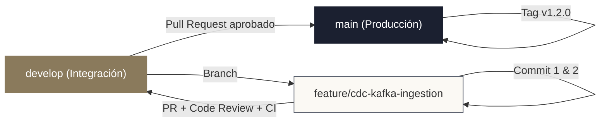
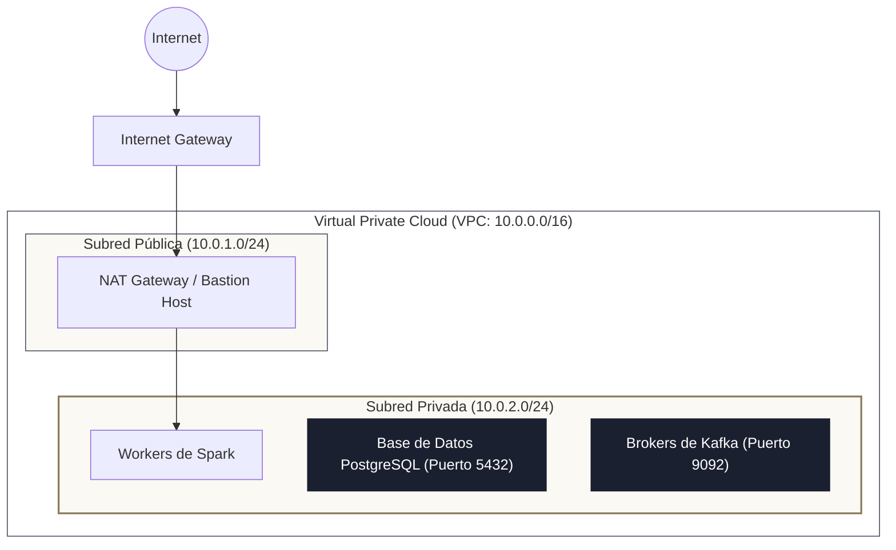

<!-- NOTAS FUENTE ORIGINALES DE OBSIDIAN: [[Linux]], [[Git]], [[Docker]], [[Networking]] -->

# Capítulo 0A: Cimientos de Plataforma: Linux, Git, Docker y Redes [NÚCLEO EMPLEABILIDAD]

> *"Un ingeniero de datos que no domina la terminal de Linux, el aislamiento de contenedores en Docker y el control de versiones con Git es como un cirujano que desconoce la anatomía básica: puede saber qué operación desea realizar, pero carece de la destreza instrumental para manipular el sistema sin provocar un desastre en producción."*

---

## Objetivos de Aprendizaje
Al finalizar este capítulo, el lector será capaz de:
* Operar con fluidez en entornos **Linux** mediante la línea de comandos, dominando tuberías, redirecciones de flujo y herramientas de procesamiento de texto (`grep`, `sed`, `awk`, `jq`).
* Automatizar tareas periódicas en el sistema operativo mediante el demonio `cron` y gestionar procesos y memoria (`ps`, `top`, `kill`, `systemd`).
* Implementar flujos de trabajo profesionales con **Git** (estrategias de ramificación, Conventional Commits, `rebase` interactivo frente a `merge` y resolución limpia de conflictos).
* Diseñar contenedores reproducibles con **Docker**, optimizando imágenes mediante construcciones multi-etapa (*multi-stage builds*), volúmenes persistentes y redes aisladas.
* Orquestar entornos locales de ingeniería de datos compuestos por múltiples servicios mediante **Docker Compose**.
* Comprender los conceptos esenciales de **redes**: direccionamiento CIDR, subredes, puertos, resolución DNS, cortafuegos (*Security Groups*), VPCs y cifrado TLS/mTLS en tránsito.

---

> **Definición 0A.1 (La Pila de Ejecución del Data Engineer)**
> En la arquitectura de sistemas distribuidos, la infraestructura no es un detalle abstracto delegado exclusivamente al equipo de operaciones. Todo pipeline de datos —sea un clúster de Spark sobre Kubernetes, un broker de Kafka o un contenedor de Airflow— se ejecuta sobre núcleos **Linux**, se versiona en **Git**, se empaqueta en imágenes de **Docker** y se comunica a través de **redes TCP/IP**.
> 
> La estabilidad y el rendimiento de un pipeline dependen directamente de cómo interactúa el código de datos con el sistema operativo anfitrión y los límites de recursos de CPU, memoria y sockets de red.

---

## 0A.1 Linux y Terminal para Ingeniería de Datos

El 99% de las plataformas de datos distribuidas se ejecutan sobre distribuciones Linux (Ubuntu, Debian, Red Hat Enterprise Linux, Alpine). La terminal no es una alternativa a la interfaz gráfica: es la interfaz nativa de automatización.

### 1. Flujos Estándar, Redirecciones y Tuberías (*Pipes*)
En Linux, todo proceso interactúa con tres descriptores de archivo estándar:
* `stdin` (Descriptor 0): Entrada estándar de datos.
* `stdout` (Descriptor 1): Salida estándar de resultados.
* `stderr` (Descriptor 2): Salida estándar de errores y diagnósticos.

```bash
# Redirigir stdout a un archivo (sobrescribiendo)
python pipeline.py > salida.log

# Redirigir stdout y stderr a un archivo combinado (modo append)
python pipeline.py >> ejecucion.log 2>&1

# Conectar la salida de un proceso con la entrada de otro mediante Pipe (|)
cat transacciones_raw.csv | grep "COMPLETADO" | cut -d',' -f1,4 > ventas_filtradas.csv
```

### 2. Procesamiento de Texto de Alto Rendimiento en Terminal
Antes de cargar gigabytes en Spark o Python, la terminal permite inspeccionar y transformar datos crudos en milisegundos:

* **`grep` (Búsqueda por patrones regex):**
  ```bash
  # Buscar errores en logs ignorando mayúsculas/minúsculas y contando ocurrencias
  grep -i "OutOfMemory" /var/log/spark/*.log | wc -l
  ```
* **`sed` (Editor de flujos para transformaciones y sustituciones):**
  ```bash
  # Reemplazar delimitadores de punto y coma por comas en archivos CSV masivos
  sed 's/;/,'/g transacciones.txt > transacciones_limpias.csv
  ```
* **`awk` (Procesador analítico de columnas estructuradas):**
  ```bash
  # Sumar el valor de la columna 3 para registros cuyo país (columna 2) sea 'CO'
  awk -F',' '$2 == "CO" { suma += $3 } END { print "Total Ventas Colombia: " suma }' ventas.csv
  ```
* **`jq` (El estándar de oro para manipular JSON en línea de comandos):**
  ```bash
  # Extraer campos anidados y filtrar eventos de telemetría provenientes de una API
  curl -s https://api.empresa.com/eventos | jq '.data[] | select(.monto > 500) | {id: .transaccion_id, valor: .monto}'
  ```

### 3. Permisos de Archivos y Administración de Procesos
* **Permisos POSIX:** El comando `chmod` altera los permisos para Usuario ($u$), Grupo ($g$) y Otros ($o$). En scripts ejecutables de producción:
  ```bash
  chmod 750 run_ingest.sh  # rwxr-x--- (Lectura, escritura y ejecución para dueño; lectura y ejecución para grupo)
  ```
* **Procesos y Memoria:** Identificar y finalizar procesos colgados en servidores:
  ```bash
  # Localizar el identificador de proceso (PID) de un driver de PySpark zombi
  ps aux | grep "pyspark"

  # Matar el proceso de forma forzada enviando la señal SIGKILL (9)
  kill -9 <PID>

  # Monitorear consumo de RAM, CPU y Swap en tiempo real
  htop
  ```

### 4. Automatización con `cron` y Acceso Remoto con SSH
El demonio `cron` programa tareas periódicas mediante una sintaxis de 5 campos temporales (`minuto hora día-mes mes día-semana`):
```bash
# Editar el crontab del usuario actual
crontab -e

# Ejecutar el script de ingesta todos los días a las 02:30 AM UTC
30 2 * * * /usr/bin/bash /opt/pipelines/ingesta_diaria.sh >> /var/log/ingesta.log 2>&1
```

Para conectarse a instancias de cómputo en la nube sin exponer credenciales inseguras se utilizan pares de claves criptográficas SSH:
```bash
# Conexión segura usando clave privada RSA/Ed25519
ssh -i ~/.ssh/data_cluster_key.pem ubuntu@10.0.1.45
```

---

## 0A.2 Git Profesional y Estrategias de Colaboración

En la ingeniería de datos moderna, los pipelines son código fuente (*Pipelines as Code*). Toda alteración debe ser trazable, reproducible y sujeta a revisión por pares.



### 1. Estrategia de Ramas y Pull Requests (Trunk-Based vs GitFlow)
* **Trunk-Based Development:** Es la práctica recomendada para equipos ágiles de ingeniería de datos. Los ingenieros crean ramas de vida corta (`feat/nueva-fuente-ventas`) a partir de la rama principal (`main`), ejecutan pruebas automáticas y fusionan en cuestión de horas o días tras aprobación de un Pull Request (PR).
* **Conventional Commits:** Estandarizar los mensajes de confirmación permite generar changelogs automáticos y versionado semántico:
  * `feat: agregar particionado dinámico en carga de capa Silver`
  * `fix: corregir manejo de valores nulos en deduplicación de clientes`
  * `perf: optimizar broadcast join en cruce de catálogo de productos`
  * `test: agregar validaciones unitarias de esquema con Chispa`

### 2. `git rebase` interactivo frente a `git merge`
* **`git merge`**: Crea un commit de unión explícito que une dos historiales. Puede generar historiales enmarañados si se abusa en ramas locales.
* **`git rebase`**: Reescribe el historial aplicando los commits locales encima de la última versión de la rama base, manteniendo un historial lineal y limpio.
```bash
# Actualizar la rama local con los últimos cambios de main de forma lineal
git checkout feat/nueva-fuente
git fetch origin
git rebase origin/main

# Limpiar y condensar (squash) commits locales antes de abrir el PR
git rebase -i HEAD~3
```

---

## 0A.3 Docker y Contenedores para Plataformas de Datos

La clásica excusa *"en mi máquina local sí funcionaba"* es inaceptable en producción. Un contenedor encapsula la aplicación junto con sus bibliotecas de sistema, intérprete de Python, dependencias de Java (JARs de Spark/Hadoop) y variables de entorno, garantizando ejecución idéntica en local, en Kubernetes y en la nube.

### 1. Dockerfile Multi-Etapa (*Multi-Stage Build*)
Las construcciones multi-etapa permiten compilar dependencias en una imagen temporal pesada y copiar únicamente los binarios limpios a la imagen final ligera, reduciendo el tamaño de la imagen de 1.5 GB a menos de 200 MB y mitigando vulnerabilidades de seguridad:

```dockerfile
# Etapa 1: Constructor (Builder)
FROM python:3.11-slim AS builder

WORKDIR /app

RUN apt-get update && apt-get install -y --no-install-recommends \
    build-essential \
    curl \
    && rm -rf /var/lib/apt/lists/*

# Instalar uv para resolución ultrarrápida de dependencias
COPY --from=ghcr.io/astral-sh/uv:latest /uv /bin/uv

COPY pyproject.toml ./
RUN uv pip install --system --no-cache -r pyproject.toml

# Etapa 2: Imagen Final de Producción (Runtime)
FROM python:3.11-slim AS runtime

WORKDIR /app

# Instalar Java OpenJDK para controladores locales de PySpark
RUN apt-get update && apt-get install -y --no-install-recommends \
    openjdk-17-jre-headless \
    curl \
    && rm -rf /var/lib/apt/lists/*

ENV JAVA_HOME=/usr/lib/jvm/java-17-openjdk-amd64
ENV PATH="${JAVA_HOME}/bin:${PATH}"

# Copiar paquetes instalados desde el builder
COPY --from=builder /usr/local/lib/python3.11/site-packages /usr/local/lib/python3.11/site-packages
COPY src/ /app/src/

# Usuario sin privilegios por seguridad
RUN useradd -m -u 1001 datauser
USER datauser

ENTRYPOINT ["python", "-m", "src.pipelines.main"]
```

### 2. Volúmenes Persistentes y Redes Aisladas
* **Volúmenes (`-v` o `volumes:`):** Los contenedores son efímeros por diseño; si un contenedor de PostgreSQL se destruye, los datos almacenados en su interior desaparecen. Los volúmenes montan directorios del host o almacenamiento administrado por Docker para persistir datos.
* **Redes Bridge (`networks:`):** Permiten la comunicación interna entre contenedores por nombre de servicio mediante DNS interno de Docker, sin necesidad de exponer puertos al exterior de la máquina física.

---

## 0A.4 Composición de Infraestructura Local con Docker Compose

Para reproducir localmente un laboratorio de ingeniería de datos (con una base transaccional PostgreSQL y un almacenamiento de objetos S3 local compatible mediante MinIO), se utiliza **Docker Compose**:

```yaml
version: '3.8'

services:
  # Base de datos relacional operacional (OLTP)
  postgres_oltp:
    image: postgres:16-alpine
    container_name: lab_postgres
    environment:
      POSTGRES_DB: transaccional_db
      POSTGRES_USER: ${POSTGRES_USER:-admin_datos}
      POSTGRES_PASSWORD: ${POSTGRES_PASSWORD} # Inyectado de forma segura desde archivo .env local
    env_file:
      - .env
    ports:
      - "5432:5432"
    volumes:
      - pgdata:/var/lib/postgresql/data
    networks:
      - red_datos

  # Almacenamiento de objetos local S3-compatible (Data Lake)
  minio_s3:
    image: minio/minio:latest
    container_name: lab_minio
    command: server /data --console-address ":9001"
    environment:
      MINIO_ROOT_USER: minio_admin
      MINIO_ROOT_PASSWORD: MinioSecretKey2026!
    ports:
      - "9000:9000"   # Puerto API S3
      - "9001:9001"   # Consola Web UI
    volumes:
      - miniodata:/data
    networks:
      - red_datos

volumes:
  pgdata:
  miniodata:

networks:
  red_datos:
    driver: bridge
```

Para levantar todo el ecosistema de laboratorio en segundo plano, basta ejecutar un único comando en la terminal:
```bash
docker compose up -d
```

---

## 0A.5 Redes Básicas y Seguridad para Plataformas de Datos

Todo sistema distribuido opera sobre redes de comunicaciones. Conocer la arquitectura de redes previene fallos de conectividad comunes en la nube:



### 1. Direccionamiento CIDR y Subredes
* **CIDR (*Classless Inter-Domain Routing*):** Representa bloques de direcciones IP mediante la notación `IP/máscara`.
  * `10.0.0.0/16`: Red privada con $2^{32-16} = 65.536$ direcciones IP disponibles (espacio típico para una VPC).
  * `10.0.1.0/24`: Subred con $2^{32-24} = 256$ direcciones IP.
* **Aislamiento en Subredes Privadas:** Los clústeres de Spark, bases de datos y brokers de Kafka **nunca deben tener direcciones IP públicas**. Deben residir en **subredes privadas**, comunicándose hacia internet exclusivamente a través de un **NAT Gateway** y recibiendo tráfico administrativo mediante un *Bastion Host* (Jump Server) o túneles VPN.

### 2. Cortafuegos de Red (*Security Groups*) y Puertos Estándar
Los cortafuegos definen reglas de entrada (*Inbound*) y salida (*Outbound*) basadas en protocolos y puertos:
* `Puerto 22`: SSH (Acceso a terminal segura).
* `Puerto 443`: HTTPS / TLS (Consumo de APIs y transferencia de objetos S3/ADLS).
* `Puerto 5432`: PostgreSQL.
* `Puerto 9092`: Apache Kafka.
* `Puerto 7077 / 4040`: Apache Spark Master y Spark Web UI.
* **Regla de Mínimo Privilegio:** Jamás abra un puerto de base de datos a `0.0.0.0/0` (todo internet). Restrinja la regla al bloque CIDR exacto de los nodos ejecutores de Spark.

### 3. Cifrado en Tránsito: TLS y mTLS
* **TLS (*Transport Layer Security*):** Cifra los datos transmitidos entre el cliente y el servidor mediante certificados criptográficos, impidiendo ataques de interceptación (*Man-In-The-Middle*).
* **mTLS (*Mutual TLS*):** Exige que **tanto el servidor como el cliente** presenten certificados válidos firmados por una Autoridad de Certificación (CA) de confianza. Es el estándar de oro para comunicar microservicios y productores con clústeres de Apache Kafka en arquitecturas de cero confianza (*Zero Trust*).

---

## 0A.6 Criterios de Fiabilidad y Anti-Patrones en Producción

**Anti-patrón 1: Ejecutar Contenedores de Producción como Usuario `root`**  
Dejar que los procesos dentro del contenedor corran como `root` representa un riesgo grave de seguridad: un atacante que explote una vulnerabilidad en una biblioteca de Python podría escapar del contenedor y obtener privilegios totales sobre la máquina anfitriona (*host breakout*).  
*Corrección:* Declare siempre `USER datauser` en su `Dockerfile`.

**Anti-patrón 2: Almacenar Credenciales Secretas en Imágenes Docker o Repositorios Git**  
Escribir contraseñas de bases de datos o claves de acceso a AWS directamente en un `Dockerfile`, script o archivo de configuración versionado en Git es una de las principales causas de brechas de seguridad.  
*Corrección:* Inyecte secretos en tiempo de ejecución mediante variables de entorno, gestores de secretos (AWS Secrets Manager, HashiCorp Vault) o herramientas de montaje seguro (`docker run --env-file .env`).

**Anti-patrón 3: Ignorar el Archivo `.dockerignore` y `.gitignore`**  
Construir una imagen Docker sin un archivo `.dockerignore` copia accidentalmente entornos virtuales locales pesados (`.venv`), cachés de Python (`__pycache__`) y claves privadas a la imagen, aumentando el tiempo de construcción y exponiendo datos sensibles.

---

## Preguntas de Revisión y Ejercicios Prácticos
**Ejercicio 0A.1 (Filtrado y Agregación Eficiente con Herramientas de Terminal):**  
Se tiene un archivo de registro crudo de 20 GB denominado `conexiones_db.log` con el siguiente formato separado por espacios:  
`TIMESTAMP IP_ORIGEN USUARIO ESTADO_CONEXION LATENCIA_MS`  
Escriba un comando de terminal Linux de una sola línea (*one-liner*) que:
1. Filtre únicamente las conexiones fallidas (`ESTADO_CONEXION = 'FAILED'`).
2. Extraiga la dirección IP de origen (columna 2).
3. Calcule las 5 direcciones IP con mayor cantidad de intentos fallidos, ordenadas de mayor a menor.

**Solución 0A.1:**
```bash
grep "FAILED" conexiones_db.log | awk '{print $2}' | sort | uniq -c | sort -nr | head -n 5
```
*Explicación Paso a Paso:*
* `grep "FAILED"` descarta de inmediato millones de registros exitosos sin cargarlos en memoria.
* `awk '{print $2}'` proyecta únicamente la columna con la dirección IP.
* `sort` agrupa las IPs consecutivamente para que `uniq` pueda operar.
* `uniq -c` contabiliza las ocurrencias de cada IP única.
* `sort -nr` realiza un ordenamiento numérico (`-n`) en orden descendente (`-r`).
* `head -n 5` trunca la salida a las 5 principales fuentes de ataques o errores de conexión.

---

**Ejercicio 0A.2 (Resolución de Conflictos en Git):**  
Dos ingenieros de datos modificaron simultáneamente el archivo `pipeline_ventas.py`. Al intentar hacer `git rebase origin/main`, Git detiene la ejecución notificando un conflicto en la línea donde se define la ruta de salida de almacenamiento. Explique el procedimiento exacto paso a paso para resolver el conflicto y completar el rebase sin perder cambios.

**Solución 0A.2:**
1. Identificar el archivo en conflicto ejecutando `git status`.
2. Abrir `pipeline_ventas.py` y localizar los marcadores de conflicto insertados por Git:
   ```python
   <<<<<<< HEAD
   RUTA_SALIDA = "s3://bucket-analitica/silver/ventas_v2/"
   =======
   RUTA_SALIDA = "s3://bucket-analitica/silver/ventas_particionadas/"
   >>>>>>> feat/nueva-ruta
   ```
3. Editar el archivo manualmente conservando la lógica arquitectónica correcta y eliminando los marcadores `<<<<<<<`, `=======` y `>>>>>>>`.
4. Marcar el archivo como resuelto en el área de preparación (*staging*): `git add pipeline_ventas.py`.
5. Continuar el proceso de rebase ejecutando: `git rebase --continue` (¡Nunca ejecutar `git commit` durante un rebase activo!).

---

## 0A.7 Resumen y Puntos Clave

* **Linux es el sustrato universal:** Las herramientas nativas de terminal (`grep`, `sed`, `awk`, `jq`) permiten realizar transformaciones exploratorias y diagnósticos de fallos órdenes de magnitud más rápido que escribir scripts ad-hoc.
* **Git profesional:** Flujos basados en ramas cortas, Conventional Commits y `rebase` interactivo mantienen historiales limpios y trazables para auditorías de código.
* **Contenedores reproducibles:** Las imágenes multi-etapa de Docker minimizan la superficie de ataque y garantizan que los pipelines se ejecuten exactamente igual en cualquier entorno.
* **Redes y seguridad de datos:** Las plataformas analíticas deben residir en subredes privadas aisladas con reglas de cortafuegos de mínimo privilegio y canales cifrados mediante TLS/mTLS.

---

## Lecturas Recomendadas
1. **Nemeth, E., Snyder, G., Hein, T. R., Whaley, B. & Mackin, D. (2017).** *UNIX and Linux System Administration Handbook (5th Edition).* Addison-Wesley.
2. **Chacon, S. & Straub, B. (2014).** *Pro Git (2nd Edition).* Apress (Disponible libre en línea).
3. **Mouat, A. (2015).** *Using Docker: Developing and Deploying Software with Containers.* O'Reilly Media.
4. **Kurose, J. F. & Ross, K. W. (2021).** *Computer Networking: A Top-Down Approach (8th Edition).* Pearson.
