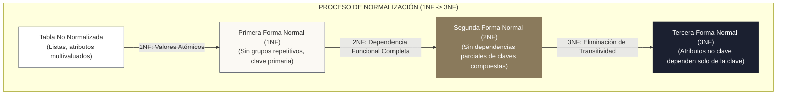
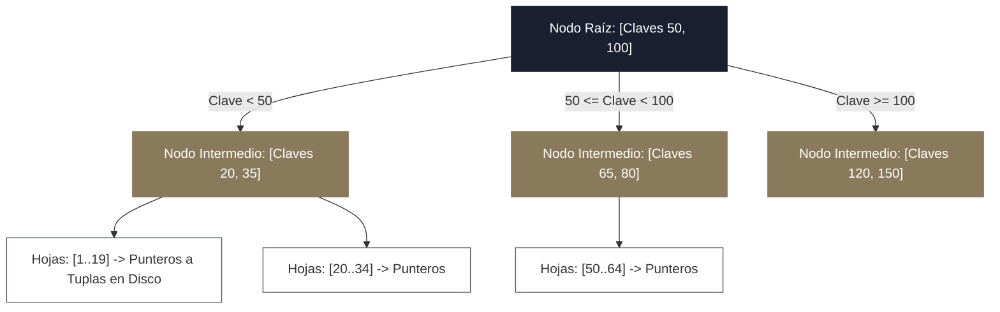
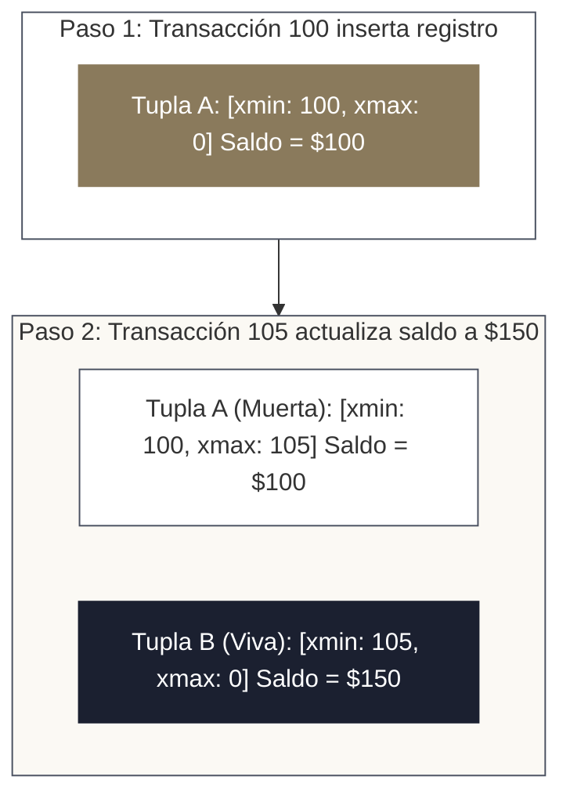

<!-- NOTAS FUENTE ORIGINALES DE OBSIDIAN: [[PostgreSQL]], [[Relational Databases]], [[ACID]], [[OLTP vs OLAP]] -->

# Capítulo 0B: Bases de Datos Relacionales (OLTP) y Modelado Transaccional [NÚCLEO EMPLEABILIDAD]

> *"Casi la totalidad de los datos analíticos que fluyen a través de un Lakehouse nacieron originalmente en una base de datos relacional orientada a transacciones. Si un ingeniero de datos no comprende los principios de normalización, la mecánica de los árboles B-Tree y los niveles de aislamiento transaccional, es incapaz de diseñar procesos de extracción e ingesta que no degraden o bloqueen los sistemas operacionales de la empresa."*

---

## Objetivos de Aprendizaje
Al finalizar este capítulo, el lector será capaz de:
* Comprender la fundamentación matemática del modelo relacional y las formas normales canónicas (**1NF**, **2NF**, **3NF**).
* Distinguir las razones arquitectónicas por las cuales los sistemas **OLTP** normalizan rigurosamente sus esquemas mientras que los sistemas **OLAP** desnormalizan intencionadamente.
* Analizar la estructura interna de los índices **B-Tree** frente a índices **Hash**, comprendiendo su costo de mantenimiento en operaciones de escritura.
* Desglosar las cuatro propiedades **ACID** (Atomicidad, Consistencia, Aislamiento, Durabilidad) y su implementación física en discos y diarios de transacciones (*Write-Ahead Logging / WAL*).
* Dominar los cuatro niveles de aislamiento transaccional estándar y diagnosticar las anomalías de concurrencia: *Dirty Reads*, *Non-Repeatable Reads*, *Phantom Reads* y *Write Skew*.
* Explicar el funcionamiento del Control de Concurrencia Multiversión (**MVCC**) en PostgreSQL y la necesidad de mantenimiento mediante `VACUUM`.

---

> **Definición 0B.1 (Sistemas OLTP frente a Sistemas OLAP)**
> * **OLTP (*Online Transaction Processing*):** Sistemas diseñados para procesar cientos o miles de operaciones simultáneas por segundo de baja latencia (altas, modificaciones, lecturas puntuales de tuplas individuales). Su prioridad absoluta es la integridad transaccional inmediata, la no redundancia de datos y la concurrencia masiva mediante bloqueos o versiones.
> * **OLAP (*Online Analytical Processing*):** Sistemas diseñados para ejecutar consultas complejas que agregan y analizan millones de registros a lo largo de amplios rangos temporales. Su prioridad es el rendimiento en lectura masiva, el escaneo secuencial en disco y la compresión columnar.

---

## 0B.1 Normalización Relacional y Eliminación de Anomalías

En los sistemas transaccionales, el objetivo principal del diseño de esquemas es la **eliminación de redundancias** para impedir anomalías operacionales:
* *Anomalía de Inserción:* Imposibilidad de registrar datos de un cliente hasta que este realice una compra.
* *Anomalía de Actualización:* Modificar la dirección de una sucursal en 10.000 filas de facturación, corriendo el riesgo de dejar registros inconsistentes si el proceso falla a la mitad.
* *Anomalía de Eliminación:* Borrar el último pedido de un usuario provocando la pérdida accidental de todos los datos de contacto de dicho usuario.

### 1. Primera Forma Normal (1NF)
Exige que cada celda de la tabla contenga un único valor **atómico** indivisible y que no existan grupos repetitivos (como columnas `telefono_1`, `telefono_2` o listas serializadas en texto). Cada fila debe poseer una clave primaria única.

### 2. Segunda Forma Normal (2NF)
Aplica a tablas con claves primarias compuestas: exige cumplir 1NF y que ningún atributo no clave dependa funcionalmente de una **parte** de la clave primaria (*dependencia parcial*). Todo atributo debe depender de la totalidad de la clave.

### 3. Tercera Forma Normal (3NF)
Exige cumplir 2NF y que ningún atributo no clave dependa transitivamente de la clave primaria a través de otro atributo no clave (*dependencia transitiva*).
* *Ejemplo:* Si una tabla tiene `(factura_id, cliente_id, ciudad_cliente)`, `ciudad_cliente` depende de `cliente_id`, y este de `factura_id`. Para alcanzar 3NF, la información del cliente se traslada a su propia tabla normalizada `clientes`.

> **¿Por qué OLTP normaliza y OLAP desnormaliza?**  
> Normalizar en OLTP garantiza que una actualización modifique exactamente **un solo registro físico en disco**, eliminando inconsistencias. Sin embargo, consultar una tabla en 3NF requiere múltiples `JOINs` costosos. En OLAP (Data Warehouses / Lakehouses), el espacio en disco es económico y las lecturas analíticas son masivas: desnormalizar en esquemas de estrella (*Star Schema*) optimiza drásticamente el escaneo columnar sin bloqueos.

---

## 0B.2 Estructura Física e Índices: B-Trees frente a Hash

Una base de datos relacional almacena las filas en páginas de disco (típicamente de 8 KB en PostgreSQL). Buscar un registro sin índices fuerza un escaneo secuencial completo de la tabla (*Sequential Scan* o $O(N)$).

### 1. El Árbol B-Tree (Balanced Tree)
Es el índice predeterminado y más versátil en motores relacionales:
* **Estructura Auto-Balanceada:** Todas las hojas se encuentran a la misma profundidad, garantizando complejidad de búsqueda logarítmica $O(\log N)$.
* **Búsquedas de Rango:** Las páginas hoja están interconectadas mediante punteros bidireccionales en lista doblemente enlazada, lo que permite resolver de forma óptima consultas con predicados de rango (`BETWEEN`, `<`, `>=`).
* **Soporte para Ordenación:** Almacena los elementos ordenados, satisfaciendo cláusulas `ORDER BY` sin necesidad de clasificar en memoria de trabajo (*Sort in-memory*).

### 2. Índices Hash
Calculan el hash criptográfico o posicional de la clave, ofreciendo búsquedas de igualdad exacta (`=`) en tiempo constante $O(1)$. Sin embargo, son **inútiles para consultas de rango** (`WHERE fecha > '2026-01-01'`) y no admiten ordenación.

### 3. El Costo de los Índices en Pipelines de Ingesta
Crear índices acelera las lecturas analíticas, pero **penaliza severamente las operaciones de escritura** (`INSERT`, `UPDATE`, `DELETE`). Cada tupla insertada requiere balancear y reescribir los nodos del árbol B-Tree en disco:
* **Regla de Producción:** Durante cargas masivas por lotes (*Bulk Load*) de millones de filas en una base relacional, la mejor práctica consiste en **eliminar los índices secundarios antes de la carga** y reconstruirlos en bloque una vez finalizada la inserción.

---

## 0B.3 Propiedades ACID y Mecánica de Durabilidad

Una **transacción** es una secuencia de operaciones relacionales tratadas como una única unidad lógica indivisible:

* **Atomicidad (Atomicity):** Todo o nada. Si falla una sola sentencia dentro del bloque transaccional, el motor deshace todas las operaciones previas mediante un *Rollback*.
* **Consistencia (Consistency):** La transacción solo puede llevar la base de datos de un estado válido a otro estado válido, respetando todas las restricciones de integridad declaradas (claves foráneas, tipos de datos, restricciones `CHECK`).
* **Aislamiento (Isolation):** La ejecución concurrente de transacciones produce el mismo estado que si se hubiesen ejecutado de forma secuencial una tras otra.
* **Durabilidad (Durability):** Una vez que una transacción confirma su éxito (*Commit*), sus cambios son permanentes y no se perderán incluso ante cortes catastróficos de energía.

### Write-Ahead Logging (WAL)
Para garantizar la durabilidad sin ralentizar cada transacción esperando a que los bloques de la tabla se sincronicen en el disco de datos, los motores utilizan un diario secuencial denominado **WAL** (*Write-Ahead Log* en PostgreSQL o *Redo Log* en Oracle):
1. Antes de modificar cualquier página de memoria en la caché (*Buffer Pool*), el cambio se escribe secuencialmente al WAL en disco.
2. Al invocar `COMMIT`, el motor solo fuerza el volcado físico del WAL a disco (*fsync* secuencial ultrarrápido).
3. Si el servidor colapsa, durante el arranque el motor lee el WAL y aplica los cambios confirmados sobre los archivos de datos (*Crash Recovery*).

---

## 0B.4 Niveles de Aislamiento Transaccional y Anomalías de Concurrencia

El estándar ANSI SQL define cuatro niveles de aislamiento crecientes, cada uno protegiendo contra anomalías específicas de concurrencia:

| Nivel de Aislamiento | Lectura Sucia (*Dirty Read*) | Lectura No Repetible (*Fuzzy Read*) | Lectura Fantasma (*Phantom Read*) | Desviación de Escritura (*Write Skew*) |
| :--- | :---: | :---: | :---: | :---: |
| **Read Uncommitted** | Posible | Posible | Posible | Posible |
| **Read Committed** *(Default en Postgres)* | **Prevenida** | Posible | Posible | Posible |
| **Repeatable Read** | **Prevenida** | **Prevenida** | **Prevenida** *(en Postgres MVCC)* | Posible |
| **Serializable** | **Prevenida** | **Prevenida** | **Prevenida** | **Prevenida** |

### Definición Matemática de las Anomalías:
1. **Lectura Sucia (*Dirty Read*):** La Transacción $T_1$ modifica una fila pero aún no hace commit. La Transacción $T_2$ lee ese valor no confirmado. Si $T_1$ hace rollback, $T_2$ procesó datos ficticios que jamás existieron formalmente.
2. **Lectura No Repetible (*Non-Repeatable Read*):** La Transacción $T_1$ lee una fila. La Transacción $T_2$ modifica o borra dicha fila y confirma su commit. Si $T_1$ vuelve a leer la misma fila, obtiene valores distintos.
3. **Lectura Fantasma (*Phantom Read*):** La Transacción $T_1$ consulta un rango de filas con una condición (ej. `WHERE saldo > 1000`). La Transacción $T_2$ inserta una nueva fila que satisface la condición y confirma. Si $T_1$ repite la consulta de rango, aparece una nueva fila "fantasma".
4. **Desviación de Escritura (*Write Skew*):** Ocurre cuando dos transacciones leen los mismos datos pero escriben en conjuntos disjuntos violando una regla de negocio global (ej. dos médicos solicitan salir de guardia simultáneamente al verificar que al menos uno de ellos sigue activo; ambas solicitudes se aprueban, dejando la guardia vacía). Solo se previene en **Serializable**.

---

## 0B.5 Control de Concurrencia Multiversión (MVCC) en PostgreSQL

PostgreSQL no utiliza bloqueos de lectura para proteger a los lectores de los escritores. En su lugar, implementa **MVCC** (*Multi-Version Concurrency Control*): **"Los lectores nunca bloquean a los escritores, y los escritores nunca bloquean a los lectores"**.

Cada fila (*heap tuple*) almacena metadatos invisibles en su encabezado:
* `xmin`: El identificador de la transacción que insertó la fila.
* `xmax`: El identificador de la transacción que borró o actualizó la fila (inicialmente 0).

* **Actualizaciones como Inserciones:** En MVCC, un `UPDATE` no sobrescribe el registro original en el disco. Marca la tupla previa asignándole el ID de la transacción actual en `xmax` (convirtiéndola en una tupla "muerta") e inserta una tupla completamente nueva con el nuevo valor.
* **El Proceso `VACUUM`:** Las tuplas muertas ocupan espacio físico en las páginas de disco. El proceso `VACUUM` (y el demonio en segundo plano `autovacuum`) escanea las páginas para reclamar el espacio de tuplas muertas que ya no son visibles para ninguna transacción activa, evitando el crecimiento descontrolado de las tablas en disco (*Table Bloat*).

---

## 0B.6 Criterios de Fiabilidad y Anti-Patrones en Producción

**Anti-patrón 1: Extraer Datos Analíticos Masivos mediante Consultas Directas sobre la Base Primaria OLTP**  
Ejecutar consultas de extracción analítica masiva (`SELECT * FROM transacciones WHERE anio = 2025`) directamente sobre el nodo primario de la base transaccional durante el día satura el buffer pool y compite por recursos con los clientes de la aplicación.  
*Corrección:* Dirija las extracciones hacia **réplicas de solo lectura** (*Read Replicas* configuradas mediante replicación física por WAL) o utilice herramientas de CDC (*Change Data Capture*) como Debezium para leer los eventos directamente del log sin consultar las tablas vivas.

**Anti-patrón 2: Desactivar o Retrasar el Proceso de `autovacuum`**  
Desactivar `autovacuum` para supuestamente ahorrar CPU en una base de datos de alto tráfico transaccional provoca que las tablas acumulen millones de tuplas muertas. Las consultas se ralentizan dramáticamente al tener que escanear páginas infladas y se corre el riesgo inminente de fallo catastrófico por agotamiento de identificadores de transacción (*Transaction ID Wraparound*).

---

## Preguntas de Revisión y Ejercicios Prácticos
**Ejercicio 0B.1 (Diagnóstico de Anomalía de Concurrencia):**  
Considere el siguiente escenario transaccional en una tabla de cuentas bancarias (`saldo` inicial = $500):
1. La Transacción A inicia en nivel `READ COMMITTED` y consulta el saldo de la cuenta 101, obteniendo $500.
2. La Transacción B inicia, descuenta $100 de la cuenta 101 (nuevo saldo = $400) y ejecuta `COMMIT`.
3. La Transacción A, aún activa, vuelve a ejecutar la misma consulta sobre la cuenta 101 y obtiene $400.
¿Qué anomalía de concurrencia ha ocurrido y a qué nivel de aislamiento debería elevarse la Transacción A para evitarla?

**Solución 0B.1:**
* Ha ocurrido una anomalía de **Lectura No Repetible (*Non-Repeatable Read* o *Fuzzy Read*)**, donde una misma transacción obtiene valores contradictorios para una misma fila tras el commit de una transacción concurrente.
* Para evitar esta anomalía, la Transacción A debe ejecutarse bajo el nivel de aislamiento **`REPEATABLE READ`** (o `SERIALIZABLE`). Bajo `REPEATABLE READ`, el motor establece una instantánea (*snapshot*) temporal al momento de la primera consulta, garantizando que lecturas posteriores dentro de la misma transacción lean exactamente la misma foto inmutable del registro.

---

**Ejercicio 0B.2 (Estructuración de Índices B-Tree Compuestos):**  
Se tiene una tabla `pedidos` con 100 millones de registros. Las consultas más recurrentes del sistema transaccional tienen la siguiente estructura:  
`SELECT * FROM pedidos WHERE cliente_id = 4500 AND fecha_pedido >= '2026-01-01'`  
Compare las siguientes dos alternativas de índice B-Tree compuesto y justifique cuál es la óptima:
* Opción 1: `CREATE INDEX idx_pedidos ON pedidos (fecha_pedido, cliente_id);`
* Opción 2: `CREATE INDEX idx_pedidos ON pedidos (cliente_id, fecha_pedido);`

**Solución 0B.2:**
* **La Opción 2 `(cliente_id, fecha_pedido)` es la óptima.**
* *Justificación Técnica:* En un árbol B-Tree compuesto, los nodos se ordenan jerárquicamente por la primera columna y luego por la segunda.
  * Con la Opción 2, el motor busca por igualdad exacta sobre `cliente_id` (alta selectividad), descendiendo directamente a la rama del cliente específico en $O(\log N)$ y luego escaneando secuencialmente solo el rango de fechas de ese cliente.
  * Con la Opción 1, la primera columna es un predicado de rango (`fecha_pedido >= '2026-01-01'`). Una vez que un B-Tree entra en una búsqueda de rango sobre su primera columna, el motor no puede podar eficientemente por la segunda columna y se ve forzado a escanear todas las entradas que cumplan la fecha en todas las páginas hoja.

---

## 0B.7 Resumen y Puntos Clave

* **Diseño para la integridad:** Los sistemas OLTP normalizan (1NF a 3NF) para eliminar anomalías de actualización y garantizar que cada hecho se registre en una sola ubicación física.
* **Mecánica de índices B-Tree:** Ofrecen búsquedas logarítmicas $O(\log N)$ y ordenación eficiente, pero imponen una penalización de mantenimiento en cada inserción o modificación.
* **Garantías ACID y WAL:** La durabilidad se garantiza mediante el volcado secuencial al Write-Ahead Log (*WAL*), permitiendo recuperaciones rápidas ante caídas del servidor.
* **MVCC en PostgreSQL:** Mediante identificadores de transacción `xmin` y `xmax`, PostgreSQL permite lecturas no bloqueantes generando nuevas versiones de tuplas, requiriendo `autovacuum` para reclamar espacio muerto.
* **Aislamiento transaccional:** Conocer las anomalías de concurrencia permite elegir el nivel óptimo sin incurrir en bloqueos excesivos.

---

## Lecturas Recomendadas
1. **Silberschatz, A., Korth, H. F. & Sudarshan, S. (2020).** *Database System Concepts (7th Edition).* McGraw-Hill.
2. **Kleppmann, M. (2017).** *Designing Data-Intensive Applications (Chapter 7: Transactions).* O'Reilly Media.
3. **Stonebraker, M. & Cetintemel, U. (2005).** *“One Size Fits All”: An Idea Whose Time Has Come and Gone.* Proceedings of the 21st International Conference on Data Engineering (ICDE).
4. **PostgreSQL Global Development Group (2024).** *PostgreSQL Documentation: Concurrency Control and MVCC.*
