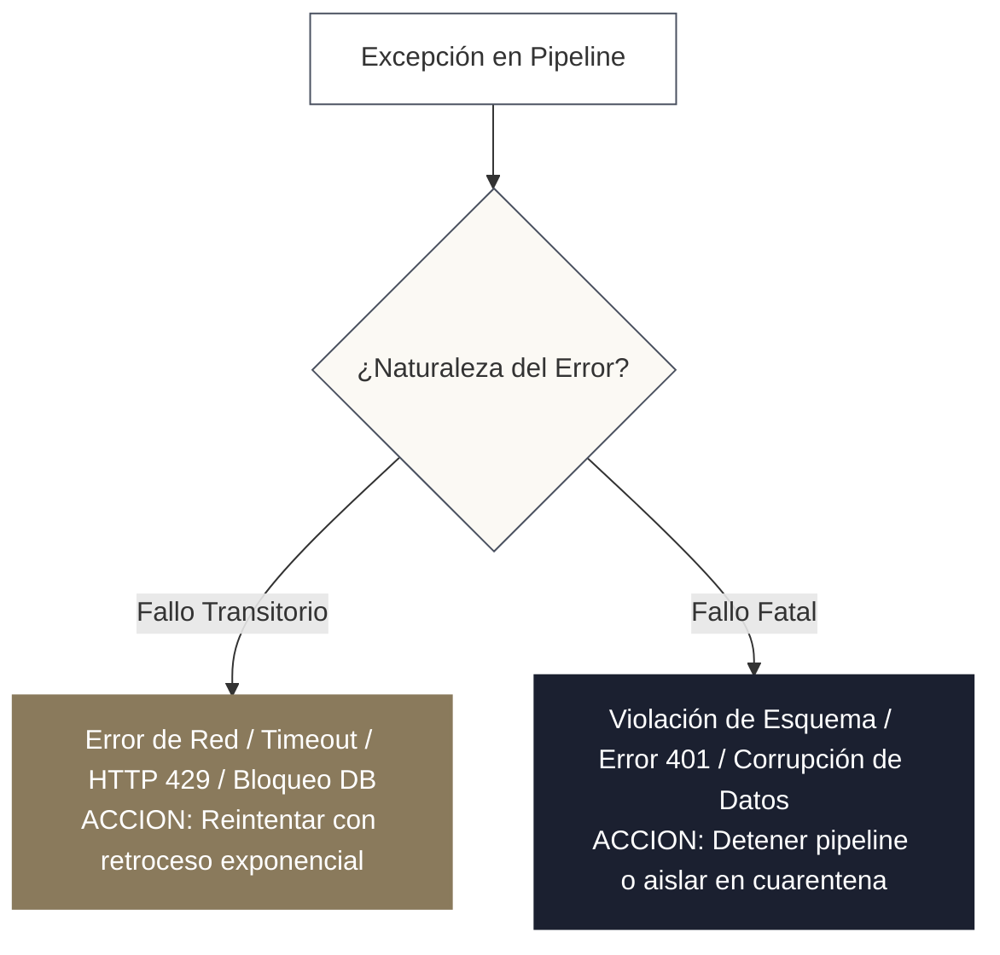
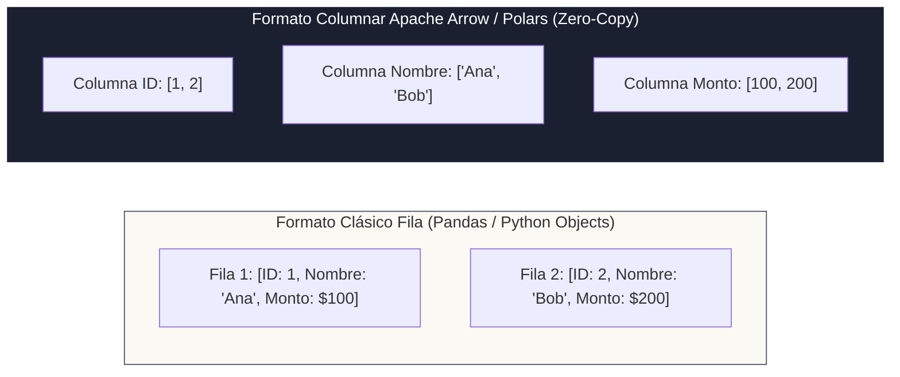

<!-- NOTAS FUENTE ORIGINALES DE OBSIDIAN: [[Python]], [[Data Ingestion]], [[APIs]], [[Pydantic]] -->

# Capítulo 0C: Python para Ingeniería de Datos: Tipado, APIs y Resiliencia [NÚCLEO EMPLEABILIDAD]

> *"Escribir scripts exploratorios en un notebook es una habilidad de análisis; construir pipelines modulares, fuertemente tipados, tolerantes a fallos y empaquetados con rigor de ingeniería de software es la verdadera responsabilidad del Data Engineer. En entornos de producción, Python no es un lenguaje de juguete: es el lenguaje de orquestación, integración y transformación de datos por excelencia."*

---

## 0C.0 Intuición Inicial: La Cinta Transportadora de la Fábrica

Imagina que te encargan procesar las facturas de una tienda pequeña. Tienes diez facturas en papel sobre una mesa: tomas cada una, lees el total con los ojos y anotas la suma en una libreta con lápiz. Si son diez facturas, el método manual funciona sin problemas.

Pero ahora imagina que la tienda se convierte en un gigante de comercio electrónico que procesa 500.000 transacciones por hora provenientes de ocho países distintos. Las facturas ya no vienen en papel: llegan como mensajes JSON a través de conexiones de red inestables, algunas traen importes nulos, otras traen identificadores duplicados y los servidores de origen se saturan con frecuencia arrojando errores temporales. Si intentas resolver esto con un script improvisado que asume que "nada fallará", el sistema colapsará en cuestión de minutos.

**Python es la cinta transportadora programable de esa fábrica industrial de datos.** En este capítulo comenzaremos desde lo más elemental —cómo guardar un dato en una variable, cómo filtrar una lista de registros, cómo encapsular lógica en funciones y cómo leer archivos de disco— hasta ensamblar componentes de nivel productivo: contratos de datos estrictos con Pydantic, consumo resiliente de APIs REST con reintentos exponenciales y manipulación columnar de alta velocidad con Polars y Apache Arrow.

---

## Objetivos de Aprendizaje
Al finalizar este capítulo, el lector será capaz de:
* Programar en Python moderno desde los fundamentos: variables, colecciones (`list`, `dict`, `set`, `tuple`), estructuras de control, funciones puras y manejo seguro de archivos con *context managers*.
* Aplicar Programación Orientada a Objetos básica y `@dataclass` para modelar entidades de datos estructuradas.
* Aislar dependencias y ejecutar pruebas unitarias automatizadas con **`uv`** y **`pytest`**.
* Aplicar el sistema de tipos moderno (`typing`) y validar contratos de datos en tiempo de ejecución con **Pydantic**.
* Diseñar clientes de ingesta HTTP resilientes para **APIs REST** con soporte para autenticación, paginación por cursores y retroceso exponencial (*Exponential Backoff con Jitter*).
* Manipular datos en memoria comparando los paradigmas de **Pandas**, **PyArrow** y **Polars** (ejecución multihilo perezosa en Rust).

---

### Profundiza: La Brecha entre Scripting y Software Engineering
> **Definición 0C.1 (La Brecha entre Scripting y Software Engineering)**  
> Un *script de datos* se escribe para ejecutarse una sola vez de forma interactiva: asume que la red nunca se corta, que el esquema del JSON de origen es estático y que todos los datos caben cómodamente en la memoria RAM.
> 
> Un **pipeline de ingeniería de software para datos** se diseña bajo la premisa del fallo inevitable (*Design for Failure*): valida los datos entrantes contra un contrato estricto, maneja desconexiones transitorias mediante reintentos exponenciales, no filtra credenciales en los logs y garantiza reproducibilidad absoluta de su entorno mediante bloqueos de dependencias (*lockfiles*).

---

## 0C.1 Fundamentos de Python para Ingeniería de Datos: De Cero a Código Modular

Para el aspirante a Data Engineer que proviene de cero o de campos no computacionales, dominar Python no significa memorizar sintaxis abstracta: significa comprender cómo estructurar datos en memoria, cómo procesar archivos y cómo escribir código modular y testeable.

### 1. Tipos de Datos Primitivos y Variables
En Python, una variable es una referencia en memoria a un objeto tipado:
```python
# Tipos primitivos esenciales en pipelines de datos
registro_id = 1048576            # int: enteros de precisión arbitraria
monto_transaccion = 450.75       # float: números de punto flotante IEEE 754 de 64 bits
estado_pago = "COMPLETADO"       # str: cadenas inmutables codificadas en UTF-8
es_valido = True                 # bool: valores booleanos para predicados lógicos
tasa_cambio = None               # NoneType: representa la ausencia explícita de valor
```

### 2. Estructuras de Datos de Primera Clase para Pipelines
Los flujos de datos manipulan cuatro colecciones fundamentales:

```python
# 1. LISTAS (list): Secuencias ordenadas y mutables. Útiles para acumular registros
transacciones = [120.50, 45.00, 890.10, 15.20]
transacciones.append(300.00)     # O(1) amortizado

# 2. DICCIONARIOS (dict): Tablas hash de clave-valor O(1). El corazón de cada fila o evento JSON
cliente = {
    "cliente_id": 4501,
    "nombre": "Ana Gomez",
    "pais": "CO",
    "activo": True
}
print(cliente.get("correo", "desconocido@correo.com"))  # Acceso seguro ante claves faltantes

# 3. CONJUNTOS (set): Colecciones no ordenadas de elementos únicos. Deduplicación instantánea O(1)
paises_con_ventas = {"CO", "MX", "CL", "PE"}
paises_con_ventas.add("CO")      # No duplica; el tamaño del conjunto sigue intacto
print("US" in paises_con_ventas) # Verificación de pertenencia en O(1)

# 4. TUPLAS (tuple): Secuencias ordenadas e inmutables. Seguras como claves compuestas
coordenada_evento = ("servidor_01", 8080)
```

#### Comprensiones de Listas y Diccionarios (*Comprehensions*)
Permiten transformar y filtrar colecciones con sintaxis concisa y optimizada en C:
```python
# Filtrar y transformar ventas superiores a $100 aplicando un impuesto del 19%
ventas_con_iva = [round(monto * 1.19, 2) for monto in transacciones if monto > 100.0]

# Indexar un diccionario de clientes por su ID para búsquedas directas
lista_clientes = [
    {"id": 101, "nombre": "Carlos"},
    {"id": 102, "nombre": "Lucia"}
]
indice_clientes = {c["id"]: c["nombre"] for c in lista_clientes}
```

### 3. Control de Flujo y Funciones Modulares
Las funciones puras encapsulan lógica de transformación sin efectos secundarios:
```python
def procesar_lote_ventas(montos, umbral_alerta=500.0, **kwargs):
    """Procesa un lote de montos, calculando totales y detectando anomalías."""
    total = 0.0
    alertas = []

    for monto in montos:
        if monto is None or monto < 0:
            continue  # Omitir registros corruptos
        total += monto
        if monto >= umbral_alerta:
            alertas.append(monto)

    return {"total_procesado": round(total, 2), "alertas": alertas}

resultado = procesar_lote_ventas(transacciones, umbral_alerta=200.0)
```

### 4. Manejo de Archivos en Disco: CSV, JSON y Context Managers
En ingeniería de datos, **nunca se abren archivos sin un administrador de contexto (`with`)**, el cual garantiza el cierre inmediato de los descriptores de archivo incluso ante excepciones no controladas:

```python
import csv
import json

# Lectura y parseo seguro de archivos CSV fila a fila
def leer_transacciones_csv(ruta_archivo):
    registros = []
    with open(ruta_archivo, mode="r", encoding="utf-8") as archivo:
        lector_csv = csv.DictReader(archivo)
        for fila in lector_csv:
            registros.append({
                "id": int(fila["transaccion_id"]),
                "monto": float(fila["monto_usd"]),
                "pais": fila["pais"]
            })
    return registros

# Serialización y guardado de resultados en JSON estructurado
def exportar_resumen_json(datos, ruta_destino):
    with open(ruta_destino, mode="w", encoding="utf-8") as archivo:
        json.dump(datos, archivo, indent=2, ensure_ascii=False)
```

### 5. Programación Orientada a Objetos (OOP) Esencial para DE
La POO se utiliza en ingeniería de datos para modelar clientes de bases de datos, extractores de APIs y transformadores modulares:

```python
class ExtractorDatosAPI:
    """Clase base reutilizable para clientes de ingesta con encapsulamiento de estado."""
    def __init__(self, endpoint_base: str, api_key: str):
        self.endpoint_base = endpoint_base.rstrip("/")
        self._api_key = api_key  # Atributo protegido para no exponer credenciales
        self.registros_procesados = 0

    def construir_url(self, recurso: str) -> str:
        return f"{self.endpoint_base}/{recurso.lstrip('/')}"

    def registrar_metrica(self, cantidad: int) -> None:
        self.registros_procesados += cantidad
        print(f"[{self.__class__.__name__}] Total procesado acumulado: {self.registros_procesados}")
```

### 6. Aislamiento de Entornos Virtuales y Dependencias con `uv`
Nunca instale paquetes de ingeniería en el entorno global del sistema operativo:
```bash
# 1. Crear entorno virtual moderno y ultrarrápido con uv
uv venv .venv --python 3.11

# 2. Activar el entorno virtual:
# En Linux / macOS / WSL:
source .venv/bin/activate
# En Windows PowerShell:
.venv\Scripts\Activate.ps1

# 3. Instalar librerías de producción:
uv pip install pydantic requests pyarrow polars pytest
```

### 7. Pruebas Unitarias desde Cero con `pytest`
La ingeniería de software aplicada a datos exige validar que las funciones de transformación respeten sus especificaciones matemáticas antes de promover código a producción:

```python
# tests/test_transformaciones.py
import pytest

def normalizar_pais(pais: str) -> str:
    if not pais or not isinstance(pais, str):
        return "UNKNOWN"
    return pais.strip().upper()

# Casos de prueba automatizados con pytest
def test_normalizar_pais_exitoso():
    assert normalizar_pais("  co ") == "CO"
    assert normalizar_pais("mx") == "MX"

def test_normalizar_pais_nulo_o_invalido():
    assert normalizar_pais(None) == "UNKNOWN"
    assert normalizar_pais("") == "UNKNOWN"

def test_normalizar_pais_tipo_invalido():
    assert normalizar_pais(123) == "UNKNOWN"
```

Para ejecutar las pruebas en la terminal:
```bash
uv run pytest tests/ -v
```

---

## 0C.2 Tipado Estático Moderno y Validación con Pydantic

Python es un lenguaje de tipado dinámico, pero la introducción de anotaciones de tipo (*Type Hints*, PEP 484) permite verificar el código estáticamente mediante herramientas como `mypy` y `ruff`, detectando bugs antes del despliegue:

```python
from typing import Optional, List, Dict, Any, Union
from datetime import datetime

def calcular_tasa_churn(
    usuarios_activos: List[int],
    bajas_periodo: List[int],
    factor_ajuste: Optional[float] = None
) -> float:
    if not usuarios_activos:
        return 0.0
    
    tasa_base = len(bajas_periodo) / len(usuarios_activos)
    if factor_ajuste is not None:
        return tasa_base * factor_ajuste
    return tasa_base
```

### Validación en Tiempo de Ejecución con Pydantic (v2)
Las anotaciones de tipo estándar son ignoradas en tiempo de ejecución. **Pydantic** resuelve esta carencia parseando y validando automáticamente estructuras de datos externas (JSONs crudos provenientes de APIs o Kafka):

```python
from pydantic import BaseModel, Field, EmailStr, field_validator
from datetime import date
from typing import Literal

class TransaccionVenta(BaseModel):
    transaccion_id: str = Field(..., description="UUID único de la transacción")
    cliente_id: int = Field(..., gt=0, description="Identificador positivo del cliente")
    correo: EmailStr
    monto_usd: float = Field(..., ge=0.01, description="Monto mínimo positivo")
    moneda: Literal["USD", "EUR", "COP"] = "USD"
    fecha: date

    @field_validator("monto_usd")
    @classmethod
    def validar_monto_maximo(cls, v: float) -> float:
        if v > 1_000_000:
            raise ValueError("Monto excede el límite permitido para procesamiento automático sin auditoría")
        return round(v, 2)

# Demostración de parseo y validación estricta
raw_payload = {
    "transaccion_id": "tx-99482-abc",
    "cliente_id": 4501,
    "correo": "cliente.analitica@empresa.com",
    "monto_usd": "1540.508",  # Pydantic coacciona el string a float y aplica el validador
    "moneda": "USD",
    "fecha": "2026-03-15"
}

try:
    evento_validado = TransaccionVenta.model_validate(raw_payload)
    print(f"Evento válido: ID={evento_validado.transaccion_id}, Monto={evento_validado.monto_usd}")
except Exception as e:
    print(f"Error de contrato de datos: {e}")
```

---

## 0C.2 Manejo Robusto de Excepciones y Logging Contextual

Un pipeline de datos nunca debe capturar excepciones genéricas silenciosamente (`except: pass`). El manejo de errores debe clasificar las fallas en dos categorías fundamentales:



### Excepciones de Dominio Personalizadas y Bloques de Limpieza
```python
import logging
import sys

# Configuración de Logging Estructurado
logging.basicConfig(
    level=logging.INFO,
    format='{"timestamp": "%(asctime)s", "nivel": "%(levelname)s", "modulo": "%(name)s", "mensaje": "%(message)s"}',
    stream=sys.stdout
)
logger = logging.getLogger("ingestion_pipeline")

class PipelineDataException(Exception):
    """Excepción base para fallos en el procesamiento de datos."""
    pass

class SchemaContractViolation(PipelineDataException):
    """Fallo fatal: el payload recibido viola el contrato de datos."""
    pass

def procesar_lote_archivos(ruta_archivo: str) -> None:
    manejador_recurso = None
    try:
        logger.info(f"Iniciando apertura de recurso: {ruta_archivo}")
        manejador_recurso = open(ruta_archivo, "r", encoding="utf-8")
        # Lógica de transformación...
    except FileNotFoundError as e:
        logger.error(f"Archivo no localizado en almacenamiento: {ruta_archivo}")
        raise PipelineDataException(f"Recurso inalcanzable: {e}") from e
    except Exception as e:
        logger.critical(f"Fallo imprevisto en la ejecución del lote: {e}", exc_info=True)
        raise
    finally:
        # Garantía incondicional de liberación de sockets o archivos
        if manejador_recurso and not manejador_recurso.closed:
            manejador_recurso.close()
            logger.info("Recurso liberado exitosamente en bloque finally.")
```

---

## 0C.3 Consumo Resiliente de APIs REST: Paginación y Rate Limits

Las APIs transaccionales restringen la cantidad de registros devueltos por petición y limitan la frecuencia de solicitudes mediante cuotas (*Rate Limits*).

### 1. Estrategias de Paginación
* **Paginación por Desplazamiento (`limit` y `offset`):**  
  `GET /api/v1/ventas?limit=100&offset=200`  
  *Desventaja:* Ineficiente para grandes volúmenes ($O(N)$ en la base de datos de origen para saltar filas) y sufre inconsistencias si se insertan nuevas filas mientras se página.
* **Paginación por Cursor (*Cursor-based Pagination*):**  
  `GET /api/v1/ventas?limit=100&starting_after=tx_cursor_991823`  
  *Ventaja:* Escanea mediante índices en $O(1)$ y es inmune a inserciones intermedias. Es el estándar en APIs modernas (Stripe, Slack, Shopify).

### 2. Retroceso Exponencial con Jitter (*Exponential Backoff*)
Cuando un servidor responde con código **HTTP 429 Too Many Requests** o errores de servidor **HTTP 503 Service Unavailable**, bombardearlo con peticiones inmediatas agrava la congestión. Se debe esperar un tiempo exponencial aleatorizado:

$$T_{\text{espera}} = \min(T_{\text{max}}, \text{base} \times 2^{\text{intento}}) + \text{aleatorio}(0, \text{jitter})$$

```python
import time
import random
import requests
from typing import Generator, Dict, Any

class ClienteApiResiliente:
    def __init__(self, url_base: str, token: str, max_reintentos: int = 5):
        self.url_base = url_base
        self.headers = {
            "Authorization": f"Bearer {token}",
            "Accept": "application/json"
        }
        self.max_reintentos = max_reintentos

    def _peticion_con_reintento(self, endpoint: str, params: Dict[str, Any]) -> Dict[str, Any]:
        url = f"{self.url_base}/{endpoint}"
        intento = 0
        tiempo_espera = 1.0  # Segundo base

        while intento < self.max_reintentos:
            try:
                respuesta = requests.get(url, headers=self.headers, params=params, timeout=10.0)
                
                # Éxito
                if respuesta.status_code == 200:
                    return respuesta.json()
                
                # Manejo de Rate Limit (HTTP 429) o fallos transitorios de servidor (5xx)
                if respuesta.status_code in (429, 500, 502, 503, 504):
                    intento += 1
                    # Respetar encabezado Retry-After si el servidor lo provee
                    reintento_sugerido = respuesta.headers.get("Retry-After")
                    if reintento_sugerido:
                        demora = float(reintento_sugerido)
                    else:
                        jitter = random.uniform(0.1, 0.5)
                        demora = min(60.0, tiempo_espera * (2 ** intento)) + jitter
                    
                    time.sleep(demora)
                    continue
                
                # Errores fatales de cliente (400, 401, 403, 404)
                respuesta.raise_for_status()

            except (requests.ConnectionError, requests.Timeout) as e:
                intento += 1
                if intento >= self.max_reintentos:
                    raise ConnectionError(f"Se agotaron los reintentos hacia {url}: {e}") from e
                time.sleep(tiempo_espera * (2 ** intento) + random.uniform(0.1, 0.5))

        raise RuntimeError(f"Fallo definitivo al consultar {url} tras {self.max_reintentos} intentos.")

    def extraer_todos_los_eventos_por_cursor(self) -> Generator[Dict[str, Any], None, None]:
        """Extrae la totalidad de los datos utilizando paginación por cursores."""
        cursor_actual = None
        tiene_mas_datos = True

        while tiene_mas_datos:
            parametros = {"limit": 100}
            if cursor_actual:
                parametros["starting_after"] = cursor_actual

            payload = self._peticion_con_reintento("eventos", parametros)
            registros = payload.get("data", [])
            
            for registro in registros:
                yield registro

            tiene_mas_datos = payload.get("has_more", False)
            if tiene_mas_datos and registros:
                cursor_actual = registros[-1]["id"]
```

---

## 0C.4 Empaquetado Moderno y Entornos Deterministas con `uv`

Durante años, el ecosistema de Python dependió de `virtualenv`, `pip` y `requirements.txt` sin resolver adecuadamente el bloqueo determinista de dependencias indirectas.

### La Revolución de `uv` (Astral)
Desarrollado en Rust, **`uv`** es un administrador de paquetes de última generación que resuelve e instala dependencias entre **10 y 100 veces más rápido que pip**, soportando nativamente el estándar moderno `pyproject.toml` (PEP 517/518/621) y lockfiles universales (`uv.lock`).

```toml
# Archivo: pyproject.toml
[project]
name = "plataforma-datos-lakehouse"
version = "0.1.0"
description = "Pipelines productivos de ingesta y transformación distribuida"
authors = [{ name = "Luis Galvis", email = "autor@empresa.com" }]
requires-python = ">=3.11"
dependencies = [
    "pyspark==3.5.2",
    "delta-spark==3.2.0",
    "pydantic>=2.7.0",
    "requests>=2.31.0",
    "tenacity>=8.2.3",
    "pyarrow>=15.0.0",
]

[project.optional-dependencies]
dev = [
    "pytest>=8.0.0",
    "chispa>=0.9.4",
    "ruff>=0.4.0",
    "mypy>=1.9.0",
]
```

### Comandos Esenciales con `uv` en Producción
```bash
# Crear entorno virtual ultrarrápido con versión específica de Python
uv venv .venv --python 3.11

# Instalar dependencias bloqueadas de forma determinista
uv pip sync uv.lock

# Compilar un lockfile determinista a partir de pyproject.toml
uv pip compile pyproject.toml -o uv.lock

# Ejecutar herramientas de linteado y tipado estático
uv run ruff check src/
uv run mypy src/
```

---

## 0C.6 Manipulación Tabular en Memoria: Pandas, Polars y Apache Arrow

Antes de escalar a clústeres de Spark distribuidos, el procesamiento en un solo nodo se ejecuta con **Pandas**, **Polars** y **Apache Arrow**:



* **Apache Arrow:** Es el estándar en memoria para datos tabulares columnares. Ofrece aceleración de instrucciones SIMD (*Single Instruction, Multiple Data*) a nivel de CPU y elimina el costo de serialización (*Zero-Copy*) al transferir datos entre Python, Spark, DuckDB y C++.
* **PyArrow en Ingesta:** Almacena esquemas fuertemente tipados con soporte nativo para compresión y escritura directa a archivos Parquet:

```python
import pyarrow as pa
import pyarrow.parquet as pq

# Definición de esquema estricto en Apache Arrow
esquema_arrow = pa.schema([
    ("transaccion_id", pa.string()),
    ("cliente_id", pa.int64()),
    ("monto_usd", pa.float64()),
    ("fecha", pa.date32())
])

datos = {
    "transaccion_id": ["tx-001", "tx-002"],
    "cliente_id": [101, 102],
    "monto_usd": [450.50, 89.20],
    "fecha": [pa.array(["2026-03-01", "2026-03-02"]).cast(pa.date32())]
}

tabla_arrow = pa.Table.from_pydict(datos, schema=esquema_arrow)

# Escritura directa a disco en formato Parquet con compresión Snappy
pq.write_table(tabla_arrow, "ventas_lote.parquet", compression="snappy")
```

### Polars en la Práctica: Rendimiento Multihilo y Evaluación Perezosa
Mientras Pandas opera de forma ansiosa (*Eager Execution*) sobre un único hilo de CPU, **Polars** (escrito en Rust sobre Apache Arrow) es el estándar moderno para transformación de datos en una sola máquina:

1. **Paralelismo Nativo:** Ejecuta transformaciones en paralelo a través de todos los núcleos disponibles, sorteando las limitaciones del Global Interpreter Lock (GIL) de Python.
2. **Evaluación Perezosa (*LazyFrames*):** Optimiza el plan de consulta fusionando filtros (*Predicate Pushdown*) y proyectando únicamente las columnas requeridas (*Projection Pushdown*) antes de leer los datos de disco.
3. **Motor Streaming (*Streaming Engine*):** Procesa archivos Parquet de decenas de gigabytes que exceden la memoria RAM de la máquina procesándolos en micro-lotes sin desbordar el sistema:

```python
import polars as pl

# 1. Definir consulta perezosa con LazyFrame (no ejecuta nada en memoria todavía)
q_lazy = (
    pl.scan_parquet("data/ventas.parquet")
    .filter(pl.col("estado_pago") == "COMPLETADO")
    .filter(pl.col("monto_usd") > 50.0)
    .group_by("pais", "categoria_producto")
    .agg([
        pl.len().alias("total_transacciones"),
        pl.col("monto_usd").sum().round(2).alias("ingresos_totales"),
        pl.col("monto_usd").mean().round(2).alias("ticket_promedio")
    ])
    .sort("ingresos_totales", descending=True)
)

# 2. Inspeccionar el plan de ejecución optimizado
print(q_lazy.explain())

# 3. Materializar el resultado (o usar collect(streaming=True) si los datos superan la RAM)
df_resultado = q_lazy.collect()
print(df_resultado.head(5))
```

---

## 0C.6 Criterios de Fiabilidad y Anti-Patrones en Producción

**Anti-patrón 1: Cargar Archivos Masivos con `pandas.read_csv()` en Producción**  
Pandas crea objetos de Python con alto sobrecosto en memoria: un archivo CSV de 5 GB puede llegar a consumir 25 GB de RAM física, provocando la terminación del proceso por el sistema operativo (*OOM Killer*).  
*Corrección:* Procese archivos en fragmentos (*chunks* con `chunksize`), utilice DuckDB/PyArrow, o migre directamente a Apache Spark.

**Anti-patrón 2: Capturar `Exception` sin Registrar el Traceback**  
Escribir `except Exception as e: logger.error(e)` oculta el número de línea, la jerarquía de llamadas y el tipo exacto de error, imposibilitando la depuración en sistemas distribuidos.  
*Corrección:* Incluya siempre `exc_info=True` en la llamada a `logger.error()` o utilice `logger.exception()`.

---

## Preguntas de Revisión y Ejercicios Prácticos
**Ejercicio 0C.1 (Generador de Extracción con Manejo de Errores):**  
Diseñe una función en Python con tipado estático completo que lea un archivo JSON línea a línea (*JSON Lines / NDJSON*) utilizando un generador (`yield`). La función debe validar cada línea contra un modelo de Pydantic. Si una línea presenta corrupción sintáctica o violación de esquema, debe registrar un mensaje de advertencia y continuar procesando las siguientes líneas sin interrumpir el flujo.

**Solución 0C.1:**
```python
import json
import logging
from typing import Generator, Optional
from pydantic import BaseModel, ValidationError

class RegistroEvento(BaseModel):
    evento_id: str
    usuario_id: int
    accion: str

def extraer_eventos_ndjson(ruta_archivo: str) -> Generator[RegistroEvento, None, None]:
    with open(ruta_archivo, "r", encoding="utf-8") as f:
        for numero_linea, linea in enumerate(f, start=1):
            linea_limpia = linea.strip()
            if not linea_limpia:
                continue
            
            try:
                payload = json.loads(linea_limpia)
                evento = RegistroEvento.model_validate(payload)
                yield evento
            except json.JSONDecodeError as err_json:
                logging.warning(f"Línea {numero_linea} corrupta (JSON inválido): {err_json}")
            except ValidationError as err_val:
                logging.warning(f"Línea {numero_linea} viola el contrato de datos: {err_val}")
```

---

## 0C.7 Resumen y Puntos Clave

* **Tipado estático y Pydantic:** Transforman Python en un entorno robusto para validar contratos de datos en las fronteras de entrada del pipeline.
* **Manejo de errores por severidad:** Los fallos transitorios se reintentan con retroceso exponencial; los fallos fatales se aíslan para no corromper capas posteriores.
* **APIs resilientes:** El consumo de servicios externos exige paginación por cursores, control estricto de timeouts y respeto a los encabezados de *Rate Limit*.
* **Empaquetado moderno con `uv`:** Garantiza la resolución determinista de dependencias con velocidades de instalación órdenes de magnitud superiores a las herramientas tradicionales.
* **Apache Arrow en memoria:** Proporciona un formato columnar de alto rendimiento y transferencias *zero-copy* entre subsistemas de datos.

---

## Lecturas Recomendadas
1. **Ramalho, L. (2022).** *Fluent Python: Clear, Concise, and Effective Programming (2nd Edition).* O'Reilly Media.
2. **Colvin, S. et al. (2024).** *Pydantic V2 Documentation and Architecture.* Pydantic Documentation.
3. **Apache Arrow Project (2024).** *Apache Arrow: A Cross-Language Development Platform for In-Memory Data.* Apache Software Foundation.
4. **Astral Software (2024).** *uv: Extremely Fast Python Package Installer and Resolver.* Astral Documentation.
