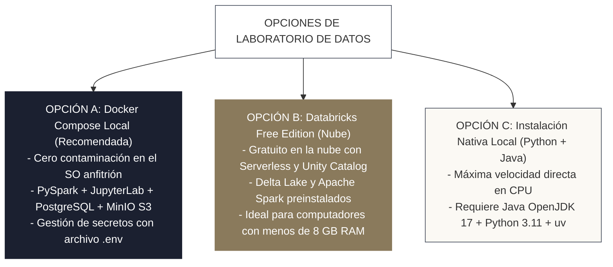

<!-- NOTAS FUENTE ORIGINALES DE OBSIDIAN: [[Lab Setup]], [[Datasets]], [[Docker Compose]] -->

# Capítulo 0D: Entorno de Laboratorio Reproducible y Generación de Datos [NÚCLEO EMPLEABILIDAD]

> *"Un libro técnico de ingeniería que propone código sobre archivos inexistentes sin ofrecer un laboratorio reproducible es un ejercicio de frustración. Para que el conocimiento arraigue, cada consulta SQL, cada script de PySpark y cada pipeline de orquestación presentado en esta obra debe ser ejecutable y verificable en su propio computador sin costo alguno."*

---

## 0D.0 El Repositorio Oficial del Libro

Todo el código fuente de los cincuenta y dos capítulos, los archivos de orquestación de Docker Compose, las suites de pruebas de pytest y el generador determinista de datos están versionados en el repositorio oficial de código abierto:

```bash
# 1. Clonar el repositorio oficial
git clone https://github.com/luisgalvis/como-ser-un-data-engineer.git

# 2. Ingresar al directorio del proyecto
cd como-ser-un-data-engineer
```

Enlace directo al repositorio: **[https://github.com/luisgalvis/como-ser-un-data-engineer](https://github.com/luisgalvis/como-ser-un-data-engineer)**

---

## Objetivos de Aprendizaje
Al finalizar este capítulo, el lector será capaz de:
* Configurar un entorno de ingeniería de datos local y aislado mediante **Docker Compose**, o en la nube mediante **Databricks Free Edition**.
* Aplicar buenas prácticas de seguridad operativa segregando secretos y credenciales en un archivo `.env` local sin exponer contraseñas en control de versiones.
* Configurar entornos Windows mediante **WSL2 (Windows Subsystem for Linux)** y ajustar la gestión de memoria RAM en `.wslconfig` para evitar saturación de recursos.
* Ejecutar el generador oficial de datos (`python scripts/generar_datos.py`) para materializar en disco la suite completa de los 8 datasets de prueba utilizados a lo largo del libro.
* Validar la conectividad de Apache Spark y la lectura de archivos Parquet y JSON semiestructurados mediante un script automatizado de auditoría.

---

> **Definición 0D.1 (El Principio de Reproducibilidad en la Ingeniería)**  
> La reproducibilidad computacional exige que cualquier ingeniero, en cualquier sistema operativo, pueda clonar el repositorio del proyecto, ejecutar un único comando de configuración y obtener idénticos esquemas, registros y resultados numéricos sin depender de archivos propietarios o configuraciones opacas.

---

## 0D.1 Opciones de Entorno de Laboratorio

El lector puede elegir la alternativa que mejor se adapte a su infraestructura disponible:



---

### Opción A: Laboratorio Completo con Docker Compose (Recomendada)

La especificación moderna de Docker Compose (sin la directiva obsoleta `version: '3.8'`) permite levantar la infraestructura completa con variables de entorno desacopladas.

#### 1. Archivo de Variables de Entorno (`.env.example` $\rightarrow$ `.env`)
Cree un archivo `.env` en la raíz del proyecto para no exponer contraseñas en texto plano:

```ini
# .env - Variables de configuración del laboratorio local
POSTGRES_DB=laboratorio_db
POSTGRES_USER=data_engineer
POSTGRES_PASSWORD=LabPasswordSeguro2026!
POSTGRES_PORT=5432

MINIO_ROOT_USER=minio_admin
MINIO_ROOT_PASSWORD=MinioSecretPassword2026!
MINIO_API_PORT=9000
MINIO_CONSOLE_PORT=9001

JUPYTER_PORT=8888
SPARK_UI_PORT=4040
```

#### 2. Definición de Servicios (`docker-compose.yml`)

```yaml
# docker-compose.yml (Especificación Docker Compose Moderna)
services:
  # Entorno interactivo con Apache Spark 3.5 y Delta Lake 3.2
  spark-jupyter:
    image: quay.io/jupyter/pyspark-notebook:spark-3.5.0
    container_name: lab_spark_notebook
    environment:
      JUPYTER_ENABLE_LAB: "yes"
      PYSPARK_SUBMIT_ARGS: "--packages io.delta:delta-spark_2.12:3.2.0 pyspark-shell"
    ports:
      - "${JUPYTER_PORT:-8888}:8888"   # JupyterLab Web UI
      - "${SPARK_UI_PORT:-4040}:4040"   # Spark Web UI
    volumes:
      - ./libro:/home/jovyan/work/libro
      - ./data:/home/jovyan/work/data
      - ./scripts:/home/jovyan/work/scripts
    networks:
      - red_laboratorio

  # Base de datos relacional para ejercicios OLTP, JDBC y CDC
  postgres:
    image: postgres:16-alpine
    container_name: lab_postgres
    environment:
      POSTGRES_DB: ${POSTGRES_DB}
      POSTGRES_USER: ${POSTGRES_USER}
      POSTGRES_PASSWORD: ${POSTGRES_PASSWORD}
    ports:
      - "${POSTGRES_PORT:-5432}:5432"
    volumes:
      - pgdata:/var/lib/postgresql/data
    networks:
      - red_laboratorio

  # MinIO: Almacenamiento de Objetos S3 local (Data Lake)
  minio:
    image: quay.io/minio/minio:RELEASE.2024-01-31T20-20-33Z
    container_name: lab_minio
    command: server /data --console-address ":9001"
    environment:
      MINIO_ROOT_USER: ${MINIO_ROOT_USER}
      MINIO_ROOT_PASSWORD: ${MINIO_ROOT_PASSWORD}
    ports:
      - "${MINIO_API_PORT:-9000}:9000"
      - "${MINIO_CONSOLE_PORT:-9001}:9001"
    volumes:
      - miniodata:/data
    networks:
      - red_laboratorio

volumes:
  pgdata:
  miniodata:

networks:
  red_laboratorio:
    driver: bridge
```

* **Instrucciones de Despliegue:**
  ```bash
  # Copiar plantilla de variables
  cp .env.example .env

  # Iniciar todos los contenedores en segundo plano
  docker compose up -d
  ```
  Acceda a `http://localhost:8888` en su navegador para interactuar con JupyterLab y ejecutar notebooks de Spark.

---

### Guía Especial para Usuarios de Windows y WSL2

Para desarrolladores en Windows, la experiencia más estable y cercana a producción se obtiene combinando **Docker Desktop** con **WSL2 (Windows Subsystem for Linux)**:

1. **Habilitar WSL2 y Ubuntu:**  
   Abra PowerShell como Administrador y ejecute:
   ```powershell
   wsl --install -d Ubuntu-24.04
   ```
2. **Configuración de Límites de Memoria (`.wslconfig`):**  
   Por defecto, WSL2 puede llegar a consumir el 80% de la memoria física del equipo durante operaciones pesadas de Spark. Para evitar que el sistema operativo Windows se ralentice, cree el archivo `C:\Users\<SuUsuario>\.wslconfig`:
   ```ini
   [wsl2]
   memory=8GB            # Límite máximo de RAM asignada a WSL2
   processors=4          # Límite de núcleos de CPU
   swap=4GB              # Archivo de paginación swap
   localhostForwarding=true
   ```
   Reinicie WSL2 desde PowerShell ejecutando: `wsl --shutdown`.
3. **Manejo de Saltos de Línea (CRLF vs LF):**  
   Los scripts shell de Linux (`.sh`) fallan con errores crípticos del tipo `\r: command not found` si Git los descarga con saltos de línea de Windows (`CRLF`). Configure Git para respetar saltos de línea Unix:
   ```bash
   git config --global core.autocrlf input
   ```
4. **Ejecutar dentro del File System de Linux:**  
   Para obtener el máximo rendimiento de lectura y escritura en disco (I/O), clone el repositorio dentro del sistema de archivos de WSL2 (ej. `/home/su_usuario/proyectos/`), en lugar de montarlo desde `/mnt/c/`.

---

### Opción B: Databricks Free Edition (Nube sin Costo)

Si su computador dispone de recursos limitados (menos de 8 GB de RAM) o desea experimentar directamente con una plataforma de datos moderna:
1. Regístrese en el portal oficial de **Databricks Free Edition** (`https://community.cloud.databricks.com/` o `https://www.databricks.com/try-databricks`).
2. Cree un clúster de trabajo (*Single Node*, Databricks Runtime 15.4+ LTS con Apache Spark 3.5+ y Delta Lake preinstalado).
3. Clone el repositorio oficial directamente en Databricks utilizando **Workspace Git Folders / Repos**.
4. Trabaje sobre el catálogo predeterminado de **Unity Catalog** (`workspace.default`), familiarizándose con la gobernanza empresarial y linaje desde el primer día.

---

### Opción C: Instalación Nativa Local (Python + PySpark)

Para ejecutar los scripts directamente en su terminal local (Linux, macOS o WSL2):
1. **Instalar Java OpenJDK 17 (Requisito fundamental de la JVM de Spark):**
   ```bash
   # En Ubuntu / Debian / WSL2:
   sudo apt-get update && sudo apt-get install -y openjdk-17-jdk-headless
   ```
2. **Crear el entorno virtual con `uv` e instalar dependencias:**
   ```bash
   uv venv .venv --python 3.11
   source .venv/bin/activate  # En Windows: .venv\Scripts\activate
   uv pip install pyspark==3.5.2 delta-spark==3.2.0 pyarrow duckdb polars pytest
   ```

---

## 0D.2 Generación Oficial de Datasets de Prueba

Para garantizar que los archivos de datos existan en disco y contengan exactamente la distribución matemática descrita en los capítulos de optimización, joins y calidad, ejecute el generador oficial determinista:

```bash
python scripts/generar_datos.py
```

### Inventario de Datasets Generados en `data/`

| Archivo | Volumen | Formato | Propósito Pedagógico en el Libro |
| :--- | :--- | :--- | :--- |
| `data/ventas.parquet` | 10.000 filas | Parquet / Snappy | Transacciones de comercio electrónico. Base para filtros, agregaciones y particionado temporal. |
| `data/clientes.parquet` | 1.500 filas | Parquet / Snappy | Catálogo maestro de clientes. Empleado en uniones relacionales (Broadcast Joins) y SCD Tipo 2. |
| `data/eventos_telemetria.json` | 1.000 eventos | JSON semiestructurado | Cargas de IoT y clickstream con campos anidados para prácticas de parsing de esquemas. |
| `data/interacciones.parquet` | 25.000 filas | Parquet / Snappy | Eventos de navegación web (clickstream) para análisis de sesiones y funciones de ventana. |
| `data/usuarios.parquet` | 2.000 filas | Parquet / Snappy | Datos con información de identificación personal (PII) para ejercicios de GDPR, enmascaramiento y Ley 1581. |
| `data/pedidos.parquet` | 20.000 filas | Parquet / Snappy | Transacciones detalladas de ventas para indexación, modelado dimensional y joins pesados. |
| `data/eventos_anuales.parquet` | 50.000 filas | Parquet / Snappy | Eventos históricos distribuidos en múltiples años para demostrar poda de particiones (*Partition Pruning*). |
| `data/transacciones_sesgadas.parquet` | 100.000 filas | Parquet / Snappy | Dataset con **sesgo extremo de datos (85% Zipf)** y payload de 256 bytes para reproducir cuellos de botella y *Shuffle Spill* en la interfaz Spark UI. |

---

## 0D.3 Script de Verificación de Integridad del Laboratorio

Para cerciorarse de que su sesión de Apache Spark está correctamente configurada y puede procesar los archivos generados sin problemas de memoria ni permisos, ejecute:

```python
# scripts/verificar_laboratorio.py
from pyspark.sql import SparkSession

def verificar_laboratorio():
    print("Iniciando auditoría del entorno de Apache Spark...")
    spark = SparkSession.builder \
        .appName("AuditoriaLaboratorio") \
        .master("local[*]") \
        .config("spark.sql.shuffle.partitions", "4") \
        .getOrCreate()
    
    print(f"Versión de Apache Spark activa: {spark.version}")
    
    ruta_ventas = "data/ventas.parquet"
    df_ventas = spark.read.parquet(ruta_ventas)
    
    total_filas = df_ventas.count()
    print(f"Archivo '{ruta_ventas}' leído exitosamente. Total registros: {total_filas}")
    
    df_ventas.createOrReplaceTempView("ventas_test")
    resumen = spark.sql("""
        SELECT pais, COUNT(transaccion_id) as total_tx, ROUND(SUM(monto_usd), 2) as facturacion
        FROM ventas_test
        GROUP BY pais
        ORDER BY facturacion DESC
        LIMIT 3
    """)
    resumen.show()
    print("¡Laboratorio verificado y 100% operativo para el estudio del libro!")

if __name__ == "__main__":
    verificar_laboratorio()
```

---

## 0D.4 Resumen y Puntos Clave

* **Cero código sobre el vacío:** Todo el código del libro es inmediatamente reproducible clonando el repositorio oficial de GitHub: `https://github.com/luisgalvis/como-ser-un-data-engineer`.
* **Seguridad desde el primer día:** Docker Compose utiliza la especificación moderna con variables de entorno desacopladas en `.env`, eliminando credenciales en texto plano.
* **Compatibilidad Windows:** La configuración de WSL2 y límites de memoria en `.wslconfig` protege el sistema anfitrión frente a bloqueos de recursos.
* **Suite completa de datos:** El script `scripts/generar_datos.py` produce deterministamente 8 datasets calibrados para reproducir desde agregaciones básicas hasta *spills* severos por sesgo de datos (*data skew*).

---

## Lecturas Recomendadas
1. **Chambers, B. & Zaharia, M. (2018).** *Spark: The Definitive Guide (Chapter 2: A Gentle Introduction to Spark).* O'Reilly Media.
2. **Docker Documentation (2024).** *The Compose Specification & Environment Variables in Compose.* Docker Docs.
3. **Microsoft Learn (2024).** *Advanced Settings Configuration in WSL2 (.wslconfig).* Microsoft Documentation.
4. **Databricks Learning (2024).** *Databricks Free Edition & Unity Catalog Quickstart.* Databricks Documentation.
