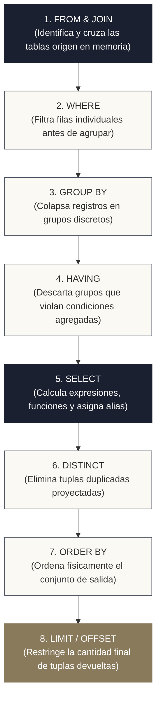
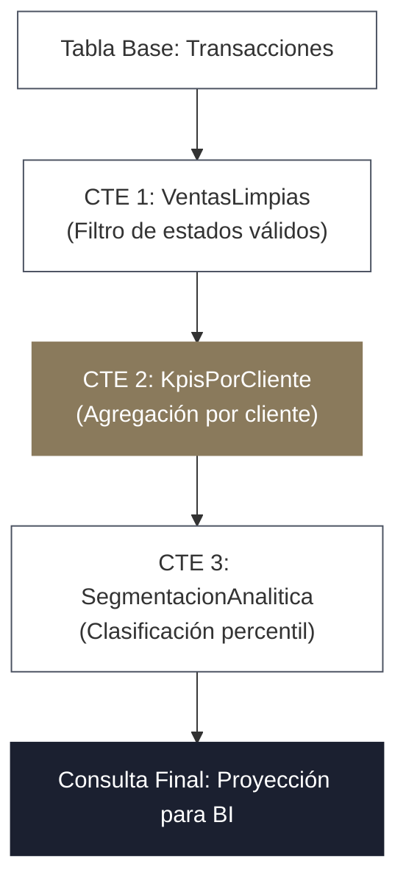
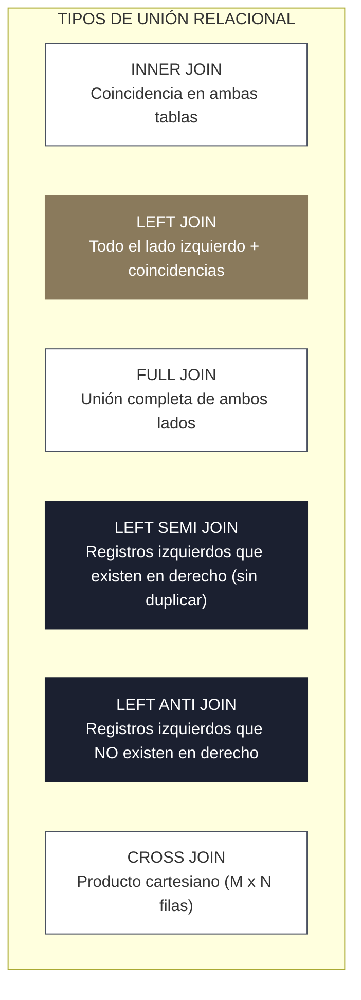
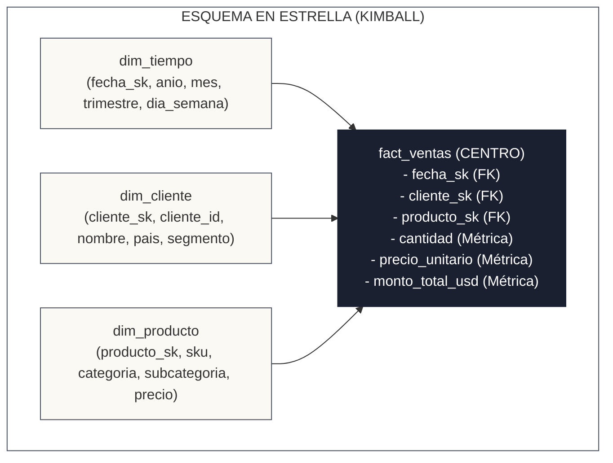

<!-- NOTAS FUENTE ORIGINALES DE OBSIDIAN: [[SQL]] -->

# Capítulo 1: Fundamentos de SQL Declarativo y Computación Analítica [NÚCLEO EMPLEABILIDAD]

> *"SQL en la ingeniería de datos no es una simple sintaxis para consultar tablas estáticas; es la interfaz declarativa universal que permite expresar qué resultado matemático se requiere, delegando en el motor computacional la generación del plan de ejecución físico óptimo."*

---

## 1.0 Intuición Inicial: Pedir un Café en Lugar de Operar la Máquina

Cuando entras a una cafetería, le dices al barista: *«Por favor, un café americano grande, bien caliente y sin azúcar»*. No necesitas entrar a la cocina a calibrar el molinillo de granos, medir los gramos de café molido, hervir el agua a 92 grados centígrados ni bombear la presión del agua a través del filtro. Describes con exactitud el resultado final que deseas (**QUÉ quieres**), y el barista se encarga de ejecutar la secuencia mecánica precisa (**CÓMO prepararlo**).

**SQL (Structured Query Language) funciona exactamente bajo este principio declarativo.** En lugar de programar bucles `for`, abrir archivos en bajo nivel, asignar punteros de memoria y recorrer registros uno a uno (como se haría en C o Java imperativo), en SQL describes las condiciones lógicas de los datos que necesitas. El motor de la base de datos (PostgreSQL, DuckDB o Apache Spark) dispone de un optimizador interno —el barista experto— que analiza los índices, el tamaño físico de las tablas y la memoria disponible para construir el plan de ejecución más rápido posible.

Si comienzas desde cero, este capítulo te guiará paso a paso: desde seleccionar tus primeras columnas y filtrar filas, hasta realizar uniones relacionales complejas, resolver casos de lógica trivaluada con valores nulos e introducir los fundamentos del modelado dimensional analítico.

---

## Objetivos de Aprendizaje
Al finalizar este capítulo, el lector será capaz de:
* Comprender la diferencia fundamental entre el paradigma declarativo de SQL y la programación procedural/imperativa.
* Escribir consultas SQL analíticas desde cero (`SELECT`, `WHERE`, `GROUP BY`, `HAVING`, `ORDER BY`, `LIMIT`) dominando el orden lógico de ejecución del motor.
* Aplicar con precisión todos los tipos de uniones relacionales (`INNER`, `LEFT`, `RIGHT`, `FULL`, `CROSS`, `LEFT SEMI`, `LEFT ANTI`) y gestionar los efectos de la lógica trivaluada ante valores `NULL`.
* Construir transformaciones modulares legibles mediante Expresiones de Tabla Comunes (CTEs) y CTEs recursivas.
* Dominar operaciones de sincronización e inserción atómica mediante `MERGE INTO`.
* Comprender los principios del **Modelado Dimensional de Ralph Kimball** (tablas de hechos, dimensiones y esquemas en estrella) frente a la normalización transaccional 3NF.

---

### Profundiza: El Fundamento Formal del Álgebra y Cálculo Relacional
> **Definición 1.1 (Cálculo Relacional y Paradigma Declarativo)**  
> En la teoría matemática de bases de datos formulada por Edgar F. Codd (1970), SQL se fundamenta en el **cálculo relacional de tuplas**: el ingeniero especifica el predicado analítico y la proyección relacional deseada (*qué calcular*), abstrayéndose por completo de la secuencia de pasos mecánicos (*cómo calcularlo*).
> 
> En contraste con la programación imperativa —donde el programador administra bucles, punteros de memoria y buffers de red—, el paradigma declarativo traslada la carga de optimización al planificador del motor (Catalyst en Spark, optimizadores basados en costos en PostgreSQL o DuckDB). Este analiza la consulta, evalúa reglas de equivalencia algebraica y compila un árbol de ejecución físico adaptado a los recursos disponibles.

---

## 1.1 Consultas SQL desde Cero: Anatomía y Orden Lógico de Ejecución

Para un ingeniero de datos, dominar SQL va más allá de recordar palabras clave: requiere asimilar el modelo relacional formal propuesto por Edgar F. Codd y comprender el orden exacto en que los motores de bases de datos compilan y ejecutan las instrucciones.

### 1. El Modelo Relacional Básico
* **Relación (Tabla):** Conjunto no ordenado de tuplas únicas con un esquema definido.
* **Tupla (Fila o Registro):** Instancia única de una entidad en el mundo real.
* **Atributo (Columna):** Dimensión con un tipo de dato y restricciones específicas.

### 2. Proyección y Filtrado Básico (`SELECT` y `WHERE`)
La consulta elemental extrae y transforma columnas de una tabla:

```sql
-- Selección de columnas específicas con alias y transformaciones aritméticas
SELECT 
    transaccion_id,
    cliente_id,
    pais,
    cantidad * precio_unitario AS subtotal_usd,
    fecha_transaccion
FROM ventas_analitica.ventas
WHERE estado_pago = 'COMPLETADO'
  AND (pais = 'CO' OR pais = 'MX')
  AND fecha_transaccion >= '2026-01-01'
  AND monto_usd BETWEEN 50.0 AND 5000.0;
```

#### Predicados y Operadores de Filtrado Esenciales
* **Igualdad y Desigualdad:** `=`, `<>` (o `!=`).
* **Comparaciones:** `>`, `<`, `>=`, `<=`.
* **Conjuntos y Rangos:** `IN ('CO', 'PE', 'CL')`, `BETWEEN 10 AND 50`.
* **Coincidencia de Patrones de Texto:** `LIKE 'TX-%'` (empieza con TX-), `LIKE '%@empresa.com'`.
* **Evaluación de Nulos:** `IS NULL` y `IS NOT NULL` (nunca use `= NULL`).

### 3. Agrupaciones y Filtrado Post-Agregación (`GROUP BY` y `HAVING`)
Una de las confusiones más comunes al iniciar es distinguir el momento de filtrado de filas frente al de grupos:

* **`WHERE`:** Filtra **filas individuales antes** de que se realice cualquier agrupación o cálculo de agregación.
* **`GROUP BY`:** Colapsa múltiples filas que comparten valores idénticos en una sola fila resumen por grupo.
* **`HAVING`:** Filtra **grupos resultantes después** de haber calculado las funciones de agregación (`COUNT`, `SUM`, `AVG`, `MIN`, `MAX`).

```sql
SELECT 
    pais,
    categoria_producto,
    COUNT(transaccion_id) AS total_pedidos,
    ROUND(SUM(monto_usd), 2) AS facturacion_total,
    ROUND(AVG(monto_usd), 2) AS ticket_promedio
FROM ventas_analitica.ventas
WHERE estado_pago = 'COMPLETADO'     -- 1. Filtra filas individuales primero
GROUP BY pais, categoria_producto    -- 2. Agrupa por país y categoría
HAVING COUNT(transaccion_id) >= 100  -- 3. Conserva solo grupos con más de 100 ventas
   AND SUM(monto_usd) > 50000.0
ORDER BY facturacion_total DESC      -- 4. Ordena el resultado agregado
LIMIT 10;                            -- 5. Extrae los 10 primeros registros
```

### 4. El Orden Lógico de Procesamiento de una Consulta SQL
Un error habitual es creer que la base de datos ejecuta la consulta en el orden en que se escribe (`SELECT` primero). En realidad, el optimizador procesa la consulta en una secuencia lógica matemática estricta:



> **Por qué importa esto al depurar:** Debido a que `WHERE` se evalúa en el paso 2 y `SELECT` se evalúa en el paso 5, **no es posible usar un alias definido en el `SELECT` dentro de la cláusula `WHERE`** (provocará un error de columna desconocida). Comprender este orden evita horas de frustración al estructurar pipelines.

---

## 1.2 Lenguaje de Definición (DDL) y Manipulación de Datos (DML)

Toda plataforma analítica interactúa con esquemas relacionales a través de dos subsistemas fundamentales:

### 1. DDL (Data Definition Language)
Permite definir, alterar y destruir estructuras tabulares, tipos de datos y restricciones de integridad:

```sql
-- Creación de esquema y tabla analítica con restricciones (PostgreSQL / DuckDB / Databricks)
CREATE SCHEMA IF NOT EXISTS ventas_analitica;

CREATE TABLE ventas_analitica.clientes (
    cliente_id BIGINT NOT NULL,
    nombre VARCHAR(150) NOT NULL,
    correo VARCHAR(200) NOT NULL,
    pais_iso CHAR(2) NOT NULL,
    segmento VARCHAR(50) DEFAULT 'ESTANDAR',
    fecha_registro DATE NOT NULL,
    CONSTRAINT pk_clientes PRIMARY KEY (cliente_id)
);
```

### 2. DML (Data Manipulation Language) y la Operación Atómica `MERGE INTO`
El DML gobierna la inserción, actualización y eliminación de registros:

```sql
-- Inserción directa de registros
INSERT INTO ventas_analitica.clientes (cliente_id, nombre, correo, pais_iso, segmento, fecha_registro)
VALUES 
    (101, 'Ana Torres', 'ana.torres@empresa.com', 'CO', 'ENTERPRISE', '2025-01-15'),
    (102, 'Carlos Ruiz', 'carlos.ruiz@empresa.com', 'MX', 'ESTANDAR', '2025-02-20'),
    (103, 'Elena Mora', 'elena.mora@empresa.com', 'CO', 'PRO', '2025-03-05');
```

En pipelines analíticos modernos, la inserción y actualización manual (`UPDATE` y `DELETE` tradicionales) son sustituidas por la sentencia atómica **`MERGE INTO`** (estándar ANSI SQL:2006 y pilar central de formatos Lakehouse como Delta Lake e Iceberg):

```sql
-- Sincronización atómica tipo Upsert (Update + Insert) usando MERGE INTO
MERGE INTO ventas_analitica.clientes AS destino
USING ventas_analitica.novedades_staging AS origen
ON destino.cliente_id = origen.cliente_id
WHEN MATCHED AND origen.correo <> destino.correo THEN
    UPDATE SET 
        destino.correo = origen.correo,
        destino.segmento = origen.segmento
WHEN NOT MATCHED THEN
    INSERT (cliente_id, nombre, correo, pais_iso, segmento, fecha_registro)
    VALUES (origen.cliente_id, origen.nombre, origen.correo, origen.pais_iso, origen.segmento, origen.fecha_registro);
```

---

## 1.2 Expresiones Condicionales, Funciones de Fecha y JSON

### Lógica Condicional con `CASE WHEN` y Manejo de Nulos
En SQL, la sentencia `CASE` es una expresión escalar determinista:

```sql
SELECT 
    cliente_id,
    monto_usd,
    CASE 
        WHEN monto_usd >= 10000 THEN 'ALTO VALOR'
        WHEN monto_usd >= 1000 THEN 'VALOR MEDIO'
        ELSE 'MINORISTA'
    END AS clasificacion_cliente,
    COALESCE(descuento_usd, 0.0) AS descuento_aplicado,
    NULLIF(dias_mora, 0) AS mora_efectiva -- Convierte ceros en NULL para no distorsionar promedios
FROM ventas_analitica.facturacion;
```

### Aritmética de Fechas y Marcas de Tiempo
Las transformaciones analíticas requieren manipular dimensiones temporales con precisión de zona horaria:

```sql
SELECT 
    pedido_id,
    fecha_hora_creacion,
    -- Truncamiento a inicio de mes
    DATE_TRUNC('month', fecha_hora_creacion) AS mes_periodo,
    -- Extracción de componentes
    EXTRACT(YEAR FROM fecha_hora_creacion) AS anio_fiscal,
    -- Diferencia temporal en días
    CAST(fecha_entrega AS DATE) - CAST(fecha_hora_creacion AS DATE) AS dias_transito,
    -- Suma de intervalos
    fecha_hora_creacion + INTERVAL '30 days' AS vencimiento_garantia
FROM ventas_analitica.pedidos;
```

### Procesamiento de Estructuras Jerárquicas JSON
En arquitecturas de ingesta moderna, los eventos provienen de APIs o Kafka en formato JSON. SQL analítico provee operadores especializados:

```sql
-- Sintaxis PostgreSQL (operadores de ruta jsonb -> y ->>)
SELECT 
    evento_id,
    payload_json->>'usuario_id' AS usuario_id,
    payload_json->'dispositivo'->>'sistema_operativo' AS so_cliente,
    CAST(payload_json->>'monto' AS NUMERIC(10,2)) AS monto_transaccion
FROM ventas_analitica.eventos_raw;

-- Sintaxis estándar Spark SQL / DuckDB equivalente
SELECT 
    evento_id,
    get_json_object(payload_str, '$.usuario_id') AS usuario_id,
    get_json_object(payload_str, '$.dispositivo.sistema_operativo') AS so_cliente
FROM ventas_analitica.eventos_raw;
```

---

## 1.3 Subconsultas y Operaciones de Conjuntos

### Subconsultas Escalares y Correlacionadas
Una subconsulta es **correlacionada** cuando depende de una fila procesada por la consulta externa, evaluándose conceptualmente para cada registro:

```sql
-- Obtener pedidos cuyo monto supera el promedio de su respectivo país (Subconsulta correlacionada)
SELECT p1.pedido_id, p1.pais_id, p1.monto_usd
FROM ventas_analitica.pedidos AS p1
WHERE p1.monto_usd > (
    SELECT AVG(p2.monto_usd)
    FROM ventas_analitica.pedidos AS p2
    WHERE p2.pais_id = p1.pais_id
);
```

### Operadores de Existencia: `EXISTS` frente a `IN`
* **`IN`**: Evalúa una lista completa de valores. Si la subconsulta contiene un valor `NULL`, evaluar `NOT IN` puede devolver un conjunto vacío de forma inesperada debido a la lógica trivaluada (`NOT (x IN (1, NULL))` evalúa a `UNKNOWN`).
* **`EXISTS`**: Evalúa la presencia de al menos una tupla que satisfaga la condición mediante un predicado booleano, permitiendo al optimizador detener el escaneo (*short-circuit evaluation*):

```sql
-- Identificar clientes con al menos una compra en los últimos 90 días
SELECT c.cliente_id, c.nombre
FROM ventas_analitica.clientes AS c
WHERE EXISTS (
    SELECT 1 
    FROM ventas_analitica.pedidos AS p
    WHERE p.cliente_id = c.cliente_id
      AND p.fecha_creacion >= CURRENT_DATE - INTERVAL '90 days'
);
```

### Operaciones de Conjuntos (`UNION`, `UNION ALL`, `INTERSECT`, `EXCEPT`)

| Operación | Semántica Relacional | Costo Computacional |
| :--- | :--- | :--- |
| **`UNION ALL`** | Concatena los registros de dos consultas preservando duplicados. | **Bajo ($O(N)$):** No requiere ordenar ni crear tablas hash. |
| **`UNION`** | Concatena y elimina tuplas duplicadas. | **Alto ($O(N \log N)$):** Fuerza una fase de deduplicación o hash de conjunto. |
| **`INTERSECT`** | Devuelve solo los registros presentes en ambos conjuntos. | Requiere coincidencia de todas las columnas. |
| **`EXCEPT` / `MINUS`** | Devuelve los registros del primer conjunto que no existen en el segundo. | Útil para pruebas de conciliación y calidad de datos. |

---

## 1.4 Expresiones de Tabla Comunes (CTEs) y CTEs Recursivas

Las **CTEs** (*Common Table Expressions*, introducidas mediante la cláusula `WITH`) transforman consultas anidadas impenetrables en secuencias lógicas modulares, legibles y reutilizables.



```sql
WITH ventas_validas AS (
    SELECT 
        pedido_id,
        cliente_id,
        monto_usd,
        DATE_TRUNC('month', fecha_creacion) AS mes
    FROM ventas_analitica.pedidos
    WHERE estado = 'COMPLETADO'
),
metricas_cliente AS (
    SELECT 
        cliente_id,
        mes,
        COUNT(pedido_id) AS total_pedidos,
        SUM(monto_usd) AS gasto_mensual
    FROM ventas_validas
    GROUP BY cliente_id, mes
)
SELECT 
    c.nombre,
    c.pais_iso,
    m.mes,
    m.total_pedidos,
    m.gasto_mensual
FROM metricas_cliente AS m
INNER JOIN ventas_analitica.clientes AS c ON m.cliente_id = c.cliente_id
WHERE m.gasto_mensual > 1000;
```

### CTEs Recursivas para Estructuras Jerárquicas
En ingeniería de datos es común modelar jerarquías organizacionales, árboles de categorías o cadenas de linaje (*data lineage*). Una CTE recursiva consta de un **miembro ancla** y un **miembro recursivo** unidos por `UNION ALL`:

```sql
-- Recorrido de una jerarquía de categorías de productos (Árbol relacional)
WITH RECURSIVE jerarquia_categorias AS (
    -- Miembro Ancla: Categorías raíz (sin padre)
    SELECT 
        categoria_id,
        nombre_categoria,
        categoria_padre_id,
        1 AS nivel_profundidad,
        CAST(nombre_categoria AS VARCHAR(1000)) AS ruta_arbol
    FROM ventas_analitica.categorias
    WHERE categoria_padre_id IS NULL

    UNION ALL

    -- Miembro Recursivo: Hijos unidos con la iteración previa
    SELECT 
        c.categoria_id,
        c.nombre_categoria,
        c.categoria_padre_id,
        j.nivel_profundidad + 1,
        CAST(j.ruta_arbol || ' > ' || c.nombre_categoria AS VARCHAR(1000))
    FROM ventas_analitica.categorias AS c
    INNER JOIN jerarquia_categorias AS j ON c.categoria_padre_id = j.categoria_id
)
SELECT categoria_id, nombre_categoria, nivel_profundidad, ruta_arbol
FROM jerarquia_categorias
ORDER BY ruta_arbol;
```

---

## 1.5 Tipos de Uniones (JOINs) y el Peligro de la Lógica Trivaluada (3VL)

El operador relacional `JOIN` combina tuplas de dos relaciones en función de una condición de acoplamiento:



### 1. `INNER JOIN`, `LEFT JOIN`, `RIGHT JOIN` y `FULL OUTER JOIN`
* **`INNER JOIN`**: Devuelve únicamente tuplas que satisfacen el predicado en ambas tablas.
* **`LEFT OUTER JOIN`**: Preserva todas las tuplas de la tabla izquierda. Si no hay coincidencia en la derecha, rellena sus columnas con `NULL`.
* **`FULL OUTER JOIN`**: Preserva todas las tuplas de ambos extremos, insertando `NULL` en los lados sin correspondencia.

### 2. Uniones de Filtrado: `LEFT SEMI JOIN` y `LEFT ANTI JOIN` vs. `EXISTS` / `NOT EXISTS`
Ampliamente utilizadas en motores analíticos distribuidos (Spark SQL, Trino, Databricks, DuckDB, Snowflake):
* **`LEFT SEMI JOIN`**: Retorna las columnas de la tabla izquierda para aquellas filas que tienen al menos una correspondencia en la derecha. **A diferencia del `INNER JOIN`, nunca duplica filas de la tabla izquierda**, incluso si hay múltiples coincidencias en la derecha. En SQL estándar (como PostgreSQL), su equivalente canónico es `WHERE EXISTS (...)`.
* **`LEFT ANTI JOIN`**: Retorna únicamente las filas de la tabla izquierda que **no tienen correspondencia** en la derecha. Es la alternativa más limpia y eficiente al peligroso `WHERE id NOT IN (...)`. 

> **Nota de Portabilidad:** La sintaxis explícita `LEFT ANTI JOIN` y `LEFT SEMI JOIN` es nativa de motores OLAP modernos (Spark SQL, DuckDB, Databricks, Trino, BigQuery). En motores relacionales tradicionales como PostgreSQL o SQL Server estándar, no existe la palabra clave `ANTI JOIN`; en ellos la forma estándar ANSI equivalente y óptima es `WHERE NOT EXISTS (...)`:

```sql
-- En Spark SQL, DuckDB, Trino y Snowflake:
SELECT c.cliente_id, c.nombre
FROM ventas_analitica.clientes AS c
LEFT ANTI JOIN ventas_analitica.pedidos AS p ON c.cliente_id = p.cliente_id;

-- Equivalente estándar ANSI (PostgreSQL, MySQL, SQL Server):
SELECT c.cliente_id, c.nombre
FROM ventas_analitica.clientes AS c
WHERE NOT EXISTS (
    SELECT 1 FROM ventas_analitica.pedidos AS p 
    WHERE p.cliente_id = c.cliente_id
);
```

### 3. La Lógica Trivaluada (Three-Valued Logic - 3VL) y Claves `NULL`
En SQL, una comparación lógica puede evaluar a `TRUE`, `FALSE` o **`UNKNOWN`** (desconocido).
* **Regla Crítica:** `NULL = NULL` evalúa a **`UNKNOWN`**, no a `TRUE`.
* En un `INNER JOIN`, dos tuplas que tengan `NULL` en su clave de unión **nunca coinciden**.
* Si una clave foránea contiene `NULL`, dichas filas desaparecen de un `INNER JOIN`. En un `FULL JOIN`, cada fila con clave `NULL` formará una tupla independiente emparejada con nulos en el lado opuesto.

```sql
-- Demostración de igualdad segura frente a NULL (Null-Safe Equality):
-- 1. En Spark SQL y MySQL (operador <=>):
SELECT *
FROM tabla_a AS a
INNER JOIN tabla_b AS b ON a.codigo <=> b.codigo;

-- 2. En SQL Estándar ANSI y PostgreSQL (predicado IS NOT DISTINCT FROM):
SELECT *
FROM tabla_a AS a
INNER JOIN tabla_b AS b ON a.codigo IS NOT DISTINCT FROM b.codigo;
```

---

## 1.6 De SQL Estándar a Spark SQL y Vistas Temporales

En Apache Spark, la interfaz SQL es de primera clase y comparte exactamente el mismo optimizador Catalyst que la API DataFrame:

```python
from pyspark.sql import SparkSession

# Inicializar sesión de Spark
spark = SparkSession.builder \
    .appName("Capitulo01-SQL-Analitico") \
    .master("local[*]") \
    .getOrCreate()

# Cargar dataset estructurado
df_ventas = spark.read.parquet("data/ventas.parquet")

# Registrar vista temporal en el catálogo en memoria de Spark
df_ventas.createOrReplaceTempView("v_ventas")

# Consulta analítica avanzada con CTEs y Anti-Join
consulta_spark_sql = """
    WITH clientes_activos AS (
        SELECT cliente_id, SUM(monto_usd) AS volumen_total
        FROM v_ventas
        WHERE fecha_transaccion >= '2026-01-01'
        GROUP BY cliente_id
    )
    SELECT 
        v.pais,
        COUNT(DISTINCT v.cliente_id) AS total_clientes,
        SUM(v.monto_usd) AS facturacion_pais
    FROM v_ventas AS v
    LEFT SEMI JOIN clientes_activos AS ca ON v.cliente_id = ca.cliente_id
    GROUP BY v.pais
    ORDER BY facturacion_pais DESC
"""

df_resultado = spark.sql(consulta_spark_sql)
df_resultado.show(5)
```

---

## 1.7 Introducción al Modelado Dimensional: Kimball vs. Normalización 3NF

Uno de los saltos cualitativos que diferencian a un programador de un verdadero ingeniero de datos es comprender **por qué estructuramos los datos de forma diferente para operar que para analizar**.

### 1. La Dualidad de Sistemas: OLTP frente a OLAP
* **Sistemas Transaccionales (OLTP):** Diseñados en **Tercera Forma Normal (3NF)**. Su meta es evitar redundancia: si un cliente cambia de correo electrónico, se modifica una única fila en una tabla aislada para evitar inconsistencias y bloqueos de escritura. Sin embargo, responder a una pregunta como *«¿Cuáles fueron las ventas por categoría en Colombia el último trimestre?»* requiere unir 8 o 10 tablas normalizadas con un costo computacional prohibitivo.
* **Sistemas Analíticos (OLAP / Data Warehouse):** Diseñados bajo la metodología dimensional de **Ralph Kimball**. Su meta es optimizar la lectura analítica masiva y la simplicidad semántica, organizando los datos en **Tablas de Hechos** y **Tablas de Dimensiones**.



### 2. Anatomía de una Tabla de Hechos (*Fact Table*)
Una tabla de hechos registra eventos numéricos medibles que ocurren en el negocio:
* **El Grano (*Granularity*):** Es el principio más sagrado de Kimball. Define con precisión quirúrgica qué representa **una sola fila** de la tabla. Por ejemplo: *«Una fila representa una línea individual de producto en un ticket de compra completado»*. Si el grano se mezcla o confunde, los cálculos de agregación (`SUM`, `AVG`) duplicarán importes.
* **Métricas Aditivas:** Valores numéricos que pueden sumarse válidamente a través de todas las dimensiones (`monto_usd`, `cantidad_unidades`).
* **Claves Foráneas:** Identificadores que apuntan a las dimensiones que contextualizan el hecho.

### 3. Anatomía de una Tabla de Dimensiones (*Dimension Table*)
Las dimensiones proporcionan el contexto descriptivo respondiendo a las preguntas de negocio: *¿Quién compró?*, *¿Dónde?*, *¿Cuándo?*, *¿Qué artículo?*.
* **Claves Subrogadas (*Surrogate Keys*):** Claves primarias artificiales (enteros secuenciales o hashes `cliente_sk`) gestionadas por el almacén de datos, independientes de la clave natural del ERP origen (`cliente_id`). Permiten manejar miembros desconocidos (clave `-1`) y registrar cambios históricos de atributos (dimensiones lentamente cambiantes o SCD).
* **Esquema en Estrella (*Star Schema*) frente a Copo de Nieve (*Snowflake*):**  
  En un esquema en estrella, las dimensiones están completamente desnormalizadas en una sola tabla (ej. `dim_producto` incluye su categoría y departamento directamente). En el esquema copo de nieve, las dimensiones se normalizan parcialmente (ej. `dim_producto` se une a `dim_subcategoria` que a su vez se une a `dim_categoria`).  
  *Veredicto de Producción:* Los motores analíticos modernos (DuckDB, Snowflake, Databricks, BigQuery) están optimizados para formatos columnares donde el almacenamiento es barato y los saltos entre múltiples tablas degradan el rendimiento. **El Esquema en Estrella es el estándar dominante de la industria.**

### 4. Consulta Analítica Canónica sobre Esquema en Estrella
Observe cómo una consulta que requeriría 8 uniones en una base relacional 3NF se reduce a simples cruces directos contra la tabla central de hechos:

```sql
SELECT 
    d_cli.pais,
    d_prod.categoria,
    d_tiem.anio,
    d_tiem.mes,
    COUNT(f.venta_id) AS total_transacciones,
    ROUND(SUM(f.monto_total_usd), 2) AS facturacion_total
FROM fact_ventas AS f
INNER JOIN dim_cliente AS d_cli 
    ON f.cliente_sk = d_cli.cliente_sk
INNER JOIN dim_producto AS d_prod 
    ON f.producto_sk = d_prod.producto_sk
INNER JOIN dim_tiempo AS d_tiem 
    ON f.fecha_sk = d_tiem.fecha_sk
WHERE d_tiem.anio = 2026
  AND d_cli.pais IN ('CO', 'MX', 'CL')
GROUP BY d_cli.pais, d_prod.categoria, d_tiem.anio, d_tiem.mes
ORDER BY facturacion_total DESC;
```

---

## 1.8 Criterios de Fiabilidad y Anti-Patrones en Producción

**Anti-patrón 1: Uso Inseguro de `NOT IN` con Columnas Anulables**  
Si la subconsulta de un `NOT IN` devuelve una sola tupla con valor `NULL`, toda la condición externa evalúa a `UNKNOWN` y la consulta devuelve cero filas.  
*Corrección:* Utilice siempre `LEFT ANTI JOIN` o `WHERE NOT EXISTS (...)`.

**Anti-patrón 2: Producto Cartesiano Inadvertido (`CROSS JOIN`)**  
Omitir la cláusula `ON` en un join genera una combinación de cada fila izquierda con cada fila derecha ($M \times N$ tuplas). Si la tabla izquierda tiene 1 millón de registros y la derecha 1 millón, el motor intentará generar $10^{12}$ filas (1 billón de registros), saturando la memoria y colapsando el clúster.

**Anti-patrón 3: Funciones No SARGables en la Cláusula `WHERE`**  
Aplicar funciones sobre columnas indexadas o particionadas (por ejemplo, `WHERE YEAR(fecha_registro) = 2026`) impide que el optimizador aplique poda de particiones (*partition pruning*) o busque en índices B-Tree.  
*Corrección:* Escriba predicados SARGables (*Search Argument Able*): `WHERE fecha_registro >= '2026-01-01' AND fecha_registro < '2027-01-01'`.

---

## Preguntas de Revisión y Ejercicios Prácticos
**Ejercicio 1.1 (Deduplicación Analítica e Identificación de Huérfanos):**  
Se tienen dos tablas en un Data Lakehouse: `transacciones` (id, cliente_id, monto, fecha) y `clientes_registrados` (cliente_id, nombre, pais).  
Escriba una consulta SQL estándar que cumpla con los siguientes dos requerimientos:
1. Extraer todas las transacciones de clientes que **no figuren** en la tabla de `clientes_registrados` (transacciones huérfanas).
2. Garantizar que la consulta sea inmune a valores `NULL` en `clientes_registrados.cliente_id` y no utilice `NOT IN`.

**Solución 1.1:**
```sql
SELECT 
    t.id AS transaccion_id,
    t.cliente_id,
    t.monto,
    t.fecha
FROM transacciones AS t
LEFT ANTI JOIN clientes_registrados AS c ON t.cliente_id = c.cliente_id;
```
*Explicación Técnica:* El operador `LEFT ANTI JOIN` evalúa la ausencia de concordancia relacional a nivel de álgebra relacional. Al comparar mediante punteros de unión física (Hash Anti Join), es inmune a la presencia de valores `NULL` en la tabla de la derecha y no sufre de la degradación a `UNKNOWN` de `NOT IN`.

---

**Ejercicio 1.2 (CTE Recursiva y Cálculo de Jerarquías):**  
En una estructura de empleados donde cada tupla tiene `(empleado_id, jefe_id, salario)`, escriba una CTE recursiva que determine la cadena de mando completa para el empleado con `empleado_id = 500`, mostrando su nivel de profundidad hasta el Director General (quien tiene `jefe_id IS NULL`).

**Solución 1.2:**
```sql
WITH RECURSIVE cadena_mando AS (
    -- Miembro Ancla: El empleado de interés
    SELECT 
        empleado_id,
        jefe_id,
        salario,
        1 AS nivel
    FROM empleados
    WHERE empleado_id = 500

    UNION ALL

    -- Miembro Recursivo: Ascendemos hacia el jefe directo
    SELECT 
        e.empleado_id,
        e.jefe_id,
        e.salario,
        cm.nivel + 1
    FROM empleados AS e
    INNER JOIN cadena_mando AS cm ON e.empleado_id = cm.jefe_id
)
SELECT * 
FROM cadena_mando
ORDER BY nivel ASC;
```

---

## 1.9 Resumen y Puntos Clave

* **SQL es un lenguaje declarativo:** La separación entre especificación lógica (*qué*) y ejecución física (*cómo*) permite al motor optimizar planes de consulta sin alterar la intención de negocio.
* **Operación atómica `MERGE INTO`:** Es el pilar fundamental para cargas incrementales y sincronizaciones *Upsert* idempotentes en tablas transaccionales.
* **CTEs y Legibilidad:** Permiten construir pipelines de transformación modulares en lugar de complejas subconsultas anidadas.
* **Joins de Filtrado:** `LEFT SEMI JOIN` y `LEFT ANTI JOIN` proporcionan una semántica limpia y altamente optimizada para comprobaciones de existencia y exclusión.
* **Lógica trivaluada (3VL):** Valores `NULL` en comparaciones booleanas producen `UNKNOWN`, lo que exige extrema precaución en uniones y cláusulas `NOT IN`.
* **Modelado Dimensional (Kimball):** Mientras OLTP normaliza en 3NF para transacciones atómicas, los sistemas analíticos organizan datos en esquemas en estrella (hechos medibles rodeados de dimensiones de contexto) para maximizar la velocidad de lectura analítica.

---

## Lecturas Recomendadas
1. **Kimball, R. & Ross, M. (2013).** *The Data Warehouse Toolkit: The Definitive Guide to Dimensional Modeling (3rd Edition).* Wiley.
2. **Date, C. J. (2019).** *SQL and Relational Theory: How to Write Accurate SQL Code (3rd Edition).* O'Reilly Media.
3. **Kleppmann, M. (2017).** *Designing Data-Intensive Applications (Chapter 2: Data Models and Query Languages).* O'Reilly Media.
4. **Armbrust, M. et al. (2015).** *Spark SQL: Relational Data Processing in Spark.* ACM SIGMOD.
