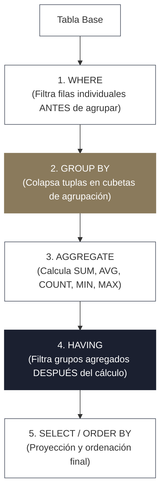
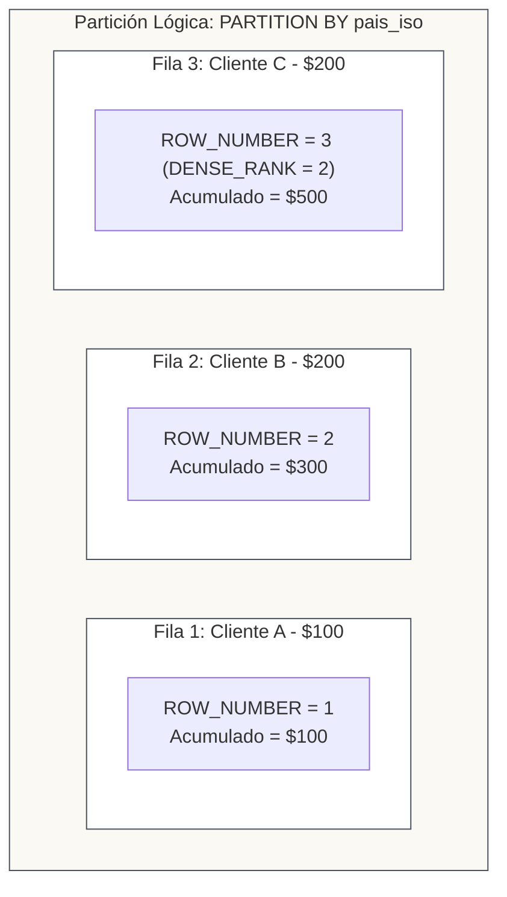

<!-- NOTAS FUENTE ORIGINALES DE OBSIDIAN: [[AGRUPACIONES DE DATOS Y FUNCIONES DE AGREGACION]] -->

# Capítulo 2: Agrupaciones Multidimensionales, Window Functions y Optimización [NÚCLEO EMPLEABILIDAD]

> *"Al agregar datos reducimos la cardinalidad de un conjunto, pero en sistemas analíticos y distribuidos desatamos una de las operaciones físicas más complejas: el reagrupamiento en memoria y el intercambio de particiones a través de la red (shuffle). Dominar las funciones analíticas de ventana y las extensiones multidimensionales es lo que distingue a un generador de consultas de un verdadero ingeniero de datos."*

---

## Objetivos de Aprendizaje
Al finalizar este capítulo, el lector será capaz de:
* Dominar la semántica de agregación con `GROUP BY` y diferenciar con precisión matemática los alcances de `WHERE` frente a `HAVING`.
* Implementar agregaciones multidimensionales para capas analíticas utilizando `ROLLUP`, `CUBE` y `GROUPING SETS`.
* Realizar transformaciones de rotación tabular mediante operadores `PIVOT` y `UNPIVOT`.
* Explicar y aplicar la anatomía completa de las **Window Functions** (*Funciones de Ventana*): cláusulas `PARTITION BY`, `ORDER BY` y especificación de marcos (`ROWS` frente a `RANGE BETWEEN`).
* Utilizar con solvencia funciones de ranking (`ROW_NUMBER`, `RANK`, `DENSE_RANK`, `NTILE`) y de desplazamiento (`LAG`, `LEAD`).
* Resolver problemas críticos de ingeniería como deduplicación por versión más reciente (*latest record*) y cálculo de métricas acumulativas continuas.
* Inspeccionar planes de ejecución con `EXPLAIN` para identificar operadores de agregación física (*HashAggregate* frente a *SortAggregate*).

---

> **Definición 2.1 (La Mecánica del Marco de Ventana)**
> A diferencia de una agregación clásica con `GROUP BY` —la cual colapsa múltiples filas en una sola tupla de resumen perdiendo la identidad individual del registro—, una **Window Function** (*Función de Ventana*) calcula un valor analítico sobre un subconjunto de filas relacionadas (*el marco o ventana*), **preservando intacta cada fila individual en la salida**.
> 
> Esta propiedad permite yuxtaponer métricas agregadas (totales acumulados, promedios móviles, rankings) junto con los atributos atómicos de cada tupla sin requerir auto-uniones (*self-joins*) costosas.

---

## 2.1 Agrupaciones Fundamentales y Filtrado: `WHERE` frente a `HAVING`

El procesamiento de una consulta relacional con agregación sigue un orden lógico estricto:



```sql
SELECT 
    pais_iso,
    categoria_id,
    COUNT(pedido_id) AS total_pedidos,
    SUM(monto_usd) AS facturacion_total,
    AVG(monto_usd) AS ticket_promedio
FROM ventas_analitica.pedidos
WHERE estado = 'ENTREGADO' -- Predicado de fila: se descartan pedidos no entregados ANTES del shuffle
GROUP BY pais_iso, categoria_id
HAVING SUM(monto_usd) >= 50000 -- Predicado de grupo: filtra agregaciones ya calculadas
ORDER BY facturacion_total DESC;
```

---

## 2.2 Extensiones Multidimensionales: `ROLLUP`, `CUBE` y `GROUPING SETS`

En el modelado analítico para inteligencia de negocios (BI), es habitual generar subtotales y totales generales en una sola pasada sobre los datos, evitando emitir múltiples consultas unidas con `UNION ALL`.

### 1. `GROUPING SETS`
Permite declarar explícitamente qué combinaciones de dimensiones deben ser agregadas:

```sql
SELECT 
    pais_iso,
    categoria_id,
    SUM(monto_usd) AS total_ventas
FROM ventas_analitica.pedidos
GROUP BY GROUPING SETS (
    (pais_iso, categoria_id), -- Subtotal por país y categoría
    (pais_iso),               -- Subtotal nacional
    ()                        -- Gran total global
);
```

### 2. `ROLLUP` (Jerarquía Piramidal)
Calcula agregaciones en forma jerárquica de izquierda a derecha. Si agrupamos por `(anio, mes, dia)`, `ROLLUP` produce:
* `(anio, mes, dia)`
* `(anio, mes)`
* `(anio)`
* `()` (Total general)

```sql
SELECT anio, mes, SUM(monto_usd) AS total_ventas
FROM ventas_analitica.fact_ventas_diarias
GROUP BY ROLLUP (anio, mes);
```

### 3. `CUBE` (Todas las Combinaciones Posibles)
Calcula todas las combinaciones $2^N$ posibles de las $N$ dimensiones especificadas. Para `CUBE(pais, canal)` genera: `(pais, canal)`, `(pais)`, `(canal)` y `()`.

---

## 2.3 Rotación Tabular: `PIVOT` y `UNPIVOT`

* **`PIVOT`**: Rota valores de una columna en filas para convertirlos en múltiples columnas (útil para generar matrices analíticas comparativas).
* **`UNPIVOT`**: Convierte columnas en filas (normalización de datos).

```sql
-- Rotación PIVOT en SQL (DuckDB / Databricks / Snowflake)
SELECT * 
FROM (
    SELECT anio, trimestre, monto_usd
    FROM ventas_analitica.ventas_trimestrales
)
PIVOT (
    SUM(monto_usd)
    FOR trimestre IN ('Q1' AS ventas_q1, 'Q2' AS ventas_q2, 'Q3' AS ventas_q3, 'Q4' AS ventas_q4)
)
ORDER BY anio DESC;
```

---

## 2.4 Anatomía Completa de las Window Functions

Una función de ventana evalúa una expresión sobre una partición lógica sin comprimir las filas:

$$\text{FUNCIÓN}(\text{expr}) \quad \mathbf{OVER} \quad \Big( \mathbf{PARTITION\ BY} \ \text{claves} \quad \mathbf{ORDER\ BY} \ \text{orden} \quad [\mathbf{MARCO\ DE\ FILAS}] \Big)$$



### 1. Funciones de Ranking
Comparativa entre las principales funciones de jerarquía sobre un conjunto con empates en el salario:

| Salario | `ROW_NUMBER()` | `RANK()` | `DENSE_RANK()` | `NTILE(2)` |
| :---: | :---: | :---: | :---: | :---: |
| $10.000 | 1 | 1 | 1 | 1 |
| $8.000 | 2 | 2 | 2 | 1 |
| $8.000 | 3 | 2 *(empate)* | 2 *(empate)* | 2 |
| $6.000 | 4 | 4 *(salta el 3)* | 3 *(sin salto)* | 2 |

* **`ROW_NUMBER()`**: Asigna un entero secuencial estrictamente único ($1, 2, 3, 4$). Si hay empates, el orden de desempate es arbitrario salvo que se agregue una clave secundaria en el `ORDER BY`.
* **`RANK()`**: Asigna el mismo rango ante valores idénticos, pero **salta** posiciones en el siguiente valor ($1, 2, 2, 4$).
* **`DENSE_RANK()`**: Asigna el mismo rango ante empates y **continúa de forma contigua sin huecos** ($1, 2, 2, 3$).
* **`NTILE(n)`**: Divide la partición en $n$ cubetas casi iguales y asigna el número de cubeta ($1$ a $n$), ideal para calcular cuartiles o deciles.

### 2. Funciones de Desplazamiento y Acceso a Fila (`LAG`, `LEAD`)
Permiten comparar una fila con su predecesora o sucesora sin auto-uniones:

```sql
SELECT 
    cliente_id,
    fecha_pedido,
    monto_usd,
    -- Valor de la compra inmediatamente anterior
    LAG(monto_usd, 1, 0.0) OVER (
        PARTITION BY cliente_id 
        ORDER BY fecha_pedido ASC
    ) AS monto_compra_previa,
    -- Días transcurridos desde la compra anterior
    CAST(fecha_pedido AS DATE) - LAG(CAST(fecha_pedido AS DATE), 1) OVER (
        PARTITION BY cliente_id 
        ORDER BY fecha_pedido ASC
    ) AS dias_desde_ultima_compra,
    -- Valor de la siguiente compra
    LEAD(monto_usd, 1) OVER (
        PARTITION BY cliente_id 
        ORDER BY fecha_pedido ASC
    ) AS monto_compra_siguiente
FROM ventas_analitica.pedidos;
```

### 3. Marcos de Ventana Físicos (`ROWS`) frente a Lógicos (`RANGE`)
Al invocar agregaciones en ventana (`SUM()`, `AVG()`), el **marco de ventana** delimita qué tuplas entran en el cálculo:

* **Acumulado Histórico Completo:**
  ```sql
  SUM(monto_usd) OVER (
      PARTITION BY cliente_id 
      ORDER BY fecha_pedido ASC
      ROWS BETWEEN UNBOUNDED PRECEDING AND CURRENT ROW
  ) AS total_acumulado_hasta_la_fecha
  ```
* **Media Móvil de los Últimos 7 Días / 7 Eventos:**
  ```sql
  AVG(monto_usd) OVER (
      PARTITION BY tienda_id 
      ORDER BY fecha_venta ASC
      ROWS BETWEEN 6 PRECEDING AND CURRENT ROW
  ) AS media_movil_7_eventos
  ```

> **CUIDADO CRÍTICO: La Trampa de `RANGE BETWEEN` por Defecto**
> Cuando se incluye una cláusula `ORDER BY` sin especificar explícitamente el marco de filas, la norma SQL aplica por defecto:
> `RANGE BETWEEN UNBOUNDED PRECEDING AND CURRENT ROW`
> `RANGE` evalúa duplicados de orden de forma conjunta: si existen tres transacciones con la misma marca de tiempo idéntica, el acumulado sumará las tres transacciones de golpe en las tres filas, en lugar de acumular fila a fila. **En producción especifique siempre `ROWS BETWEEN` para garantizar determinismo y menor sobrecosto de cálculo**.

---

## 2.5 Deduplicación Analítica: `ROW_NUMBER` frente a `dropDuplicates`

Uno de los requerimientos más recurrentes en pipelines Lakehouse es conservar únicamente la versión más reciente de un registro ante múltiples actualizaciones emitidas por sistemas CDC (*Change Data Capture*):

```sql
-- Patrón canónico de deduplicación analítica conservando el registro más reciente
WITH novedades_numeradas AS (
    SELECT 
        cliente_id,
        nombre,
        correo,
        direccion,
        fecha_actualizacion,
        ROW_NUMBER() OVER (
            PARTITION BY cliente_id 
            ORDER BY fecha_actualizacion DESC, transaccion_id DESC
        ) AS indice_version
    FROM staging.clientes_novedades
)
SELECT 
    cliente_id,
    nombre,
    correo,
    direccion,
    fecha_actualizacion
FROM novedades_numeradas
WHERE indice_version = 1;
```

* **Comparativa:** `DISTINCT` o `df.dropDuplicates(["cliente_id"])` descartan registros arbitrariamente si las filas difieren en otras columnas. `ROW_NUMBER()` con orden descendente por marca de tiempo garantiza de manera formal y determinista que solo se conserve el registro de mayor vigencia temporal.

---

## 2.6 Implementación en PySpark y Optimización Física con `EXPLAIN`

En PySpark, la API de ventanas se implementa mediante la clase `Window` del módulo `pyspark.sql.window`:

```python
from pyspark.sql import SparkSession
from pyspark.sql import functions as F
from pyspark.sql.window import Window

spark = SparkSession.builder \
    .appName("Capitulo02-WindowFunctions") \
    .master("local[*]") \
    .getOrCreate()

df_pedidos = spark.read.parquet("data/ventas.parquet")

# 1. Definición de especificación de ventana
ventana_cliente = Window \
    .partitionBy("cliente_id") \
    .orderBy(F.col("fecha_transaccion").asc()) \
    .rowsBetween(Window.unboundedPreceding, Window.currentRow)

# 2. Aplicación de agregación acumulada y ranking
df_analitico = df_pedidos.withColumn(
    "gasto_acumulado",
    F.sum("monto_usd").over(ventana_cliente)
).withColumn(
    "numero_compra",
    F.row_number().over(
        Window.partitionBy("cliente_id").orderBy(F.col("fecha_transaccion").asc())
    )
)

# 3. Inspección del plan físico con EXPLAIN
df_analitico.explain(True)
```

### Interpretación del Plan Físico
Al ejecutar `explain()`, observe cómo Catalyst organiza los operadores físicos:
1. **`Exchange hashpartitioning(cliente_id)`**: Realiza el shuffle de red para enviar todas las filas de un mismo `cliente_id` al mismo ejecutor.
2. **`Sort [cliente_id ASC, fecha_transaccion ASC]`**: Ordena las particiones locales en memoria.
3. **`Window [sum(...) ... row_number(...)]`**: El operador físico de ventana procesa secuencialmente el flujo de datos ordenado en memoria sin necesidad de reconstruir estructuras hash adicionales.

---

## 2.7 Criterios de Fiabilidad y Anti-Patrones en Producción

**Anti-patrón 1: Ventana Global sin `PARTITION BY` sobre Grandes Volúmenes**  
Declarar `Window.orderBy("monto_usd")` omitiendo el `partitionBy()` fuerza a Spark a enviar **la totalidad de las filas del dataset a un único nodo ejecutor**. Esto satura la memoria del ejecutor, desencadena fallos catastróficos por *OutOfMemory* (OOM) y destruye el paralelismo del clúster.

**Anti-patrón 2: Confundir `COUNT(*)` con `COUNT(columna)` ante Valores `NULL`**  
`COUNT(*)` cuenta el número absoluto de filas de un grupo o ventana, independientemente de su contenido. `COUNT(columna)` cuenta únicamente las tuplas donde dicha columna no es `NULL`. En métricas financieras o de calidad, este descuido altera los promedios e indicadores.

---

## Preguntas de Revisión y Ejercicios Prácticos
**Ejercicio 2.1 (Detección de Transacciones Sospechosas por Desviación de Media Móvil):**  
En una tabla de eventos financieros `transacciones(id, cuenta_id, monto, timestamp)`, escriba una consulta SQL que calcule:
1. La media móvil del monto de las últimas 5 transacciones de la cuenta (las 4 anteriores y la actual).
2. La diferencia entre el monto actual y dicha media móvil.

**Solución 2.1:**
```sql
SELECT 
    id,
    cuenta_id,
    monto,
    timestamp,
    AVG(monto) OVER (
        PARTITION BY cuenta_id
        ORDER BY timestamp ASC
        ROWS BETWEEN 4 PRECEDING AND CURRENT ROW
    ) AS media_movil_ultimas_5,
    monto - AVG(monto) OVER (
        PARTITION BY cuenta_id
        ORDER BY timestamp ASC
        ROWS BETWEEN 4 PRECEDING AND CURRENT ROW
    ) AS desviacion_respecto_media
FROM transacciones;
```

---

**Ejercicio 2.2 (Cálculo de Tasa de Retención con `LAG`):**  
Se tiene un histórico de suscripciones `pagos(pago_id, usuario_id, fecha_pago, monto)`. Escriba una consulta analítica que etiquete como `'REACTIVADO'` a cualquier usuario cuya compra actual se haya realizado más de 60 días después de su compra previa.

**Solución 2.2:**
```sql
WITH compras_previas AS (
    SELECT 
        pago_id,
        usuario_id,
        fecha_pago,
        LAG(fecha_pago) OVER (
            PARTITION BY usuario_id 
            ORDER BY fecha_pago ASC
        ) AS fecha_pago_anterior
    FROM pagos
)
SELECT 
    pago_id,
    usuario_id,
    fecha_pago,
    fecha_pago_anterior,
    CASE 
        WHEN fecha_pago_anterior IS NULL THEN 'CLIENTE NUEVO'
        WHEN CAST(fecha_pago AS DATE) - CAST(fecha_pago_anterior AS DATE) > 60 THEN 'REACTIVADO'
        ELSE 'RECURRENTE'
    END AS estado_ciclo_vida
FROM compras_previas;
```

---

## 2.8 Resumen y Puntos Clave

* **Preservación de tuplas:** Las funciones de ventana computan métricas agregadas y analíticas preservando intacta la granularidad individual de cada fila.
* **Marcos deterministas:** Utilice siempre `ROWS BETWEEN` en lugar del valor implícito `RANGE BETWEEN` para evitar comportamientos anómalos ante marcas de tiempo duplicadas.
* **Jerarquías con `DENSE_RANK` y `ROW_NUMBER`:** `ROW_NUMBER` es la herramienta matemática por excelencia para deduplicación por registro más reciente, mientras que `DENSE_RANK` evita saltos en listas de mejores puntuaciones.
* **Particionado responsable:** Toda ventana en entornos distribuidos debe incluir una clave lógica de `PARTITION BY` para evitar la serialización de todo el dataset en un único ejecutor.
* **Optimización con `EXPLAIN`:** Verificar los operadores físicos de intercambio y ordenamiento (*Exchange* y *Sort*) permite diagnosticar si el plan de consulta incurre en shuffles innecesarios.

---

## Lecturas Recomendadas
1. **Date, C. J. (2019).** *SQL and Relational Theory: How to Write Accurate SQL Code (Chapter 8: Window Functions and Relational Algebra).* O'Reilly Media.
2. **Armbrust, M. et al. (2015).** *Spark SQL: Relational Data Processing in Spark.* ACM SIGMOD.
3. **PostgreSQL Global Development Group (2024).** *PostgreSQL Documentation: Window Function Processing and Syntax.*
