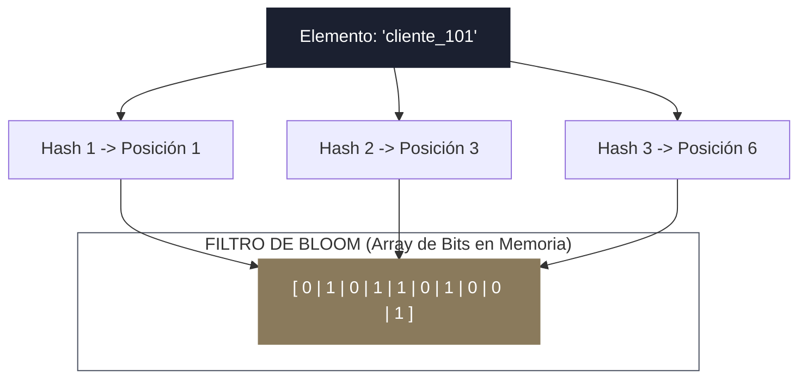
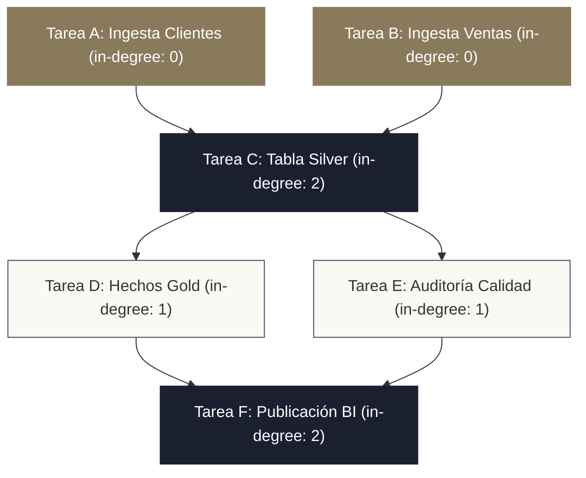
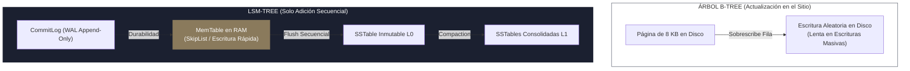

<!-- NOTAS FUENTE ORIGINALES DE OBSIDIAN: [[Algorithms]], [[Data Structures]], [[Bloom Filters]], [[LSM Trees]], [[Topological Sort]] -->

# Capítulo 2B: Algoritmos y Estructuras de Datos Esenciales para Data Engineers [RECOMENDADO]

> *"Un técnico memoriza la sintaxis de las herramientas de moda; un ingeniero de datos comprende los algoritmos y estructuras de datos fundamentales que gobiernan el comportamiento de la memoria, el disco y la red. Comprender la complejidad asintótica Big-O, los filtros probabilísticos de Bloom, el ordenamiento topológico en grafos DAG y la arquitectura de los árboles LSM-Tree es lo que permite diagnosticar por qué un pipeline colapsa y diseñar sistemas capaces de procesar petabytes con latencia predecible."*

---

## Objetivos de Aprendizaje
Al finalizar este capítulo, el lector será capaz de:
* Analizar la complejidad temporal y espacial mediante la **notación asintótica Big-O**, prediciendo el comportamiento de transformaciones masivas de datos.
* Explicar el funcionamiento matemático de las **estructuras de datos probabilísticas**: Filtros de Bloom (*Bloom Filters*), HyperLogLog y Count-Min Sketch.
* Implementar y comprender el **Algoritmo de Ordenamiento Topológico** (*Kahn's Algorithm*) que subyace a planificadores de DAGs en Apache Airflow, dbt y Spark Catalyst.
* Contrastar la arquitectura de actualización en el sitio de los **árboles B-Tree** frente a la estructura secuencial de solo adición de los **árboles LSM-Tree** (*Log-Structured Merge-Trees*).
* Diseñar pipelines analíticos evitando trampas algorítmicas de complejidad cuadrática $O(N^2)$ en uniones y agregaciones.

---

> **Definición 2B.1 (Complejidad Asintótica y Escalabilidad)**
> La **notación Big-O** describe el límite superior del consumo de recursos (tiempo de procesamiento de CPU o espacio en memoria RAM/disco) a medida que el tamaño de entrada $N$ tiende a infinito ($N \to \infty$).
> 
> En la ingeniería de datos, un algoritmo con complejidad $O(N)$ o $O(N \log N)$ escala linealmente con el crecimiento del negocio; un algoritmo con complejidad $O(N^2)$ (como un producto cartesiano inadvertido o una subconsulta correlacionada mal optimizada) se vuelve computacionalmente inviable en cuanto el dataset supera unos pocos miles de registros.

---

## 2B.1 Notación Asintótica Big-O en Sistemas de Datos

En el análisis de pipelines, clasificar el costo de cada operación previene cuellos de botella catastróficos:


| Complejidad | Ejemplo en Ingeniería de Datos | Comportamiento con $10^6$ registros |
| :--- | :--- | :--- |
| **$O(1)$ — Constante** | Búsqueda por clave primaria en Redis o diccionario en memoria. | $1$ operación (~0.1 ms). |
| **$O(\log N)$ — Logarítmico** | Búsqueda por clave indexada en un árbol B-Tree de PostgreSQL. | $\approx 20$ comparaciones de nodos en disco. |
| **$O(N)$ — Lineal** | Escaneo secuencial (*Seq Scan*), filtrado con `WHERE` en Parquet. | $1.000.000$ de filas procesadas (segundos). |
| **$O(N \log N)$ — Cuasilineal** | Shuffling, ordenamiento distribuido con `ORDER BY`, *Sort-Merge Join*. | $\approx 20.000.000$ de operaciones (minutos). |
| **$O(N^2)$ — Cuadrático** | `CROSS JOIN` accidental entre tablas o auto-uniones sin filtro. | **$10^{12}$ operaciones (colapso de clúster por OOM)**. |

---

## 2B.2 Estructuras de Datos Probabilísticas

Cuando el volumen de datos alcanza los terabytes, las estructuras de datos deterministas tradicionales consumen demasiada memoria RAM. Los sistemas modernos adoptan algoritmos probabilísticos que sacrifican una precisión despreciable a cambio de reducciones masivas de memoria:

### 1. Filtros de Bloom (Bloom Filters)
Un Filtro de Bloom es un vector de $m$ bits inicializado en ceros, acompañado de $k$ funciones hash independientes:
* **Inserción de un elemento:** Se calculan las $k$ funciones hash sobre el elemento y se activan los bits correspondientes fijándolos en $1$.
* **Consulta de pertenencia:** Se calculan las $k$ funciones hash sobre el elemento buscado y se inspeccionan los bits resultantes.



> **PROPIEDAD MATEMÁTICA FUNDAMENTAL DE LOS FILTROS DE BLOOM:**
> * Si el filtro responde **NO**: Con certeza absoluta matemática el elemento **NO existe** en el conjunto (*Cero falsos negativos*).
> * Si el filtro responde **SÍ**: El elemento **probablemente existe**, pero existe una pequeña probabilidad medible de un **falso positivo** debido a colisiones en los bits.

#### Aplicación en Spark y Parquet:
Apache Parquet y Apache Spark utilizan filtros de Bloom integrados en los footers de los archivos. Al ejecutar un join o un filtro `WHERE id = 'XYZ'`, el ejecutor evalúa el filtro de Bloom en memoria: si devuelve "NO", **Spark descarta el archivo Parquet entero sin leer un solo bloque de datos del disco o S3** (*Bloom Filter Data Skipping*).

### 2. HyperLogLog (HLL)
Permite estimar el número de elementos únicos (*Count Distinct*) en flujos de datos de miles de millones de eventos utilizando únicamente **12 KB de memoria fija**, aprovechando la distribución estadística de ceros a la izquierda en representaciones hash de los datos.

### 3. Count-Min Sketch
Una matriz de frecuencias sub-lineal que estima el número de apariciones de eventos en tiempo real, fundamental para detectar usuarios fraudulentos (*Heavy Hitters*) o ataques de denegación de servicio en streaming continuo.

---

## 2B.3 Grafos Dirigidos Acíclicos (DAG) y Ordenamiento Topológico

En la ingeniería de datos, los flujos de transformación no son secuencias lineales simples: son **Grafos Dirigidos Acíclicos** (**DAG**):
* **Dirigido:** Cada dependencia tiene un sentido temporal unívoco (la Tarea A debe ejecutarse antes que la Tarea B).
* **Acíclico:** Es imposible que la Tarea A dependa de B y que B dependa de A (ausencia de bucles infinitos).

Los orquestadores de datos (Apache Airflow, dbt y el compilador Catalyst de Spark) deben resolver una pregunta fundamental: **¿En qué orden exacto deben ejecutarse las tareas para maximizar el paralelismo sin violar dependencias?**



### El Algoritmo de Kahn para Ordenamiento Topológico (*Topological Sort*)
El algoritmo resuelve el orden de ejecución en tiempo $O(V + E)$ (donde $V$ es el número de tareas y $E$ el número de dependencias):

```python
from collections import deque, defaultdict
from typing import Dict, List

def resolver_ordenamiento_topologico(grafo_dependencias: Dict[str, List[str]]) -> List[str]:
    # 1. Calcular el grado de entrada (in-degree) de cada nodo
    grados_entrada = {nodo: 0 for nodo in grafo_dependencias}
    for nodo, vecinos in grafo_dependencias.items():
        for vecino in vecinos:
            grados_entrada[vecino] += 1

    # 2. Cola con nodos que tienen in-degree == 0 (listos para ejecución inmediata)
    cola_ejecucion = deque([nodo for nodo, grado in grados_entrada.items() if grado == 0])
    orden_final = []

    while cola_ejecucion:
        nodo_actual = cola_ejecucion.popleft()
        orden_final.append(nodo_actual)

        # Reducir in-degree de sus dependientes
        for dependiente in grafo_dependencias.get(nodo_actual, []):
            grados_entrada[dependiente] -= 1
            if grados_entrada[dependiente] == 0:
                cola_ejecucion.append(dependiente)

    # 3. Detección formal de ciclos
    if len(orden_final) != len(grafo_dependencias):
        raise ValueError("Error de Arquitectura: Se detectó una dependencia circular cíclica en el pipeline.")

    return orden_final

# Demostración práctica
pipeline_dbt = {
    "stg_clientes": ["int_clientes"],
    "stg_pedidos": ["int_pedidos"],
    "int_clientes": ["fact_ventas"],
    "int_pedidos": ["fact_ventas"],
    "fact_ventas": []
}

secuencia = resolver_ordenamiento_topologico(pipeline_dbt)
print("Orden Topológico de Ejecución:", secuencia)
```

---

## 2B.4 Motores de Almacenamiento: B-Trees frente a LSM-Trees

La elección de una base de datos analítica o transaccional depende de cómo su motor interno persiste los datos en disco:



### 1. Árboles B-Tree (Optimización para Lectura / OLTP)
* Modifican las páginas en el sitio (*In-Place Updates*).
* Sobrescritura aleatoria en disco: excelente para lecturas puntuales por clave en milisegundos, pero pésimo para flujos continuos de escritura masiva debido a fragmentación de páginas (*Page Splits*) y bloqueos.

### 2. Árboles LSM-Tree (Optimización para Escritura / Big Data)
Motores como **Apache Cassandra**, **RocksDB** (usado por Spark Streaming y Kafka Streams), **Google Bigtable** y el protocolo de logs transaccionales de **Delta Lake** utilizan **Árboles Estructurados por Mezcla de Logs (*Log-Structured Merge-Trees*)**:
1. **MemTable:** Toda nueva escritura se aloja en una estructura ordenada en memoria RAM (típicamente una *SkipList* o *Red-Black Tree*), registrándose en paralelo en un *CommitLog* secuencial para durabilidad.
2. **SSTables (*Sorted String Tables*):** Cuando la MemTable se llena, se vuelca al disco como un archivo inmutable ordenado por clave. **Las escrituras son 100% secuenciales**, alcanzando el máximo throughput físico del almacenamiento.
3. **Compactación en Segundo Plano (*Compaction*):** Un proceso asíncrono toma múltiples SSTables, fusiona las claves repetidas conservando el valor más reciente y elimina registros marcados con borrado lógico (*Tombstones*), reorganizando los archivos en niveles (*Leveled Compaction*).

---

## 2B.5 Criterios de Fiabilidad y Anti-Patrones en Producción

**Anti-patrón 1: Filtrado en Memoria con Colecciones de Búsqueda Lineal $O(N)$**  
Al realizar deduplicación o exclusión en Python dentro de una función UDF de datos, verificar si un elemento existe en una lista simple (`if x in lista_elementos:`) impone una complejidad de $O(N)$ por cada fila evaluada, elevando el costo de un dataset de 1 millón de registros a un trillón de comprobaciones ($O(N^2)$).  
*Corrección:* Convierta la colección de búsqueda a un conjunto (`set()`) o diccionario (`dict()`) basado en tablas hash con búsqueda en tiempo constante **$O(1)$**.

**Anti-patrón 2: Ignorar Ciclos en Grafos de Dependencia de Tareas**  
Permitir que dos modelos de dbt o dos tareas de Airflow dependan mutuamente de forma indirecta provoca que el planificador se bloquee indefinidamente en un interbloqueo (*deadlock*).  
*Corrección:* Valide la aciclicidad del grafo durante el pipeline de CI/CD ejecutando el algoritmo de Kahn sobre el manifiesto de dependencias.

---

## Preguntas de Revisión y Ejercicios Prácticos
**Ejercicio 2B.1 (Cálculo de Tasa de Falsos Positivos en Filtros de Bloom):**  
Un ingeniero de datos desea indexar 1.000.000 de clientes únicos en un Filtro de Bloom para descartar lecturas innecesarias en un clúster de Spark. Dispone de un array de bits de $m = 10.000.000$ bits (aproximadamente 1.2 MB de RAM) y utiliza $k = 7$ funciones hash independientes.  
La fórmula matemática aproximada para la tasa de falsos positivos $p$ es:
$$p \approx \left( 1 - e^{-k \cdot n / m} \right)^k$$
Calcule la probabilidad de que una consulta reciba un falso positivo.

**Solución 2B.1:**
1. Razón de bits por elemento:
   $$\frac{n}{m} = \frac{1.000.000}{10.000.000} = 0.1$$
2. Evaluación del exponente:
   $$-k \cdot \frac{n}{m} = -7 \cdot 0.1 = -0.7$$
3. Cálculo de la potencia exponencial:
   $$e^{-0.7} \approx 0.496585$$
4. Sustitución en la fórmula de probabilidad:
   $$1 - e^{-0.7} = 1 - 0.496585 = 0.503415$$
   $$p \approx (0.503415)^7 \approx 0.00819 \quad (\mathbf{0.82\%})$$
* **Conclusión Técnica:** Con solo **1.2 Megabytes de memoria RAM**, el clúster puede descartar con una precisión de acierto del **99.18%** si un cliente no está en el archivo Parquet, reduciendo drásticamente las lecturas a disco y la saturación de I/O.

---

## 2B.6 Resumen y Puntos Clave

* **Complejidad Big-O:** Dicta la viabilidad matemática de los pipelines; las operaciones deben mantenerse dentro de complejidades $O(1)$, $O(N)$ o $O(N \log N)$.
* **Filtros de Bloom:** Ofrecen pruebas de pertenencia ultrarrápidas con cero falsos negativos, permitiendo poda masiva de datos en Parquet y Spark (*Data Skipping*).
* **Ordenamiento Topológico:** El algoritmo de Kahn permite a orquestadores de DAG (Airflow, dbt) resolver el orden óptimo de ejecución paralela libre de dependencias cíclicas.
* **LSM-Trees vs. B-Trees:** Los árboles B-Tree optimizan lecturas puntuales en disco mediante actualizaciones locales; los árboles LSM-Tree maximizan el rendimiento de escritura masiva mediante registros secuenciales inmutables en disco (SSTables) y compactación.

---

## Lecturas Recomendadas
1. **Cormen, T. H., Leiserson, C. E., Rivest, R. L. & Stein, C. (2022).** *Introduction to Algorithms (4th Edition).* The MIT Press.
2. **Kleppmann, M. (2017).** *Designing Data-Intensive Applications (Chapter 3: Storage and Retrieval: Hash Indexes, SSTables and LSM-Trees).* O'Reilly Media.
3. **Bloom, B. H. (1970).** *Space/Time Trade-offs in Hash Coding with Allowable Errors.* Communications of the ACM.
