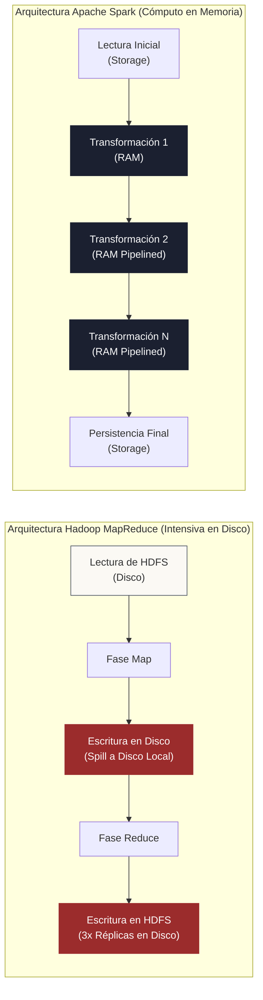

<!-- NOTAS FUENTE ORIGINALES DE OBSIDIAN: [[Hadoop]], [[MapReduce]], [[Spark]], [[Apache Spark]] -->

# Capítulo 3: De Hadoop y MapReduce al Cómputo en Memoria [NÚCLEO EMPLEABILIDAD]

> *"Antes de Spark existía Hadoop, que introdujo el paradigma de MapReduce para procesar grandes volúmenes de datos en clústeres. El problema fundamental era que procesaba en disco: cada etapa leía y grababa constantemente, lo que hacía todo lento y costoso. Spark revolucionó la industria llevando el cómputo directamente a la memoria RAM."*

---

## Objetivos de Aprendizaje
Al finalizar este capítulo, el lector será capaz de:
* Analizar la arquitectura fundacional de Apache Hadoop (HDFS, MapReduce, YARN) y sus limitaciones de E/S.
* Entender la transición del procesamiento por lotes centrado en disco hacia la computación distribuida en memoria (*in-memory computation*).
* Describir cómo Apache Spark logra órdenes de magnitud de mayor rendimiento en algoritmos iterativos y analítica interactiva.
* Evaluar cuándo utilizar procesamiento por lotes tradicional y cuándo adoptar motores de memoria de baja latencia.

---

> **Definición 3.1 (Escribir en la Pizarra vs. Grabar en Tablas de Piedra)**
> Imagina un equipo de matemáticos resolviendo un problema complejo de 20 ecuaciones sucesivas.
> 
> El enfoque de Hadoop MapReduce es como obligar a los matemáticos a tallar el resultado de cada ecuación en una pesada tabla de piedra (disco HDFS), guardarla en la bodega y luego sacarla para la siguiente ecuación. Tallar la piedra toma el 95% del tiempo total.
> 
> El enfoque de Apache Spark es dotar a cada matemático de una pizarra acrílica (memoria RAM): calculan de inmediato, encadenan las operaciones sin soltar el marcador y solo tallan en piedra el resultado final de la ecuación 20 cuando el trabajo está terminado.

---

## 3.1 El Paradigma Fundacional: Hadoop y MapReduce

A principios de la década de 2000, el volumen de datos de la web superó la capacidad de las bases de datos relacionales tradicionales y los sistemas multiprocesador de memoria compartida (*SMP*). En respuesta, Google publicó sus artículos seminales sobre *Google File System* (GFS) y *MapReduce*, sentando las bases de lo que se convertiría en **Apache Hadoop**, desarrollado por Doug Cutting y Mike Cafarella.

Hadoop democratizó el análisis de Big Data permitiendo a las organizaciones procesar petabytes en clústeres de servidores comerciales de bajo costo (*commodity hardware*), apoyándose en tres pilares:

1. **HDFS (Hadoop Distributed File System):** Sistema de archivos distribuido que divide archivos masivos en bloques (típicamente 128 MB) y los replica en múltiples nodos del clúster para tolerancia a fallos.
2. **YARN (Yet Another Resource Negotiator):** Capa de gestión de infraestructura que orquesta CPU y memoria entre aplicaciones concurrentes.
3. **MapReduce:** Modelo de programación funcional dividido en dos primitivas esenciales:
   * **Map:** Transforma y proyecta registros locales sin dependencias externas.
   * **Reduce:** Agrupa y sintetiza los valores intermedios tras una fase obligatoria de shuffle.



---


## 3.2 Profundización Técnica: El Cuello de Botella de E/S y la Revolución de Spark


El talón de Aquiles de MapReduce es la **persistencia obligatoria entre fases**. Si un pipeline analítico requería encadenar 5 trabajos consecutivos de MapReduce (por ejemplo en algoritmos de machine learning iterativo o consultas complejas), el sistema debía escribir a HDFS y replicar tres veces por la red tras cada paso intermedio.


En 2009, en el laboratorio AMPLab de la Universidad de California en Berkeley, Matei Zaharia y su equipo diseñaron **Apache Spark** con una premisa revolucionaria: *retener las colecciones de datos en la memoria RAM distribuida entre operaciones sucesivas*.


Al evitar la lectura y escritura constante en disco, Spark alcanzó velocidades hasta **100 veces superiores en memoria** y 10 veces superiores en disco frente a MapReduce, además de introducir el concepto de **DAG** para ejecutar operaciones en cadena sin serializaciones innecesarias.


---

> **Consideraciones de Producción 3.1: Cómputo Iterativo en Memoria**
> El verdadero poder de la computación en memoria se evidencia en algoritmos iterativos (como K-Means, Logistic Regression o PageRank), donde los datos se leen una sola vez y se reutilizan en memoria en cada ciclo.

```python
from pyspark.sql import SparkSession
from pyspark.sql.functions import col

spark = SparkSession.builder \
    .appName("Capitulo03-Hadoop-vs-Spark") \
    .master("local[*]") \
    .getOrCreate()

# Cargar dataset masivo una única vez
df_base = spark.read.parquet("data/interacciones.parquet")

# Persistir en la memoria RAM del clúster (In-memory computation)
# Esto replica el salto histórico frente a Hadoop: cero lecturas de disco posteriores
df_base.cache()

# Algoritmo iterativo: Múltiples pasadas sobre los mismos datos en memoria
for iteracion in range(3):
    umbral = iteracion * 10
    total_segmento = df_base.filter(col("score") > umbral).count()
    print(f"Iteración {iteracion + 1} completada en memoria RAM: {total_segmento} registros")

# Liberar memoria al finalizar el ciclo
df_base.unpersist()
```

---


## 3.3 Criterios de Fiabilidad y Anti-Patrones en Producción


**Anti-patrón 1: Creer que Hadoop está Muerto**

Un error conceptual común es afirmar que "Hadoop ya no existe". Si bien el motor de cómputo *MapReduce* ha sido reemplazado en la gran mayoría de casos por Spark, el sistema de archivos distribuido (HDFS) y el gestor de recursos (YARN) continúan siendo la columna vertebral de miles de clústeres on-premise corporativos.


**Anti-patrón 2: Cachear Datos sin Suficiente Capacidad de RAM**

Llamar a `df.cache()` indiscriminadamente sobre datasets que superan la memoria disponible del clúster provocará que Spark expulse particiones a disco (*Spill to Disk*) o genere pausas prolongadas del recolector de basura de Java (*Garbage Collection Overhead*).


---


## Preguntas de Revisión y Ejercicios Prácticos
**Ejercicio 3.1 (Comparativa Arquitectónica):**

Elabora una tabla comparativa entre Hadoop MapReduce y Apache Spark analizando: (1) Medio de almacenamiento intermedio, (2) Modelo de tolerancia a fallos, y (3) Soporte para procesamiento en streaming en tiempo real.

**Solución:**
<table style="width: 100%; border-collapse: collapse; margin-top: 8px;">
  <thead>
    <tr style="background-color: #1b2030; color: #ffffff;">
      <th style="padding: 8px; border: 1px solid #4a5160;">Criterio</th>
      <th style="padding: 8px; border: 1px solid #4a5160;">Hadoop MapReduce</th>
      <th style="padding: 8px; border: 1px solid #4a5160;">Apache Spark</th>
    </tr>
  </thead>
  <tbody>
    <tr>
      <td style="padding: 8px; border: 1px solid #ddd;">**Almacenamiento Intermedio**</td>
      <td style="padding: 8px; border: 1px solid #ddd;">Disco rígido (HDFS con triple réplica)</td>
      <td style="padding: 8px; border: 1px solid #ddd;">Memoria RAM distribuida (con spill a disco solo si se llena)</td>
    </tr>
    <tr>
      <td style="padding: 8px; border: 1px solid #ddd;">**Tolerancia a Fallos**</td>
      <td style="padding: 8px; border: 1px solid #ddd;">Replicación física de archivos en disco</td>
      <td style="padding: 8px; border: 1px solid #ddd;">Linaje lógico del DAG (reconstrucción de particiones perdidas)</td>
    </tr>
    <tr>
      <td style="padding: 8px; border: 1px solid #ddd;">**Streaming**</td>
      <td style="padding: 8px; border: 1px solid #ddd;">No soportado de forma nativa (solo batch)</td>
      <td style="padding: 8px; border: 1px solid #ddd;">Nativo mediante Spark Structured Streaming</td>
    </tr>
  </tbody>
</table>

---

## 3.4 Resumen y Puntos Clave

* **Hadoop abrió el camino:** Resolvió el almacenamiento masivo con HDFS y demostró que la computación distribuida en hardware comercial era viable.
* **El salto a la memoria:** Apache Spark eliminó el cuello de botella de E/S de disco, habilitando la analítica iterativa, pipelines en cadena y streaming en un único motor unificado.
* **Tolerancia a fallos sin replicación en disco:** A través del linaje de operaciones (DAG), Spark puede reconstruir datos perdidos sin pagar el costo de replicar cada paso intermedio en almacenamiento físico.

---

## Lecturas Recomendadas
1. **White, T. (2015).** *Hadoop: The Definitive Guide (4th Edition).* O'Reilly Media.
2. **Zaharia, M. et al. (2010).** *Spark: Cluster Computing with Working Sets.* HotCloud '10.
