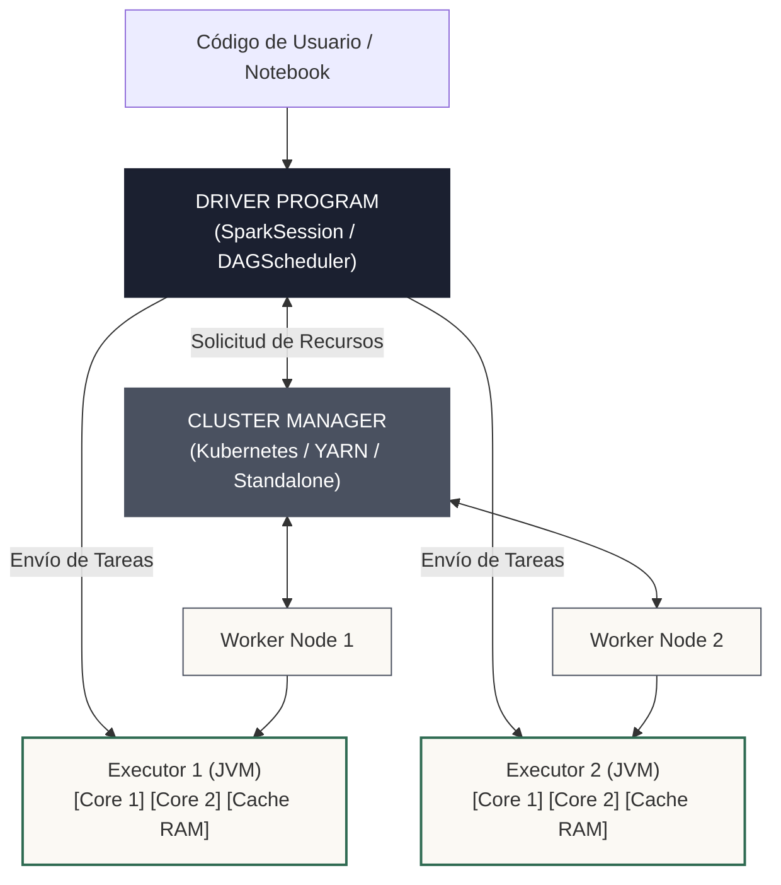

<!-- NOTAS FUENTE ORIGINALES DE OBSIDIAN: [[Cluster Computing]], [[Cluster Manager]], [[Driver Program]], [[Worker Node]], [[Ejecutores]], [[Ejecutor]] -->

# Capítulo 4: Arquitectura de Clúster: Driver, Workers y Ejecutores [NÚCLEO EMPLEABILIDAD]

> *"Un clúster de Spark no es una máquina gigante, sino una orquesta coordinada: el Driver es el director que interpreta la partitura; el Cluster Manager es el administrador del teatro que asigna las sillas; y los Ejecutores son los músicos que tocan en paralelo en cada nodo trabajador."*

---

## Objetivos de Aprendizaje
Al finalizar este capítulo, el lector será capaz de:
* Comprender la topología física y lógica de un clúster de computación distribuida.
* Identificar las responsabilidades exclusivas del **Driver Program** frente a los **Worker Nodes**.
* Comparar los diferentes administradores de clúster soportados por Spark: Standalone, Apache YARN y Kubernetes.
* Analizar el ciclo de vida y la configuración interna de la JVM de los **Ejecutores** (*Executors*).

---

> **Definición 4.1 (La Flota de Transporte y la Torre de Control)**
> Imagina una mega-empresa de mudanzas encargada de trasladar un rascacielos entero:
>
> * El **Driver Program** es el jefe de operaciones en la torre de control: revisa el inventario, descompone la mudanza en tareas pequeñas y supervisa el avance general.
> * El **Cluster Manager** es la agencia de alquiler de vehículos: el jefe le pide 20 camiones con 4 operarios cada uno, y la agencia los despacha según disponibilidad.
> * Los **Worker Nodes** son los estacionamientos físicos donde se encuentran los camiones.
> * Los **Ejecutores** (*Executors*) son los camiones con sus operarios: cargan las cajas asignadas (particiones de datos), suben los muebles al ascensor (tareas de cómputo) y reportan a la torre cuando finalizan.

---

## 4.1 La Anatomía de un Clúster de Spark

En la ingeniería de datos a escala petabyte, ninguna máquina individual dispone de suficiente memoria RAM o capacidad de CPU para almacenar y procesar la información. El **Cluster Computing** interconecta un conjunto de servidores independientes para que operen como un sistema unificado y tolerante a fallos.

La arquitectura de una aplicación Spark se basa en el patrón maestro/esclavo (*master/worker*):

1. **Driver Program (El Cerebro):**
   * Es el proceso que ejecuta la función `main()` del programa del usuario.
   * Crea y administra la sesión de Spark (`SparkSession` / `SparkContext`).
   * Convierte el código del usuario en un grafo lógico y físico (DAG).
   * Programa y distribuye las tareas individuales (*Tasks*) a través del planificador de tareas (*Task Scheduler*).
   * Recopila los resultados de las acciones de agregación final.
2. **Cluster Manager (El Asignador de Recursos):**
   * Servicio de infraestructura pluggable que adquiere y libera recursos del clúster físico.
   * Spark soporta los siguientes modos principales:
     * **Standalone:** Gestor nativo simple incluido en Spark.
     * **Apache YARN:** Gestor corporativo tradicional en entornos Hadoop.
     * **Kubernetes (K8s):** El estándar moderno de la industria cloud-native basado en contenedores.
     * **Mesos (obsoleto):** su soporte fue declarado obsoleto en Spark 3.2 y eliminado en Spark 4.0; no debe usarse en proyectos nuevos.
3. **Worker Nodes (La Infraestructura Física):**
   * Servidores o instancias de cómputo que ejecutan los procesos esclavos asignados por el Cluster Manager.
4. **Ejecutores (Executors - La Fuerza de Trabajo):**
   * Procesos JVM (*Java Virtual Machine*) que residen dentro de los Worker Nodes.
   * Cada ejecutor tiene asignada una cantidad fija de memoria RAM y núcleos de CPU (*cores*).
   * Ejecutan las tareas asignadas por el Driver y almacenan en memoria/disco los datos cacheados del DataFrame.



---


## 4.2 Profundización Técnica: Ciclo de Vida y Asignación de Recursos


Los ejecutores existen **exclusivamente durante el ciclo de vida de la aplicación Spark** que los solicitó:

1. **Aislamiento estricto:** Cada aplicación dispone de sus propios procesos ejecutores. Dos aplicaciones concurrentes en el mismo clúster no comparten espacio de memoria JVM, lo que garantiza seguridad y previene corrupciones cruzadas.

2. **Asignación Dinámica (Dynamic Allocation):** Mediante `spark.dynamicAllocation.enabled = true`, Spark solicita ejecutores adicionales cuando la cola de tareas crece y los devuelve al Cluster Manager cuando el clúster entra en inactividad, optimizando costos en la nube.

3. **Tolerancia a fallos de ejecutores:** Si un Worker Node se apaga o un ejecutor falla por un error del kernel, el Cluster Manager lanza inmediatamente un nuevo ejecutor en otro nodo. El Driver reasigna las tareas pendientes y reconstruye las particiones perdidas a través del linaje del DAG.


---

> **Consideraciones de Producción 4.1: Inspección de Ejecutores Activos**
> PySpark **no** expone la lista de ejecutores en `statusTracker()` (ese método existe solo en la API de Scala/Java). La vía soportada para auditar ejecutores, memoria y núcleos es la **REST API de monitoreo** que el Driver publica junto a la Spark UI.

```python
import requests
from pyspark.sql import SparkSession

spark = SparkSession.builder \
    .appName("Capitulo04-ArquitecturaCluster") \
    .getOrCreate()

sc = spark.sparkContext

# 1. Identidad de la aplicación y paralelismo por defecto
print(f"Spark Version: {sc.version}")
print(f"Master URL: {sc.master}")
print(f"Application ID: {sc.applicationId}")
print(f"Paralelismo por defecto: {sc.defaultParallelism}")

# 2. Ejecutores conectados, consultados a la REST API del Driver
url = f"{sc.uiWebUrl}/api/v1/applications/{sc.applicationId}/executors"
ejecutores = requests.get(url, timeout=10).json()

print(f"\nEjecutores registrados (incluye al driver): {len(ejecutores)}")
for ex in ejecutores:
    print(f" -> id={ex['id']:>6}  host={ex['hostPort']}  cores={ex['totalCores']}  "
          f"tareas activas={ex['activeTasks']}  memoria máx={ex['maxMemory'] / 1024**2:.0f} MiB")
```

---


## 4.3 Criterios de Fiabilidad y Anti-Patrones en Producción


**Anti-patrón 1: Ejecutores "Demasiado Gordos" (Fat Executors)**

Configurar ejecutores gigantes con 64 GB de RAM y 16 núcleos en una sola JVM tiende a producir pausas largas de *Garbage Collection* (GC) y cuellos de botella de I/O en HDFS. La heurística más difundida (popularizada por Cloudera y reflejada en guías de ajuste de Spark) es usar **alrededor de 5 núcleos por ejecutor** y memorias del orden de decenas de GB; es un punto de partida empírico, no una ley, y debe validarse midiendo GC en la Spark UI.


**Anti-patrón 2: Ejecutores "Demasiado Enanos" (Tiny Executors)**

Asignar 1 núcleo y 1 GB de RAM por ejecutor desperdicia memoria en la sobrecarga base de la JVM de cada proceso y elimina los beneficios de procesar múltiples hilos en memoria compartida.


---


## Preguntas de Revisión y Ejercicios Prácticos
**Ejercicio 4.1 (Cálculo de Dimensionamiento de Clúster):**

Dispones de 10 nodos trabajadores en AWS (instancias de 16 vCPUs y 64 GB de RAM cada una). Dejando 1 vCPU y 2 GB por nodo para el sistema operativo y el demonio de YARN/K8s, ¿cuántos ejecutores de 5 núcleos deberías solicitar y con cuánta memoria por ejecutor?

**Solución:**
**Cálculo paso a paso:**

1. *Recursos disponibles por nodo:* 15 vCPUs y 62 GB de RAM.

2. *Ejecutores por nodo:* 15 vCPUs / 5 núcleos por ejecutor = **3 ejecutores por nodo**.

3. *Memoria bruta por ejecutor:* 62 GB / 3 = ~20.6 GB.

4. *Reserva de overhead de memoria (10%):* ~2 GB para `spark.executor.memoryOverhead`.

5. *Configuración final:* `spark.executor.instances = 29` (dejando 1 ejecutor reservado para el Driver ApplicationMaster), `spark.executor.cores = 5`, `spark.executor.memory = 18g`.

---

## 4.4 Resumen y Puntos Clave

* **Separación de roles:** El Driver coordina y planifica; el Cluster Manager asigna hardware; los Ejecutores procesan particiones en paralelo.
* **Aislamiento JVM:** Cada aplicación opera en un entorno de memoria desacoplado de las demás.
* **Dimensionamiento balanceado:** Ni ejecutores gigantescos ni diminutos; 4 a 5 núcleos por ejecutor es el equilibrio óptimo de rendimiento y recolección de basura.

---

## Lecturas Recomendadas
1. **Chambers, B. & Zaharia, M. (2018).** *Spark: The Definitive Guide.* O'Reilly Media. (Capítulo 15: How Spark Runs on a Cluster).
2. **Ryza, S. (2014).** *How-to: Tune Your Apache Spark Jobs (Part 2).* Cloudera Engineering Blog.
