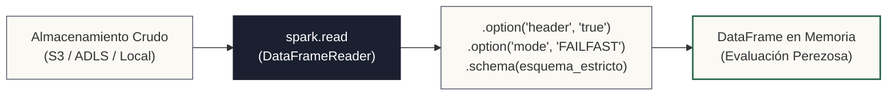

<!-- NOTAS FUENTE ORIGINALES DE OBSIDIAN: [[como abrir archivos y cargar en pyspark]], [[JDBC Ingestion]], [[Batch Sources]] -->

# Capítulo 7: Ingesta de Datos: Archivos, JDBC Batch y Fuentes Incrementales [NÚCLEO EMPLEABILIDAD]

> *"La ingesta es el primer puerto de entrada al lago de datos: a través del DataFrameReader podemos montar rutas de almacenamiento de objetos, inferir o forzar esquemas estrictos, conectarnos en paralelo a bases de datos relacionales vía JDBC y capturar incrementos controlados mediante columnas de marca de agua."*

---

## Objetivos de Aprendizaje
Al finalizar este capítulo, el lector será capaz de:
* Utilizar el objeto `DataFrameReader` (`spark.read`) para cargar datos desde almacenamiento de objetos (Amazon S3, Azure ADLS Gen2, GCP GCS) y sistemas de archivos locales.
* Configurar opciones críticas de lectura: delimitadores, encabezados, manejo de caracteres corruptos y modos de fallo (`PERMISSIVE`, `DROPMALFORMED`, `FAILFAST`).
* Comprender la penalización de rendimiento de `inferSchema` y aplicar esquemas explícitos mediante `StructType`.
* Diseñar ingestas paralelas desde motores relacionales mediante **JDBC (`spark.read.jdbc`)** configurando `partitionColumn`, `lowerBound`, `upperBound` y `numPartitions`.
* Implementar patrones de **extracción incremental batch** basados en marcas de agua temporales (*Watermark Columns*).
* Evaluar el rol de conectores gestionados modernos (**Airbyte**, **Fivetran**, SFTP y APIs REST) frente a pipelines Spark nativos.

---

> **Definición 7.1 (La Aduana en el Puerto de Carga Analítico)**
> Imagine cientos de contenedores marítimos arribando a un puerto de transferencia internacional.
> 
> Si el inspector de aduana decide inferir el contenido abriendo cada caja una por una (`inferSchema = True`), se formará una congestión kilométrica y el barco tardará días en desembarcar, consumiendo el doble de combustible e I/O.
> 
> Un puerto moderno exige un manifiesto de carga oficial sellado de antemano (un `StructType` explícito): el operario solo valida que los contenedores coincidan con las especificaciones y los transfiere a máxima velocidad hacia las grúas de clasificación sin inspecciones redundantes.

---

## 7.1 El Objeto `DataFrameReader` y Formatos de Archivo

En PySpark, la carga de datos se canaliza a través de la propiedad `.read` de la instancia `SparkSession`, la cual retorna un objeto `DataFrameReader`.

El flujo estándar de ingesta sigue tres pasos estructurales:
1. **Definir la ruta fuente:** Puede ser una ruta local del sistema de archivos, un bucket de Amazon S3 (`s3a://`), Azure Data Lake Storage (`abfss://`) o Google Cloud Storage (`gs://`).
2. **Especificar el formato:** Mediante métodos directos (`.csv()`, `.parquet()`, `.json()`, `.orc()`, `.text()`) o el método genérico `.format("formato")`.
3. **Parametrizar opciones de lectura:** Configurar delimitadores (`sep`), presencia de cabeceras (`header`), manejo de valores nulos (`nullValue`) y políticas de parseo ante registros malformados.



### Modos de Manejo de Registros Corruptos
Al ingerir fuentes de texto semiestructuradas (como CSV o JSON) es común encontrar filas incompletas o tipos de datos alterados. Spark ofrece tres modos de parseo mediante `.option("mode", ...)`:

1. **PERMISSIVE (Por defecto):** Inserta `null` en los campos corruptos y, si se define una columna especial `_corrupt_record` en el esquema, almacena la cadena cruda malformada para su posterior auditoría.
2. **DROPMALFORMED:** Descarta silenciosamente las filas que no cumplan el esquema.
3. **FAILFAST:** Lanza una excepción inmediata (`SparkException`) y detiene el job en el primer registro corrupto. Es el estándar recomendado para ingestas financieras donde la pérdida de datos es inaceptable.

```python
from pyspark.sql import SparkSession
from pyspark.sql.types import StructType, StructField, StringType, IntegerType, DoubleType

spark = SparkSession.builder \
    .appName("Capitulo07-IngestaArchivos") \
    .master("local[*]") \
    .getOrCreate()

# Definición rigurosa del esquema oficial (Manifiesto de Carga)
esquema_pedidos = StructType([
    StructField("pedido_id", StringType(), False),
    StructField("cliente_id", IntegerType(), False),
    StructField("fecha_creacion", StringType(), True),
    StructField("monto_total", DoubleType(), True),
    StructField("estado", StringType(), True)
])

# Ingesta controlada con DataFrameReader
df_pedidos = spark.read \
    .format("csv") \
    .option("header", "true") \
    .option("sep", ",") \
    .option("mode", "FAILFAST") \
    .option("nullValue", "NA") \
    .schema(esquema_pedidos) \
    .load("data/crudo/pedidos_2026.csv")
```

---

## 7.2 Ingesta Paralela desde Bases de Datos Relacionales (JDBC)

La extracción de datos desde sistemas relacionales transaccionales (PostgreSQL, MySQL, Oracle, SQL Server) es una de las tareas más comunes del Data Engineer. Utilizar `spark.read.jdbc` sin comprender sus parámetros internos puede colapsar la base de datos origen o generar cuellos de botella extremos:

### La Trampa del Hilo Único (Single-Thread Bottleneck)
Si se ejecuta:
```python
# ANTI-PATRÓN: Extracción monohilo
df_clientes = spark.read.jdbc(url=jdbc_url, table="clientes", properties=db_properties)
```
Spark lanzará **una única tarea en un único ejecutor** para descargar millones de registros a través de una sola conexión JDBC. El resto del clúster permanecerá totalmente ocioso.

### Extracción Paralela Particionada por Rango
Para extraer la tabla de forma distribuida en $N$ hilos concurrentes, se debe especificar una columna numérica particionable:

```python
jdbc_url = "jdbc:postgresql://db-oltp.corp:5432/produccion"
db_properties = {
    "user": "analitica_read_only",
    "password": "token_secreto_vault",
    "driver": "org.postgresql.Driver",
    "fetchsize": "10000" # Tamaño del cursor por lote para evitar OOM en la JVM
}

# Ingesta paralela distribuida en 8 ejecutores
df_clientes_paralelo = spark.read.jdbc(
    url=jdbc_url,
    table="clientes",
    column="cliente_id",      # Debe ser columna numérica indexada
    lowerBound=1,             # Valor mínimo esperado
    upperBound=8000000,       # Valor máximo esperado
    numPartitions=8,          # Cantidad de conexiones paralelas simultáneas
    properties=db_properties
)
```

Spark generará internamente 8 consultas SQL concurrentes dividiendo el rango mediante operadores `WHERE`:
* *Tarea 0:* `WHERE cliente_id < 1000000`
* *Tarea 1:* `WHERE cliente_id >= 1000000 AND cliente_id < 2000000`
* ...
* *Tarea 7:* `WHERE cliente_id >= 7000000`

---

## 7.3 Extracción Incremental Batch con Marca de Agua (Watermark)

Extraer la tabla transaccional completa todos los días (*Full Table Dump*) es inviable ante tablas con cientos de millones de tuplas. El patrón de **Extracción Incremental** utiliza una columna de auditoría monotónicamente creciente (por ejemplo, `fecha_actualizacion` o `modificado_el`) para consultar únicamente las novedades:

```python
# 1. Recuperar la marca de agua del último lote procesado exitosamente
ultima_marca_tiempo = "2026-10-11 23:59:59"

# 2. Construir predicado de extracción incremental (Pushdown hacia la base relacional)
query_incremental = f"""
    (SELECT cliente_id, nombre, saldo, modificado_el
     FROM cuentas
     WHERE modificado_el > '{ultima_marca_tiempo}') AS novedades_cuentas
"""

df_novedades = spark.read.jdbc(
    url=jdbc_url,
    table=query_incremental,
    column="cliente_id",
    lowerBound=1,
    upperBound=5000000,
    numPartitions=4,
    properties=db_properties
)

# 3. Guardar las novedades en la capa Bronze
df_novedades.write.format("delta").mode("append").save("lakehouse/bronze/cuentas_novedades")
```

---

## 7.4 Ingesta Gestionada: Airbyte, Fivetran, SFTP y APIs REST

En la arquitectura empresarial moderna, Spark no es siempre la mejor herramienta para conectar cientos de fuentes heterogéneas:
* **Herramientas ELT Gestionadas (Airbyte / Fivetran):** Especializadas en sincronizar conectores SaaS (Salesforce, Stripe, HubSpot, Google Ads) y bases relacionales directamente hacia almacenamiento de objetos o almacenes MPP, gestionando esquemas, reintentos y paginación sin escribir código manual.
* **Archivos SFTP / Legacy:** Para archivos CSV o XML recibidos por SFTP de proveedores externos, se emplean contenedores ligeros de Python o tareas de Airflow que descargan y depositan los datos en el bucket Landing antes de activar Spark.
* **Consumo de APIs REST:** Si la fuente expone una API REST con límites de tasa (*Rate Limits*) y paginación por cursor, un script de Python con `requests` y retroceso exponencial (*Exponential Backoff*) es superior a un clúster de Spark.

---

## 7.5 Criterios de Fiabilidad y Anti-Patrones en Producción

**Anti-patrón 1: Creer que `coalesce` Resuelve el Problema de Archivos Pequeños en Ingesta**  
Leer miles de micro-archivos de 10 KB genera una sobrecarga severa en el Driver durante la fase de listado de metadatos en almacenamiento de objetos. Aplicar `df.coalesce(1)` tras la lectura **no soluciona el cuello de botella**, ya que el Driver ya tuvo que listar y programar todas las particiones. La solución real exige compactar los archivos en reposo (mediante Delta `OPTIMIZE` o procesos de compactación programados) o ajustar `spark.sql.files.maxPartitionBytes` (128 MB por defecto) para que Spark agrupe múltiples archivos pequeños en una sola tarea física de lectura.

**Anti-patrón 2: Ejecutar Ingestas JDBC sobre Tablas Transaccionales en Horas Pico sin Índices**  
Lanzar una consulta `spark.read.jdbc` con `numPartitions = 32` sobre una columna que no tiene índice en PostgreSQL puede provocar bloqueos de tablas y saturación de CPU en la base de datos de producción. Verifique siempre que la columna de particionamiento posea un índice B-tree y ajuste las horas de ejecución a ventanas de bajo tráfico.

---

## Preguntas de Revisión y Ejercicios Prácticos
**Ejercicio 7.1 (Descubrimiento Automático de Particiones):**  
Si un lago de datos almacena archivos Parquet organizados como `s3://datalake/ventas/anio=2026/mes=10/datos.parquet`, ¿qué sucede si se ejecuta `spark.read.parquet("s3://datalake/ventas/")`?

**Solución 7.1:**  
Spark implementa **Partition Discovery automático**. Al detectar la convención `clave=valor` en las rutas de directorios, Spark escanea los archivos e inyecta dinámicamente las columnas virtuales `anio` (Integer) y `mes` (Integer) en el esquema del DataFrame. Si una consulta posterior incluye `filter(col("mes") == 10)`, Catalyst aplica *Partition Pruning*, descartando la lectura de todos los directorios que correspondan a otros meses sin transferir sus archivos físicos por la red.

---

**Ejercicio 7.2 (Tuning de Conexiones JDBC en Spark):**  
Un pipeline JDBC tarda 45 minutos en extraer 10 millones de filas desde MySQL. Al revisar la Spark UI, el ingeniero observa un único Stage con una sola tarea (*Task*). Explique la causa y detalle la solución en código.

**Solución 7.2:**  
* **Causa:** La llamada `spark.read.jdbc` no especificó los parámetros de paralelismo (`column`, `lowerBound`, `upperBound`, `numPartitions`). Al omitirlos, Spark utiliza una única conexión JDBC secuencial en un solo ejecutor.
* **Solución:** Especificar una columna numérica indexada (como la clave primaria `id`) y definir el número de particiones:
```python
df = spark.read.jdbc(
    url=url, table="transacciones",
    column="id", lowerBound=1, upperBound=10000000,
    numPartitions=10, properties=props
)
```
Esto divide el trabajo en 10 tareas paralelas, reduciendo el tiempo de extracción de 45 minutos a menos de 5 minutos según la capacidad del servidor de base de datos.

---

## 7.6 Resumen y Puntos Clave

* **DataFrameReader:** La interfaz unificada para ingestar archivos y fuentes relacionales con control de esquemas y modos de fallo.
* **Esquemas explícitos:** Suprimen la doble lectura de I/O provocada por `inferSchema` y garantizan tipado determinista.
* **Paralelismo JDBC:** Exige configurar `partitionColumn`, cotas de rango y `numPartitions` sobre columnas indexadas para evitar extracciones monohilo.
* **Extracción incremental:** Minimiza el impacto sobre fuentes operacionales consultando solo registros cuya marca de agua temporal sea superior al último corte exitoso.

---

## Lecturas Recomendadas
1. **Damji, J. et al. (2020).** *Learning Spark: Lightning-Fast Data Analytics* (2nd ed.). O'Reilly Media. (Capítulo 4: "Spark SQL and DataFrames: Built-in Data Sources").
2. **PostgreSQL Global Development Group (2024).** *PostgreSQL Documentation: Concurrency Control and Indexes.* (`https://www.postgresql.org/docs/`).
3. **Apache Spark Documentation (2024).** *Spark SQL Programming Guide: JDBC To Other Databases.* Apache Software Foundation (`https://spark.apache.org/docs/latest/sql-data-sources-jdbc.html`).
