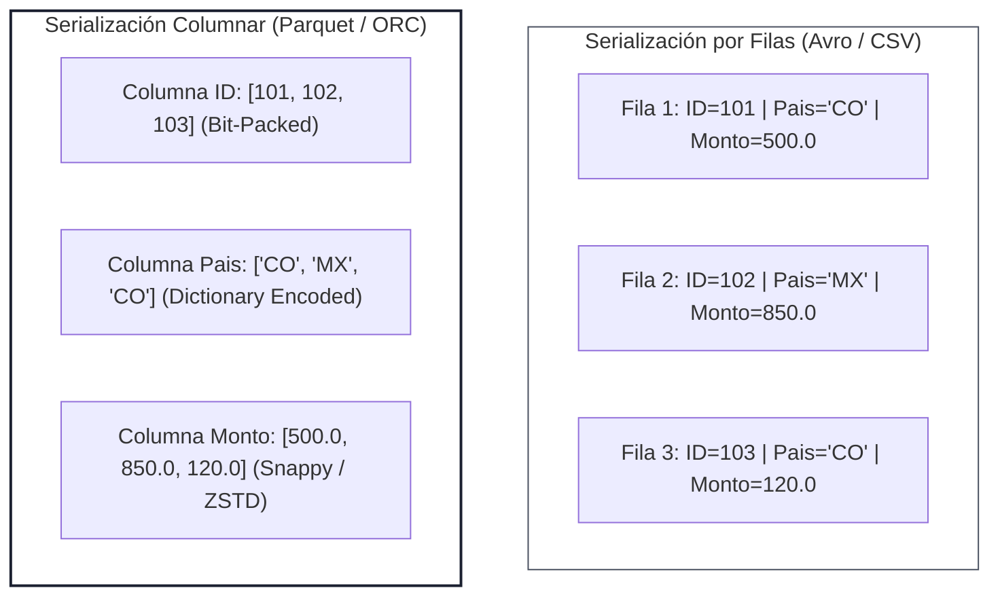

<!-- NOTAS FUENTE ORIGINALES DE OBSIDIAN: Formatos de Almacenamiento Columnar y Serialización Binaria -->
# Capítulo 8: Formatos de Archivo: Parquet, ORC y Avro [NÚCLEO EMPLEABILIDAD]

> *"La elección del formato de archivo es la decisión de arquitectura física más determinante en un lago de datos: define la tasa de compresión, la eficiencia de E/S mediante lectura columnar y la capacidad de evolucionar esquemas en el tiempo."*

---

## Objetivos de Aprendizaje
Al finalizar este capítulo, el lector será capaz de:
* Diferenciar formalmente entre formatos de almacenamiento orientados a filas (*Row-oriented*) y orientados a columnas (*Columnar-oriented*).
* Describir la estructura interna de Apache Parquet: *File Footer*, *Row Groups*, *Column Chunks* y páginas de datos.
* Comparar los casos de uso óptimos para Apache Parquet, Apache ORC y Apache Avro en arquitecturas de Big Data.
* Aprovechar las estadísticas de bloque (Min/Max) para habilitar poda de datos (*Data Skipping*) y optimizar costos de almacenamiento en la nube.
* Configurar algoritmos de compresión modernos (Snappy, ZSTD, Gzip) según el perfil de carga (escritura frecuente vs. lectura intensiva).

---

> **Definición 8.1 (Almacenamiento Columnar y Principio de Proyección Física)**
> Un formato de almacenamiento **orientado a columnas** organiza los datos en disco agrupando secuencialmente todos los valores pertenecientes a una misma columna, en lugar de almacenar tuplas consecutivas de filas. Esta disposición física desacopla el costo de I/O del ancho total de la tabla (*número de columnas*): las consultas analíticas solo transfieren a memoria los bloques de bytes correspondientes a las columnas proyectadas en la consulta (*Column Pruning*).

---

## 8.1 Almacenamiento Orientado a Filas vs. Orientado a Columnas

En el diseño de sistemas analíticos modernos coexisten dos filosofías fundamentales de serialización en almacenamiento secundario:

1. **Almacenamiento Orientado a Filas (Row-Oriented - CSV, JSON, Apache Avro):**
   * Cada registro se almacena de forma contigua en bloques secuenciales de disco: `[id_1, nombre_1, balance_1]`, `[id_2, nombre_2, balance_2]`.
   * *Ventaja:* Eficiencia máxima en escrituras atómicas puntuales y recuperación de entidades completas por identificador primario (ideal para cargas transaccionales OLTP y buses de mensajería como Kafka).
   * *Desventaja en analítica:* Para calcular la suma de una columna sobre 1.000 millones de filas en una tabla con 200 columnas, el motor debe leer el 100% de los bytes del archivo, desperdiciando ancho de banda de red y memoria caché.

2. **Almacenamiento Orientado a Columnas (Columnar-Oriented - Apache Parquet, Apache ORC):**
   * Todos los valores de un mismo atributo se agrupan en bloques contiguos: `[id_1, id_2, id_3...]`, `[balance_1, balance_2, balance_3...]`.
   * *Ventaja analítica (OLAP):* Permite **Column Pruning** (lectura selectiva de columnas) y algoritmos de compresión de alta densidad (como *Run-Length Encoding* y codificación por diccionario), reduciendo el tamaño en almacenamiento entre un 60% y un 85% comparado con formatos planos.



---

## 8.2 Anatomía Interna de Apache Parquet

Un archivo Apache Parquet es un contenedor binario autosuficiente estructurado jerárquicamente en cuatro capas de granularidad:

1. **File Footer (Pie de Archivo):**  
   Ubicado al final del archivo físico. Contiene el esquema completo de la tabla y los punteros de desplazamiento (*byte offsets*) hacia cada grupo de filas. Los lectores de Parquet leen primero los últimos bytes del archivo para conocer la estructura completa sin escanear el cuerpo de datos.

2. **Row Groups (Grupos de Filas):**  
   Particiones lógicas horizontales de los datos, típicamente dimensionadas entre 128 MB y 512 MB. Un archivo puede contener múltiples Row Groups.

3. **Column Chunks (Trozos de Columna):**  
   Dentro de cada Row Group, los datos de una columna específica se almacenan en un bloque exclusivo contiguo.

4. **Data Pages (Páginas de Datos):**  
   Unidad mínima e indivisible de lectura y compresión (típicamente 1 MB). Cada página contiene valores codificados y comprimidos, junto con encabezados de metadatos que almacenan estadísticas locales: valor mínimo, valor máximo, recuento de nulos y cardinalidad.

```
┌─────────────────────────────────────────────────────────────┐
│                    ARCHIVO PARQUET (.parquet)               │
├─────────────────────────────────────────────────────────────┤
│  ROW GROUP 0 (~128 - 256 MB)                                │
│    ├── Column Chunk: transaccion_id (Páginas 0, 1, 2...)    │
│    ├── Column Chunk: cliente_id    (Páginas 0, 1...)        │
│    └── Column Chunk: monto_usd     (Páginas 0, 1, 2...)     │
├─────────────────────────────────────────────────────────────┤
│  ROW GROUP 1 (~128 - 256 MB)                                │
│    ├── Column Chunk: transaccion_id                         │
│    ├── Column Chunk: cliente_id                             │
│    └── Column Chunk: monto_usd                              │
├─────────────────────────────────────────────────────────────┤
│  FILE FOOTER (Metadatos globales, esquemas, offsets, stats) │
└─────────────────────────────────────────────────────────────┘
```

---

## 8.3 Profundización Técnica: Técnicas de Codificación y Poda de Datos (Data Skipping)

La eficiencia extrema de Parquet no radica únicamente en la compresión (ej. Snappy), sino en las técnicas de codificación previa (*Encoding*):

1. **Dictionary Encoding:** Sustituye cadenas de texto repetitivas (ej. nombres de países) por enteros pequeños (0, 1, 2) y mantiene una tabla de correspondencia en el encabezado.
2. **Run-Length Encoding (RLE):** Si un valor booleano o de estado se repite 500 veces seguidas, se almacena como el par `(500, 'APROBADO')` en lugar de escribir 500 registros.
3. **Data Skipping mediante Estadísticas Min/Max:**  
   Cuando un motor ejecuta una consulta con filtro:
   ```sql
   SELECT SUM(monto_usd) FROM ventas WHERE transaccion_id = 'TRX-998822';
   ```
   El motor lee el *File Footer* y los encabezados de cada *Row Group*. Si el rango estadístico de un Row Group indica `min: 'TRX-000001', max: 'TRX-500000'`, el motor **omite por completo la lectura física de ese bloque de 256 MB de disco**, reduciendo el I/O en órdenes de magnitud.

---

## 8.4 Comparativa Técnica: Parquet vs. ORC vs. Avro

| Dimensión de Comparación | Apache Parquet | Apache ORC | Apache Avro |
| :--- | :--- | :--- | :--- |
| **Orientación** | Columnar | Columnar | Filas |
| **Ecosistema Predilecto** | Apache Spark, Databricks, Snowflake | Apache Hive, Trino, Presto | Apache Kafka, Mensajería RPC |
| **Estructura de Bloque** | Row Groups + Column Chunks | Stripes (típicamente 256 MB) | Sync Markers + Blocks |
| **Soporte de Esquema Complejo** | Excelente (anidamientos Dremel) | Excelente (estructuras y mapas) | Excelente (JSON Schema estricto) |
| **Evolución de Esquemas** | Adición y eliminación de columnas | Compatible hacia atrás | Sobresaliente (reglas estrictas) |
| **Caso de Uso Primario** | Data Lakes, Lakehouses, BI masivo | Almacenes Hive y consultas SQL | Ingesta de streaming y buses CDC |

---

> **Consideraciones de Producción 8.1: Selección de Algoritmos de Compresión (Snappy vs. ZSTD)**
> * **Snappy (Predeterminado en Spark):** Optimizado para velocidad extrema de descompresión con consumo moderado de CPU. Ideal para capas intermedias de procesamiento (Silver) donde los datos se leen frecuentemente.
> * **ZSTD (Zstandard):** Desarrollado por Meta. Ofrece ratios de compresión significativamente superiores (reducción adicional del 15-30% respecto a Snappy) con niveles de compresión ajustables. Es el estándar recomendado para capas históricas de almacenamiento (Bronze y Cold Storage) para minimizar facturación en la nube.

---

```python
from pyspark.sql import SparkSession
from pyspark.sql.types import StructType, StructField, StringType, DoubleType, TimestampType

spark = SparkSession.builder \
    .appName("Capitulo08-OptimizacionFormatos") \
    .config("spark.sql.parquet.compression.codec", "zstd") \
    .config("spark.sql.parquet.filterPushdown", "true") \
    .getOrCreate()

# Escritura con compresión ZSTD y configuración de tamaño de Row Group
df_transacciones = spark.read.json("data/transacciones_crudo/")

df_transacciones.write \
    .mode("overwrite") \
    .option("compression", "zstd") \
    .parquet("lakehouse/silver/transacciones_optimizadas/")
```

---

## 8.5 Criterios de Fiabilidad y Anti-Patrones en Producción

**Anti-patrón 1: Almacenar Cargas Analíticas Masivas en Archivos CSV o JSON Comprimidos en Gzip**  
Gzip no es divisible (*splittable*); un archivo JSON de 50 GB comprimido en `.gz` debe ser procesado secuencialmente por un único ejecutor de Spark, perdiendo todo beneficio de paralelismo en el clúster.

**Anti-patrón 2: Generar Millones de Archivos Parquet Diminutos (*Small Files Problem*)**  
Escribir archivos Parquet de menos de 10 MB multiplica la sobrecarga de lectura del metastore y el sistema de archivos. El tamaño óptimo para archivos Parquet en almacenamiento de objetos (S3, ADLS) oscila entre 128 MB y 1 GB.

---

## Preguntas de Revisión y Ejercicios Prácticos
**Ejercicio 8.1 (Divisibilidad de Archivos y Compresión):**  
Explica la diferencia entre *Data Splittability* (capacidad de dividir un archivo en bloques paralelos) y compresión de archivos, detallando por qué Parquet es intrínsecamente divisible independientemente del códec empleado.

**Solución 8.1:**
* **Data Splittability:** Es la propiedad física que permite a un motor distribuido (Spark o MapReduce) asignar múltiples tareas concurrentes para procesar diferentes segmentos de un mismo archivo físico sin coordinar entre sí.
* **Impacto del códec:** En archivos de texto planos como CSV o JSON, si se comprimen con algoritmos como Gzip (`.gz`), el archivo pierde su divisibilidad porque el flujo de bytes comprimido carece de marcadores de sincronización interna (*sync markers*); un único ejecutor debe descomprimir el archivo de principio a fin de forma secuencial.
* **Divisibilidad de Parquet:** Apache Parquet organiza internamente los datos en **Row Groups** delimitados e indexados en el *File Footer*. Aunque cada página interna esté comprimida con Snappy o ZSTD, los límites y offsets en bytes de cada Row Group están explícitamente declarados en los metadatos. Durante la planificación, Spark divide los archivos en particiones lógicas (*Splits*) gobernadas por rangos de bytes mediante `spark.sql.files.maxPartitionBytes` (128 MB por defecto), asignando los Row Groups a las tareas correspondientes según su posición física, lo que permite procesar múltiples bloques en paralelo sin dependencias secuenciales.

---

**Ejercicio 8.2 (Data Skipping mediante File Footer):**  
¿Cómo interactúa el *File Footer* de Parquet con el optimizador Catalyst y los lectores en los ejecutores para evitar transferencias de red y lecturas innecesarias en almacenamiento de objetos (Amazon S3 / Azure ADLS)?

**Solución 8.2:**
1. **Empuje de predicados (Catalyst):** Cuando Spark compila una consulta con filtros relacionales (por ejemplo, `WHERE fecha = '2026-10-12'`), Catalyst empuja dichos filtros (*Predicate Pushdown*) al operador físico `FileScan parquet`, delegando la evaluación de la condición a la capa de lectura.
2. **Lectura de metadatos en ejecutores:** El lector columnar de Parquet en el ejecutor realiza una solicitud HTTP de rango de bytes (*HTTP Range Request*) hacia los últimos kilobytes del archivo en el almacenamiento de objetos para descargar exclusivamente el **File Footer** (`FileMetaData`).
3. **Inspección de estadísticas de bloque:** El lector examina los metadatos de cada **Row Group** (`ColumnChunkMetaData`), los cuales registran los valores mínimo y máximo (`min_value`, `max_value`) y el conteo de nulos para cada columna.
4. **Descarte de grupos de filas (Row Group Skipping):** Si las estadísticas del Row Group indican un rango entre `'2026-10-01'` y `'2026-10-10'`, el lector determina que la condición `fecha = '2026-10-12'` es imposible de satisfacer en ese bloque y **omite la lectura de las páginas de datos completas de ese Row Group**, ahorrando transferencias de red y ciclos de CPU.

---

**Ejercicio 8.3 (Avro en Streaming vs. Parquet en Lakehouse):**  
En una arquitectura de ingesta en tiempo real conectada a Apache Kafka, ¿por qué es recomendable utilizar Apache Avro en el bus de streaming y convertir a Apache Parquet en la capa de persistencia del Lakehouse?

**Solución 8.3:**
* **Apache Avro en Streaming (Kafka):**
  * *Orientación a filas:* Kafka transmite eventos transaccionales individuales emitidos uno por uno. Avro serializa registros como tuplas compactas con encabezados ligeros gobernados por Schema Registry, minimizando la latencia de serialización por mensaje a microsegundos.
  * *Evolución de esquemas:* Avro maneja rigurosamente la compatibilidad hacia atrás y hacia adelante (*BACKWARD/FORWARD*), protegiendo a los consumidores ante cambios de campos en los microservicios productores.
* **Apache Parquet en el Lakehouse:**
  * *Orientación a columnas:* Las consultas analíticas de BI y SQL agregan métricas sobre millones de filas proyectando solo un subconjunto de columnas.
  * *Eficiencia analítica:* Parquet ofrece tasas de compresión superiores (reducción típica del 60% al 80% frente a JSON sin comprimir), codificación por diccionario y soporte nativo para *Column Pruning* y *Data Skipping*, optimizando tanto el almacenamiento en reposo como los tiempos de respuesta de consulta interactiva.

---

## 8.6 Resumen y Puntos Clave

* **Orientación física:** Los formatos orientados a filas (Avro, CSV) optimizan la escritura atómica y el streaming; los formatos columnares (Parquet, ORC) optimizan la lectura analítica y el cálculo de agregados.
* **Anatomía de Parquet:** Se estructura jerárquicamente en *File Footer*, *Row Groups*, *Column Chunks* y *Data Pages*, permitiendo lectura de metadatos primero y salto de bloques.
* **Poda de datos (Data Skipping):** Las estadísticas de bloque (Min/Max y nulos) permiten a los motores de consulta descartar particiones y grupos de filas completos sin leer sus datos físicos.
* **Compresión balanceada:** Snappy proporciona máxima velocidad de descompresión para capas intermedias; ZSTD ofrece ratios de compresión superiores para capas frías o históricas.

---

## Lecturas Recomendadas
1. **White, T. (2015).** *Hadoop: The Definitive Guide: Storage and Analysis at Internet Scale* (4th ed.). O'Reilly Media. (Capítulo 12: "Avro" y Capítulo 13: "Parquet").
2. **Melnik, S. et al. (2010).** *Dremel: Interactive Analysis of Web-Scale Datasets.* Proceedings of the VLDB Endowment, 3(1-2), 330-339. (El artículo científico seminal de Google en el que se basa la codificación columnar anidada de Apache Parquet).
3. **Apache Parquet Project Documentation (2024).** *Parquet Format Specification, Metadata and Encodings.* Apache Software Foundation (`https://parquet.apache.org/docs/`).
