<!-- NOTAS FUENTE ORIGINALES DE OBSIDIAN: [[lazy evaluation]], [[DAG]], [[Acción]] -->

# Capítulo 13: Evaluación Perezosa (Lazy Evaluation) y el Grafo DAG [RECOMENDADO]

> *"Spark es como un chef de alta cocina: planifica la comanda y diseña la receta paso a paso, pero no enciende los fogones ni toca un solo ingrediente hasta que el cliente pide que se sirva el plato."*

---

## Objetivos de Aprendizaje
Al finalizar este capítulo, el lector será capaz de:
* Comprender por qué Apache Spark no ejecuta transformaciones de forma inmediata y cómo esta estrategia maximiza el rendimiento distribuido.
* Diferenciar formalmente entre operaciones de **Transformación** (narrow y wide) y operaciones de **Acción**.
* Analizar la estructura interna de un **DAG** (*Directed Acyclic Graph*), identificando cómo se segmenta en *Jobs*, *Stages* y *Tasks*.
* Interpretar planes de ejecución lógicos y físicos mediante el método `.explain()`.
* Evitar cuellos de botella de re-cómputo y desbordamiento de memoria (*Driver OOM*) causados por llamadas indebidas a acciones.

---

> **Definición 13.1 (Evaluación Perezosa y Diferimiento de Cómputo)**
> La **evaluación perezosa** (*Lazy Evaluation*) es una estrategia computacional en la cual las operaciones de transformación sobre estructuras distribuidas (DataFrames y RDDs) no materializan resultados inmediatos en memoria ni generan tráfico en el clúster. En su lugar, cada operación se registra como un vértice o arista dentro de un grafo de dependencias dirigidas (*lineage graph*).
> 
> Esta estrategia otorga al motor un panorama global del pipeline analítico antes de iniciar el procesamiento físico. De este modo, el optimizador puede fusionar transformaciones contiguas en un solo pase de datos (*pipeline execution*), anticipar filtros a la etapa de lectura en disco (*Predicate Pushdown*) y descartar columnas irrelevantes (*Column Pruning*), ejecutando el trabajo exclusivamente cuando una acción explícita lo demanda.

---

## 13.1 Fundamentos: ¿Qué es la Evaluación Perezosa?

La **evaluación perezosa** (*Lazy Evaluation*) es una de las características angulares de PySpark al trabajar con DataFrames y RDDs. Cuando invocamos métodos de transformación sobre un DataFrame (como `.filter()`, `.select()` o `.withColumn()`), Spark **no procesa ninguna fila inmediatamente**.

En su lugar, Spark registra cada operación como una instrucción dentro de un plan lógico. Los DataFrames en Spark son **inmutables**: cada transformación aplicada no modifica el DataFrame original, sino que genera una nueva abstracción que añade un nodo al linaje de transformaciones (*data lineage*).

Sin una acción que solicite un resultado tangible, los DataFrames son únicamente descripciones matemáticas de un cómputo futuro, no datos materializados en memoria.

```mermaid
graph LR
    A["Fuente de Datos
(Parquet / S3 / HDFS)"] -->|Transformación| B["df.filter(...)
(Narrow Transformation)"]
    B -->|Transformación| C["df.select(...)
(Narrow Transformation)"]
    C -->|Transformación| D["df.groupBy(...)
(Wide Transformation)"]
    D -->|ACCIÓN DISPARADORA| E["df.count() / df.write()
(Ejecución Materializada)"]
    style A fill:#fbf9f4,stroke:#4a5160,stroke-width:1px
    style B fill:#fbf9f4,stroke:#4a5160,stroke-width:1px
    style C fill:#fbf9f4,stroke:#4a5160,stroke-width:1px
    style D fill:#fbf9f4,stroke:#4a5160,stroke-width:1px
    style E fill:#1b2030,color:#ffffff,stroke:#1b2030,stroke-width:2px
```



### La Dualidad Fundamental: Transformaciones vs. Acciones

Para dominar el cómputo distribuido es imperativo distinguir entre estas dos naturalezas de operaciones:

1. **Transformaciones (Perezosas):**
   * *Propósito:* Producen un nuevo DataFrame a partir de uno existente.
   * *Comportamiento:* No desencadenan cómputo físico ni mueven datos a través de la red.
   * *Ejemplos comunes:* `.filter()`, `.where()`, `.select()`, `.withColumn()`, `.groupBy()`, `.join()`, `.drop()`.
2. **Acciones (Disparadoras):**
   * *Propósito:* Obligan a Spark a ejecutar el plan acumulado para devolver un valor concreto al Driver o persistir el resultado en almacenamiento persistente.
   * *Comportamiento:* Materializan el DAG, compilan el plan físico y dividen el trabajo en ejecutores.
   * *Ejemplos comunes:*
     * *Retorno de datos:* `.count()`, `.first()`, `.take(n)`, `.collect()`.
     * *Inspección en consola:* `.show()`.
     * *Escritura en disco:* `.write.parquet()`, `.write.format("delta").save()`.

---

## 13.2 Anatomía del Grafo Acíclico Dirigido (DAG)

Un **DAG** (*Directed Acyclic Graph*) es la estructura formal con la que Spark representa el plan de ejecución de una aplicación:

* **Grafo:** Está compuesto por un conjunto de **nodos** (que representan RDDs o DataFrames intermedios generados por operaciones como `filter`, `map` o `groupBy`) y **aristas** directas (que definen las dependencias y el flujo de los datos).
* **Dirigido:** El flujo de procesamiento se desplaza en un único sentido, desde las fuentes de lectura hacia las salidas.
* **Acíclico:** No contiene ciclos ni bucles cerrados. Esta propiedad garantiza que el flujo de ejecución tenga un inicio y un fin rigurosamente acotados, previniendo bucles infinitos en clústeres distribuidos.

---


## 13.3 Profundización Técnica: De la Acción al Hardware (Jobs, Stages y Tasks)


Cuando el Driver Program detecta una acción, el motor desglosa el DAG en una jerarquía física de tres niveles de granularidad:


1. **Job:** Una acción invocada en el código desencadena uno o más *Jobs* en el SparkContext (algunas acciones como `take()`, `first()` o lecturas con cabeceras/inferencia de tipos pueden disparar múltiples Jobs secuenciales según la distribución de datos).

2. **Stages (Etapas):** El planificador descompone el Job en Stages analizando las dependencias del grafo:
* **Dependencias Estrechas (Narrow Dependencies):** Operaciones como `filter()` y `select()` donde cada partición del DataFrame padre es consumida por a lo sumo una partición del DataFrame hijo. Se encadenan en memoria sin tocar disco (*Pipelining*) dentro del mismo Stage.
* **Dependencias Amplias (Wide Dependencies):** Operaciones como `groupBy()` o `join()` donde múltiples particiones hijas dependen de datos dispersos en todas las particiones del padre. Exigen redistribuir datos por la red (**Shuffle**). *Cada frontera de shuffle corta el grafo y crea un nuevo Stage.*
3. **Tasks (Tareas):** Es la unidad mínima de ejecución física. Cada Stage se fragmenta en tantas *Tasks* como particiones existan. Una tarea se envía a un hilo de un **Executor** para procesar su partición de datos.


---

> **Consideraciones de Producción 13.1: Inspección de Linaje y Plan Físico**
> En entornos productivos, nunca adivines qué hará Spark: utiliza .explain(extended=True) para verificar si Catalyst logró aplicar optimizaciones como Predicate Pushdown (empujar filtros a la fuente de almacenamiento) y Column Pruning (leer únicamente las columnas requeridas).

```python
from pyspark.sql import SparkSession
from pyspark.sql.functions import col, year, current_date

# 1. Inicialización de la sesión de cómputo
spark = SparkSession.builder \
    .appName("Capitulo13-LazyEvaluation-DAG") \
    .master("local[*]") \
    .getOrCreate()

# 2. Carga diferida (Transformación)
# Spark solo lee el esquema/metadatos; no carga filas a memoria
df_clientes = spark.read.parquet("data/clientes.parquet")

# 3. Encadenamiento de transformaciones estrechas (Narrow Transformations)
# Construyen el grafo lógico sin cómputo en ejecutores
df_mayores = df_clientes \
    .withColumn("edad_aprox", year(current_date()) - col("birth_year")) \
    .filter(col("edad_aprox") >= 18) \
    .select("cliente_id", "nombre", "edad_aprox", "pais")

# 4. Inspección del plan optimizado por Catalyst antes de ejecutar
print("=== PLAN DE EJECUCIÓN LÓGICO Y FÍSICO ===")
df_mayores.explain(True)

# 5. Acción Disparadora (Action)
# En este instante preciso se compila el DAG, se lanzan los Jobs y se computa
total_mayores = df_mayores.count()
print(f"Total de clientes mayores de edad: {total_mayores}")
```

---


## 13.4 Criterios de Fiabilidad y Anti-Patrones en Producción


**Anti-patrón 1: Disparar Acciones en Bucle o Múltiples Veces sin Persistencia**

Un error clásico es encadenar varias acciones sobre un DataFrame derivado costoso sin llamar a `.persist()` o `.cache()`:

```python
# ¡PELIGRO EN PRODUCCIÓN!
df_filtrado = df_gigante.filter(col("monto") > 1000).groupBy("region").sum()

# Acción 1: Spark re-lee df_gigante y ejecuta todo el DAG
print("Conteo:", df_filtrado.count())

# Acción 2: Spark vuelve a leer df_gigante desde cero y re-ejecuta todo el DAG
df_filtrado.write.parquet("salida/metricas.parquet")
```
*Solución de producción:* Si vas a reutilizar un DataFrame en más de una acción, invoca `df_filtrado.persist()` antes de la primera acción y libera la memoria con `.unpersist()` al concluir.


**Anti-patrón 2: El Peligro de `.collect()` en Grandes Volúmenes**

La acción `collect()` transfiere **todas las particiones distribuidas del clúster** a la memoria RAM del nodo Driver. Si el DataFrame pesa 50 GB y el Driver dispone de 8 GB de RAM, la JVM colapsará instantáneamente con un error `java.lang.OutOfMemoryError: Java heap space`. Utiliza siempre `.take(n)` o escribe directamente a disco.


---


## Preguntas de Revisión y Ejercicios Prácticos
**Ejercicio 13.1 (Diagnóstico de Acciones y Transformaciones):**

Dado el siguiente bloque de código, determina cuántos *Jobs* independientes de Spark se enviarán al clúster para su ejecución física:

```python
from pyspark.sql import functions as F

df1 = spark.read.csv("ventas.csv", header=True)
df2 = df1.filter(F.col("precio") > 50)
df3 = df2.withColumn("iva", F.col("precio") * 0.19)
print("Paso intermedio listo")
df4 = df3.groupBy("categoria").count()
print(df4.first())
df4.write.mode("overwrite").parquet("reportes/")
```
**Solución 13.1:**  
Al razonar línea por línea sobre el código, se deduce un mínimo de **3 Jobs** enviados al clúster:

1. **Job 1 (Lectura de metadatos):** `spark.read.csv("ventas.csv", header=True)` no es puramente perezosa. Para leer la cabecera y fijar los nombres de columna en el esquema, Spark ejecuta un primer job pequeño sobre el inicio del archivo (con `inferSchema=True` lanzaría un job adicional que recorre los datos completos).
2. **Transformaciones intermedias (0 Jobs):** `filter`, `withColumn` y `groupBy(...).count()` son transformaciones perezosas que solo actualizan el grafo DAG sin disparar ningún cálculo en el clúster.
3. **Job 2 (Acción de retorno):** `df4.first()` es una acción disparadora. Materializa el plan físico acumulado y extrae la primera tupla (escaneando particiones mediante `limit(1)`).
4. **Job 3 (Acción de escritura):** `df4.write.parquet(...)` es una acción de persistencia que materializa el DAG completo para procesar y escribir todas las particiones en disco. Como `df4` no fue persistido en caché tras `first()`, Spark recalcula el pipeline completo para este segundo job.

**Ejercicio 13.2 (Optimización de Linaje):**

Explica por qué un filtro ubicado al final de un script PySpark como `df.groupBy("id").agg(F.sum("monto").alias("total")).filter(F.col("id") == 100)` puede ser reorganizado por el optimizador de Spark para ejecutarse antes del agrupamiento. ¿Qué nombre recibe este mecanismo interno de Catalyst y cuándo **no** es posible aplicarlo?

**Solución:**
**Respuesta:** Este mecanismo se denomina **Predicate Pushdown** (o filtrado anticipado; en Catalyst lo implementan reglas como `PushDownPredicates`). Como Spark conoce todo el DAG antes de ejecutarlo, Catalyst puede desplazar el predicado lo más cerca posible de la fuente, siempre que el resultado sea equivalente. Aquí lo es porque el filtro depende de `id`, que es la **clave de agrupación**: descartar las filas con `id != 100` antes o después de agrupar produce el mismo resultado, y hacerlo antes reduce las filas que entran al shuffle. **No** es posible si el filtro depende de un resultado agregado (`.filter(F.col("total") > 1000)`, equivalente a `HAVING`), porque ese valor solo existe después de agregar.

---

## 13.5 Resumen y Puntos Clave

* **La pereza es eficiencia:** Spark pospone la ejecución material para poder ver el panorama completo del cómputo y optimizarlo de forma holística mediante el motor Catalyst.
* **El DAG es el mapa de ruta:** Representa el linaje de transformaciones inmutables; si un nodo del clúster falla, Spark puede reconstruir exactamente las particiones perdidas re-ejecutando únicamente el linaje afectado (*fault tolerance*).
* **Fronteras de Shuffle:** Las transformaciones estrechas (*narrow*) se ejecutan de corrido en memoria; las transformaciones amplias (*wide*) introducen intercambios en red y delimitan los *Stages*.
* **Controla tus acciones:** Nunca llames a `.collect()` sin límite de filas ni encadenes múltiples acciones sobre el mismo DataFrame sin evaluar si amerita ser persistido en memoria.

---

## Lecturas Recomendadas
1. **Zaharia, M. et al. (2016).** *Apache Spark: A Unified Engine for Big Data Processing.* Communications of the ACM.
2. **Chambers, B. & Zaharia, M. (2018).** *Spark: The Definitive Guide.* O'Reilly Media. (Capítulo 2: A Gentle Introduction to Spark; Capítulo 15: How Spark Runs on a Cluster).
3. **Documentación Oficial de Apache Spark:** *Tuning Spark & Catalyst Optimizer Internals* (`https://spark.apache.org/docs/latest/tuning.html`).
