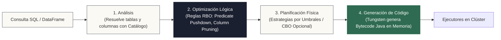

<!-- NOTAS FUENTE ORIGINALES DE OBSIDIAN: [[Spark SQL]], [[Spark SQL y Catalyst Optimizer]] -->

# Capítulo 14: El Optimizador Catalyst y Spark SQL [AVANZADO]

> *"Catalyst es el cerebro matemático de Spark: toma consultas SQL abstractas y las traduce a través de un árbol de operadores lógicos, aplicando optimización basada en reglas y en costos para generar código Java ultra-eficiente en tiempo de ejecución."*

---

## Objetivos de Aprendizaje
Al finalizar este capítulo, el lector será capaz de:
* Comprender las cuatro fases del pipeline de optimización de Catalyst: *Analysis*, *Logical Optimization*, *Physical Planning* y *Code Generation (Tungsten)*.
* Distinguir con precisión entre la optimización basada en reglas (*Rule-Based Optimization - RBO*), la selección de operadores por umbrales y el optimizador basado en costos (*Cost-Based Optimization - CBO*).
* Inspeccionar y depurar planes de ejecución mediante `.explain(mode="formatted")`.
* Comprender por qué el CBO y el reordenamiento de joins vienen desactivados por omisión en Spark y cómo habilitarlos con `ANALYZE TABLE`.
* Explicar cómo **Adaptive Query Execution (AQE)** re-optimiza el plan físico en tiempo de ejecución utilizando estadísticas reales de shuffle.

---

> **Definición 14.1 (El Compilador de Estrategia Relacional)**
> Imagine a un general militar que recibe directivas en múltiples lenguajes declarativos (SQL, Python, Scala, Java, R).
> 
> En lugar de enviar a los soldados a correr a ciegas con cada orden, el general cuenta con Catalyst, un estratega matemático que traduce todas las órdenes a un mapa táctico universal (el árbol sintáctico abstracto o AST). El estratega elimina movimientos redundantes mediante reglas de álgebra relacional, evalúa estrategias físicas viables y compila las órdenes en código binario de máquina ejecutado a máxima velocidad por los nodos del clúster.

---

## 14.1 Arquitectura del Motor Spark SQL

**Spark SQL** es el módulo de Apache Spark para el procesamiento de datos estructurados. A diferencia de la API de bajo nivel de RDDs, Spark SQL proporciona al motor información enriquecida sobre los tipos de datos y las relaciones lógicas de la computación.

El núcleo de esta capacidad reside en **Catalyst**, un optimizador extensible basado en programación funcional en Scala que manipula y transforma árboles de expresiones relacionales:



### Las Cuatro Fases de Optimización de Catalyst

1. **Análisis (Analysis):** Comienza con un *Unresolved Logical Plan*. El analizador consulta el catálogo de metadatos (Hive Metastore o Unity Catalog) para resolver identificadores de tablas y columnas, verificar tipos de datos y asignar identificadores internos únicos a cada atributo relacional.
2. **Optimización Lógica (Logical Optimization):** Aplica optimizaciones estándar basadas en reglas (*Rule-Based Optimization - RBO*), transformando el árbol relacional sin alterar su semántica:
   * **Constant Folding:** Evalúa expresiones deterministas en tiempo de compilación (por ejemplo, `1 + 1` se simplifica a `2`).
   * **Predicate Pushdown:** Desplaza filtros relacionales hacia los operadores de escaneo en almacenamiento para descartar filas lo más cerca posible de la fuente.
   * **Projection Pruning:** Descarta columnas que no participan en agregaciones, filtros o proyecciones posteriores.
3. **Planificación Física (Physical Planning):** Traduce el plan lógico optimizado en uno o más planes físicos ejecutables compuestos por operadores de Spark (`SparkPlan`). En esta fase se seleccionan los algoritmos concretos (por ejemplo, `BroadcastHashJoinExec` vs. `SortMergeJoinExec`).
4. **Generación de Código (Code Generation con Tungsten):** Compila el plan físico en bytecode Java altamente eficiente mediante *Whole-Stage Java Code Generation*, colapsando múltiples operadores en un único bucle continuo en memoria y eliminando la sobrecarga de despacho virtual.

---

## 14.2 Planificación Física: Umbrales de Tamaño frente a Cost-Based Optimizer (CBO)

Existe una confusión generalizada sobre cómo Catalyst decide las estrategias de cruce en su configuración predeterminada:

### La Selección Predeterminada por Umbrales (Threshold-Driven)
Por omisión en Apache Spark, **el optimizador basado en costos (CBO) está desactivado** (`spark.sql.cbo.enabled = false`). La elección entre un Broadcast Hash Join (BHJ) y un Sort-Merge Join (SMJ) **no es realizada por CBO**, sino por una regla heurística del planificador físico basada en umbrales de tamaño en bytes:
* Si las estadísticas de metadatos del catálogo o del escaneo indican que una tabla tiene un tamaño en bytes inferior o igual a `spark.sql.autoBroadcastJoinThreshold` (10 MB por defecto), Catalyst selecciona automáticamente `BroadcastHashJoinExec`.
* Si ambas tablas superan este umbral (o carecen de estimaciones de tamaño en disco), el planificador físico recurre a la estrategia estándar y segura: `SortMergeJoinExec`.

### El Optimizador Basado en Costos (CBO) y Reordenamiento de Joins
Para consultas analíticas complejas que involucran múltiples cruces en estrella ($N \ge 3$ tablas), el orden en que se unen las tablas altera drásticamente el volumen de shuffle intermedio. En este escenario interviene el **CBO**:

```python
# Habilitación explícita de CBO y reordenamiento de joins en la SparkSession
spark.conf.set("spark.sql.cbo.enabled", "true")
spark.conf.set("spark.sql.cbo.joinReorder.enabled", "true")
spark.conf.set("spark.sql.cbo.joinReorder.dp.threshold", "12") # Máximo número de tablas para DP
```

Para que CBO opere eficazmente, requiere estadísticas de cardinalidad y distribución de columnas en el metastore, las cuales deben recopilarse manualmente mediante comandos de mantenimiento:

```sql
-- Recopilación de estadísticas de tamaño y cardinalidad de columnas
ANALYZE TABLE ventas COMPUTE STATISTICS FOR COLUMNS cliente_id, monto;
ANALYZE TABLE clientes COMPUTE STATISTICS FOR COLUMNS cliente_id;
```

Con estas estadísticas, el algoritmo de programación dinámica del CBO calcula el costo estimado de los árboles de unión alternativos y selecciona el orden de ejecución que minimice las tuplas intermedias.

---

## 14.3 Inspección de Planes con `.explain()`

Utilice `.explain(mode="formatted")` para auditar cómo Catalyst optimizó la consulta antes de lanzarla en un clúster de producción:

```python
from pyspark.sql import SparkSession
from pyspark.sql.functions import col

spark = SparkSession.builder \
    .appName("Capitulo14-CatalystOptimizer") \
    .master("local[*]") \
    .getOrCreate()

df_pedidos = spark.read.parquet("data/pedidos.parquet")

# Consulta con filtro y agregación
df_resultado = df_pedidos \
    .select("pedido_id", "cliente_id", "monto_usd", "pais") \
    .filter((col("pais") == "CO") & (col("monto_usd") > 100)) \
    .groupBy("cliente_id") \
    .sum("monto_usd")

# Inspección del plan físico y lógico
df_resultado.explain(mode="formatted")
```

En la salida de `explain`, observe:
* **PushedFilters:** Confirma que el predicado `[EqualTo(pais, 'CO'), GreaterThan(monto_usd, 100.0)]` fue empujado al lector Parquet.
* **ReadSchema:** Muestra que las columnas no utilizadas fueron podadas, leyendo únicamente las requeridas para la computación.

---

## 14.4 Adaptive Query Execution (AQE): Optimización Dinámica en Tiempo de Ejecución

Antes de Spark 3.0, Catalyst planificaba las consultas de forma estática antes de comenzar la ejecución. Si los datos reales diferían de las estimaciones del catálogo (por ejemplo, debido a filtros altamente selectivos que reducían el 99% de las filas), el plan estático no podía adaptarse.

**Adaptive Query Execution (AQE)** resuelve esta limitación re-optimizando el plan físico en tiempo de ejecución en las fronteras de los stages de shuffle:

```python
from pyspark.sql import SparkSession
from pyspark.sql import functions as F

spark = (SparkSession.builder
         .appName("Capitulo14-AQE")
         .master("local[4]")
         .config("spark.sql.shuffle.partitions", "200")
         .getOrCreate())

ventas = spark.range(0, 2_000_000).select(
    (F.col("id") % 50).alias("pais_id"),
    (F.rand(seed=7) * 100).alias("monto"),
)

def correr(aqe: bool):
    spark.conf.set("spark.sql.adaptive.enabled", str(aqe).lower())
    df = ventas.groupBy("pais_id").agg(F.sum("monto").alias("total"))
    df.collect()
    df.explain()

correr(aqe=False)   # El shuffle conserva rígidamente 200 particiones
correr(aqe=True)    # AQE fusiona particiones pequeñas mediante AQEShuffleRead coalesced
```

### Las Tres Capacidades Fundamentales de AQE
1. **Fusión Dinámica de Particiones de Shuffle (`coalescePartitions`):** Si tras una operación `groupBy` el volumen de datos en muchas particiones es mínimo, AQE las consolida dinámicamente en menos particiones para evitar la sobrecarga de programar cientos de tareas triviales.
2. **Conversión Dinámica a Broadcast Join:** Si tras aplicar filtros selectivos el tamaño real de una tabla en un join resulta inferior al umbral de broadcast, AQE transmuta un `SortMergeJoin` planificado inicialmente a un `BroadcastHashJoin`, eliminando el shuffle de la tabla contraria.
3. **Manejo Dinámico de Particiones Sesgadas (`skewJoin`):** Si una partición de shuffle es desproporcionadamente más grande que la mediana, AQE la divide automáticamente en múltiples subtareas paralelas.

---

## 14.5 Criterios de Fiabilidad y Anti-Patrones en Producción

**Anti-patrón 1: Bloquear Catalyst con UDFs Opacas de Python Puro**  
Cuando se utiliza una función `@udf` de Python en un filtro (`df.filter(mi_udf(col("x")))`), Catalyst no puede inspeccionar su contenido lógico. Como resultado, ese predicado no puede ser empujado a la capa de almacenamiento, obligando al motor a transferir todas las filas a la JVM y luego a los procesos de Python para evaluarlas una a una. Combine siempre filtros con funciones nativas de PySpark para reducir el volumen de datos antes de aplicar transformaciones complejas.

**Anti-patrón 2: Asumir que el Reordenamiento de Joins Opera sin Configuración**  
Creer que Spark optimizará automáticamente el orden de unión de múltiples tablas gigantescas sin haber ejecutado `ANALYZE TABLE` ni habilitado `spark.sql.cbo.joinReorder.enabled = true`. Sin estas directivas, Catalyst ejecuta los joins en el orden sintáctico estricto en que fueron declarados en el código.

---

## Preguntas de Revisión y Ejercicios Prácticos
**Ejercicio 14.1 (Operadores de Whole-Stage Code Generation):**  
Al ejecutar `df.explain()`, observa el operador `*(1) FileScan parquet [monto_usd#12, pais#13] PushedFilters: [IsNotNull(pais), EqualTo(pais,CO)]`. ¿Qué denota el asterisco `*(1)` al inicio del operador?

**Solución 14.1:**  
El asterisco `*` indica que el operador físico forma parte de una fase de **Whole-Stage Code Generation** gobernada por el motor Tungsten. El número `(1)` representa el identificador del subárbol de operadores fusionados que Catalyst compiló en una única función Java en memoria, ejecutando el procesamiento en un único bucle continuo que aprovecha los registros de la CPU y minimiza el uso de la pila de llamadas.

---

**Ejercicio 14.2 (Optimización Estática frente a Adaptive Query Execution):**  
¿Por qué una consulta que une una tabla de 100 GB con una tabla de 50 GB puede ejecutarse físicamente como un `BroadcastHashJoin` si AQE está activo, aun cuando ambas tablas superen ampliamente el umbral de 10 MB al inicio?

**Solución 14.2:**  
En la planificación estática inicial, Catalyst estima los tamaños a partir de los metadatos de los archivos en reposo y determina que ambas tablas (100 GB y 50 GB) requieren un `SortMergeJoin`.
Sin embargo, si la consulta contiene un filtro altamente restrictivo sobre la tabla de 50 GB (por ejemplo, `WHERE fecha = '2026-10-12' AND sucursal = 'BOG'`), el volumen real de datos resultante tras el filtrado en la fase de mapeo puede ser de solo 4 MB.
Al estar habilitado **AQE** (`spark.sql.adaptive.enabled = true`), el motor recopila los tamaños reales generados en la frontera del stage de shuffle: al detectar que la tabla filtrada tiene únicamente 4 MB (inferior al umbral de 10 MB), AQE re-optimiza el plan físico en caliente y transforma el `SortMergeJoin` en un `BroadcastHashJoin`, suprimiendo la fase de shuffle y ordenamiento de la tabla de 100 GB.

---

## 14.6 Resumen y Puntos Clave

* **Pipeline de Catalyst:** Se compone de cuatro fases secuenciales: Análisis, Optimización Lógica (RBO), Planificación Física y Generación de Código (Tungsten).
* **Selección por umbrales:** La elección entre BHJ y SMJ en la configuración estándar responde a `spark.sql.autoBroadcastJoinThreshold`, no a CBO.
* **CBO opcional:** El Cost-Based Optimizer y el reordenamiento de joins requieren activación manual (`spark.sql.cbo.enabled = true`) y estadísticas calculadas mediante `ANALYZE TABLE`.
* **Adaptive Query Execution (AQE):** Representa el estándar moderno de ejecución en Spark, ajustando el número de particiones, dividiendo sesgos de datos y convirtiendo dinámicamente operadores a broadcast en tiempo de ejecución.

---

## Lecturas Recomendadas
1. **Armbrust, M. et al. (2015).** *Spark SQL: Relational Data Processing in Spark.* Proceedings of the 2015 ACM SIGMOD International Conference on Management of Data, 1383-1394.
2. **Zaharia, M. et al. (2016).** *Apache Spark: A Unified Engine for Big Data Processing.* Communications of the ACM, 59(11), 56-65.
3. **Apache Spark Project Authors (2024).** *SQL Programming Guide: Catalyst Optimizer and Performance Tuning.* Apache Software Foundation (`https://spark.apache.org/docs/latest/sql-performance-tuning.html`).
