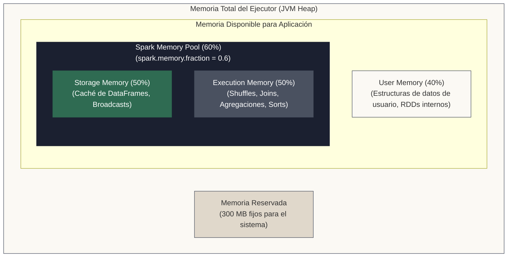

<!-- NOTAS FUENTE ORIGINALES DE OBSIDIAN: [[Memoria RAM]], [[Cache]], [[Spark Memory Management]] -->

# Capítulo 15: Gestión de Memoria RAM y Estrategias de Caché [AVANZADO]

> *"La memoria RAM en Spark no es un espacio homogéneo: está rigurosamente dividida entre memoria de almacenamiento para caché y memoria de ejecución para shuffles y joins. Comprender esta frontera dinámica es la diferencia entre un clúster veloz y uno colapsado por OOM y Garbage Collection."*

---

## Objetivos de Aprendizaje
Al finalizar este capítulo, el lector será capaz de:
* Comprender la arquitectura de memoria del ejecutor (JVM Heap, Off-Heap, Storage Memory, Execution Memory, User Memory).
* Conocer la frontera dinámica entre *Storage* y *Execution* introducida por el modelo de gestión unificada de memoria de Spark.
* Dominar los niveles de persistencia (`cache()`, `persist()` con `MEMORY_ONLY`, `MEMORY_AND_DISK`, `DISK_ONLY`) y saber cuáles aplican en PySpark.
* Diagnosticar y resolver errores de desbordamiento de memoria (*OutOfMemoryError*) y pausas prolongadas de *Garbage Collection*.

---

> **Definición 15.1 (Modelo Unificado de Gestión de Memoria en Spark)**
> A partir de Apache Spark 1.6+, el motor implementa un modelo de asignación unificada de memoria que supera la fragmentación estática tradicional. La memoria heap de cada ejecutor se subdivide dinámicamente entre dos reservas principales: **Execution Memory** (destinada a buffers de barajado, ordenamiento y agregaciones en memoria) y **Storage Memory** (destinada a la persistencia y cacheo de DataFrames y RDDs).
> 
> La frontera entre ambas reservas es elástica, pero **asimétrica**: la ejecución puede desalojar bloques en caché hacia disco cuando necesita memoria de cálculo, aunque solo hasta el **umbral protegido** definido por `spark.memory.storageFraction` (50% del pool de Spark por defecto). Por debajo de ese umbral, los bloques cacheados no pueden ser desalojados por la ejecución; en sentido contrario, el almacenamiento nunca puede desalojar memoria de ejecución en uso.

---

## 15.1 La Arquitectura de Memoria Unificada de Spark

A partir de Spark 1.6, el motor reemplazó el antiguo modelo estático de memoria por el **Unified Memory Manager**. Cada proceso ejecutor (*Executor JVM*) divide su memoria total en cuatro regiones clave:



### La Frontera Dinámica: Storage vs. Execution

1. **Storage Memory (Almacenamiento):** Aloja DataFrames y RDDs cacheados mediante `.cache()` o `.persist()`, así como variables broadcast transmitidas a los nodos.
2. **Execution Memory (Ejecución):** Aloja las estructuras temporales necesarias para computar shuffles, joins, agrupamientos y ordenamientos (*sort buffers*).
3. **El Préstamo Dinámico:**
   * Si la memoria de ejecución no se está utilizando, el almacenamiento puede expandirse para ocupar todo el pool.
### Memoria Fuera de la JVM y Procesos de Python (`memoryOverhead`)

En clústeres orquestados por YARN o Kubernetes, el gestor de recursos impone un límite estricto de memoria física por contenedor:

$$\text{Memoria Física del Contenedor} = \text{spark.executor.memory} + \text{spark.executor.memoryOverhead}$$

* **`spark.executor.memoryOverhead`:** Es la memoria nativa (fuera del heap de la JVM) reservada para buffers del sistema operativo, memoria off-heap de Tungsten y bibliotecas en C/C++. Por defecto se calcula como $\max(384\text{ MB}, 0.10 \times \text{spark.executor.memory})$.
* **El Cuello de Botella de PySpark:** Cada ejecutor que procesa transformaciones de Python (como UDFs o Pandas UDFs con Arrow) spawnea subprocesos de Python independientes (`python3` / `pyspark.daemon`). Estos procesos consumen memoria del sistema operativo fuera del heap de la JVM.
* **El Error "Container killed by YARN for exceeding memory limits":** Si los subprocesos de Python acumulan DataFrames o arrays en memoria que superan el margen asignado por `memoryOverhead`, YARN o el OOM Killer de Linux destruyen el contenedor inmediatamente.
* **Solución en Producción:** Incrementar `spark.executor.memoryOverhead` (por ejemplo, al 25% o 30% de la memoria del ejecutor) o limitar la memoria del worker de Python mediante `spark.python.worker.memory` (por defecto 512 MB).

---

## 15.2 Profundización Técnica: Niveles de Persistencia (StorageLevel)

El método `.cache()` es un alias abreviado para `.persist(StorageLevel.MEMORY_AND_DISK)` en DataFrames.

> **Regla de Oro: `.cache()` y `.persist()` son Estrictamente Perezosos**  
> Invocar `df.cache()` no carga ni un solo byte en la memoria RAM de los ejecutores de forma inmediata. La persistencia es una **instrucción diferida**: Spark registrará que el DataFrame debe guardarse en caché, pero los datos se materializarán en la memoria física únicamente en el instante en que se evalúe la primera acción (`count()`, `show()`, `write()`).

Spark ofrece múltiples niveles de almacenamiento:
* **MEMORY_ONLY:** Guarda los datos como objetos Java deserializados en RAM. Máxima velocidad de lectura, pero si no cabe, las particiones no cacheadas se recalculan desde cero al leerlas.
* **MEMORY_AND_DISK (Recomendado):** Guarda en RAM; si se llena, vuelca el excedente a disco local (*Spill*) sin recalcular el linaje.
* **Variantes `_SER` (`MEMORY_ONLY_SER`, `MEMORY_AND_DISK_SER`):** Almacenan datos serializados en bytes compactos, reduciendo el consumo de RAM a cambio de CPU al deserializar. En PySpark, los DataFrames ya se almacenan internamente en formato binario columnar comprimido gestionado por Tungsten.

---

> **Consideraciones de Producción 15.1: Caché Estratégica y Liberación de Memoria**
> Cachear tiene sentido únicamente cuando un DataFrame costoso se va a reutilizar en **múltiples acciones subsecuentes**. Siempre se debe liberar la memoria con `.unpersist()` cuando concluye el bloque de trabajo:

```python
from pyspark.sql import SparkSession
from pyspark.storagelevel import StorageLevel
from pyspark.sql.functions import col

spark = SparkSession.builder \
    .appName("Capitulo15-GestionMemoriaCache") \
    .master("local[*]") \
    .getOrCreate()

# Cargar y aplicar transformaciones complejas
df_pesado = spark.read.parquet("data/eventos_anuales.parquet") \
    .filter(col("tipo_evento").isin(["COMPRA", "REEMBOLSO"])) \
    .groupBy("cliente_id", "categoria") \
    .count()

# 1. Persistir en memoria con desborde a disco (perezoso: no ejecuta I/O aún)
df_pesado.persist(StorageLevel.MEMORY_AND_DISK)

# 2. Acción 1: Conteo total (aquí se materializa la caché en los Workers)
total_filas = df_pesado.count()
print(f"Total agrupado: {total_filas}")

# 3. Acción 2: Exportar a dos destinos distintos reutilizando la caché en RAM
df_pesado.filter(col("count") > 10).write.parquet("salida/clientes_frecuentes/")
df_pesado.filter(col("count") <= 10).write.parquet("salida/clientes_ocasionales/")

# 4. LIBERACIÓN OBLIGATORIA DE MEMORIA EN PRODUCCIÓN
df_pesado.unpersist()
print("Memoria RAM del clúster liberada exitosamente.")
```

---

## 15.3 Criterios de Fiabilidad y Anti-Patrones en Producción

**Anti-patrón 1: Cachear DataFrames que Solo se Usan una Vez**  
Escribir `df.cache()` y luego invocar una única acción (`df.write.parquet(...)`) es un desperdicio neto de cómputo y memoria: fuerza a Spark a serializar y retener los datos en RAM innecesariamente antes de que el script termine.

**Anti-patrón 2: Asumir que `.cache()` es una Acción Inmediata**  
Creer que llamar a `df.cache()` precalienta la memoria antes de un bloque de código crítico. Como es perezosa, la primera consulta pagará todo el costo de escaneo y cómputo más la sobrecarga adicional de escribir en la memoria de Storage.

**Anti-patrón 3: Olvidar `unpersist()` en Pipelines de Larga Duración**  
En aplicaciones continuas o pipelines diarios, acumular DataFrames cacheados sin despersistir fragmenta la memoria y detona un `java.lang.OutOfMemoryError` en los ejecutores.


---


## Preguntas de Revisión y Ejercicios Prácticos
**Ejercicio 15.1 (Diagnóstico de Spill to Disk):**

En el Spark UI observas que una etapa muestra: `Spill (Memory): 12.4 GB` y `Spill (Disk): 3.2 GB`. ¿Qué significa exactamente esta métrica y qué impacto tiene en el tiempo de ejecución?

**Solución:**
**Explicación técnica:**

Significa que durante un shuffle o join, el pool de Execution Memory del ejecutor se agotó. Spark tuvo que serializar 12.4 GB de datos en RAM y volcarlos como 3.2 GB comprimidos al disco rígido local del Worker Node.

*Impacto:* Degrada severamente el rendimiento debido al tiempo de E/S de disco. Se soluciona aumentando `spark.sql.shuffle.partitions` (para que cada partición sea más pequeña) o aumentando la memoria RAM por ejecutor (`spark.executor.memory`).

---

## 15.4 Resumen y Puntos Clave

* **Memoria dinámica:** Execution y Storage comparten el pool de Spark; la ejecución puede desalojar caché solo hasta el umbral protegido de `spark.memory.storageFraction`.
* **Caché selectiva:** Solo persiste DataFrames que intervengan en múltiples acciones posteriores.
* **Regla de oro:** Todo `.persist()` o `.cache()` en producción debe tener su correspondiente `.unpersist()` al terminar su ciclo útil.

---

## Lecturas Recomendadas
1. **Karau, H. & Warren, R. (2017).** *High Performance Spark: Best Practices for Scaling and Optimizing Apache Spark.* O'Reilly Media. (Capítulo 2: How Spark Works).
2. **Spark Documentation:** *Memory Management Overview* (`https://spark.apache.org/docs/latest/tuning.html#memory-management-overview`).
