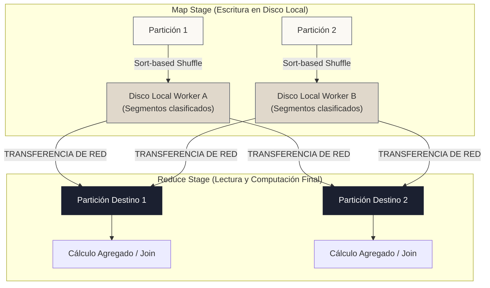

<!-- NOTAS FUENTE ORIGINALES DE OBSIDIAN: [[Partitioning y Shuffling en Spark]], [[shuffle]] -->

# Capítulo 16: Particionado, Shuffling y Mitigación de Data Skew [AVANZADO]

> *"El particionado es el plano regulador de la computación distribuida: define cómo se fragmentan los datos entre los ejecutores. Un mal particionado produce cuellos de botella de red y el temido Data Skew, donde un solo ejecutor retrasado frena a todo el clúster."*

---

## Objetivos de Aprendizaje
Al finalizar este capítulo, el lector será capaz de:
* Comprender la mecánica física del **Shuffling**: fase Map, serialización a disco local, transferencia de red y fase Reduce.
* Diferenciar cuándo utilizar `repartition()` (con shuffle total) y cuándo usar `coalesce()` (sin shuffle, solo fusión local).
* Calibrar el número óptimo de particiones de salida (`spark.sql.shuffle.partitions`) buscando particiones de 100 MB a 200 MB.
* Diagnosticar y resolver el **Data Skew** (desequilibrio de datos) utilizando *Salting* y *Adaptive Query Execution (AQE)* (véase la sección 14.3).

---

> **Definición 16.1 (La Autopista Congestionada y las Cajas Desiguales)**
> Imagina un equipo de 10 trabajadores empacando frutas en un almacén. Las operaciones locales (lavar, pelar) se hacen en paralelo sin estorbarse.
> 
> El Shuffle ocurre cuando se da la orden de que todas las manzanas deben ir a la mesa 1, todas las naranjas a la mesa 2 y todas las uvas a la mesa 3: los 10 trabajadores tienen que caminar por los pasillos al mismo tiempo esquivándose entre sí. Los pasillos se congestionan (la red del clúster).
> 
> El Data Skew ocurre cuando resulta que el 90% de la carga del camión eran uvas: la mesa 3 queda enterrada bajo una montaña de frutas y trabaja durante 5 horas extras, mientras las otras 9 mesas terminaron en 5 minutos y se quedan con los brazos cruzados esperando a que la mesa 3 termine.

---

## 16.1 La Mecánica Física del Shuffling

El **Shuffling** es el proceso mediante el cual Apache Spark redistribuye los datos entre los nodos del clúster para ejecutar operaciones que requieren una reorganización global por clave, como agrupaciones (`groupBy`), uniones (`join`) o cambios forzados de particionamiento.

Es una de las operaciones más costosas del cómputo distribuido y consta de dos fases:

1. **Map Phase (Shuffle Write):** Cada partición de entrada procesa sus datos y escribe los resultados en archivos temporales en el disco local del nodo trabajador, organizados y clasificados por la partición de destino.
2. **Reduce Phase (Shuffle Read):** Las particiones de destino recogen los bloques que les corresponden a través de la red desde todos los nodos remotos, los deserializan y continúan el cálculo.



### Repartition vs. Coalesce

Para alterar el número de particiones de un DataFrame disponemos de dos herramientas con comportamientos físicos radicalmente distintos:

* `repartition(numPartitions)`:
  * Ejecuta un **shuffle completo** a través de la red redistribuyendo los datos de forma equitativa (*Full Shuffle*).
  * Es obligatorio cuando necesitas **aumentar** el número de particiones o cuando quieres redistribuir datos sesgados por una clave (`repartition(100, "pais")`).
* `coalesce(numPartitions)`:
  * **No realiza shuffle de red**. Simplemente fusiona particiones existentes que ya residen en el mismo nodo o en nodos vecinos.
  * Solo puede utilizarse para **reducir** el número de particiones (por ejemplo, reducir de 200 a 10 particiones antes de escribir a disco para evitar miles de archivos pequeños).

---


## 16.2 Profundización Técnica: El Síndrome del Straggler (Data Skew)


El **Data Skew** es la patología número uno en pipelines de producción:


Ocurre cuando una clave de agrupación o join está hiperconcentrada (por ejemplo, un valor por defecto como `id_usuario = -1` o transacciones masivas de una corporación multinacional).


En el Spark UI, verás que una tarea (*Task*) tarda 45 minutos mientras las otras 199 tareas terminaron en 10 segundos. Este ejecutor retrasado se denomina **Straggler** y suele colapsar con `OutOfMemory: Container killed by YARN for exceeding memory limits`.


---

> **Consideraciones de Producción 16.1: Mitigación de Skew con Salting**
> La técnica de Salting rompe la concentración artificial de una clave agregando un componente aleatorio ("sal") para forzar a Spark a distribuir el trabajo entre múltiples ejecutores:

```python
from pyspark.sql import SparkSession
from pyspark.sql import functions as F

spark = SparkSession.builder \
    .appName("Capitulo16-Particionado-Salting") \
    .master("local[*]") \
    .getOrCreate()

df_sesgado = spark.read.parquet("data/transacciones_sesgadas.parquet")

N_SAL = 10  # número de subclaves en las que se fragmenta la clave caliente

# 1. Añadir una sal aleatoria 0..9 COMO COLUMNA APARTE (no se concatena al id)
df_salado = df_sesgado.withColumn("sal", (F.rand() * N_SAL).cast("int"))

# 2. Primera agregación por (cliente_id, sal): la clave caliente se reparte en 10 grupos
df_parcial = df_salado.groupBy("cliente_id", "sal") \
    .agg(F.sum("monto").alias("monto_parcial"))

# 3. Segunda agregación solo por cliente_id: ahora hay como máximo 10 filas por cliente
df_final = df_parcial.groupBy("cliente_id") \
    .agg(F.sum("monto_parcial").alias("monto_total"))

df_final.show(5)
```

Agrupar por `(cliente_id, sal)` evita el error clásico de concatenar el id con la sal y luego intentar recuperar el id con `substr(...)`, que solo funciona si todos los identificadores miden exactamente lo mismo. Este patrón de dos fases es útil sobre todo para agregaciones que **no** se resuelven bien con *map-side combine* y para joins; para `sum` y `count` simples, el *combine* parcial ya reduce el problema (véase el Cap. 2) y AQE puede mitigar el resto en joins.


---


## 16.3 Criterios de Fiabilidad y Anti-Patrones en Producción


**Anti-patrón 1: Usar `repartition(1)` o `coalesce(1)` sin entender su costo**

Para generar un único archivo existen dos caminos con costos distintos. `repartition(1)` ejecuta un shuffle completo hacia una sola partición, pero la etapa **anterior** conserva todo su paralelismo. `coalesce(1)` evita el shuffle, y por eso puede ser **peor**: al fusionar sin frontera de shuffle, **toda la etapa previa se ejecuta en una única tarea**, colapsando el paralelismo de cálculos pesados (joins, agregaciones, UDFs) que estaban antes. Regla práctica: usa `coalesce(n)` para reducir de forma moderada (por ejemplo, de 200 a 20 particiones) justo antes de escribir; si de verdad necesitas un solo archivo y el cómputo previo es pesado, prefiere `repartition(1)`, y solo si los datos caben sobradamente en un nodo. En muchos casos es mejor escribir varios archivos y consolidarlos después, o dejar que Delta compacte con `OPTIMIZE` (Cap. 18).


**Anti-patrón 2: Mantener spark.sql.shuffle.partitions en 200 para cualquier dataset**

200 es el valor por defecto de Spark y no tiene relación con tu volumen. Si procesas 1 TB de datos, 200 particiones producirían particiones de unos 5 GB cada una, con alto riesgo de *spill* y fallos por memoria. Si procesas 10 MB, producirás 200 micro-tareas que gastan más tiempo en coordinación que en computación. Calibra para obtener particiones del orden de 100 a 200 MB (o, con AQE activo, fija un número inicial alto y deja que el coalescing lo ajuste hacia `advisoryPartitionSizeInBytes`).


---


## Preguntas de Revisión y Ejercicios Prácticos
**Ejercicio 16.1 (Cálculo del Shuffle Partition Ideal):**

Si tu pipeline realiza un `groupBy` sobre un dataset cuyo tamaño intermedio antes del shuffle es de 64 GB, ¿cuál es el número ideal de `spark.sql.shuffle.partitions` que deberías configurar para apuntar a un tamaño de partición de 128 MB?

**Solución:**
**Cálculo:**

$$\text{Particiones} = \frac{64\text{ GB}}{128\text{ MB}} = \frac{64 \times 1024\text{ MB}}{128\text{ MB}} = 512\text{ particiones}$$

*Configuración recomendada:* `spark.conf.set("spark.sql.shuffle.partitions", 512)`. Esto apunta a que cada tarea procese aproximadamente 128 MB, un tamaño cómodo que reduce el riesgo de *spill* a disco y evita el exceso de tareas diminutas. Con AQE activo puedes fijar un valor inicial mayor y dejar que el coalescing lo ajuste.

---

## 16.4 Resumen y Puntos Clave

* **El shuffle no es gratis:** Implica escritura a disco, tráfico de red y deserialización; debe minimizarse mediante filtros tempranos y broadcast joins.
* **Coalesce para reducir, Repartition para aumentar o redistribuir:** `coalesce()` evita el shuffle, pero fusionar hasta muy pocas particiones puede colapsar el paralelismo de la etapa previa; entonces `repartition()` es la opción más segura.
* **Salting combate el sesgo:** Romper claves calientes en fragmentos aleatorios es el patrón estándar de la industria para derrotar al *straggler*.

---

## Lecturas Recomendadas
1. **Karau, H. & Warren, R. (2017).** *High Performance Spark.* O'Reilly Media. (Capítulo 5: Effective Transformations; Capítulo 6: Working with Key/Value Data).
2. **Databricks Blog:** *Optimizing Apache Spark SQL Joins* (`https://databricks.com/blog/2021/04/19/optimizing-apache-spark-sql-joins.html`).
