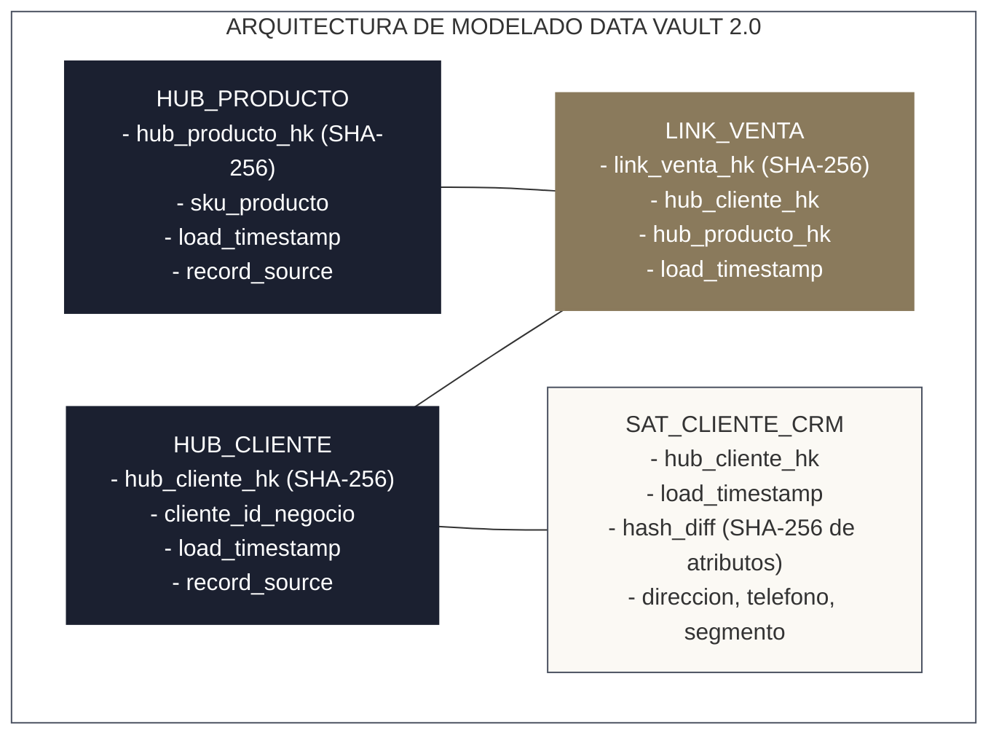

<!-- NOTAS FUENTE ORIGINALES DE OBSIDIAN: [[Medallion Architecture]], [[Modelado Dimensional en Lakehouse]], [[Dimensional Modeling]], [[Data Modeling Patterns]] -->

# Capítulo 17: Arquitectura Medallón y Modelado Dimensional [NÚCLEO EMPLEABILIDAD]

> *"La arquitectura medallón y el modelado dimensional representan la convergencia definitiva entre el lago y el almacén: los datos transitan desde el estado crudo inmutable en Bronze, se sanean y enriquecen en Silver, y culminan en modelos dimensionales de estrella y tablas consolidadas en Gold listos para alimentar decisiones estratégicas de negocio con latencia predecible."*

---

## Objetivos de Aprendizaje
Al finalizar este capítulo, el lector será capaz de:
* Comprender la jerarquía de refinamiento y garantías de servicio de la **Arquitectura Medallón**: Capa Bronze (Raw / Inmutable), Capa Silver (Enriched / Conforme) y Capa Gold (Business Aggregates / Data Marts).
* Comparar críticamente esquemas en estrella (*Star Schema*), esquemas en copo de nieve (*Snowflake Schema*) y el patrón *One Big Table* (OBT) sobre motores columnares modernos.
* Clasificar y modelar tablas de hechos (*Transaction Facts*, *Periodic Snapshots*, *Accumulating Snapshots*, *Factless Facts*) y dimensiones (*Conformed*, *Role-Playing*, *Degenerate*, *Bridge*, *Junk Dimensions*).
* Generar claves subrogadas deterministas y evaluar rigurosamente los riesgos de colisión de funciones hash de 64 bits frente a 256 bits (`sha256`).
* Implementar de extremo a extremo el ciclo de vida de Dimensiones Lentamente Cambiantes (*SCD Tipo 1 y Tipo 2*) mediante transacciones `MERGE INTO` en Delta Lake sin duplicación de registros.
* Garantizar idempotencia física utilizando la opción idiomática `replaceWhere` de Delta Lake y el modo de sobrescritura dinámica de particiones.

---

> **Definición 17.1 (La Refinería de Metales Preciosos)**
>
> La Arquitectura Medallón conceptualiza el flujo de datos como un proceso físico de purificación metalúrgica:
>
> * **Capa Bronze (Mina y Almacén Crudo):** Representa el mineral extraído de la veta geológica tal y como sale a la superficie: contiene barro, impurezas y rocas no mineralizadas. Ningún fragmento se descarta; se preserva en su estado original bajo almacenamiento inmutable para permitir auditorías forenses y reconstrucciones completas del sistema ante cambios de lógica retrospectivos.
> * **Capa Silver (Fundición y Refinamiento Conforme):** Es el proceso donde se eliminan las impurezas, se filtran las anomalías, se estandarizan las barras metálicas a un grado de pureza homogéneo y se integran minerales afines. Es la fuente de la verdad operacional para ingenieros de datos y científicos de datos.
> * **Capa Gold (Joyería y Acuñación de Monedas):** Constituye el producto final pulido con precisión micrométrica: joyas, coronas y monedas certificadas listas para el consumo directo por parte de usuarios finales, cuadros de mando ejecutivos (Power BI, Tableau) y modelos analíticos de alto impacto.

---

## 17.1 Jerarquía de Capas en la Arquitectura Medallón

La Arquitectura Medallón organiza el lago de datos transaccional en tres capas de madurez progresiva, desacoplando la ingestión veloz de la computación semántica compleja:

```mermaid
graph LR
    Fuentes["Fuentes Externas<br/>(Kafka, CDC, APIs, ERPs)"] -->|"Ingesta Continua<br/>Append-Only"| Bronze["CAPA BRONZE<br/>(Raw / Auditoría / Inmutable)"]
    Bronze -->|"Limpieza, Tipado,<br/>Deduplicación & Enriquecimiento"| Silver["CAPA SILVER<br/>(Tablas Conformadas / Fuente Única)"]
    Silver -->|"Agregaciones Kimball,<br/>Marts & Métricas de Negocio"| Gold["CAPA GOLD<br/>(Star Schema / OBT / Consumo)"]
    Gold --> Consumo["Consumo Analítico<br/>(BI, SQL Interactivos, ML Ops)"]
    style Fuentes fill:#ffffff,stroke:#4a5160,stroke-width:1px
    style Bronze fill:#8a7a5c,color:#ffffff,stroke:#8a7a5c,stroke-width:2px
    style Silver fill:#4a5160,color:#ffffff,stroke:#4a5160,stroke-width:2px
    style Gold fill:#1b2030,color:#ffffff,stroke:#1b2030,stroke-width:2px
    style Consumo fill:#ffffff,stroke:#2f6b52,stroke-width:2px
```



### 1. Capa Bronze (Raw / Ingesta Histórica)
* **Contenido:** Copia fidedigna de las cargas de origen sin modificaciones de valor ni descarte de registros. Los esquemas admiten variantes flexibles (JSON empaquetado o columnas estructuradas).
* **Columnas obligatorias de metadatos de auditoría:**
  * `_ingestion_timestamp`: Marca temporal UTC en la que el registro aterrizó en el Lakehouse.
  * `_source_file`: Ruta de almacenamiento o identificador del mensaje Kafka de origen.
  * `_batch_id` / `_job_id`: Identificador de ejecución del pipeline orquestador.
* **Política de escritura:** Estrictamente **Append-Only** (anexión continua). Jamás se ejecutan actualizaciones ni borrados directos en Bronze, salvo purgas obligatorias por regulaciones de privacidad (RGPD / Habeas Data).

### 2. Capa Silver (Limpia, Tipada y Conformada)
* **Contenido:** Datos validados, normalizados con tipos canónicos (reemplazo de strings por timestamps, enteros y decimales precisos), deduplicados y enriquecidos con cruces fundamentales.
* **Propósito:** Representa la "versión única de la verdad" corporativa. Aquí viven las entidades de negocio centrales (clientes, órdenes, pagos, eventos de navegación).
* **Reglas de Calidad:** Se descartan o desvían a tablas de cuarentena aquellos registros que violan contratos de datos o integridad estructural.

### 3. Capa Gold (Agregada y Optimizada para el Negocio)
* **Contenido:** Conjuntos de datos estructurados para maximizar la velocidad de lectura interactiva. Implementa modelos dimensionales de Ralph Kimball (esquemas en estrella), vistas materializadas y tablas desnormalizadas (*One Big Table*).
* **Consumidores:** Consultas ad-hoc de analistas, reportes regulatorios, dashboards ejecutivos y *feature stores* para aprendizaje automático.

---

## 17.2 Modelado Dimensional en el Lakehouse Moderno

El modelado dimensional introducido por Ralph Kimball mantiene plena vigencia en los motores analíticos columnares, aunque su justificación física ha evolucionado:

### Clasificación Integral de Tablas de Hechos (Fact Tables)
Las tablas de hechos capturan métricas cuantitativas generadas por eventos operacionales:
1. **Hechos Transaccionales (*Transaction Facts*):** Registran un evento en un instante temporal discreto (una venta, un clic, un movimiento bancario). Poseen la granularidad más atómica y el volumen más masivo.
2. **Hechos de Instantánea Periódica (*Periodic Snapshot Facts*):** Capturan el estado del negocio en intervalos regulares acumulativos (saldo de fin de mes de una cuenta, nivel de inventario semanal por almacén).
3. **Hechos de Instantánea Acumulativa (*Accumulating Snapshot Facts*):** Modelan el ciclo de vida de un proceso con inicio y fin definidos con múltiples hitos temporales (solicitud de préstamo: fecha recepción $\rightarrow$ fecha aprobación $\rightarrow$ fecha desembolso).
4. **Hechos Sin Hechos (*Factless Fact Tables*):** Tablas de hechos que no contienen métricas numéricas acumulables, sino exclusivamente claves foráneas que registran la ocurrencia de un evento (ej. asistencia de un estudiante a una clase o cobertura de un evento promocional).

### Clasificación de Tablas de Dimensiones (Dimension Tables)
1. **Dimensiones Conformadas (*Conformed Dimensions*):** Dimensiones consistentes y universales compartidas entre múltiples hechos (ej. la dimensión `dim_cliente` es idéntica para hechos de ventas, soporte y facturación).
2. **Dimensiones de Rol Jugado (*Role-Playing Dimensions*):** Una misma dimensión física asume diferentes roles lógicos en la misma tabla de hechos mediante múltiples claves foráneas (ej. `dim_tiempo` referenciada como `fecha_orden_id`, `fecha_envio_id` y `fecha_entrega_id`).
3. **Dimensiones Degeneradas (*Degenerate Dimensions*):** Identificadores transaccionales que residen en la tabla de hechos sin una tabla de dimensión satélite propia (ej. `numero_factura`, `codigo_rastreo`).
4. **Dimensiones Basura (*Junk Dimensions*):** Combinación de atributos discretos de baja cardinalidad (flags booleanos, códigos de estado) agrupados en una sola tabla de dimensión para evitar saturar la tabla de hechos con decenas de claves foráneas.
5. **Tablas Puente (*Bridge Tables*):** Tablas intermedias utilizadas para modelar relaciones de muchos a muchos (*M:N*) entre una tabla de hechos y una dimensión (ej. una póliza de seguro con múltiples beneficiarios).
6. **Miembros Desconocidos (*Unknown Members*):** Toda dimensión debe incluir un registro con clave subrogada `-1` (ej. `cliente_sk = -1`, `nombre = 'NO INFORMADO'`). Cuando una transacción de la tabla de hechos contiene una clave natural nula o no resuelta, apunta a `-1` en lugar de dejar la clave foránea en `NULL`, evitando que los cruces `INNER JOIN` descarten transacciones legítimas.

### Star Schema vs. Snowflake Schema vs. One Big Table (OBT)

| Criterio | Esquema en Estrella (Star) | Esquema Copo de Nieve (Snowflake) | One Big Table (OBT) |
| :--- | :--- | :--- | :--- |
| **Normalización** | Desnormalizado en dimensiones (2NF). | Altamente normalizado (3NF en dimensiones). | Completamente desnormalizado (1 sola tabla). |
| **Complejidad de Joins** | Baja (1 join por dimensión contra el hecho). | Alta (múltiples joins en cascada para resolver jerarquías). | Cero joins (toda la información en la misma fila). |
| **Eficiencia en Motores Columnares** | **Excelente:** Excelente compresión y data skipping. | **Deficiente:** Múltiples shuffles distribuidos ralentizan BI. | **Suprema en consultas específicas:** Máxima velocidad, mayor costo de almacenamiento. |
| **Mantenibilidad** | Alta: Esquema comprensible por usuarios de negocio. | Media: Jerarquías rígidas y complejas. | Baja: Cambios de atributos requieren reescribir tablas masivas. |

### Claves Subrogadas Distribuidas: Paradoja del Cumpleaños y Hashing
En almacenes relacionales tradicionales se utilizaban secuencias autoincrementales (`AUTO_INCREMENT`). En sistemas distribuidos, generar un entero monótono global introduce un cuello de botella de coordinación centralizado.

El estándar moderno en Lakehouse consiste en generar claves subrogadas deterministas mediante **funciones hash criptográficas** sobre la clave natural del negocio y los metadatos de vigencia:

$$\text{cliente\_sk} = \text{sha2}(\text{concat}(\text{sistema\_origen}, \text{cliente\_id}, \text{date\_format}(\text{valido\_desde}, \text{'yyyy-MM-dd HH:mm:ss'})), 256)$$

#### Análisis de Probabilidad de Colisión
Un error frecuente consiste en emplear hashes de 64 bits (`xxhash64`) en tablas masivas. De acuerdo con la **paradoja del cumpleaños**, la probabilidad de que ocurra al menos una colisión en un espacio de claves de tamaño $N$ tras insertar $n$ registros se aproxima por:

$$P(\text{colisión}) \approx 1 - e^{-\frac{n^2}{2N}}$$

* Para un hash de **64 bits** ($N = 2^{64} \approx 1.84 \times 10^{19}$):
  Con apenas $n = 10^9$ registros (mil millones de filas), la probabilidad de colisión es:
  $$P \approx 1 - e^{-\frac{10^{18}}{2 \times 1.84 \times 10^{19}}} \approx 1 - e^{-0.027} \approx \mathbf{2.7\%}$$
  Una probabilidad del 2.7% de corromper la unicidad de las claves es inaceptable en analítica empresarial.
### 4. Data Vault 2.0 en la Capa Silver Empresarial: Hubs, Links y Satellites

En organizaciones corporativas complejas con decenas de sistemas transaccionales heterogéneos (SAP, Salesforce, bases operacionales locales), intentar forzar un modelo dimensional de Kimball directamente en la ingesta crea cuellos de botella organizacionales: cualquier cambio en una fuente exige renegociar el esquema de la dimensión compartida.

**Data Vault 2.0** (diseñado por Dan Linstedt) resuelve este problema desacoplando la integración en tres primitivas tabulares normalizadas y auditables:



1. **Hubs (Centros de Negocio):** Representan conceptos centrales del negocio (Clientes, Productos, Tiendas). Contienen únicamente la clave de negocio única (*Business Key*), su hash SHA-256 (`hub_cliente_hk`), la marca de tiempo de carga (`load_timestamp`) y el sistema fuente de origen (`record_source`). **No contienen atributos descriptivos.**
2. **Links (Interconexiones y Transacciones):** Representan relaciones asociativas o transacciones de negocio entre dos o más Hubs (ej. una venta que asocia a un Cliente con un Producto). Almacenan los hashes foráneos de los Hubs interconectados y son **estrictamente de solo adición (*Append-Only*)**.
3. **Satellites (Contexto Descriptivo e Historial):** Almacenan todos los atributos descriptivos mutables a lo largo del tiempo. Incorporan un campo especial **`hash_diff`** (un hash SHA-256 concatenado de todos los atributos descriptivos). Al procesar una carga incremental, si el `hash_diff` entrante difiere del último registrado, se inserta una nueva fila satélite de forma automática sin bloquear otras fuentes.

> **Estrategia Híbrida en Producción:** La arquitectura más robusta utiliza **Data Vault 2.0 en la Capa Silver** (para integrar 30+ fuentes heterogéneas sin fricciones de esquema) y proyecta **Modelos Dimensionales de Kimball en la Capa Gold** (para que analistas de negocio y herramientas de BI como Power BI o Tableau consulten estrellas optimizadas y comprensibles).

---

## 17.3 Slowly Changing Dimensions (SCD) Tipo 1 y Tipo 2

Cuando los atributos de una dimensión cambian con el tiempo (por ejemplo, un cliente se traslada de ciudad), el modelo debe gobernar la mutación histórica:

* **SCD Tipo 1 (Sobrescritura Directa):** El valor anterior se destruye y se reemplaza por el nuevo. No conserva historia. Adecuado para corregir errores tipográficos en nombres o números telefónicos.
* **SCD Tipo 2 (Preservación Histórica):** Se cierra la vigencia del registro existente estableciendo su fecha final y marcando su bandera de actualidad como inactiva; a continuación, se inserta una nueva fila con los valores actualizados y vigencia abierta.

```
Estado Original:
[ID: 101 | Nombre: Juan | Ciudad: Bogotá    | Valido_Desde: 2024-01-01 | Valido_Hasta: 9999-12-31 | Es_Actual: TRUE]

Tras mudanza a Medellín (SCD Tipo 2 aplicado el 2026-06-15):
[ID: 101 | Nombre: Juan | Ciudad: Bogotá    | Valido_Desde: 2024-01-01 | Valido_Hasta: 2026-06-15 | Es_Actual: FALSE]
[ID: 101 | Nombre: Juan | Ciudad: Medellín  | Valido_Desde: 2026-06-15 | Valido_Hasta: 9999-12-31 | Es_Actual: TRUE]
```

---

> **Consideraciones de Producción 17.1: Implementación Robusta de SCD Tipo 2 con Delta Lake MERGE**
>
> Para ejecutar SCD Tipo 2 en una sola transacción atómica distribuida **sin duplicar registros que no cambiaron**, se identifican de forma rigurosa los cambios reales y los clientes nuevos:

```python
from pyspark.sql import SparkSession
import pyspark.sql.functions as F
from delta.tables import DeltaTable

spark = SparkSession.builder \
    .appName("Capitulo17-SCD2-Robusto") \
    .config("spark.sql.extensions", "io.delta.sql.DeltaSparkSessionExtension") \
    .config("spark.sql.catalog.spark_catalog", "org.apache.spark.sql.delta.catalog.DeltaCatalog") \
    .master("local[*]") \
    .getOrCreate()

ruta_dim_clientes = "lakehouse/gold/dim_clientes"
delta_dim = DeltaTable.forPath(spark, ruta_dim_clientes)

# 1. Novedades entrantes validadas
df_novedades = spark.read.table("silver_staging_clientes")

# 2. Clientes actualmente vigentes en la dimensión
df_actuales = delta_dim.toDF().filter(F.col("es_actual") == True)

# 3. Detectar registros modificados (cambio en atributos seguidos)
df_cambios = df_novedades.alias("nov") \
    .join(df_actuales.alias("dim"), "cliente_id") \
    .filter("(nov.ciudad <> dim.ciudad) OR (nov.segmento <> dim.segmento)")

# 4. Detectar clientes completamente nuevos (que no existen en la dimensión)
df_nuevos = df_novedades.join(df_actuales, "cliente_id", "left_anti")

# 5. Construir el conjunto unificado para el MERGE:
# a) Filas para CERRAR: merge_key = cliente_id (coincide con target vigente)
df_para_cerrar = df_cambios.select(
    F.col("nov.cliente_id").alias("merge_key"),
    F.col("nov.*")
)

# b) Filas para INSERTAR: solo los clientes nuevos y la nueva versión de los modificados
#    (merge_key = NULL para forzar la rama whenNotMatchedInsert)
df_para_insertar = df_nuevos.unionByName(df_cambios.select("nov.*")).select(
    F.lit(None).cast("string").alias("merge_key"),
    F.col("*")
)

df_staged_merge = df_para_cerrar.unionByName(df_para_insertar)

# 6. Ejecución atómica de MERGE INTO en Delta Lake
delta_dim.alias("target").merge(
    df_staged_merge.alias("source"),
    "target.cliente_id = source.merge_key AND target.es_actual = true"
).whenMatchedUpdate(
    set={
        "valido_hasta": F.col("source.fecha_evento"),
        "es_actual": F.lit(False)
    }
).whenNotMatchedInsert(
    values={
        "cliente_sk": F.expr("sha2(concat('ERP_', source.cliente_id, '_', string(source.fecha_evento)), 256)"),
        "cliente_id": "source.cliente_id",
        "nombre": "source.nombre",
        "ciudad": "source.ciudad",
        "segmento": "source.segmento",
        "valido_desde": "source.fecha_evento",
        "valido_hasta": F.to_timestamp(F.lit("9999-12-31 23:59:59")),
        "es_actual": F.lit(True)
    }
).execute()

print("[PRODUCCIÓN] SCD Tipo 2 aplicado exitosamente bajo transacción ACID.")
```

---

> **Consideraciones de Producción 17.2: Generación Automatizada de la Dimensión de Tiempo**
>
> La dimensión `dim_tiempo` es el eje gravitacional de todo esquema en estrella. Jamás debe depender de extracciones de fuentes operacionales; se genera sintéticamente cubriendo un horizonte de 10 a 20 años:

```python
# Generación de dim_tiempo para 2020 a 2035 en PySpark
df_fechas = spark.sql("""
    SELECT explode(sequence(to_date('2020-01-01'), to_date('2035-12-31'), interval 1 day)) AS fecha
""").select(
    F.date_format("fecha", "yyyyMMdd").cast("int").alias("fecha_id"),
    F.col("fecha"),
    F.year("fecha").alias("anio"),
    F.quarter("fecha").alias("trimestre"),
    F.month("fecha").alias("mes"),
    F.date_format("fecha", "MMMM").alias("nombre_mes"),
    F.dayofmonth("fecha").alias("dia_mes"),
    F.dayofweek("fecha").alias("dia_semana"),
    F.date_format("fecha", "EEEE").alias("nombre_dia"),
    F.when(F.dayofweek("fecha").isin(1, 7), F.lit(True)).otherwise(F.lit(False)).alias("es_fin_de_semana")
)

df_fechas.write.format("delta").mode("overwrite").save("lakehouse/gold/dim_tiempo")
```

---

> **Consideraciones de Producción 17.3: Idempotencia Idiomática con `replaceWhere` en Delta Lake**
>
> Aunque `spark.sql.sources.partitionOverwriteMode = "dynamic"` funciona a nivel de sesión en Spark, el estándar idiomático y más seguro en Delta Lake es utilizar la opción **`replaceWhere`**. Permite sobrescribir atómicamente un predicado específico garantizando que únicamente los datos que cumplan la condición sean reemplazados:

```python
# Sobrescritura atómica e idempotente de la partición del 12 de octubre de 2026
df_hechos_dia.write \
    .format("delta") \
    .mode("overwrite") \
    .option("replaceWhere", "fecha_id = 20261012") \
    .save("lakehouse/gold/fact_ventas_diarias")
```

---

## 17.4 Criterios de Fiabilidad y Anti-Patrones en Producción

**Anti-patrón 1: Exponer la Capa Bronze a Usuarios Finales y Analistas de Negocio**
Permitir que herramientas de BI apunten a Bronze ocasiona escaneos ineficientes sobre miles de archivos crudos sin optimizar, genera métricas discordantes debido a registros malformados y viola normativas de privacidad al consultar datos PII no enmascarados.

**Anti-patrón 2: Normalización Extrema (3NF) en la Capa Gold**
Diseñar un modelo normalizado con 10 o más tablas intermedias obliga al motor distribuido a realizar múltiples etapas de shuffle y cruces complejos en cada consulta analítica. En motores columnares analíticos, la desnormalización controlada (Star Schema o OBT) reduce drásticamente el costo de red.

**Anti-patrón 3: Insertar Todas las Novedades Ciegas en el Staging de SCD2**
Como se demostró, insertar todas las novedades de entrada con clave nula en lugar de unir exclusivamente los clientes nuevos y las nuevas versiones de los modificados provoca la duplicación silenciosa de millones de registros idénticos en cada ejecución del pipeline.

---

## Preguntas de Revisión y Ejercicios Prácticos
**Ejercicio 17.1 (Diseño de Esquema Dimensional de Comercio Electrónico):**  
Diseña el esquema en estrella conceptual para una plataforma transaccional de ventas internacionales. Define:
1. La tabla de hechos central indicando su granularidad atómica y tres métricas cuantitativas no redundantes.
2. Al menos cuatro dimensiones conformadas con sus respectivas claves subrogadas generadas mediante hashing SHA-256.
3. Identifica una dimensión degenerada que deba permanecer en el hecho.

**Solución 17.1:**
* **Granularidad del Hecho:** Una fila por cada ítem individual comprado dentro de una orden de pedido (`fact_ventas_items`).
* **Métricas Cuantitativas:** `cantidad_unidades` (entero aditivo), `precio_unitario_usd` (decimal semi-aditivo), `monto_descuento_usd` (aditivo), `costo_envio_imputado_usd` (aditivo).
* **Dimensiones Satélites:**
  * `dim_cliente`: Clave subrogada `cliente_sk = sha2(concat(sistema_origen, cliente_id, date_format(valido_desde, 'yyyyMMddHHmmss')), 256)`. Atributos: nombre, segmento, país de residencia, fecha de alta.
  * `dim_producto`: Clave subrogada `producto_sk = sha2(sku, 256)`. Atributos: SKU, categoría, subcategoría, marca, costo estándar.
  * `dim_tiempo`: Clave subrogada `fecha_id = cast(date_format(fecha, 'yyyyMMdd') as int)`. Atributos: fecha, día semana, trimestre, año fiscal, indicador festivo.
  * `dim_medio_pago`: Clave subrogada `medio_pago_sk = sha2(metodo_id, 256)`. Atributos: tipo pasarela, emisor, franquicia, modalidad (crédito/débito).
* **Dimensión Degenerada:** `numero_orden_pedido` (se conserva en la tabla de hechos para rastreo y auditoría sin requerir un join con una dimensión separada).

---

**Ejercicio 17.2 (Gobernanza de SCD Tipo 2 y Claves Deterministas):**  
Un cliente corporativo con `cliente_id = 'C-8921'` cambia su categoría de riesgo financiero de `'MEDIO'` a `'CRITICO'` el día `2026-10-12 12:00:00`.
1. ¿Por qué la clave subrogada `cliente_sk` no puede calcularse simplemente como `sha2(cliente_id, 256)`?
2. Muestra los atributos exactos de las dos filas resultantes en la dimensión tras el merge.

**Solución 17.2:**
1. *Razón:* Si `cliente_sk` fuera solo el hash de `cliente_id`, ambas versiones del cliente (la histórica cerrada y la nueva activa) tendrían **exactamente la misma clave subrogada**, violando la unicidad de la clave primaria de la dimensión. En SCD2, la clave subrogada debe incorporar la fecha de inicio de vigencia: `sha2(concat(cliente_id, valido_desde), 256)`.
2. *Filas resultantes en la dimensión:*
   * *Versión Histórica Cerrada:*
     - `cliente_sk`: `sha2('C-8921_2025-01-01 00:00:00', 256)`
     - `cliente_id`: `'C-8921'`
     - `categoria_riesgo`: `'MEDIO'`
     - `valido_desde`: `'2025-01-01 00:00:00'`
     - `valido_hasta`: `'2026-10-12 12:00:00'`
     - `es_actual`: `false`
   * *Versión Vigente Activa:*
     - `cliente_sk`: `sha2('C-8921_2026-10-12 12:00:00', 256)`
     - `cliente_id`: `'C-8921'`
     - `categoria_riesgo`: `'CRITICO'`
     - `valido_desde`: `'2026-10-12 12:00:00'`
     - `valido_hasta`: `'9999-12-31 23:59:59'`
     - `es_actual`: `true`

---

## 17.5 Resumen y Puntos Clave

* **Refinamiento progresivo:** Bronze asegura inmutabilidad y auditabilidad cruda; Silver conforma, tipa y estandariza la verdad operacional; Gold estructura datos para máxima velocidad analítica.
* **Vigencia de Ralph Kimball:** El modelado dimensional en estrella y OBT maximiza el rendimiento de motores columnares al eliminar cruces distribuidos complejos y potenciar el data skipping.
* **Claves subrogadas y Paradoja del Cumpleaños:** Para dimensiones que superan cientos de millones de registros, los hashes de 64 bits (`xxhash64`) presentan un riesgo de colisión inaceptable (~2.7% con $10^9$ filas). Utilice **SHA-256** para garantizar unicidad global determinista.
* **SCD Tipo 2 atómico y seguro:** Al construir la fuente del `MERGE INTO`, filtre estrictamente para unir únicamente clientes nuevos y las nuevas versiones de los modificados, evitando duplicar registros estables.
* **Idempotencia con `replaceWhere`:** En Delta Lake, utilice `.option("replaceWhere", "predicado")` para garantizar el reemplazo atómico de particiones específicas sin riesgo de borrar datos ajenos.

---

## Lecturas Recomendadas
1. **Kimball, R. & Ross, M. (2013).** *The Data Warehouse Toolkit: The Definitive Guide to Dimensional Modeling (3rd Edition).* Wiley.
2. **Armbrust, M., Ghodsi, A., Xin, R., & Zaharia, M. (2021).** *Lakehouse: A New Generation of Open Platforms that Unify Data Warehousing and Advanced Analytics.* Proceedings of the 11th Conference on Innovative Data Systems Research (CIDR).
3. **Databricks Engineering Documentation (2024).** *Delta Lake Merge and SCD Type 2 Architecture Patterns.* Databricks Guides (`https://docs.delta.io/latest/delta-update.html`).
