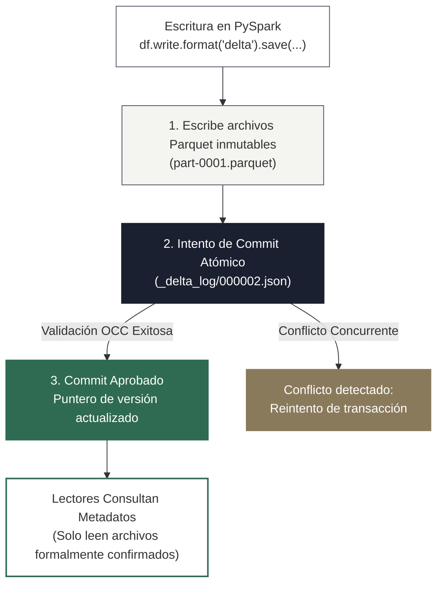

<!-- NOTAS FUENTE ORIGINALES DE OBSIDIAN: [[Delta Lake]], [[Apache Iceberg]], [[Liquid Clustering]], [[Open Table Formats]] -->

# Capítulo 18: Lakehouse y Formatos de Tabla Abiertos: Delta Lake y Apache Iceberg [NÚCLEO EMPLEABILIDAD]

> *"Los formatos de tabla abiertos como Delta Lake y Apache Iceberg redefinen la relación entre el cómputo distribuido y el almacenamiento masivo: dotan a los archivos columnares de semántica transaccional ACID, aíslan a los lectores de escrituras concurrentes y elevan un lago pasivo de objetos a un sistema gestor de bases de datos de escala planetaria."*

---

## Objetivos de Aprendizaje
Al finalizar este capítulo, el lector será capaz de:
* Comprender la anatomía interna del registro de transacciones de **Delta Lake** (`_delta_log`), los commits atómicos JSON y los checkpoints Parquet.
* Analizar la jerarquía arquitectónica en cinco capas de **Apache Iceberg**: Catálogo, archivos de metadatos, listas de manifiestos (*Manifest Lists*), manifiestos (*Manifests*) y archivos de datos.
* Dominar las innovaciones modernas de Delta Lake: **Liquid Clustering (`CLUSTER BY`)**, vectores de borrado (*Deletion Vectors*) y mapeo de columnas (*Column Mapping*).
* Implementar operaciones atómicas de fusión (`MERGE INTO` / UPSERT), compactación con Z-Order (curva de Morton) y purga segura (`VACUUM`).
* Escribir DDL y comandos de mantenimiento en **Apache Iceberg**: particionamiento transformado (`days(ts)`, `bucket`), compactación de archivos (`rewrite_data_files`) y expiración de snapshots.
* Evaluar el control de concurrencia optimista (OCC) y los escenarios reales de colisión bajo el nivel de aislamiento `WriteSerializable`.

---

> **Definición 18.1 (El Lago Pasivo frente al Notario Transaccional)**
>
> Un Data Lake tradicional basado puramente en Parquet sobre Amazon S3 o Azure ADLS es equivalente a una carpeta de red compartida sin control de concurrencia: si un proceso de escritura falla a mitad de la carga, deja archivos a medio escribir que corrompen las lecturas concurrentes; si un registro requiere actualizarse, es necesario reescribir la partición completa.
>
> Un **formato de tabla abierto** actúa como un **notario público transaccional**: los datos se almacenan en archivos Parquet inmutables, pero ningún motor de cómputo (Spark, Trino, Flink, DuckDB) puede acceder a ellos sin consultar primero el libro de actas oficial (el registro `_delta_log` en Delta o el árbol de manifiestos en Iceberg). El notario solo valida una operación cuando todos los archivos han sido escritos con éxito, garantizando atomicidad estricta y aislamiento optimista.

---

## 18.1 Semántica ACID y Control de Concurrencia Optimista (OCC)

Los formatos de tabla abiertos extienden las garantías ACID a los sistemas de almacenamiento de objetos en la nube:

* **Atomicidad:** La transacción es indivisible. Si un job de Spark de 50.000 tareas falla en la última tarea, ninguno de los archivos escritos es referenciado en el catálogo; para los lectores externos, la operación nunca ocurrió.
* **Consistencia:** Mediante la imposición de esquemas (*Schema Enforcement*), el formato rechaza escrituras que alteren los tipos de datos o nombres de columnas no autorizados, garantizando la validez de los datos.
* **Aislamiento:** Emplea **Control de Concurrencia Optimista (OCC)** bajo el estándar de aislamiento `WriteSerializable` o `Serializable`. Los lectores nunca bloquean a los escritores.
* **Durabilidad:** La durabilidad física en reposo la provee el almacenamiento de objetos subyacente (ej. la resiliencia de 99.999999999% de Amazon S3 o ADLS Gen2), mientras que el formato garantiza la durabilidad lógica mediante su registro de transacciones de escritura anticipada (*Write-Ahead Log*).



### Mecánica Real de Conflictos en OCC
Bajo el nivel de aislamiento `WriteSerializable` de Delta Lake:
* **Dos inserciones ciegas concurrentes (`Append + Append`):** Si dos jobs distintos ejecutan `df.write.mode("append")` sobre la misma partición, **no colisionan**. Delta resuelve el orden de los commits y confirma ambos sin error.
* **Conflicto real de escritura:** Ocurre cuando una transacción ejecuta una operación condicional (`MERGE INTO`, `UPDATE` o `DELETE`) que lee un conjunto de archivos para evaluar predicados, y otra transacción concurrente modifica o elimina esos mismos archivos antes de que la primera haga el commit.

---

## 18.2 Anatomía Interna de Delta Lake: El Registro `_delta_log`

Cada tabla Delta almacena en su directorio raíz una subcarpeta obligatoria denominada `_delta_log/`:

1. **Archivos de Transacción JSON (`000000.json`, `000001.json`):** Cada operación confirmada añade un nuevo archivo JSON monótonamente creciente. Contiene las acciones atómicas del commit:
   * `add`: Registra la ruta, tamaño y estadísticas (mínimo, máximo, nulos por columna) de los nuevos archivos Parquet generados.
   * `remove`: Marca archivos Parquet existentes como lógicamente obsoletos (sin eliminarlos físicamente de inmediato).
   * `commitInfo`: Metadatos del usuario, motor de cómputo y timestamp de la operación.
2. **Checkpoints Consolidados Parquet (`000010.checkpoint.parquet`):** Cada 10 transacciones, Delta consolida todos los commits previos en un archivo Parquet optimizado. Al leer la tabla, Spark solo consulta el checkpoint más reciente y aplica los deltas JSON subsiguientes, evitando escanear miles de archivos JSON individuales.
3. **Column Mapping:** Permite que las columnas de la tabla tengan identificadores numéricos y nombres físicos desacoplados de sus nombres lógicos, habilitando renombramientos instantáneos (`ALTER TABLE ... RENAME COLUMN`) sin reescribir archivos Parquet.
4. **Deletion Vectors:** Al ejecutar `DELETE` o `UPDATE`, Delta no reescribe los archivos Parquet enteros que contienen las filas afectadas (Copy-on-Write). En su lugar, escribe un pequeño vector de borrado (mapa de bits Roaring Bitmap) que indica las posiciones de fila invalidadas, reduciendo el I/O en más de un 90%.

---

## 18.3 Liquid Clustering: La Superación del Particionado Tradicional

Históricamente, las tablas se particionaban mediante carpetas jerárquicas rígidas (`anio=2026/mes=10/dia=12/`). Este enfoque presenta graves problemas:
* **Sobre-particionado (*Overpartitioning*):** Miles de carpetas con archivos diminutos que saturan el sistema de archivos.
* **Rigidez:** Imposible optimizar consultas que filtren por columnas no incluidas en la jerarquía física de partición.
* **Sesgo de Datos (*Data Skew*):** Particiones con tamaños gigantescos y otras casi vacías.

**Liquid Clustering (`CLUSTER BY`)** reemplaza el particionado físico y Z-Order en Delta Lake moderno utilizando la **curva de Hilbert**:

```sql
-- Creación de tabla con Liquid Clustering nativo
CREATE TABLE lakehouse.gold.fact_ventas (
    venta_id STRING,
    cliente_id STRING,
    fecha_transaccion DATE,
    monto_usd DOUBLE
)
USING DELTA
CLUSTER BY (fecha_transaccion, cliente_id);

-- Compactación y re-agrupamiento incremental con Liquid Clustering
OPTIMIZE lakehouse.gold.fact_ventas;
```

* **Re-clustering Incremental:** Solo reorganiza los datos nuevos o desbalanceados sin requerir la reescritura de particiones completas.
* **Evolución sin Migración:** Las columnas de clustering pueden modificarse (`ALTER TABLE ... CLUSTER BY (nuevo_campo)`) sin necesidad de reescribir la tabla histórica.

---

## 18.4 Arquitectura Profunda de Apache Iceberg (5 Niveles)

**Apache Iceberg** es un formato de tabla abierto de alto rendimiento diseñado originalmente por Netflix para superar las deficiencias de escala del Hive Metastore en tablas con millones de particiones y archivos.

Iceberg organiza sus metadatos en un **árbol jerárquico de cinco niveles**:

```
[ Nivel 1: Catálogo de Metadatos (Iceberg REST / Polaris / Nessie / Glue) ]
                               │ (Apunta al puntero activo v3.metadata.json)
                               ▼
        [ Nivel 2: metadata/v3.metadata.json (Schema, Partition Spec, Snapshots) ]
                               │ (Snapshot S3 activo)
                               ▼
    [ Nivel 3: metadata/snap-3-manifest-list.avro (Lista de Manifiestos) ]
                 │                                │
                 ▼                                ▼
    [ Nivel 4: manifest-A.avro ]      [ Nivel 4: manifest-B.avro ]
    (Partición 2026-10-10)            (Partición 2026-10-11)
    Min/Max por columna               Min/Max por columna
         │                                │
         ▼                                ▼
    [ Nivel 5: data-1.parquet ]       [ Nivel 5: data-2.parquet ]
```

1. **Nivel 1 - Catálogo de Metadatos (Iceberg Catalog):** Almacena exclusivamente el puntero atómico hacia el archivo de metadatos más reciente (`vN.metadata.json`). Admite implementaciones abiertas como Iceberg REST Catalog, Apache Polaris, Project Nessie, AWS Glue o Hive Metastore.
2. **Nivel 2 - Archivo de Metadatos de la Tabla (`metadata.json`):** Contiene el esquema completo de la tabla, las especificaciones de partición, el historial de evolución de esquemas y la lista completa de todos los *snapshots* válidos.
3. **Nivel 3 - Lista de Manifiestos (*Manifest List - Avro*):** Representa un snapshot individual de la tabla. Lista todos los archivos de manifiesto que componen ese snapshot, incluyendo el rango de particiones cubiertas por cada manifiesto para permitir podar manifiestos enteros antes de leer archivos de datos.
4. **Nivel 4 - Archivos de Manifiesto (*Manifest Files - Avro*):** Enumeran los archivos de datos físicos individuales (`.parquet`), especificando su ruta, tamaño y estadísticas exhaustivas a nivel de columna (mínimos, máximos, conteo de nulos y valores NaN).
5. **Nivel 5 - Archivos de Datos Físicos (*Data Files*):** Bloques columnares Parquet u ORC que contienen las filas útiles de la tabla.

---

> **Consideraciones de Producción 18.1: DDL y Mantenimiento de Apache Iceberg**
>
> Código ejecutable en Spark SQL para crear, particionar con transformaciones nativas y optimizar una tabla en Apache Iceberg:

```sql
-- 1. Creación de tabla con particionamiento oculto transformado
CREATE TABLE local_iceberg.telemetria.eventos_sensores (
    sensor_id STRING,
    timestamp_evento TIMESTAMP,
    temperatura DOUBLE,
    voltaje DOUBLE
)
USING ICEBERG
PARTITIONED BY (days(timestamp_evento), bucket(16, sensor_id));

-- 2. Compactación de micro-archivos mediante el procedimiento del sistema
CALL local_iceberg.system.rewrite_data_files(
    table => 'local_iceberg.telemetria.eventos_sensores',
    strategy => 'binpack',
    options => map('target-file-size-bytes', '536870912') -- 512 MB
);

-- 3. Expiración segura de snapshots antiguos para liberar almacenamiento en la nube
CALL local_iceberg.system.expire_snapshots(
    table => 'local_iceberg.telemetria.eventos_sensores',
    older_than => TIMESTAMP '2026-10-05 00:00:00',
    retain_last => 5
);
```

---

## 18.5 Matriz Comparativa: Delta Lake vs. Apache Iceberg vs. Apache Hudi

| Característica / Criterio | Delta Lake (3.x / Linux Foundation) | Apache Iceberg (1.x / ASF) | Apache Hudi (0.16+ / ASF) |
| :--- | :--- | :--- | :--- |
| **Gobernanza / Origen** | Databricks / Linux Foundation | Netflix, Apple / ASF | Uber / ASF |
| **Modelo de Metadatos** | Registro secuencial de deltas (`_delta_log/`) con checkpoints Parquet. | Árbol jerárquico en 5 niveles con manifiestos Avro. | Registro de línea de tiempo (*Timeline*) con metadatos indexados. |
| **Optimización de Agrupación** | **Liquid Clustering (`CLUSTER BY`)** con curva de Hilbert, Z-Order (Morton). | Compactación binpack / ordenamiento Z-Order o Sort. | Clustering y compresión basados en Timeline. |
| **Particionamiento** | Basado en columnas lógicas; reemplazado por Liquid Clustering. | **Oculto (Hidden Partitioning)** con funciones nativas (`days`, `bucket`). | Basado en claves de partición explícitas configuradas. |
| **Evolución de Esquema** | Por ID con **Column Mapping** activado; o por nombre con `mergeSchema`. | **Por ID entero inmutable:** Totalmente inmune a renombramientos y reordenamientos. | Soportado mediante esquemas Avro. |
| **Mecanismo de Borrado** | Deletion Vectors (Roaring Bitmaps) y Copy-on-Write. | Copy-on-Write (COW) y Merge-on-Read (MOR) con archivos de borrado posicional. | Copy-on-Write (COW) y Merge-on-Read (MOR) optimizado para streaming. |
| **Catálogo Abierto** | Unity Catalog OSS, Hive Metastore, Delta Sharing. | Iceberg REST Catalog, Apache Polaris, Nessie, Glue. | Hudi Metastore, Hive, Glue. |

---

> **Consideraciones de Producción 18.2: Mantenimiento Seguro con OPTIMIZE, Z-ORDER y VACUUM**
>
> Para tablas Delta Lake tradicionales basadas en particiones, el agrupamiento espacial con Z-Order utiliza la **curva de Morton (curva Z)** intercalando bits para agrupar registros multidimensionales:

```sql
-- 1. Z-Order tradicional sobre columnas de filtro frecuente
OPTIMIZE delta.`s3://lakehouse-corp/gold/fact_ventas`
ZORDER BY (cliente_id, fecha_transaccion);

-- 2. Purga segura de archivos obsoletos (retención obligatoria de 7 días)
VACUUM delta.`s3://lakehouse-corp/gold/fact_ventas` RETAIN 168 HOURS;
```

Para entornos de prueba o emergencias operacionales donde se requiera forzar `RETAIN 0 HOURS`, **el flag oficial de seguridad en el motor Spark de Databricks es**:
```python
spark.conf.set("spark.databricks.delta.retentionDurationCheck.enabled", "false")
```

---

## 18.6 Criterios de Fiabilidad y Anti-Patrones en Producción

**Anti-patrón 1: Ejecutar `VACUUM` con Retención Cero en Entornos Concurrentes**
Deshabilitar la verificación de retención (`retentionDurationCheck.enabled = false`) y ejecutar `VACUUM ... RETAIN 0 HOURS` mientras otro trabajo de Spark está leyendo la tabla causará que la consulta falle con un error fatal de `FileNotFoundException` tan pronto intente leer un archivo que acaba de ser eliminado físicamente.

**Anti-patrón 2: Borrar Archivos Parquet Manualmente desde la Consola de la Nube**
Borrar directamente archivos `.parquet` del bucket eludiendo el registro de transacciones o el árbol de manifiestos corrompe la consistencia de la tabla. Al consultar la tabla, el motor asumirá que los archivos declarados en los metadatos existen y fallará la lectura.

**Anti-patrón 3: Z-Ordering sobre Más de 3 o 4 Columnas de Alta Cardinalidad**
La curva de Morton de Z-Order pierde drásticamente su efectividad a medida que se incrementa el número de dimensiones. En Delta Lake moderno, migre hacia **Liquid Clustering (`CLUSTER BY`)** para evitar este problema.

---

## Preguntas de Revisión y Ejercicios Prácticos
**Ejercicio 18.1 (Control de Concurrencia Optimista en Operaciones Concurrentes):**  
Dos pipelines de Spark (`Job_A` y `Job_B`) escriben en la misma tabla Delta `telemetria`:
1. Si ambos jobs ejecutan simultáneamente `df.write.format("delta").mode("append").save(ruta)` sobre la misma fecha, ¿Delta Lake lanza una excepción de conflicto concurrente bajo el nivel `WriteSerializable`?
2. ¿Bajo qué escenario exacto de operaciones concurrentes sí se aborta la transacción lanzando un conflicto de concurrencia?

**Solución 18.1:**
1. *Escenario de Append + Append:* **No hay conflicto.** Bajo el nivel de aislamiento `WriteSerializable`, Delta Lake permite anexiones concurrentes ciegas (*Blind Appends*). Como ninguna de las dos operaciones realiza lecturas para modificar o borrar filas existentes, Delta asigna números de commit secuenciales consecutivos (ej. versión 101 para `Job_A` y versión 102 para `Job_B`), confirmando ambas escrituras sin lanzar ninguna excepción.
2. *Escenario de Conflicto Real:* Se produce cuando una transacción ejecuta una operación condicional (`MERGE INTO`, `UPDATE` o `DELETE`) que lee un subconjunto de archivos Parquet para determinar qué filas alterar, y concurrentemente otro proceso modifica o elimina esos mismos archivos físicos antes de que el primer job confirme su commit. En ese instante, Delta detecta una colisión de lectura-escritura (*Read-Write Conflict*) y aborta la transacción con una excepción `ConcurrentAppendException` o `ConcurrentTransactionException`.

---

**Ejercicio 18.2 (Particionamiento Oculto de Iceberg frente a Parquet Clásico):**  
Una tabla almacena telemetría con la columna `timestamp_evento TIMESTAMP`. En Hive/Parquet tradicional, los ingenieros particionaban creando una columna derivada `fecha STRING`.
1. ¿Qué riesgo introduce este esquema tradicional si un usuario nuevo filtra `WHERE timestamp_evento = '2026-10-12 14:00:00'` omitiendo la columna sintética `fecha`?
2. ¿Cómo resuelve Apache Iceberg este problema mediante *Hidden Partitioning*?

**Solución 18.2:**
1. *Riesgo tradicional:* Si el usuario omite la columna sintética `fecha` en el filtro `WHERE`, el motor no puede aplicar *Partition Pruning* y ejecuta un **escaneo completo de la tabla (*Full Table Scan*)**, leyendo terabytes de datos innecesariamente y aumentando los costos y tiempos de ejecución.
2. *Solución de Iceberg:* Iceberg vincula la transformación de partición (`days(timestamp_evento)`) directamente a los metadatos de la columna original. Cuando el usuario consulta `WHERE timestamp_evento = '2026-10-12 14:00:00'`, el optimizador de Iceberg proyecta internamente la función temporal sobre la partición y lee **únicamente** el manifiesto correspondiente al día especificado, eliminando la duplicación de columnas y asegurando poda de datos automática y transparente.

---

## 18.7 Resumen y Puntos Clave

* **Semántica ACID en la nube:** Los formatos abiertos de tabla proporcionan transacciones ACID desacopladas del almacenamiento de objetos mediante registros de transacciones (Delta Lake) o árboles de manifiestos (Apache Iceberg).
* **Innovación en Delta Lake:** Liquid Clustering (`CLUSTER BY`) con la curva de Hilbert supera las limitaciones del particionado rígido tradicional, complementado por Deletion Vectors y Column Mapping.
* **Los 5 niveles de Apache Iceberg:** Catálogo $\rightarrow$ `metadata.json` $\rightarrow$ Manifest List (Avro) $\rightarrow$ Manifest Files (Avro) $\rightarrow$ Data Files (Parquet).
* **Mantenimiento y Concurrencia:** La compactación (`OPTIMIZE` / `rewrite_data_files`) combate el problema de archivos pequeños, mientras que `VACUUM` purga archivos obsoletos respetando el flag oficial de retención `retentionDurationCheck.enabled`.

---

## Lecturas Recomendadas
1. **Armbrust, M., Das, T., Sun, L., et al. (2020).** *Delta Lake: High-Performance ACID Table Storage over Cloud Object Stores.* Proceedings of the VLDB Endowment (PVLDB), 13(12), 3411-3424.
2. **Apache Iceberg Project (2024).** *Apache Iceberg Table Specification and System Procedures.* Apache Software Foundation (`https://iceberg.apache.org/spec/`).
3. **Databricks Documentation (2024).** *Use Liquid Clustering for Delta Tables.* Databricks Guides (`https://docs.databricks.com/delta/clustering.html`).
