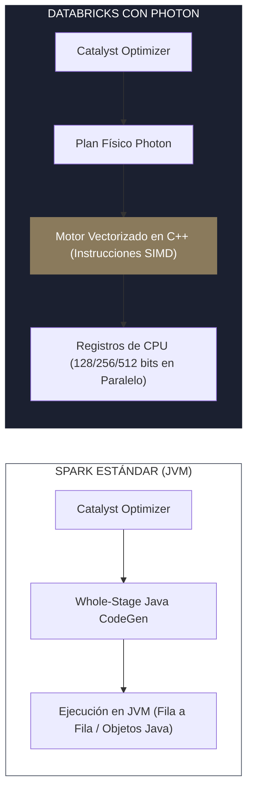
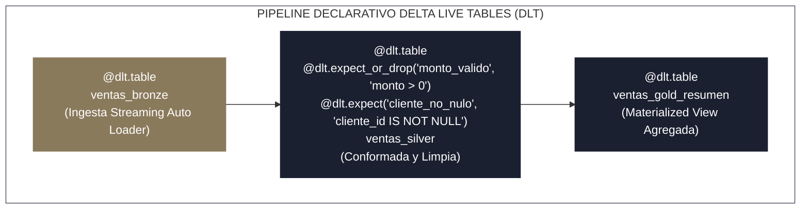
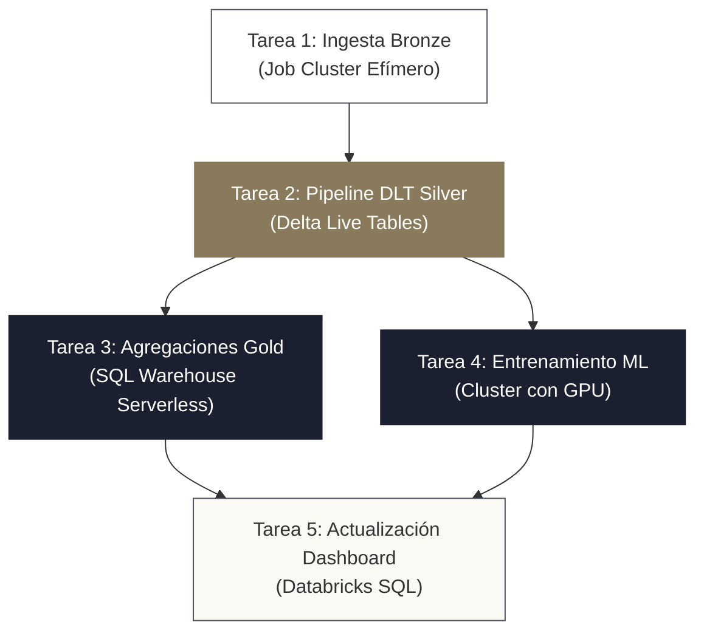

<!-- NOTAS FUENTE ORIGINALES DE OBSIDIAN: [[Databricks]], [[Delta Live Tables]], [[Auto Loader]], [[Photon]], [[Workflows]] -->

# Capítulo 18A: Plataforma Databricks: Arquitectura, Delta Live Tables, Photon y Workflows [RECOMENDADO]

> *"Aprender Apache Spark sobre un clúster genérico enseña los fundamentos del cómputo distribuido; dominar Databricks enseña cómo opera la ingeniería de datos en las empresas más competitivas del mundo. Databricks no es un simple envoltorio para Spark: es una Plataforma de Inteligencia de Datos completa que desacopla la infraestructura, introduce ejecución vectorial en C++ con Photon, automatiza la ingesta continua con Auto Loader y transforma el código artesanal en pipelines declarativos con Delta Live Tables."*

---

## Objetivos de Aprendizaje
Al finalizar este capítulo, el lector será capaz de:
* Comprender la topología de red y seguridad de Databricks, diferenciando el **Plano de Control (*Control Plane*)** del **Plano de Datos (*Data Plane*)**, tanto en modalidad clásica como **Serverless**.
* Evaluar y seleccionar la tipología óptima de cómputo: clústeres interactivos (*All-Purpose*), clústeres de trabajo efímeros (*Job Clusters*) y almacenes de datos (*SQL Warehouses*).
* Explicar el funcionamiento interno del motor de cómputo vectorizado **Photon** y sus ventajas de rendimiento frente a la JVM de Apache Spark.
* Implementar ingesta incremental de alta escala en almacenamiento de objetos con **Auto Loader** (`cloudFiles`), administrando evolución de esquemas y la columna de rescate `_rescued_data`.
* Construir pipelines declarativos con **Delta Live Tables (DLT)**, aplicando expectativas de calidad automáticas y procesando Change Data Capture (CDC) con `dlt.apply_changes()` para SCD Tipo 1 y 2.
* Orquestar dependencias complejas mediante **Databricks Workflows**, pasando parámetros dinámicos entre tareas con `taskValues`.
* Desarrollar y desplegar pipelines con estándares profesionales de software mediante **Databricks Asset Bundles (DABs)** y el SDK de Python (`databricks-sdk`).

---

> **Definición 18A.1 (Plataforma de Inteligencia de Datos - Databricks)**
> Databricks es una plataforma unificada en la nube (AWS, Microsoft Azure y Google Cloud Platform) diseñada sobre una arquitectura **Lakehouse** centrada en **Delta Lake** y gobernada por **Unity Catalog**.
> 
> A diferencia de los clústeres Spark tradicionales donde el ingeniero debe administrar dependencias del sistema operativo, aprovisionamiento de nodos, conectividad y balanceo manual de recursos, Databricks provee una capa de abstracción empresarial que optimiza el almacenamiento, vectoriza el motor de cómputo en C++ (Photon), automatiza la orquestación (Workflows) y asegura gobernanza unificada sobre datos, modelos de IA y código.

---

## 18A.1 Arquitectura del Workspace: Control Plane frente a Data Plane

La seguridad y el aislamiento de datos en Databricks se fundamentan en la separación estricta entre dos planos arquitectónicos:

```mermaid
graph TD
    subgraph ControlPlane ["PLANO DE CONTROL (Administrado por Databricks)"]
        UI["Interfaz Web / Workspace UI"]
        Scheduler["Planificador de Jobs / Workflows"]
        Meta["Servicio de Catálogo / Metadatos"]
        Notebooks["Gestor de Notebooks y Código"]
    end

    subgraph DataPlane ["PLANO DE DATOS (En la cuenta Cloud del Cliente)"]
        subgraph VNet ["VNet / VPC Privada (Sin IPs Públicas)"]
            Driver["Nodo Driver (VM)"]
            W1["Nodo Worker 1 (VM)"]
            W2["Nodo Worker 2 (VM)"]
        end
        Storage["Almacenamiento de Objetos S3 / ADLS Gen2<br/>(Datos Crudos, Bronze, Silver, Gold)"]
    end

    ControlPlane <-->|Túnel Seguro Bidireccional (SCC)| DataPlane
    Driver <--> Storage
    W1 <--> Storage
    W2 <--> Storage

    style ControlPlane fill:#ffffff,stroke:#4a5160,stroke-width:1px
    style DataPlane fill:#fbf9f4,stroke:#4a5160,stroke-width:1px
    style VNet fill:#ffffff,stroke:#8a7a5c,stroke-width:2px
    style Storage fill:#1b2030,color:#ffffff,stroke:#1b2030,stroke-width:2px
```

### 1. Plano Clásico (Classic Compute)
* **Plano de Control (*Control Plane*):** Se aloja en la infraestructura propia de Databricks. Aloja la interfaz web, el servicio de gestión de usuarios, el planificador de trabajos (*Job Scheduler*) y el almacenamiento de código fuente. **Los datos analíticos del cliente nunca residen en el plano de control**.
* **Plano de Datos (*Data Plane*):** Se ejecuta dentro de la suscripción o cuenta en la nube del propio cliente (AWS VPC, Azure VNet o GCP VPC). Allí se aprovisionan las máquinas virtuales que ejecutan el Driver y los Workers de Spark, garantizando que los datos en reposo y en tránsito residan dentro del perímetro de seguridad corporativo.
* **Conectividad de Clúster Segura (*Secure Cluster Connectivity - SCC / No Public IPs*):** Los nodos de cómputo no requieren direcciones IP públicas ni puertos abiertos de entrada en el cortafuegos. El clúster inicia conexiones salientes cifradas hacia el plano de control mediante un túnel de retransmisión seguro (*Relay Tunnel*).

### 2. Cómputo Serverless (Serverless Compute)
En la modalidad **Serverless** (disponible para SQL Warehouses, Notebooks interactivos y Jobs), el plano de datos es administrado por Databricks en un entorno multi-inquilino altamente aislado mediante micro-máquinas virtuales seguras:
* **Ventaja Operativa:** El clúster arranca en **menos de 10 segundos** (frente a los 4–7 minutos que tarda aprovisionar instancias de máquinas virtuales tradicionales en la nube).
* **Eficiencia Financiera:** El escalado descendente a cero es casi instantáneo tras unos segundos de inactividad, evitando pagar por capacidad ociosa.

---

## 18A.2 Tipología de Clústeres y Dimensionamiento de Cómputo

Databricks ofrece tres categorías principales de recursos de cómputo:

| Tipo de Cómputo | Caso de Uso Principal | Modo de Facturación | Retención de Estado |
| :--- | :--- | :--- | :--- |
| **All-Purpose Cluster** | Desarrollo interactivo, exploración en notebooks y depuración ad-hoc. | Tarifa DBU interactiva alta (~$0.40 - $0.55/DBU). | Manual o auto-terminación por inactividad (ej. 20 min). |
| **Job Cluster (Efímero)** | Cargas de producción automatizadas y programadas en Workflows. | **Tarifa DBU de trabajo reducida (~$0.15 - $0.20/DBU)**. | **Efímero:** Se crea para ejecutar el job y se destruye inmediatamente al finalizar. |
| **SQL Warehouse** | Consultas analíticas SQL para analistas, herramientas de BI (Power BI, Tableau) y dbt. | Facturado por tamaño de almacén (2X-Small a 4X-Large) y tiempo de ejecución. | Serverless con auto-escalado horizontal de múltiples clústeres. |

### Regla de Oro FinOps en Databricks:
> **Jamás ejecute un pipeline programado de producción en un clúster All-Purpose.** Ejecutar un DAG diario en un clúster interactivo representa un sobrecosto directo del **65% al 70%** en la factura mensual de Databricks por exactamente el mismo cómputo físico.

---

## 18A.3 El Motor Photon: Ejecución Vectorizada en C++

Apache Spark clásico compila las consultas analíticas a bytecode de Java ejecutado sobre la Máquina Virtual de Java (**JVM**). Aunque Catalyst y Tungsten optimizan la memoria, la JVM sufre de penalizaciones inherentes: sobrecosto de recolección de basura (*Garbage Collection*), limitaciones de optimización del compilador JIT y pobre aprovechamiento de las instrucciones vectoriales modernas de la CPU.

**Photon** es el motor de ejecución nativo desarrollado desde cero por Databricks en **C++**:



* **Vectorización SIMD (*Single Instruction, Multiple Data*):** En lugar de evaluar operadores fila a fila, Photon procesa bloques columnares contiguos en memoria, aprovechando los registros vectoriales del procesador (AVX-512) para evaluar filtros y sumas sobre múltiples valores numéricos en un solo ciclo de reloj.
* **Gestión de Memoria Explícita:** Photon administra su propia memoria fuera de la JVM (*Off-Heap C++*), eliminando las pausas de recolección de basura (*GC pauses*) que provocan inestabilidad en grandes agregaciones y joins.
* **¿Cuándo Activar Photon?** Es sumamente rentable en cargas que involucran escaneo masivo de Parquet/Delta, agregaciones pesadas y joins de alta cardinalidad. No aporta beneficio significativo en transformaciones que dependan de UDFs de Python puras o I/O lento con APIs externas.

---

## 18A.4 Ingesta Continua con Auto Loader (`cloudFiles`)

Al ingestar terabytes de archivos continuos en la capa Bronze desde Amazon S3 o Azure ADLS Gen2, ejecutar un `spark.read.parquet()` tradicional requiere listar la totalidad del directorio en cada ejecución. Cuando un bucket acumula millones de archivos, el comando `LIST` puede tardar más de una hora solo en descubrir qué archivos son nuevos.

**Auto Loader** resuelve este problema procesando billones de archivos de forma incremental y económica:

```python
# Ingesta incremental de alta resiliencia con Auto Loader en PySpark
from pyspark.sql import SparkSession

spark = SparkSession.builder.getOrCreate()

ruta_almacenamiento_crudo = "s3://empresa-telemetria-cruda/eventos_json/"
ruta_destino_bronze = "s3://empresa-lakehouse-prod/bronze/eventos_telemetria/"
ruta_metadatos_esquema = "s3://empresa-lakehouse-prod/metadatos/checkpoint_autoloader/"

# Flujo de lectura incremental con Auto Loader
df_stream_crudo = spark.readStream \
    .format("cloudFiles") \
    .option("cloudFiles.format", "json") \
    .option("cloudFiles.schemaLocation", ruta_metadatos_esquema) \
    .option("cloudFiles.schemaEvolutionMode", "addNewColumns") \
    .option("cloudFiles.inferColumnTypes", "true") \
    .load(ruta_almacenamiento_crudo)

# Escritura continua a Delta Lake Bronze con preservación de datos corruptos
query_escritura = df_stream_crudo.writeStream \
    .format("delta") \
    .outputMode("append") \
    .option("checkpointLocation", f"{ruta_metadatos_esquema}/delta_checkpoint") \
    .start(ruta_destino_bronze)
```

### Características Críticas de Auto Loader:
1. **La Columna de Rescate (`_rescued_data`):** Si un evento entrante contiene un campo que no coincide con el tipo inferido (por ejemplo, un string `"ERROR"` en una columna entera), Auto Loader **no aborta el pipeline**. Guarda los campos incompatibles o corruptos en una columna oculta `_rescued_data` en formato JSON, permitiendo a los ingenieros auditar anomalías sin perder registros.
2. **Evolución Automática de Esquemas:** Con `.option("cloudFiles.schemaEvolutionMode", "addNewColumns")`, si el sistema de origen agrega una nueva columna al JSON, Auto Loader altera automáticamente la tabla Delta de destino agregando la nueva columna sin intervención manual.
3. **Modos de Notificación de Archivos:**
   * *Listado de Directorios Incremental (*Directory Listing*):* Ideal para directorios bien particionados con menos de unos pocos millones de archivos.
   * *Notificación de Eventos (*File Notification*):* Configura colas de mensajería en la nube (AWS SQS / Azure Event Grid) para que cada archivo depositado notifique instantáneamente a Databricks, reduciendo el costo de llamadas a la API de S3 a cero.

---

**Delta Live Tables (DLT)** —integrado en la suite moderna **Databricks Lakeflow Pipelines** junto con Lakeflow Connect y Lakeflow Jobs— es el framework declarativo nativo de Databricks para construir canalizaciones ETL fiables y gobernadas. En lugar de escribir lógica imperativa de lectura, control de checkpoints, gestión de reintentos y llamadas a `save()`, el ingeniero declara las tablas y vistas deseadas:

> **Evolución Editorial (Databricks Lakeflow):** Databricks unificó su ecosistema de ingeniería de datos bajo la marca **Lakeflow**:
> 1. **Lakeflow Connect:** Ingesta nativa gobernada desde bases de datos operacionales (PostgreSQL, MySQL, Salesforce) mediante CDC automático.
> 2. **Lakeflow Pipelines:** El motor declarativo de transformación basado en la tecnología de Delta Live Tables (DLT).
> 3. **Lakeflow Jobs:** El orquestador unificado de tareas y dependencias construido sobre Databricks Workflows.



### 1. Sintaxis en Python con Expectativas de Calidad
```python
import dlt
from pyspark.sql import functions as F

# Capa Bronze: Ingesta continua declarativa
@dlt.table(
    name="pedidos_bronze",
    comment="Tabla cruda ingesta incremental desde almacenamiento de objetos",
    table_properties={"quality": "bronze"}
)
def pedidos_bronze():
    return spark.readStream.format("cloudFiles") \
        .option("cloudFiles.format", "json") \
        .load("s3://bucket-origen/pedidos/")

# Capa Silver: Validación y reglas de calidad (Data Expectations)
@dlt.table(
    name="pedidos_silver",
    comment="Tabla conformada con deduplicación y reglas de integridad"
)
@dlt.expect_or_drop("monto_positivo", "monto_total_usd > 0")
@dlt.expect_or_fail("identificador_obligatorio", "pedido_id IS NOT NULL")
@dlt.expect("cliente_valido", "cliente_id > 0") # Alerta en métricas, pero preserva la fila
def pedidos_silver():
    return dlt.read_stream("pedidos_bronze") \
        .select(
            F.col("pedido_id").cast("string"),
            F.col("cliente_id").cast("long"),
            F.col("monto_total_usd").cast("double"),
            F.col("timestamp_creacion").cast("timestamp")
        )
```

### 2. Modos de Expectativas de Calidad en DLT:
* `@dlt.expect("regla", "condicion")`: Registra métricas de cumplimiento en el catálogo de eventos de DLT. Si la fila no cumple, se contabiliza como violación pero **la fila se mantiene** en la tabla.
* `@dlt.expect_or_drop("regla", "condicion")`: Si el registro viola la condición, se descarta silenciosamente de la salida y se registra en los indicadores de calidad.
* `@dlt.expect_or_fail("regla", "condicion")`: Si una sola fila incumple la condición, **todo el pipeline se detiene inmediatamente con fallo crítico**, garantizando que datos corruptos jamás contaminen la tabla.

### 3. CDC Declarativo con `dlt.apply_changes()` (SCD Tipo 1 y 2)
Implementar dimensiones que cambian lentamente (SCD) o fusionar cambios CDC desde Debezium requiere escribir complejas sentencias `MERGE INTO`. En DLT, se resuelve en una sola declaración:

```python
# Procesamiento declarativo de CDC sin escribir MERGE manual
dlt.create_streaming_table(name="clientes_silver_scd2")

dlt.apply_changes(
    target = "clientes_silver_scd2",
    source = "clientes_cdc_bronze",
    keys = ["cliente_id"],
    sequence_by = F.col("timestamp_modificacion"),
    apply_as_deletes = F.expr("operacion = 'DELETE'"),
    except_column_list = ["operacion", "timestamp_modificacion"],
    stored_as_scd_type = 2  # Crea automáticamente valido_desde, valido_hasta y es_actual
)
```

---

## 18A.6 Databricks Workflows: Orquestación Nativa de Producción

Databricks Workflows es el orquestador nativo de la plataforma. Permite coordinar tareas heterogéneas (notebooks, scripts Python, consultas SQL, pipelines DLT y modelos de dbt) en un grafo acíclico dirigido (DAG) sin necesidad de mantener servidores externos de Apache Airflow:



### Paso de Parámetros Dinámicos entre Tareas (`taskValues`)
Una tarea previa puede compartir valores computados (como la cantidad de registros procesados o una fecha de partición) con tareas posteriores mediante la utilidad de sistema `dbutils`:

```python
# En la Tarea 1 (Generadora del valor):
dbutils.jobs.taskValues.set(key="total_procesados", value=145000)
dbutils.jobs.taskValues.set(key="lote_fecha", value="2026-03-31")

# En la Tarea 2 (Consumidora del valor):
total = dbutils.jobs.taskValues.get(taskKey="Tarea1_Ingesta", key="total_procesados", default=0)
fecha = dbutils.jobs.taskValues.get(taskKey="Tarea1_Ingesta", key="lote_fecha", default="1970-01-01")
print(f"Recibidos {total} registros correspondientes a la fecha {fecha}")
```

---

## 18A.7 Databricks Asset Bundles (DABs) y Automatización con SDK

El desarrollo profesional en Databricks ha dejado atrás la edición manual de notebooks en el navegador. El estándar de ingeniería moderno utiliza **Databricks Asset Bundles (DABs)**: infraestructura, código y pipelines definidos como código en archivos YAML versionados en Git y editados en entornos locales como Visual Studio Code.

### Estructura de un Proyecto con DABs (`databricks.yml`)
```yaml
bundle:
  name: plataforma_lakehouse_prod

include:
  - resources/*.yml

targets:
  dev:
    mode: development
    default: true
    workspace:
      host: https://adb-dev-instance.azuredatabricks.net

  prod:
    mode: production
    workspace:
      host: https://adb-prod-instance.azuredatabricks.net
    run_as:
      service_principal_name: sp-lakehouse-pipeline-automation
```

### Definición Declarativa del Job (`resources/pipeline_job.yml`)
```yaml
resources:
  jobs:
    lakehouse_diario_job:
      name: "Lakehouse_Diario_${bundle.target}"
      schedule:
        quartz_cron_expression: "0 0 4 * * ?"
        timezone_id: "UTC"
      tasks:
        - task_key: ingesta_autoloader
          job_cluster_key: cluster_optimo
          python_wheel_task:
            package_name: mi_paquete_datos
            entry_point: run_ingesta
      job_clusters:
        - job_cluster_key: cluster_optimo
          new_cluster:
            spark_version: 15.4.x-photon-scala2.12
            node_type_id: i3.xlarge
            num_workers: 4
```

### Comandos del CLI para Despliegues Multi-Entorno
```bash
# Validar la sintaxis de los recursos y dependencias
databricks bundle validate

# Desplegar al entorno de desarrollo
databricks bundle deploy -t dev

# Desplegar a producción mediante integración continua (CI/CD)
databricks bundle deploy -t prod

# Disparar ejecución manual de prueba del bundle desplegado
databricks bundle run lakehouse_diario_job -t dev
```

---

## 18A.8 Criterios de Fiabilidad y Anti-Patrones en Producción

**Anti-patrón 1: Almacenar Datos de Producción en el DBFS Raíz (`dbfs:/`)**  
El Databricks File System raíz (`dbfs:/`) es un almacenamiento temporal asociado al workspace. Almacenar tablas de negocio allí impide la segregación de permisos de red, dificulta auditorías de seguridad y expone los datos a pérdida accidental si el workspace se reconstruye.  
*Corrección:* Almacene todos los datos en **Volumes de Unity Catalog** o tablas externas vinculadas directamente a sus buckets de almacenamiento de objetos gestionados.

**Anti-patrón 2: Dejar Clústeres All-Purpose sin Apagado Automático (*Auto-Termination*)**  
Crear un clúster de 8 nodos para exploración y olvidar configurarle un tiempo de auto-terminación (ej. 15–20 minutos de inactividad) mantendrá las máquinas virtuales encendidas todo el fin de semana, facturando miles de dólares innecesariamente.

**Anti-patrón 3: Utilizar `dlt.read()` en Lugar de `dlt.read_stream()` en Pipelines Incrementales**  
En Delta Live Tables, invocar `dlt.read("tabla_origen")` fuerza a la tabla a comportarse como un lote completo (*batch*), recomputando la tabla entera en cada ejecución. Para procesar únicamente las novedades incrementales de forma continua, se debe utilizar estrictamente `dlt.read_stream("tabla_origen")`.

---

## Preguntas de Revisión y Ejercicios Prácticos
**Ejercicio 18A.1 (Diseño de Pipeline Declarativo con DLT y Rescate de Errores):**  
Una fintech recibe archivos JSON de transferencias bancarias en S3.  
1. Diseñe el código de un pipeline DLT en Python que ingeste continuamente los archivos con Auto Loader.
2. Defina una regla de calidad en la capa Silver que descarte registros donde el monto sea menor o igual a cero, pero que detenga de forma crítica todo el pipeline si el campo `cuenta_origen` es nulo.

**Solución 18A.1:**
```python
import dlt
from pyspark.sql import functions as F

@dlt.table(
    name="transferencias_bronze",
    comment="Ingesta streaming de transacciones con Auto Loader"
)
def transferencias_bronze():
    return (
        spark.readStream.format("cloudFiles")
        .option("cloudFiles.format", "json")
        .option("cloudFiles.schemaLocation", "s3://fintech-checkpoints/transferencias_schema")
        .load("s3://fintech-landing/transferencias/")
    )

@dlt.table(
    name="transferencias_silver",
    comment="Capa Silver validada y tipada"
)
@dlt.expect_or_drop("monto_positivo_requerido", "monto > 0")
@dlt.expect_or_fail("cuenta_origen_obligatoria", "cuenta_origen IS NOT NULL")
def transferencias_silver():
    return (
        dlt.read_stream("transferencias_bronze")
        .select(
            F.col("transferencia_id").cast("string"),
            F.col("cuenta_origen").cast("string"),
            F.col("cuenta_destino").cast("string"),
            F.col("monto").cast("decimal(12,2)"),
            F.col("timestamp_operacion").cast("timestamp")
        )
    )
```

---

## 18A.9 Resumen y Puntos Clave

* **Separación de planos:** El Plano de Control gestiona metadatos y orquestación; el Plano de Datos ejecuta las máquinas virtuales en la nube del cliente preservando soberanía y seguridad.
* **Photon vectorizado:** Reemplaza la ejecución tradicional de la JVM por un motor nativo en C++ con aceleración SIMD en registros de procesador, acelerando consultas de gran escala.
* **Auto Loader:** Descubre e ingesta millones de archivos en S3/ADLS de forma incremental, aislando esquemas incompatibles en la columna `_rescued_data`.
* **Delta Live Tables (DLT):** Define canalizaciones declarativas integrando gobernanza de calidad con `@dlt.expect` y CDC automático con `dlt.apply_changes()`.
* **Workflows y DABs:** Proveen orquestación de nivel empresarial e implementación mediante infraestructura como código con `databricks.yml` y CI/CD.

---

## Lecturas Recomendadas
1. **Databricks Documentation (2024).** *Databricks Architecture Overview: Control Plane and Data Plane Security.* Databricks Guides.
2. **Armbrust, M. et al. (2020).** *Delta Lake: High-Performance ACID Table Storage over Cloud Object Stores.* Proceedings of the VLDB Endowment.
3. **Databricks Engineering (2022).** *Photon: A Fast Query Engine for Lakehouse Systems.* ACM SIGMOD Conference.
4. **Databricks Learning (2024).** *Developing Data Pipelines with Delta Live Tables and Asset Bundles.*
