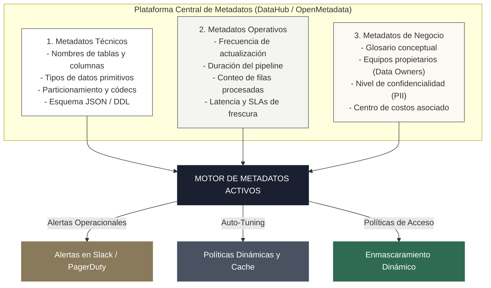

<!-- NOTAS FUENTE ORIGINALES DE OBSIDIAN: [[Data Catalog]], [[Data Discovery]], [[Data Contracts]], [[Metadata as Code]] -->

# Capítulo 20: Catalogación, Descubrimiento y Contratos de Datos (Data Contracts) [RECOMENDADO]

> *"El valor de una plataforma de datos es directamente proporcional a su capacidad de descubrimiento y a la fiabilidad de sus compromisos de entrega. Un lago de datos donde nadie sabe qué significa una columna, quién es su propietario o cuándo cambiará su esquema es un cementerio computacional. Los contratos de datos y la catalogación activa transforman datos caóticos en productos de software gobernados con interfaces formales."*

---

## Objetivos de Aprendizaje
Al finalizar este capítulo, el lector será capaz de:
* Diseñar ecosistemas de metadatos modernos articulando la **tríada de metadatos**: técnicos, operativos y de negocio.
* Distinguir entre catálogos pasivos tradicionales y plataformas de **metadatos activos** (*Active Metadata*).
* Dominar el concepto, arquitectura y ciclo de vida de los **Contratos de Datos (*Data Contracts*)**.
* Redactar especificaciones formales de contratos de datos bajo el estándar abierto **ODCS** (*Open Data Contract Standard*) e implementarlos en dbt mediante `contract: {enforced: true}`.
* Automatizar la extracción programática de esquemas desde Apache Spark para alimentar buses de eventos de catalogación (DataHub, OpenMetadata).

---

> **Definición 20.1 (Contrato de Datos / Data Contract)**
>
> Un **Contrato de Datos** es un acuerdo formal, declarativo y versionable entre el equipo productor de datos (desarrolladores de microservicios, equipos de producto o ingenieros de software transaccional) y los equipos consumidores (ingenieros de datos, analistas y científicos de datos). 
> 
> Define con rigor de ingeniería el esquema de los datos, la semántica de negocio, los acuerdos de nivel de servicio (SLA de frescura y latencia), las clasificaciones de privacidad (PII) y las garantías de calidad que el productor se compromete a no romper sin una negociación previa y un versionado controlado.

---

## 20.1 La Tríada de Metadatos y el Catálogo Activo

El descubrimiento de datos empresarial descansa sobre la integración continua de tres categorías de información:



### Catálogos Pasivos frente a Metadatos Activos (*Active Metadata*)
* **Catálogos Pasivos (Tradicionales):** Actúan como un "inventario estático de biblioteca". Requieren que los ingenieros o catalogadores ingresen descripciones manualmente en una interfaz web. Se desactualizan a los pocos días de ser implementados.
* **Metadatos Activos (Modernos):** El catálogo no solo almacena información; **acciona el ecosistema en tiempo de ejecución**. Si un pipeline produce un volumen anormalmente bajo de filas, el sistema de metadatos activos intercepta la anomalía, suspende los modelos analíticos aguas abajo, notifica a los responsables y ajusta temporalmente las políticas de retención.

---

## 20.2 Contratos de Datos: El Fin de las Roturas Silenciosas en Producción

El problema endémico de la ingeniería de datos clásica radica en que **las bases de datos transaccionales de las aplicaciones operacionales cambian sin previo aviso**:
* Un desarrollador backend renombra la columna `monto_pago` a `valor_transaccion` o cambia un formato de fecha de ISO-8601 a un entero Unix.
* La base de datos operacional sigue funcionando sin problema, pero los pipelines analíticos de Spark o dbt colapsan en la madrugada o, peor aún, propagan valores nulos silenciosos hacia los tableros de la junta directiva.

Los contratos de datos desplazan la responsabilidad de la calidad hacia la fuente (*Shift-Left Data Quality*):

```
[ Microservicio Backend ] ──> [ CI/CD Contract Gate (datacontract-cli) ]
                                            │
                             ¿Rompe el Contrato de Datos?
                             ├── SÍ ──> Build Fallido (El commit se bloquea)
                             └── NO ──> Pasa a Producción
                                            │
                                            ▼
                             [ Tópico Kafka / Ingesta Lakehouse ]
```

---

## 20.3 Especificación Estándar de un Data Contract (ODCS v3.0)

El estándar **Open Data Contract Standard (ODCS)** define la estructura formal de un contrato en un archivo YAML legible por máquinas y humanos:

```yaml
# data-contract-ordenes.odcs.yaml
kind: DataContract
apiVersion: v3.0.0
id: urn:datacontract:ventas:ordenes_completadas
info:
  title: Contrato de Datos de Órdenes Transaccionales
  version: 2.1.0
  status: active
  description: Emisión formal de órdenes facturadas del servicio de Checkout.
  owner: equipo-backend-checkout@empresa.com

models:
  ordenes_facturadas:
    description: Registro canónico de órdenes que completaron el ciclo de pago.
    fields:
      orden_id:
        type: string
        required: true
        unique: true
        description: Identificador UUID v4 universal de la transacción.
      cliente_id:
        type: string
        required: true
        description: Clave foránea hacia el registro maestro de clientes.
      monto_total_centavos:
        type: integer
        required: true
        minimum: 1
        maximum: 100000000
        description: Monto en centavos para evitar imprecisiones de coma flotante.
      divisa:
        type: string
        required: true
        enum: ['USD', 'COP', 'EUR', 'MXN']
      fecha_pago_utc:
        type: timestamp
        required: true

servicelevels:
  freshness:
    max: 15m
  availability:
    percentage: 99.9
```

### Implementación en dbt con `contract: {enforced: true}`

Desde dbt Core v1.5+, los contratos de datos pueden forzarse a nivel de modelo compilado en SQL:

```yaml
# models/marts/fct_ordenes.yml
version: 2

models:
  - name: fct_ordenes
    config:
      contract:
        enforced: true
    columns:
      - name: orden_id
        data_type: string
        constraints:
          - type: not_null
          - type: primary_key
      - name: monto_total_usd
        data_type: numeric(18, 4)
        constraints:
          - type: not_null
      - name: fecha_cierre
        data_type: date
```

Si el modelo SQL `fct_ordenes.sql` devuelve un tipo incompatible (por ejemplo, si `orden_id` se genera como entero en lugar de `string`), o si omite alguna columna declarada, dbt **aborta la compilación antes de escribir en el Data Warehouse**, impidiendo la propagación de datos no conformes.

---

> **Consideraciones de Producción 20.1: Extracción Programática de Esquemas en PySpark**
>
> Para registrar automáticamente los metadatos de esquemas en catálogos abiertos (como OpenMetadata o DataHub), los pipelines deben inspeccionar programáticamente la estructura del DataFrame y publicar el esquema normalizado en JSON Schema:

```python
import json
from pyspark.sql import SparkSession
from pyspark.sql.types import (
    StructType, StructField, StringType, DoubleType, 
    IntegerType, BooleanType, DateType, DecimalType, TimestampType
)

spark = SparkSession.builder.appName("CatalogoExtraccionEsquema").getOrCreate()

# Definición del esquema productivo
esquema = StructType([
    StructField("transaccion_id", StringType(), False),
    StructField("cliente_id", StringType(), False),
    StructField("monto_usd", DecimalType(18, 2), True),
    StructField("es_fraude", BooleanType(), False),
    StructField("fecha_proceso", DateType(), False),
    StructField("timestamp_evento", TimestampType(), False)
])

# Inspección y serialización hacia formato canónico JSON Schema
def exportar_json_schema(struct_schema, titulo):
    properties = {}
    required = []
    
    for field in struct_schema.fields:
        tipo_spark = field.dataType.__class__.__name__
        
        # Mapeo exhaustivo de tipos de Spark a tipos canónicos de JSON Schema
        if tipo_spark in ("StringType", "VarcharType", "CharType"):
            schema_type = {"type": "string"}
        elif tipo_spark in ("IntegerType", "LongType", "ShortType", "ByteType"):
            schema_type = {"type": "integer"}
        elif tipo_spark in ("DoubleType", "FloatType", "DecimalType"):
            schema_type = {"type": "number"}
        elif tipo_spark == "BooleanType":
            schema_type = {"type": "boolean"}
        elif tipo_spark == "DateType":
            schema_type = {"type": "string", "format": "date"}
        elif tipo_spark in ("TimestampType", "TimestampNTZType"):
            schema_type = {"type": "string", "format": "date-time"}
        else:
            schema_type = {"type": "string"}
            
        schema_type["nullable"] = field.nullable
        properties[field.name] = schema_type
        
        if not field.nullable:
            required.append(field.name)
            
    return {
        "$schema": "https://json-schema.org/draft/2020-12/schema",
        "title": titulo,
        "type": "object",
        "properties": properties,
        "required": required
    }

esquema_json = exportar_json_schema(esquema, "TransaccionSilver")
print(json.dumps(esquema_json, indent=2))
```

---

## 20.4 Criterios de Fiabilidad y Anti-Patrones en Producción

**Anti-patrón 1: Catálogos Manuales en Hojas de Cálculo o Wikis Desconectadas**
Mantener diccionarios de datos en documentos estáticos compartidos garantiza su obsolescencia en semanas. La catalogación debe gestionarse como código (*Metadata-as-Code*) e integrarse al ciclo de vida del pipeline mediante hooks de CI/CD.

**Anti-patrón 2: Contratos de Datos sin Validación Automatizada en el CI/CD del Productor**
Firmar un contrato en un documento PDF sin un validador automatizado (como `datacontract-cli` o GitHub Actions en el repositorio del backend) es una declaración de intenciones vacía. Si el commit del microservicio no se bloquea al romper el contrato, el contrato no existe operativamente.

**Anti-patrón 3: Activos de Datos Huérfanos (*Orphan Data Assets*)**
Permitir la creación de tablas y pipelines en el catálogo sin declarar explícitamente un equipo propietario (*Owner*) y un canal de comunicación de soporte. Ante cualquier incidente crítico, nadie asume la responsabilidad de reparación.

---

## Preguntas de Revisión y Ejercicios Prácticos
**Ejercicio 20.1 (Diseño de Compuerta de Contrato en CI/CD):**  
Un equipo backend modifica el servicio de pagos: cambian el tipo de dato de `monto` de `DECIMAL(12,2)` a un número flotante de precisión simple `FLOAT`. Describe las consecuencias que tendría esta alteración en los modelos de finanzas aguas abajo y cómo un contrato de datos previene este incidente antes del despliegue a producción.

**Solución 20.1:**
1. *Consecuencias operativas:* El tipo `FLOAT` almacena números binarios en coma flotante según IEEE 754, lo que introduce errores de redondeo infinitesimales (por ejemplo, `0.1 + 0.2 = 0.30000000000000004`). En conciliaciones financieras de millones de transacciones, estos micro-errores acumulan discrepancias contables graves que impiden cuadrar los balances tributarios de fin de mes.
2. *Prevención con Contrato de Datos:* 
   * En el repositorio del microservicio existe un archivo `datacontract.yaml` que estipula `monto: decimal(12,2)` con precisión estricta.
   * Durante el pipeline de Integración Continua (CI) del backend, una herramienta como `datacontract-cli test` compara el esquema exportado del servicio con el contrato.
   * La suite detecta la discrepancia de tipos y emite un fallo bloqueante (`BREAKING CHANGE DETECTED: Column 'monto' type changed from decimal to float`). El Pull Request no puede fusionarse a la rama principal hasta que el backend rectifique el cambio.

---

**Ejercicio 20.2 (Diferenciación entre Catálogos Activos y Pasivos):**  
Presenta un caso de uso práctico donde un catálogo de metadatos activo evite un incidente de facturación de nube en un motor como Snowflake o BigQuery.

**Solución 20.2:**
Un analista programa un job que ejecuta un `SELECT *` sobre una tabla de eventos de 500 terabytes sin filtros de partición. 
* Un **catálogo pasivo** simplemente almacena el nombre de la tabla; la consulta se ejecuta, escanea los 500 TB y genera una factura inmediata de $3.000 USD.
* Un **catálogo activo** intercepta la consulta en el proxy analítico, coteja las políticas operativas del activo (regla: "tablas con clasificación masiva requieren filtro obligatorio de fecha"), detecta la ausencia de predicados de partición y cancela preventivamente la consulta con una alerta explicativa al usuario, protegiendo el presupuesto de la empresa.

---

## 20.5 Resumen y Puntos Clave

* **La tríada de metadatos:** Un activo de datos maduro requiere metadatos técnicos (esquemas y formatos), operativos (latencia, SLAs y conteo de filas) y de negocio (glosario conceptual, propietarios y clasificación PII).
* **Metadatos activos:** Superan el inventario pasivo tradicional actuando en tiempo real para disparar alertas, aplicar optimizaciones de cómputo y bloquear accesos no conformes.
* **Contratos de Datos (Data Contracts):** Establecen una frontera formal de ingeniería entre productores operacionales y consumidores analíticos, desplazando el aseguramiento de calidad hacia la fuente (*Shift-Left*).
* **Estándar ODCS y dbt:** Permiten declarar esquemas, restricciones y SLAs en archivos YAML versionados en Git con validación forzada en tiempo de compilación (`contract: {enforced: true}`).

---

## Lecturas Recomendadas
1. **Sanderson, C. & Freeman, M. (2025).** *Data Contracts: Building Production-Grade Pipelines with Software Engineering Rigor.* O'Reilly Media.
2. **Open Data Contract Standard (ODCS) Technical Committee (2024).** *ODCS Specification v1.0.* (`https://datacontract.com/`).
3. **Jones, A. (2023).** *Driving Data Quality with Data Contracts: A Comprehensive Guide to Managing Data Pipelines.* Packt Publishing.
