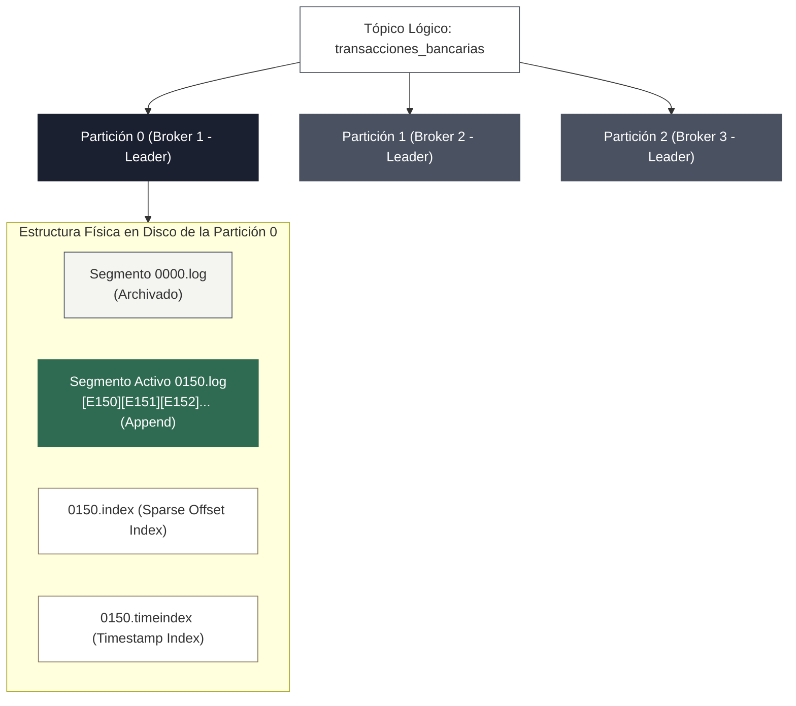
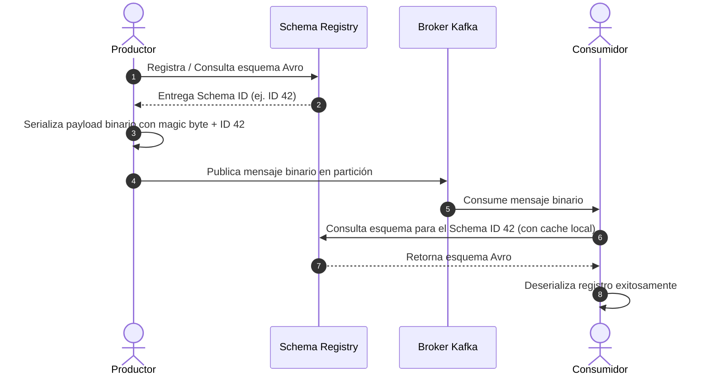

<!-- NOTAS FUENTE ORIGINALES DE OBSIDIAN: [[Kafka]], [[Streaming]], [[KRaft]], [[Schema Registry]] -->

# Capítulo 21: Fundamentos de Streaming y Apache Kafka [RECOMENDADO]

> *"El mundo operacional no emite transacciones en lotes nocturnos; los eventos ocurren de forma continua e ininterrumpida. Procesar datos en lotes es una aproximación forzada por limitaciones históricas de infraestructura; el procesamiento de flujos (*streaming*) representa el modelo natural de la realidad computacional."*

---

## Objetivos de Aprendizaje
Al finalizar este capítulo, el lector será capaz de:
* Comprender la arquitectura de **Apache Kafka** basada en registros inmutables distribuidos (*Commit Log*), segmentos físicos, índices dispersos y offsets.
* Dominar la evolución arquitectónica hacia **KRaft (Kafka Raft Metadata mode)** y la eliminación definitiva de Apache ZooKeeper en Kafka 4.0.
* Diseñar estrategias de replicación de alta disponibilidad con réplicas sincronizadas (*In-Sync Replicas - ISR*), `min.insync.replicas` y productores idempotentes.
* Integrar **Schema Registry** con esquemas **Apache Avro** gobernando compatibilidades evolutivas (*BACKWARD*, *FORWARD*, *FULL*).
* Distinguir rigurosamente las tres semánticas temporales en sistemas distribuidos: *Event Time*, *Ingestion Time* y *Processing Time*.
* Implementar productores idempotentes y consumidores resilientes con control manual de offsets en Python empleando `confluent-kafka`.

---

> **Definición 21.1 (Registro Distribuido Inmutable / Commit Log)**
>
> Apache Kafka es un sistema de almacenamiento distribuido modelado como un **registro de confirmación estructurado y solo anexable (*append-only log*)**. Los eventos se escriben de manera estrictamente secuencial al final del archivo físico y se indexan mediante un entero incremental de 64 bits denominado **offset**.
> 
> Esta inmutabilidad secuencial elimina la contención por bloqueos de fila, permite lecturas concurrentes masivas a través del caché de páginas del sistema operativo (*Page Cache*) y desacopla la velocidad de ingesta de la capacidad de procesamiento de los consumidores.

---

## 21.1 Anatomía Interna: Tópicos, Particiones, Segmentos y Offsets

El paralelismo horizontal de Kafka descansa en la descomposición física de los tópicos:



* **Partición y Segmentos:** Cada partición se materializa en el sistema de archivos del broker como un directorio que contiene archivos de segmento (típicamente de 1 GB). Solo el segmento activo recibe escrituras; los segmentos anteriores son inmutables y se purgan o compactan según las políticas de retención.
* **Índices Dispersos (*Sparse Indices*):** Para localizar un mensaje por su offset o timestamp sin escanear gigabytes de datos, Kafka mantiene archivos `.index` que asocian offsets lógicos con posiciones de bytes exactas en el archivo `.log`.
* **Zero-Copy Data Transfer y la Salvedad de TLS:** Al servir datos a los consumidores en conexiones de texto plano, Kafka utiliza la llamada al sistema operativo `sendfile()`. Esto transfiere bytes directamente desde el *Page Cache* del kernel hacia el búfer del socket de red (NIC), evitando copiar los datos al espacio de usuario de la JVM. No obstante, **si se habilita cifrado TLS/SSL entre el broker y el cliente**, los datos deben desencriptarse y encriptarse forzosamente en el espacio de usuario de la JVM, por lo que la optimización de zero-copy queda desactivada en favor de la seguridad en tránsito.

---

## 21.2 La Revolución de KRaft: De ZooKeeper al Quórum Raft Nativo

Durante más de una década, Apache Kafka dependió de **Apache ZooKeeper** para coordinar el clúster, elegir al broker líder y almacenar metadatos de configuración. Esta dependencia causaba graves problemas operativos:
1. **Cuello de Botella de Metadatos:** Clústeres con más de 100.000 particiones experimentaban degradación severa; una caída del broker controlador requería releer y reconstruir todo el estado desde ZooKeeper, demorando minutos.
2. **Duplicación de Sistemas:** Los operadores debían mantener, monitorear y asegurar dos clústeres distribuidos distintos (Kafka y ZooKeeper).

Con la introducción de **KRaft (KIP-500)** y su consagración definitiva en **Kafka 4.0**, ZooKeeper ha sido completamente eliminado:

```
[ ARQUITECTURA KRAFT MODERNA ]
┌────────────────────────────────────────────────────────┐
│              QUÓRUM DE CONTROLADORES KRAFT             │
│      (Algoritmo de Consenso Raft · Metadata Topic)     │
│       [Ctrl-1 (Leader)] ──> [Ctrl-2] ──> [Ctrl-3]      │
└──────────────────────────┬─────────────────────────────┘
                           │ Réplica síncrona de metadatos
                           ▼
┌────────────────────────────────────────────────────────┐
│                     POOL DE BROKERS                    │
│     Broker 101       │     Broker 102       │ Broker 103│
│ (Almacena Particiones de Datos · Caches de Metadatos)  │
└────────────────────────────────────────────────────────┘
```

* **Tópico Interno `__cluster_metadata`:** Los metadatos de particiones, tópicos y ACLs se gestionan como un registro distribuido interno replicado entre los nodos controladores.
* **Recuperación Sub-Segundo:** El traspaso de liderazgo del controlador (*failover*) es casi instantáneo porque todos los controladores mantienen el log de metadatos sincronizado en memoria en todo momento.
* **Escalabilidad Masiva:** Permite soportar millones de particiones por clúster sin degradación de latencia.

---

## 21.3 Gobernanza de Esquemas: Schema Registry y Apache Avro

Enviar cargas binarias o JSON crudo por Kafka sin gobernanza conduce a desastres en producción: si un productor altera un campo, los consumidores fallan con errores de deserialización.

**Confluent Schema Registry** resuelve este problema actuando como el plano de control para los esquemas serializados en **Apache Avro**:



### Formato de Transmisión (Wire Format) de Schema Registry
Los mensajes serializados con Schema Registry no transportan el esquema completo en cada evento. Utilizan una cabecera compacta de **5 bytes**:
* **Byte 0:** *Magic Byte* (siempre `0x00`).
* **Bytes 1-4:** Entero de 32 bits en big-endian que representa el identificador global del esquema en el registro (*Schema ID*).
* **Bytes 5 en adelante:** Datos útiles binarios codificados según la especificación de Apache Avro.

### Modos de Compatibilidad Evolutiva

Es fundamental entender la dirección de la compatibilidad entre consumidores y productores:

* **BACKWARD (Compatibilidad hacia atrás):**
  * **Definición:** Los consumidores que han sido actualizados con el **esquema nuevo** pueden leer datos producidos con el **esquema anterior**.
  * **Regla de oro:** Permite actualizar los consumidores primero antes que los productores.
  * **Restricción de esquema:** Si se agrega un nuevo campo en el esquema nuevo, este campo **debe tener un valor predeterminado (*default value*)** o ser opcional (`["null", "string"]`). Si carece de default, el consumidor nuevo no sabrá qué valor asignar a ese campo cuando procese un mensaje antiguo que no lo contiene.
* **FORWARD (Compatibilidad hacia adelante):**
  * **Definición:** Los consumidores que todavía operan con el **esquema anterior** pueden leer datos emitidos por productores que ya migraron al **esquema nuevo**.
  * **Regla de oro:** Permite actualizar los productores primero.
  * **Restricción de esquema:** Los campos nuevos introducidos por el productor son ignorados por el consumidor viejo. Si se elimina un campo en el nuevo esquema, ese campo debió haber tenido un valor por defecto en el esquema viejo para que el consumidor anterior pueda seguir funcionando.
* **FULL (Compatibilidad total):**
  * Combina simultáneamente las garantías de **BACKWARD** y **FORWARD**. Los consumidores nuevos pueden leer datos viejos y los consumidores viejos pueden leer datos nuevos. Permite desplegar productores y consumidores en cualquier orden arbitrario. Solo permite agregar o eliminar campos que posean un valor por defecto explícito.

---

## 21.4 Semántica Temporal: Event Time, Ingestion Time y Processing Time

En sistemas de procesamiento de flujos, el tiempo físico del reloj de la máquina no refleja el momento en que ocurrieron los hechos:

1. **Event Time:** El instante temporal en que el evento se originó en el sistema fuente o dispositivo emisor (ej. la marca de tiempo del sensor telemático o el momento en que el usuario presionó "Pagar"). Es la única semántica que garantiza resultados deterministas y reproducibles.
2. **Ingestion Time:** El instante en que el evento fue recibido por el broker de Kafka y añadido a la partición correspondiente.
3. **Processing Time:** El instante del reloj local del nodo de cómputo (ej. Worker de Spark o Flink) en el momento exacto en que se ejecuta la transformación. Varía ante fluctuaciones de carga y reinicios.

---

> **Consideraciones de Producción 21.1: Productor Idempotente en Python**
>
> Para garantizar que fallos en la red o reintentos automáticos nunca generen mensajes duplicados ni alteren el orden de los eventos, el productor debe configurar `enable.idempotence = True` junto con `acks = 'all'`:

```python
from confluent_kafka import Producer
import json
import sys

def callback_entrega(err, msg):
    """Callback invocado por librdkafka cuando el broker confirma la escritura."""
    if err is not None:
        sys.stderr.write(f"[ERROR] Fallo en confirmación de mensaje: {err}\n")
    else:
        print(f"[OK] Mensaje confirmado: Tópico={msg.topic()} | "
              f"Partición={msg.partition()} | Offset={msg.offset()}")

configuracion_productor = {
    'bootstrap.servers': 'kafka-broker-1:9092,kafka-broker-2:9092',
    'client.id': 'productor-telemetria-v1',
    
    # 1. Semántica de Entrega Idempotente Estricta
    'enable.idempotence': True,
    'acks': 'all',  # Esperar a todas las réplicas sincronizadas (min.insync.replicas)
    'retries': 1000000,
    'max.in.flight.requests.per.connection': 5,
    
    # 2. Optimización de Rendimiento y Rendimiento I/O (Lotes y Compresión)
    'compression.type': 'zstd',
    'linger.ms': 20,           # Agrupar mensajes durante 20 ms antes de enviar
    'batch.size': 65536         # Tamaño de lote de 64 KB
}

productor = Producer(configuracion_productor)

evento_telemetria = {
    "sensor_id": "SN-8841-CO",
    "temperatura_celsius": 24.8,
    "presion_barometrica": 1013.2,
    "event_time_utc": "2026-10-12T14:30:00Z"
}

clave_evento = evento_telemetria["sensor_id"].encode('utf-8')
valor_evento = json.dumps(evento_telemetria).encode('utf-8')

productor.produce(
    topic='iot.telemetria.v1',
    key=clave_evento,
    value=valor_evento,
    on_delivery=callback_entrega
)

productor.flush(timeout=10)
```

---

> **Consideraciones de Producción 21.2: Consumidor Resiliente con Control Manual de Offsets**
>
> En producción, nunca confíe en `enable.auto.commit = True` si su procesamiento realiza escrituras en bases de datos externas. Si el commit ocurre automáticamente cada 5 segundos pero su aplicación falla procesando el registro en el segundo 3, ese mensaje se perderá al reiniciar. Use confirmación manual sincrónica (*At-Least-Once Delivery*):

```python
from confluent_kafka import Consumer, KafkaError, KafkaException
import sys

def callback_rebalance(consumer, particiones):
    """Callback invocado durante rebalances cooperativos de particiones."""
    print(f"[REBALANCE] Asignación actualizada: {[p.partition for p in particiones]}")

configuracion_consumidor = {
    'bootstrap.servers': 'kafka-broker-1:9092,kafka-broker-2:9092',
    'group.id': 'grupo-procesamiento-telemetria',
    'auto.offset.reset': 'earliest',
    
    # Desactivar auto-commit para controlar manualmente la durabilidad
    'enable.auto.commit': False,
    'partition.assignment.strategy': 'cooperative-sticky',
    'max.poll.interval.ms': 300000  # 5 minutos para procesar antes de considerar muerto
}

consumidor = Consumer(configuracion_consumidor)
consumidor.subscribe(['iot.telemetria.v1'], on_assign=callback_rebalance)

try:
    while True:
        msg = consumidor.poll(timeout=1.0)
        if msg is None:
            continue
        if msg.error():
            if msg.error().code() == KafkaError._PARTITION_EOF:
                continue
            else:
                raise KafkaException(msg.error())

        # 1. Procesar la carga del mensaje
        clave = msg.key().decode('utf-8') if msg.key() else None
        valor = msg.value().decode('utf-8')
        
        # 2. Persistir en la capa destino (operación idempotente)
        print(f"[CONSUMO] Clave={clave} | Offset={msg.offset()} | Partición={msg.partition()}")

        # 3. Confirmar manualmente el offset tras procesamiento exitoso
        consumidor.commit(message=msg, asynchronous=False)

except KeyboardInterrupt:
    sys.stderr.write("[APAGADO] Deteniendo consumidor de forma segura...\n")
finally:
    consumidor.close()
```

---

## 21.5 Criterios de Fiabilidad y Anti-Patrones en Producción

**Anti-patrón 1: Configurar `acks=1` o `acks=0` en Pipelines Financieros o Transaccionales**
Con `acks=1`, el productor recibe la confirmación tan pronto como el broker líder escribe en disco. Si el líder colapsa antes de replicar el mensaje a los seguidores en ISR, el mensaje se pierde irrecuperablemente (*Data Loss*). En entornos de producción, use siempre `acks=all` combinado con un clúster con `min.insync.replicas=2` y factor de replicación 3.

**Anti-patrón 2: Publicar Mensajes sin Clave (`key=None`) Cuando se Requiere Orden Estricto**
Si se publica sin clave, el productor distribuye los mensajes mediante round-robin entre todas las particiones del tópico. Dado que Kafka solo garantiza el orden **dentro de una partición individual**, eventos secuenciales de una misma cuenta bancaria (ej. *Depósito de $100* y posterior *Retiro de $100*) terminarán en particiones distintas y podrán procesarse en desorden, causando inconsistencias contables graves.

**Anti-patrón 3: Diseñar Mensajes Mayores a 1 MB sin Patrón Claim-Check**
Kafka está optimizado para procesar millones de mensajes ligeros (1 KB a 64 KB). Enviar cargas de decenas de megabytes degrada el Page Cache, satura los búferes de red y provoca pausas graves en los consumidores. Si requiere transferir archivos masivos, implemente el patrón **Claim-Check**: guarde el archivo en almacenamiento de objetos (S3/ADLS) y envíe por Kafka un mensaje ligero con el puntero URI y metadatos de acceso.

---

## Preguntas de Revisión y Ejercicios Prácticos
**Ejercicio 21.1 (Escalabilidad de Grupos de Consumidores):**  
Un tópico de Kafka denominado `pedidos_checkout` posee **8 particiones físicas**. 
1. Si un grupo de consumidores (`grupo_facturacion`) levanta **4 instancias** de consumidores, ¿cómo se distribuyen las particiones entre ellos?
2. Si la carga de trabajo se incrementa y el equipo decide escalar el grupo levantando **12 instancias** de consumidores en el mismo grupo, ¿cuántos consumidores procesarán datos y qué ocurre con los restantes?
3. ¿Cuál es el límite teórico de escalabilidad horizontal de un grupo de consumidores en Kafka?

**Solución 21.1:**
1. *Con 4 consumidores:* El coordinador del grupo asigna equitativamente **2 particiones a cada consumidor** (4 × 2 = 8 particiones).
2. *Con 12 consumidores:* Debido a la regla fundamental de diseño de Kafka que estipula que una partición solo puede ser consumida por **exactamente un consumidor** dentro del mismo grupo en un instante dado, **8 consumidores recibirán 1 partición cada uno** y **4 consumidores permanecerán completamente inactivos (*idle*)**.
3. *Límite teórico:* La capacidad máxima de paralelismo de un grupo de consumidores está rígidamente acotada por el **número total de particiones del tópico**. Para escalar a 12 consumidores activos, es obligatorio incrementar previamente el particionamiento del tópico a un mínimo de 12 particiones.

---

**Ejercicio 21.2 (Gobernanza con Schema Registry y Regla BACKWARD):**  
Un equipo desea añadir un nuevo campo llamado `codigo_promocional` al esquema Avro de `pedidos`. El registro de esquemas está configurado con la regla de compatibilidad `BACKWARD`. 
1. Bajo la definición formal de compatibilidad `BACKWARD`, ¿qué componentes del sistema se actualizan primero: los productores o los consumidores?
2. ¿Por qué el campo nuevo debe definir obligatoriamente un valor por defecto (`default`)?
3. ¿Qué código HTTP y mensaje de error devuelve Schema Registry si se intenta registrar un esquema que viole esta regla?

**Solución 21.2:**
1. *Orden de despliegue en BACKWARD:* Se actualizan **primero los consumidores**. La regla `BACKWARD` garantiza que los consumidores que ya tienen el nuevo esquema puedan procesar sin fallos los datos antiguos emitidos por productores que aún no se han actualizado.
2. *Necesidad de valor por defecto:* Cuando el consumidor actualizado recibe un mensaje serializado con el esquema anterior, el payload binario no contendrá el campo `codigo_promocional`. Si el nuevo esquema no especifica un `default` (ej. `default: null`), el motor de deserialización no puede inferir el valor del atributo y abortará el procesamiento con un error de deserialización.
3. *Respuesta de Schema Registry ante violación:* Al intentar registrar el nuevo esquema incompatible mediante la API REST (`POST /subjects/{subject}/versions`), Schema Registry rechaza la solicitud devolviendo el código de estado HTTP **409 Conflict** con la respuesta JSON canónica:
```json
{
  "error_code": 40901,
  "message": "Schema being registered is incompatible with an earlier schema"
}
```

---

## 21.6 Resumen y Puntos Clave

* **Arquitectura Commit Log:** Kafka almacena eventos secuenciales inmutables indexados por offsets en disco, alcanzando rendimiento masivo gracias al Page Cache del sistema operativo y transferencias *zero-copy* (en conexiones de texto plano).
* **La era KRaft:** La eliminación definitiva de ZooKeeper en Kafka 4.0 sustituye la coordinación externa por un quórum de controladores nativo basado en el algoritmo Raft, acelerando los tiempos de recuperación a milisegundos y habilitando millones de particiones por clúster.
* **Gobernanza con Schema Registry:** Previene roturas catastróficas en consumidores aplicando contratos binarios en Apache Avro y gobernando la evolución de esquemas (*BACKWARD*, *FORWARD*, *FULL*).
* **Entrega idempotente:** Configurar `enable.idempotence=True`, `acks=all` y claves de particionamiento estrictas previene duplicados y garantiza el orden secuencial por entidad.

---

## Lecturas Recomendadas
1. **Shapira, G., Palino, T., Sivaram, R., & Petty, K. (2021).** *Kafka: The Definitive Guide: Real-Time Data and Stream Processing at Scale (2nd Edition).* O'Reilly Media.
2. **Kleppmann, M. (2017).** *Designing Data-Intensive Applications: The Big Ideas Behind Reliable, Scalable, and Maintainable Systems.* O'Reilly Media. (Capítulo 11: Stream Processing).
3. **Confluent Documentation (2024).** *Schema Registry Overview, Compatibility Types and Wire Format.* Confluent Documentation (`https://docs.confluent.io/platform/current/schema-registry/`).
