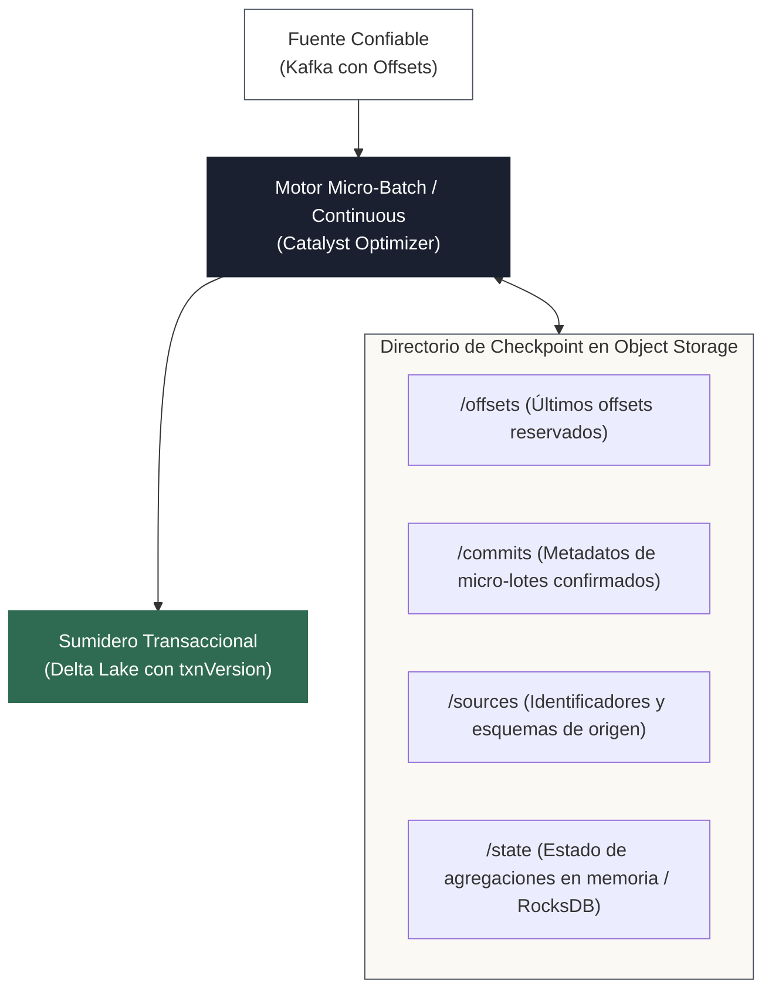
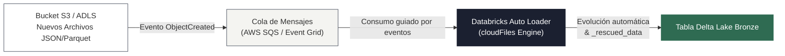

<!-- NOTAS FUENTE ORIGINALES DE OBSIDIAN: [[Structured Streaming]], [[Data Quality en Streaming con Delta Lake]], [[Debezium CDC]], [[Auto Loader]] -->

# Capítulo 22: Spark Structured Streaming y Change Data Capture (CDC) [RECOMENDADO]

> *"Spark Structured Streaming redefine el procesamiento de eventos bajo la premisa de tablas ilimitadas: el cómputo continuo es conceptualmente idéntico a una consulta analítica sobre una tabla infinita a la que se anexan filas sin cesar. Al integrar esta abstracción con Change Data Capture (CDC) y Delta Lake, los ingenieros pueden sincronizar réplicas de bases de datos operacionales con latencia de segundos y garantías estrictas de consistencia."*

---

## Objetivos de Aprendizaje
Al finalizar este capítulo, el lector será capaz de:
* Comprender el modelo de datos de tabla sin fin (*Unbounded Table*) y los tres modos de salida (*Append, Complete, Update*).
* Analizar la anatomía interna del directorio de puntos de control (*Checkpointing*) y los proveedores de gestión de estado (*HDFSBacked* vs. *RocksDB*).
* Procesar flujos de captura de cambios operacionales (**Change Data Capture - CDC**) emitidos por Debezium, gestionando el envelope estructurado, mensajes *tombstone* y coordenadas de binlog/LSN.
* Resolver colisiones en micro-lotes (*Multiple Source Rows Matched*) en operaciones `MERGE INTO` concurrentes y garantizar idempotencia de extremo a extremo mediante `txnAppId` y `txnVersion`.
* Configurar la ingesta incremental de archivos en almacenamiento de objetos con **Databricks Auto Loader (`cloudFiles`)**, distinguiendo el listado incremental del modo de notificaciones por colas.
* Gestionar la acumulación de estado en memoria mediante ventanas temporales y marcas de agua (*Watermarking*), entendiendo la semántica de descarte por lotes previos.

---

> **Definición 22.1 (Modelo Unbounded Table y Structured Streaming)**
>
> **Spark Structured Streaming** es un motor de procesamiento de flujos de eventos escalable y tolerante a fallos construido sobre el optimizador Catalyst de Spark SQL. Modela los flujos de datos continuos como una **tabla sin límites (*Unbounded Table*)**.
> 
> En lugar de manipular APIs de bajo nivel orientadas a mensajes individuales, el ingeniero expresa transformaciones declarativas utilizando las mismas operaciones relacionales de DataFrames y SQL empleadas en cargas por lotes (*Batch*). El motor descompone automáticamente la consulta en micro-lotes periódicos o en ejecución continua (*Continuous Processing Engine*) según la latencia requerida.

---

## 22.1 Arquitectura Interna: Modos de Salida, Checkpointing y Proveedores de Estado

Structured Streaming desacopla fuentes reproducibles con seguimiento de offsets (por ejemplo, Apache Kafka) y sumideros transaccionales idempotentes (por ejemplo, Delta Lake):



### Modos de Salida (Output Modes)
1. **Append Mode (Predeterminado):** Solo las filas nuevas confirmadas desde el último lote se emiten al sumidero. Requiere que las filas existentes no puedan mutar. Es obligatorio para sumideros que no admiten actualizaciones.
2. **Complete Mode:** La tabla de resultados completa se reescribe en cada micro-lote. Se utiliza exclusivamente en consultas con agregaciones acumulativas globales (por ejemplo, conteo total acumulado de eventos por país).
3. **Update Mode:** Solo las filas cuyo valor agregado o proyectado cambió desde el micro-lote anterior se emiten hacia el sumidero externo.

### Proveedores de Almacén de Estado (*State Store Providers*)
Cuando una consulta incluye agregaciones con estado (por ejemplo, `groupBy().count()` sobre ventanas de tiempo) o uniones streaming-streaming:
* **`HDFSBackedStateStoreProvider` (Por Defecto):** Mantiene todo el estado en la memoria heap de la JVM del ejecutor y escribe copias de seguridad sincrónicas a HDFS o almacenamiento de objetos en cada micro-lote. Es ideal para estados pequeños (< 10 GB), pero sufre pausas de Garbage Collection severas con estados grandes.
* **`RocksDBStateStoreProvider` (Opcional):** Emplea una base de datos local embebida fuera de la JVM (C++ RocksDB) en los discos locales de los Workers, volcando únicamente cambios a almacenamiento de objetos:
  ```python
  spark.conf.set(
      "spark.sql.streaming.stateStore.providerClass",
      "org.apache.spark.sql.execution.streaming.state.RocksDBStateStoreProvider"
  )
  ```
  Permite gestionar estados de cientos de gigabytes sin sobrecargar la memoria heap de la JVM.

### Tolerancia a Fallos y Semántica de Ejecución
Si un ejecutor o el nodo Driver colapsan a mitad de un micro-lote:
1. Al reiniciar, Spark inspecciona los directorios `/offsets` y `/commits`.
2. Si el lote $N$ fue reservado en `/offsets` pero no posee su confirmación en `/commits`, Spark detecta que el procesamiento quedó incompleto.
3. El motor **re-ejecuta el micro-lote $N$** desde los mismos offsets de Kafka.
4. *Aclaración Crítica de Consistencia:* A nivel del motor, esta recuperación ofrece garantías de **al menos una vez (*At-Least-Once*)**. La garantía de **exactamente una vez (*Exactly-Once*)** solo se alcanza si el sumidero es estrictamente idempotente.

---

## 22.2 Change Data Capture (CDC) con Debezium y Envelope Estructurado

El patrón **Change Data Capture (CDC)** extrae mutaciones directamente del registro de transacciones de bases de datos operacionales (el WAL en PostgreSQL, el Binlog en MySQL, o el Oplog en MongoDB) utilizando **Debezium**, evitando consultas periódicas que saturan las bases operacionales.

### El Envelope Completo de Debezium frente a SMT
Por defecto, cuando Kafka Connect opera sin transformaciones de mensaje único (*SMT*), cada mensaje en Kafka contiene metadatos de esquema y un payload anidado:

```json
{
  "schema": { "type": "struct", "fields": [...] },
  "payload": {
    "op": "u",
    "before": { "cliente_id": "C-101", "saldo": 500.00, "pais": "CO" },
    "after":  { "cliente_id": "C-101", "saldo": 850.50, "pais": "CO" },
    "source": { 
      "name": "mysql_core", 
      "ts_ms": 1773412800000, 
      "file": "binlog.000042",
      "pos": 1048576,
      "table": "cuentas" 
    },
    "ts_ms": 1773412800500
  }
}
```

* **Operación (`op`):** `c` (*create/insert*), `u` (*update*), `d` (*delete*), `r` (*read/snapshot* inicial).
* **`before` y `after`:** Estado previo y estado nuevo de la tupla.
* **Coordenadas de Binlog / LSN (`source.file`, `source.pos`, `source.lsn`):** Posición monotónicamente creciente en el registro de transacciones. **No confíe únicamente en `ts_ms`** para ordenar eventos, ya que múltiples mutaciones dentro de una misma transacción comparten exactamente el mismo milisegundo.
* **Mensajes Tombstone:** Al ejecutarse un borrado (`DELETE`), Debezium emite primero el evento con `op = 'd'`, seguido de un mensaje con valor nulo (`null payload`) para permitir la compactación de tópicos en Kafka. Si el pipeline no filtra `value IS NOT NULL`, el parser de JSON arrojará errores de ejecución.

---

## 22.3 Resolución de Colisiones en Micro-Lotes: Deduplicación e Idempotencia con MERGE

Si un mismo micro-lote contiene múltiples eventos para una misma clave primaria (por ejemplo, una inserción rápida seguida de dos actualizaciones en un lapso de 5 segundos), ejecutar `MERGE INTO` directamente sobre el lote disparará la excepción:

```
DeltaAnalysisException: Cannot perform MERGE as multiple source rows matched the same target row.
```

Para evitar este fallo y asegurar idempotencia exacta, el micro-lote debe:
1. Filtrar registros *tombstone* (`value IS NOT NULL`).
2. Deduplicarse reteniendo la mutación con mayor posición en el binlog (`source.pos`) o mayor `ts_ms`.
3. Ejecutar `MERGE INTO` asociando el identificador del micro-lote con `txnAppId` y `txnVersion` para evitar reprocesamientos duplicados si el micro-lote se reintenta.

```python
from pyspark.sql import SparkSession, Window
import pyspark.sql.functions as F
from pyspark.sql.types import *
from delta.tables import DeltaTable

spark = SparkSession.builder \
    .appName("Capitulo22-CDC-Streaming-Resiliente") \
    .config("spark.sql.extensions", "io.delta.sql.DeltaSparkSessionExtension") \
    .config("spark.sql.catalog.spark_catalog", "org.apache.spark.sql.delta.catalog.DeltaCatalog") \
    .getOrCreate()

# 1. Definición del esquema estricto del payload de Debezium (con schemas.enable=false)
esquema_fila = StructType([
    StructField("cliente_id", StringType(), False),
    StructField("nombre", StringType(), True),
    StructField("saldo", DoubleType(), True),
    StructField("pais", StringType(), True)
])

esquema_source = StructType([
    StructField("name", StringType(), True),
    StructField("ts_ms", LongType(), True),
    StructField("file", StringType(), True),
    StructField("pos", LongType(), True)
])

esquema_debezium = StructType([
    StructField("op", StringType(), False),
    StructField("before", esquema_fila, True),
    StructField("after", esquema_fila, True),
    StructField("source", esquema_source, True),
    StructField("ts_ms", LongType(), False)
])

# 2. Lectura continua de Kafka desde earliest para no perder el snapshot inicial
df_kafka = spark.readStream \
    .format("kafka") \
    .option("kafka.bootstrap.servers", "kafka-broker:9092") \
    .option("subscribe", "cdc.mysql.cuentas") \
    .option("startingOffsets", "earliest") \
    .load()

# Filtrar mensajes tombstone (payloads nulos emitidos tras borrados)
df_valid_kafka = df_kafka.filter(F.col("value").isNotNull())

df_parsed = df_valid_kafka.select(
    F.from_json(F.col("value").cast("string"), esquema_debezium).alias("data")
).select(
    F.col("data.op").alias("op"),
    F.coalesce(F.col("data.after.cliente_id"), F.col("data.before.cliente_id")).alias("cliente_id"),
    F.col("data.after.nombre").alias("nombre"),
    F.col("data.after.saldo").alias("saldo"),
    F.col("data.after.pais").alias("pais"),
    F.col("data.source.file").alias("binlog_file"),
    F.col("data.source.pos").alias("binlog_pos"),
    # Clave de secuencia monotónica que resiste rotación de archivos binlog:
    F.concat(
        F.col("data.source.file"),
        F.lit("#"),
        F.lpad(F.col("data.source.pos").cast("string"), 20, "0")
    ).alias("coordenada_cdc"),
    F.to_timestamp(F.col("data.ts_ms") / 1000).alias("timestamp_evento")
)

# 3. Función de procesamiento de micro-lote con deduplicación y MERGE idempotente
def fusionar_cdc_a_delta(df_micro_batch, batch_id):
    if df_micro_batch.isEmpty():
        return

    # Deduplicación intra-lote: ordenar por coordenada compuesta de binlog y timestamp
    # Nota crítica: La posición se reinicia al rotar de archivo, por lo que la tupla (file, pos) es obligatoria
    ventana_dedup = Window.partitionBy("cliente_id").orderBy(
        F.col("coordenada_cdc").desc(),
        F.col("timestamp_evento").desc()
    )
    
    df_dedup = df_micro_batch \
        .withColumn("ranking", F.row_number().over(ventana_dedup)) \
        .filter(F.col("ranking") == 1) \
        .drop("ranking")

    app_id = "streaming_cdc_cuentas_v1"
    tabla_delta = DeltaTable.forPath(spark, "lakehouse/silver/cuentas_clientes")

    # MERGE INTO con soporte para inserción de updates tardíos (upsert robusto)
    # y condición de versión monotónica para evitar sobreescribir datos nuevos con tardíos
    condicion_orden = """
        target.coordenada_cdc IS NULL OR 
        source.coordenada_cdc >= target.coordenada_cdc
    """

    tabla_delta.alias("target").merge(
        df_dedup.alias("source"),
        "target.cliente_id = source.cliente_id"
    ).whenMatchedDelete(
        condition=f"source.op = 'd' AND ({condicion_orden})"
    ).whenMatchedUpdate(
        condition=f"source.op = 'u' AND ({condicion_orden})",
        set={
            "nombre": "source.nombre",
            "saldo": "source.saldo",
            "pais": "source.pais",
            "binlog_file": "source.binlog_file",
            "binlog_pos": "source.binlog_pos",
            "coordenada_cdc": "source.coordenada_cdc",
            "timestamp_evento": "source.timestamp_evento",
            "_batch_id": F.lit(batch_id).cast("bigint")
        }
    ).whenNotMatchedInsert(
        condition="source.op IN ('c', 'r', 'u')", # Si un update llega para una fila inexistente, se inserta
        values={
            "cliente_id": "source.cliente_id",
            "nombre": "source.nombre",
            "saldo": "source.saldo",
            "pais": "source.pais",
            "binlog_file": "source.binlog_file",
            "binlog_pos": "source.binlog_pos",
            "coordenada_cdc": "source.coordenada_cdc",
            "timestamp_evento": "source.timestamp_evento",
            "_batch_id": F.lit(batch_id).cast("bigint")
        }
    ).execute()

# 4. Iniciar ejecución continua con foreachBatch y checkpointing persistente
query_cdc = df_parsed.writeStream \
    .foreachBatch(fusionar_cdc_a_delta) \
    .option("checkpointLocation", "s3://lakehouse-checkpoints/cdc_cuentas/") \
    .trigger(processingTime="10 seconds") \
    .start()
```

---

## 22.4 Ingesta de Archivos con Databricks Auto Loader (`cloudFiles`)

Al procesar millones de archivos depositados de forma continua en almacenamiento de objetos (Amazon S3, Azure ADLS, GCP GCS), el lector tradicional (`readStream.format("parquet")`) experimenta una degradación severa provocada por la latencia del listado recursivo de directorios (*Directory Listing Latency*).

**Auto Loader (`cloudFiles`)** optimiza esta ingesta mediante dos modos operativos:
1. **Modo Listado Incremental (Por Defecto):** Escanea únicamente los subdirectorios modificados recientemente utilizando la marca de tiempo de los archivos (`cloudFiles.useIncrementalListing = true`), evitando listar el bucket completo.
2. **Modo Notificaciones por Colas (Opcional):** Se suscribe directamente a colas de eventos en la nube (AWS SQS, Azure Event Grid) para recibir alertas directas ante la creación de nuevos objetos (`cloudFiles.useNotifications = true`), eliminando completamente cualquier llamada a operaciones de listado:



### Características Críticas de Auto Loader
* **Inferencia y Evolución de Esquema:** Detecta automáticamente nuevas columnas en los archivos entrantes y las incorpora al esquema (`cloudFiles.schemaEvolutionMode = "addNewColumns"`).
* **Resguardo de Datos Malformados (`_rescued_data`):** En lugar de abortar el pipeline cuando un registro contiene tipos de datos corruptos o campos no mapeados, Auto Loader desvía los datos discordantes a una columna oculta `_rescued_data` en formato JSON, permitiendo que el micro-lote continúe sin interrupciones.
* **Disparador `Trigger.AvailableNow`:** Procesa todos los archivos acumulados hasta el momento y detiene el flujo automáticamente, ofreciendo la economía de costos de un trabajo batch con las ventajas operativas de streaming.

```python
# Ingesta robusta con Auto Loader
df_auto_loader = spark.readStream \
    .format("cloudFiles") \
    .option("cloudFiles.format", "json") \
    .option("cloudFiles.schemaLocation", "s3://lakehouse-checkpoints/autoloader_schemas/ventas/") \
    .option("cloudFiles.schemaEvolutionMode", "addNewColumns") \
    .load("s3://fuentes-externas/ventas_landing/")

query_al = df_auto_loader.writeStream \
    .format("delta") \
    .option("checkpointLocation", "s3://lakehouse-checkpoints/autoloader_cp/ventas/") \
    .trigger(availableNow=True) \
    .toTable("lakehouse.bronze.ventas_raw")
```

---

## 22.5 Criterios de Fiabilidad y Anti-Patrones en Producción

**Anti-patrón 1: Configurar `startingOffsets = "latest"` en Pipelines de CDC**  
Configurar `latest` hace que Spark comience a leer únicamente los mensajes publicados tras el arranque del stream, omitiendo por completo el snapshot inicial de la base de datos y todas las mutaciones generadas durante el periodo de despliegue. En pipelines de CDC, utilice siempre `earliest`.

**Anti-patrón 2: Modificar la Consulta sin Reiniciar el Checkpoint Cuando Cambia el Esquema de Estado**  
Si una consulta utiliza agregaciones con estado (por ejemplo, ventanas temporales) y se modifica la clave de agrupación o la ventana en el código, el motor no podrá deserializar el estado previo en el checkpoint. En tales situaciones, debe definirse una nueva ruta de checkpoint y planificar la transición de datos.

**Anti-patrón 3: Agregaciones Temporales sin Declaración de Watermarking**  
Ejecutar agrupaciones basadas en tiempo sin declarar `.withWatermark()` obliga a Spark a retener el estado de todas las ventanas en memoria de forma indefinida, ya que el motor nunca sabrá cuándo considerar cerrada una ventana. Esto culminará inevitablemente en un fallo por memoria agotada (*OutOfMemoryError*) tras varios días de operación ininterrumpida.

---

## Preguntas de Revisión y Ejercicios Prácticos
**Ejercicio 22.1 (Semántica Exacta de Watermarking y Descarte de Datos Tardíos):**  
Un flujo continuo de eventos se procesa agrupando por ventanas de 5 minutos sobre `timestamp_evento` con una marca de agua configurada como `.withWatermark("timestamp_evento", "10 minutes")`.
1. Si en el micro-lote $N-1$ el mayor `timestamp_evento` procesado fue `12:30:00`, ¿cuál es el umbral de la marca de agua aplicado para evaluar las ventanas del micro-lote $N$?
2. Si durante el micro-lote $N$ llega un evento retrasado con `timestamp_evento = 12:18:00`, ¿el evento se procesa o se descarta? Explique la regla de cierre de ventanas.

**Solución 22.1:**
1. *Umbral de Watermark:* El umbral se calcula restando la duración de la marca de agua al timestamp máximo observado en el **micro-lote previo**:
   $$\text{Umbral} = 12:30:00 - 10 \text{ minutos} = 12:20:00$$
2. *Evaluación del evento 12:18:00:*
   * La ventana de 5 minutos que corresponde a este evento es `[12:15:00, 12:20:00)`.
   * El límite superior de esta ventana es $12:20:00$. Dado que el umbral actual es $12:20:00$, la ventana se encuentra **estrictamente cerrada** (su límite superior no supera el umbral).
   * En consecuencia, Spark **descarta el evento y no actualiza el estado de la ventana**, protegiendo la memoria del almacén de estado frente a datos excesivamente tardíos (*Late Data*).

---

**Ejercicio 22.2 (Sincronización de Borrados Físicos en CDC y Mensajes Tombstone):**  
En una arquitectura CDC conectada a PostgreSQL, un registro se elimina con `DELETE FROM cuentas WHERE cliente_id = 'C-55'`. Explique por qué es obligatorio filtrar `value IS NOT NULL` antes de parsear los eventos de Kafka y cómo actúa la cláusula `whenMatchedDelete` en el `foreachBatch`.

**Solución 22.2:**
1. *Filtrado de Tombstones:* Tras emitir el evento de borrado (`op = 'd'`), Debezium genera un registro de tipo *tombstone* con la clave `C-55` y un cuerpo nulo (`value = null`) para habilitar la compactación de logs en Kafka. Si el pipeline intenta ejecutar `F.from_json(col("value"), ...)`, la función recibirá una cadena nula, lo que puede provocar excepciones o generar filas vacías que corrompen la deduplicación posterior. Filtrar `value IS NOT NULL` antes del parsing asegura que solo se procese el evento legítimo con `op = 'd'`.
2. *Comportamiento de `whenMatchedDelete`:*
   ```python
   tabla_delta.alias("target").merge(
       df_dedup.alias("source"),
       "target.cliente_id = source.cliente_id"
   ).whenMatchedDelete(
       condition="source.op = 'd'"
   )
   ```
   Si el cliente existe en el destino (`target.cliente_id = source.cliente_id`) y el evento deduplicado más reciente indica borrado (`source.op = 'd'`), Delta Lake elimina físicamente la fila en la capa Silver. Si el registro ya fue borrado en un lote previo o nunca existió, la condición `whenMatched` no se cumple y la sentencia concluye sin errores.

---

## 22.6 Resumen y Puntos Clave

* **Unbounded Table:** Structured Streaming unifica el procesamiento continuo modelando los datos como una tabla infinita gobernada por el optimizador Catalyst.
* **Proveedores de Estado:** Por defecto se emplea `HDFSBackedStateStoreProvider` en memoria heap; para estados superiores a decenas de gigabytes se debe habilitar `RocksDBStateStoreProvider`.
* **Garantía Exactly-Once:** Requiere fuentes con offsets reproducibles (Kafka), checkpointing persistente y operaciones idempotentes en el sumidero (como `MERGE` en Delta Lake asociando transacciones).
* **Robustez en CDC:** Exige manejar esquemas completos de Debezium, descartar tombstones nulos, deduplicar intra-lote utilizando posiciones de binlog/LSN y usar `startingOffsets = "earliest"`.
* **Auto Loader:** Reduce drásticamente la latencia de escaneo en almacenamiento de objetos mediante listado incremental o notificaciones por colas, resguardando datos corruptos en `_rescued_data`.

---

## Lecturas Recomendadas
1. **Armbrust, M. et al. (2018).** *Structured Streaming: A Declarative Engine for Real-Time Big Data Processing.* Proceedings of the 2018 ACM SIGMOD International Conference on Management of Data, 601-613.
2. **Debezium Technical Documentation (2024).** *Debezium Connectors for MySQL and PostgreSQL: Architecture and Event Envelope Specification.* Red Hat (`https://debezium.io/documentation/`).
3. **Databricks Engineering (2024).** *Efficient Incremental Ingestion with Auto Loader and Delta Lake.* Databricks Documentation (`https://docs.databricks.com/ingestion/auto-loader/`).
