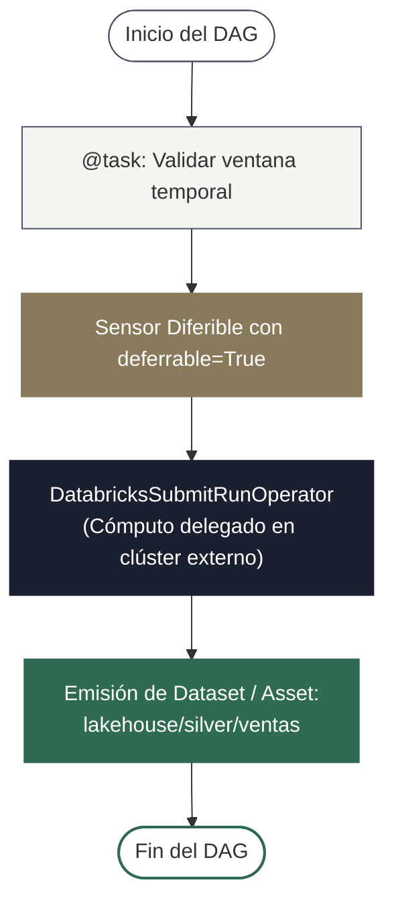
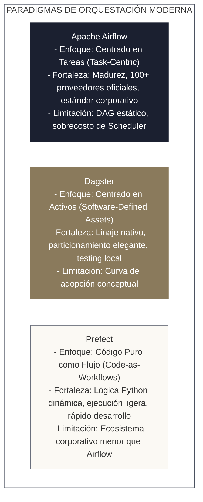

<!-- NOTAS FUENTE ORIGINALES DE OBSIDIAN: [[Airflow vs ADF]], [[Apache Airflow]], [[Azure Data Factory]], [[Orchestration Patterns]] -->

# Capítulo 23: Orquestación de Flujos: Apache Airflow y Azure Data Factory [NÚCLEO EMPLEABILIDAD]

> *"Un clúster distribuido capaz de computar petabytes en segundos carece de utilidad productiva si sus tareas se ejecutan a ciegas o en momentos aleatorios. La orquestación es el sistema nervioso central de la plataforma de datos: resuelve dependencias entre sistemas heterogéneos, administra reintentos ante fallos transitorios y garantiza que la información esté disponible con puntualidad matemática."*

---

## Objetivos de Aprendizaje
Al finalizar este capítulo, el lector será capaz de:
* Comprender el rol de los orquestadores analíticos frente a programadores de tareas elementales como *Cron*.
* Evaluar y comparar críticamente las arquitecturas de **Apache Airflow** (versión moderna 2.10+ / 3.0) y **Azure Data Factory (ADF)**.
* Diseñar grafos acíclicos dirigidos (**DAGs**) en Airflow aplicando el paradigma **TaskFlow API** (`@dag`, `@task`), operadores diferibles con `deferrable=True` y programación reactiva basada en **Datasets / Assets**.
* Dominar la semántica matemática de intervalos de datos (`logical_date`, `data_interval_start`, `data_interval_end`) para garantizar ejecuciones estrictamente **idempotentes**.
* Construir pipelines nativos en **Azure Data Factory** articulando *Linked Services*, *Datasets*, *Activities* e *Integration Runtimes* (Azure IR vs. Self-Hosted IR).

---

> **Definición 23.1 (Orquestación de Pipelines de Datos)**
>
> La **orquestación de datos** es la automatización programática del ciclo de vida integral de los flujos de trabajo analíticos. Comprende la resolución de dependencias topológicas entre tareas heterogéneas, la planificación cronológica o reactiva por eventos, la asignación dinámica de recursos computacionales, la gestión de reintentos con retraso exponencial ante fallos transitorios y la emisión de métricas de cumplimiento de acuerdos de nivel de servicio (SLA).

---

## 23.1 Comparativa Arquitectónica: Apache Airflow vs. Azure Data Factory

| Criterio de Selección | Apache Airflow (2.10+ / 3.0) | Azure Data Factory (ADF) |
| :--- | :--- | :--- |
| **Filosofía Fundamental** | *Pipelines as Code* (Python nativo, control total). | Orquestación visual declarativa basada en JSON (*Low-Code/UI-First*). |
| **Flexibilidad Dinámica** | Total: soporte para bucles dinámicos, librerías personalizadas y SDKs. | Rígida: acotada por los bloques y conectores provistos por Azure. |
| **Infraestructura** | Requiere gestión (Astronomer, MWAA, Cloud Composer, Kubernetes). | Totalmente administrada (*Serverless / PaaS*) en Azure. |
| **Conectividad Híbrida** | Agentes en red o workers desplegados en cualquier nube u on-premise. | **Self-Hosted Integration Runtime (SHIR)** para cruzar firewalls locales. |
| **Carga Computacional** | **Director liviano:** Delega el cómputo a motores externos (Databricks, Snowflake). | **Orquestador + Motor ETL:** Ejecuta Data Flows (Spark gestionado) o delega. |
| **CI/CD y Testing** | Excelente: pruebas unitarias con `pytest`, linters y control Git estándar. | Exportación de plantillas ARM/Bicep y ramas de publicación en Azure DevOps. |

---

## 23.2 Anatomía de un DAG en Apache Airflow: TaskFlow API y Datasets

El estándar moderno de Apache Airflow utiliza la sintaxis declarativa **TaskFlow API** (`@dag`, `@task`) y el parámetro `schedule` (reemplazando al deprecado `schedule_interval`):



### Operadores Diferibles (*Deferrable Operators*)
Los sensores tradicionales bloquean permanentemente un hilo de ejecución (*worker slot*) mientras esperan que ocurra un evento externo, desperdiciando recursos del clúster. Con `deferrable=True`, el operador suspende su ejecución y cede su worker, registrándose en el proceso asíncrono **Triggerer** de Airflow hasta que el evento se activa.

### Programación Reactiva basada en Datasets / Assets
En lugar de acoplar DAGs mediante horarios fijos en cron, Airflow permite que un pipeline productor declare un **Dataset** en sus salidas (`outlets`), disparando automáticamente el DAG consumidor en el instante en que los datos se confirman:

```python
from datetime import datetime, timedelta
from airflow.decorators import dag, task
from airflow.datasets import Dataset
from airflow.providers.databricks.operators.databricks import DatabricksSubmitRunOperator
from airflow.sensors.external_task import ExternalTaskSensor

# Definición del activo de datos compartido (URI canónica)
dataset_ventas_silver = Dataset("lakehouse://silver/ventas_diarias")

argumentos_por_defecto = {
    'owner': 'data_engineering',
    'depends_on_past': False,
    'email_on_failure': True,
    'retries': 3,
    'retry_delay': timedelta(minutes=3),
    'retry_exponential_backoff': True
}

@dag(
    dag_id='pipeline_ventas_medallon',
    default_args=argumentos_por_defecto,
    schedule='0 3 * * *',  # Ejecución diaria programada a las 03:00 UTC
    start_date=datetime(2026, 1, 1),
    catchup=False,
    max_active_runs=1,
    tags=['ventas', 'lakehouse']
)
def pipeline_ventas():

    @task
    def pre_validacion(data_interval_start=None, data_interval_end=None):
        print(f"[INTERVALO] Ventana de datos desde {data_interval_start} hasta {data_interval_end}")
        return {"inicio": str(data_interval_start)}

    # Sensor diferible de Airflow core (libera el worker slot mientras espera)
    esperar_datos_crudos = ExternalTaskSensor(
        task_id='esperar_ingesta_cruda',
        external_dag_id='dag_ingesta_landing',
        allowed_states=['success'],
        execution_delta=timedelta(hours=1), # Ajuste si el DAG externo corre a las 02:00 UTC
        deferrable=True,                    # Clave de eficiencia: ejecución asíncrona
        timeout=7200
    )

    tarea_databricks = DatabricksSubmitRunOperator(
        task_id='procesar_silver_en_databricks',
        databricks_conn_id='databricks_default',
        new_cluster={
            'spark_version': '14.3.x-scala2.12',
            'node_type_id': 'Standard_D4ds_v5',
            'num_workers': 2
        },
        notebook_task={
            'notebook_path': '/Production/Pipelines/02_Silver_Ventas',
            'base_parameters': {'fecha_proceso': '{{ ds }}'}
        },
        outlets=[dataset_ventas_silver]  # Emite el activo para activar DAGs dependientes
    )

    pre_validacion() >> esperar_datos_crudos >> tarea_databricks

instancia_dag = pipeline_ventas()
```

---

## 23.3 Semántica Matemática de Intervalos de Datos e Idempotencia

En Apache Airflow, el tiempo de planificación se define de forma rigurosa:

* **Para una expresión cron `0 3 * * *` (ejecución diaria a las 03:00 UTC):**
  * Una ejecución disparada el **3 de octubre a las 03:00 UTC** no procesa de 00:00 a 00:00; procesa el intervalo comprendido entre la corrida programada anterior y la actual:
    $$\text{data\_interval\_start} = \text{2026-10-02 03:00:00 UTC}$$
    $$\text{data\_interval\_end} = \text{2026-10-03 03:00:00 UTC}$$
    $$\text{logical\_date} = \text{2026-10-02 03:00:00 UTC}$$
* **Para la macro `@daily` (`0 0 * * *`):**
  * Únicamente en este caso el intervalo abarca desde `00:00:00` hasta `00:00:00` del día siguiente.

### Garantía de Idempotencia en Pipelines
Un pipeline es **idempotente** si la reejecución de cualquier intervalo temporal produce exactamente el mismo estado en la base de datos destino:
$$\text{Pipeline}(\text{Pipeline}(D, \text{intervalo})) = \text{Pipeline}(D, \text{intervalo})$$
Esto exige que el código SQL o PySpark parametrice sus filtros con `{{ ds }}` y escriba mediante reemplazo atómico de partición (`replaceWhere` en Delta Lake) en lugar de inserciones acumulativas ciegas.

---

## 23.4 Orquestación en Azure Data Factory (ADF)

En arquitecturas empresariales sobre Microsoft Azure, **Azure Data Factory (ADF)** es el servicio gestionado líder para orquestar movimientos e ingestas de datos.

### Componentes Fundamentales de ADF
1. **Linked Services (Servicios Vinculados):** Definen la información de conexión e identidad hacia almacenes externos (Azure Key Vault, ADLS Gen2, Databricks, PostgreSQL local).
2. **Datasets (Conjuntos de Datos):** Punteros tipados que hacen referencia a las estructuras de datos dentro de un Linked Service (ej. carpeta de archivos Parquet en ADLS Gen2).
3. **Activities (Actividades):** Pasos de ejecución dentro de un pipeline:
   * *Actividades de Movimiento:* `Copy Activity` para transferencias masivas optimizadas.
   * *Actividades de Transformación:* `Databricks Notebook Activity`, `Databricks Spark Jar Activity`, `Stored Procedure Activity`.
   * *Actividades de Control de Flujo:* `Lookup`, `ForEach`, `If Condition`, `Execute Pipeline`, `Web Activity`.
4. **Integration Runtime (IR):** La infraestructura de cómputo que ejecuta las actividades:
   * **Azure IR:** Cómputo serverless elástico administrado por Microsoft para transferencias en la nube pública.
   * **Self-Hosted IR (SHIR):** Agente de software instalado en máquinas virtuales privadas o servidores on-premise para extraer datos corporativos detrás de firewalls sin exponer puertos a internet.

### Definición JSON de un Pipeline de Producción en ADF

El siguiente manifiesto ilustra un pipeline de ADF que extrae parámetros dinámicos, ejecuta una validación previa y dispara una transformación en Azure Databricks:

```json
{
  "name": "Pipeline_Ingesta_Medallon_ADF",
  "properties": {
    "parameters": {
      "FechaEjecucion": {
        "type": "string",
        "defaultValue": "@formatDateTime(pipeline().TriggerTime, 'yyyy-MM-dd')"
      }
    },
    "activities": [
      {
        "name": "Validar_Disponibilidad_Landing",
        "type": "Validation",
        "dependsOn": [],
        "typeProperties": {
          "dataset": {
            "referenceName": "Dataset_ADLS_Bronze_Landing",
            "type": "DatasetReference"
          },
          "timeout": "00:30:00",
          "sleep": 60,
          "childItems": true
        }
      },
      {
        "name": "Transformar_Silver_Databricks",
        "type": "DatabricksNotebook",
        "dependsOn": [
          {
            "activity": "Validar_Disponibilidad_Landing",
            "dependencyConditions": ["Succeeded"]
          }
        ],
        "linkedServiceName": {
          "referenceName": "LinkedService_AzureDatabricks",
          "type": "LinkedServiceReference"
        },
        "typeProperties": {
          "notebookPath": "/Production/Pipelines/02_Silver_Ventas",
          "baseParameters": {
            "fecha_proceso": {
              "value": "@pipeline().parameters.FechaEjecucion",
              "type": "Expression"
            }
          }
        }
      }
    ],
    "annotations": ["Produccion", "Medallon", "FinOps"]
  }
}
---

## 23.5 Ecosistema Moderno de Orquestación: Airflow vs. Dagster vs. Prefect

Aunque Apache Airflow mantiene el dominio del mercado corporativo, la última generación de orquestadores introdujo paradigmas que resuelven fricciones históricas de desarrollo local y modelado de datos:



### 1. Dagster: Orquestación Basada en Activos (*Software-Defined Assets*)
En lugar de pensar en *"la tarea A ejecuta un script y luego la tarea B ejecuta otro"*, Dagster modela **qué activo de datos debe existir**:
```python
# Definición declarativa de un activo en Dagster
from dagster import asset
import pandas as pd

@asset
def clientes_limpios() -> pd.DataFrame:
    df = pd.read_parquet("data/clientes.parquet")
    return df.dropna(subset=["correo"])

@asset
def metricas_ventas_por_cliente(clientes_limpios: pd.DataFrame) -> pd.DataFrame:
    # Dagster deduce automáticamente la dependencia a partir del nombre del argumento
    ventas = pd.read_parquet("data/ventas.parquet")
    return ventas.merge(clientes_limpios, on="cliente_id").groupby("segmento").agg({"monto_usd": "sum"})
```

### 2. Prefect: Flujos Dinámicos con Código Python Nativo
Prefect permite transformar cualquier script de Python ordinario en un flujo observable simplemente añadiendo decoradores:
```python
# Flujo dinámico nativo en Prefect 2.x/3.x
from prefect import flow, task

@task(retries=3, retry_delay_seconds=10)
def extraer_datos_api(lote: int):
    return {"lote": lote, "filas": [1, 2, 3]}

@flow(name="pipeline_dinamico_prefect")
def flujo_principal(total_lotes: int = 5):
    # Permite bucles e if/else dinámicos nativos en Python sin mapping complejo
    for i in range(total_lotes):
        extraer_datos_api(i)
```

### Criterio de Selección:
* **Seleccione Airflow si:** Su organización requiere un estándar industrial consolidado con miles de integraciones maduras, orquesta sistemas híbridos multi-nube y cuenta con ingenieros experimentados en su operación.
* **Seleccione Dagster si:** El equipo está enfocado intensamente en calidad y linaje de datos (Analytics Engineering, data mesh), integrando dbt y validaciones a nivel de columna como ciudadanos de primera clase.
* **Seleccione Prefect si:** El equipo prioriza la velocidad de desarrollo en Python puro, necesita desplegar tareas en contenedores efímeros sin la sobrecarga operativa de un scheduler pesado, y requiere flujos dinámicos con lógica condicional en tiempo de ejecución.

## 23.5 Criterios de Fiabilidad y Anti-Patrones en Producción

**Anti-patrón 1: Cargar Grandes Volúmenes de Datos en la Memoria del Worker de Airflow**
Ejecutar código que descargue DataFrames masivos en el worker de Airflow provoca colapsos por *Out Of Memory* (OOM) y bloquea el scheduler. Airflow debe actuar siempre como un director de orquesta ligero que delega el cómputo pesado a Databricks, Snowflake o Spark en Kubernetes.

**Anti-patrón 2: Habilitar `catchup=True` con Fechas de Inicio Antiguas**
Crear un DAG con una fecha de inicio de hace un año y dejar `catchup=True` dispara cientos de ejecuciones simultáneas al encenderlo, saturando las bases de datos transaccionales de origen y disparando la facturación cloud.

**Anti-patrón 3: Diseñar Pipelines en ADF con Bucles `ForEach` Secuenciales sobre Millones de Archivos**
Iterar archivo por archivo en ADF mediante un bucle de actividades incurre en costos elevados por ejecución de actividades y tiempos de respuesta ineficientes. Utilice la `Copy Activity` con comodines (*Wildcards*) o procese mediante Databricks Auto Loader.

---

## Preguntas de Revisión y Ejercicios Prácticos
**Ejercicio 23.1 (Sincronización de DAGs a Horas Distintas y Datasets):**  
El DAG de ingesta de CRM finaliza diariamente a las **02:00 UTC**. El DAG de consolidación financiera está programado para correr a las **04:00 UTC**.
1. Si se utiliza un `ExternalTaskSensor` en el DAG de las 04:00 UTC, ¿por qué fallará si se deja la configuración por defecto? ¿Qué parámetro exacto debe ajustarse?
2. ¿Cómo se resuelve esta dependencia de forma nativa y desacoplada utilizando **Datasets / Assets** en Airflow moderno?

**Solución 23.1:**
1. *Fallo y corrección con sensor:* Por defecto, `ExternalTaskSensor` busca una ejecución en el DAG externo que tenga exactamente el **mismo `logical_date`**. Al ejecutarse a horas distintas (04:00 vs 02:00), las marcas de tiempo difieren por 2 horas, por lo que el sensor esperará hasta alcanzar el timeout. La corrección exige configurar el desfase explícito:
   ```python
   ExternalTaskSensor(
       task_id='esperar_crm',
       external_dag_id='dag_ingesta_crm',
       execution_delta=timedelta(hours=2),
       deferrable=True
   )
   ```
2. *Solución moderna con Datasets / Assets:* Se desacoplan los horarios por cron. 
   * El DAG de CRM declara en su tarea terminal: `outlets=[Dataset("lakehouse://silver/crm")]`.
   * El DAG financiero se declara sin expresión cron fija: `schedule=[Dataset("lakehouse://silver/crm")]`.
   Tan pronto como el DAG de CRM confirma la actualización del dataset en la base de metadatos de Airflow, el DAG financiero se activa inmediatamente de forma reactiva, eliminando esperas ociosas y desfasajes horarios.

---

**Ejercicio 23.2 (Conectividad Híbrida Segura en Azure Data Factory):**  
Una entidad bancaria necesita extraer diariamente 500 GB de datos desde un servidor Oracle alojado en un centro de cómputo privado (*On-Premise*) sin conexión pública a internet hacia un contenedor ADLS Gen2 en Azure.
Describe los componentes arquitectónicos de ADF requeridos para cumplir este flujo de forma segura.

**Solución 23.2:**
1. **Self-Hosted Integration Runtime (SHIR):** Se instala el agente de software SHIR en una máquina virtual Windows ubicada dentro de la red corporativa del banco con acceso local a la base de datos Oracle. El agente solo requiere salida HTTPS (puerto 443 saliente) hacia Azure; no requiere abrir puertos entrantes en el firewall bancario.
2. **Linked Services:**
   * *Linked Service Oracle:* Configurado para utilizar el SHIR local, autenticándose mediante credenciales seguras almacenadas en Azure Key Vault.
   * *Linked Service ADLS Gen2:* Conectado al almacenamiento del Lakehouse mediante una Identidad Administrada (*Managed Identity*).
3. **Copy Activity en ADF:** Se ejecuta un pipeline en ADF cuya actividad de copia lee a través del túnel seguro establecido por el SHIR y escribe directamente en el contenedor Bronze en la nube con cifrado TLS 1.3 en tránsito.

---

## 23.6 Resumen y Puntos Clave

* **Orquestador como director liviano:** Airflow y ADF deben coordinar dependencias y estados sin procesar transformaciones analíticas pesadas en su propia infraestructura.
* **Modernidad en Airflow:** La TaskFlow API (`@dag`, `@task`), los operadores diferibles (`deferrable=True`) y la programación por Datasets representan el estándar de alta concurrencia.
* **Intervalos cron y semántica temporal:** Para `0 3 * * *`, el intervalo de datos procesado cubre de 03:00 a 03:00 del periodo precedente, requiriendo parametrización determinista con `{{ ds }}` para garantizar idempotencia.
* **Ecosistema de Azure Data Factory:** Articula *Linked Services*, *Datasets*, *Activities* y *Integration Runtimes* (Azure IR para nube y Self-Hosted IR para redes híbridas privadas).

---

## Lecturas Recomendadas
1. **Harenslak, B. & de Ruiter, J. (2021).** *Data Pipelines with Apache Airflow.* Manning Publications.
2. **Apache Airflow Documentation (2024).** *Data-Aware Scheduling, Datasets, and Deferrable Operators.* Apache Software Foundation (`https://airflow.apache.org/docs/`).
3. **Microsoft Learn (2024).** *Azure Data Factory Pipelines, Integration Runtime and Hybrid Networking Architecture.* Microsoft Documentation.
