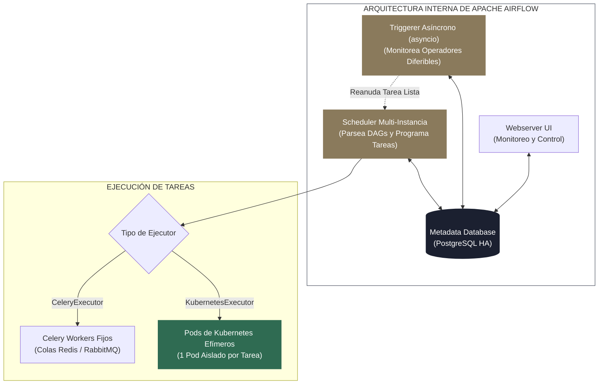
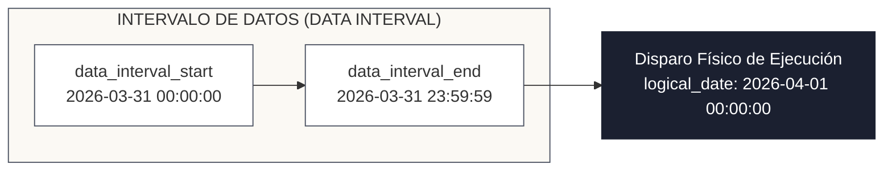

<!-- NOTAS FUENTE ORIGINALES DE OBSIDIAN: [[Airflow Advanced]], [[Dynamic Task Mapping]], [[Deferrable Operators]], [[KubernetesExecutor]], [[Airflow 3.0]] -->

# Capítulo 23A: Orquestación Avanzada con Apache Airflow: Arquitectura Interna, Dynamic Mapping y Datasets [RECOMENDADO]

> *"Un DAG elemental con dos tareas lineales puede escribirse en una tarde de exploración; operar una plataforma de orquestación a escala corporativa con cientos de pipelines concurrentes exige dominar los mecanismos internos de Apache Airflow. Desde el bucle del Scheduler y la ejecución asíncrona de los Triggerers hasta el mapeo dinámico de tareas y la programación orientada a datos, la excelencia en orquestación radica en convertir el orquestador en un director liviano, tolerante a fallos y desacoplado de la carga pesada de cómputo."*

---

## Objetivos de Aprendizaje
Al finalizar este capítulo, el lector será capaz de:
* Comprender la arquitectura de procesos interna de **Apache Airflow**: el ciclo del **Scheduler**, la base de datos de metadatos, el servidor web y los **Triggerers** asíncronos.
* Evaluar y seleccionar el ejecutor óptimo para producción: `CeleryExecutor` frente a **`KubernetesExecutor`** (aislamiento de pods efímeros por tarea).
* Aplicar las transformaciones arquitectónicas de **Airflow 2.10+ y la llegada de Airflow 3.0**, dominando la semántica de ventanas temporales (`logical_date`, `data_interval_start`, `data_interval_end`) y el nuevo SDK desacoplado.
* Implementar **Mapeo Dinámico de Tareas (*Dynamic Task Mapping*)** con `.expand()` y `.partial()` para paralelizar cargas de trabajo arbitrarias en tiempo de ejecución.
* Utilizar **Operadores Diferibles (*Deferrable Operators*)** con `deferrable=True` para liberar slots de workers durante esperas prolongadas.
* Orquestar canalizaciones reactivas mediante **Datasets / Assets** (*Data-Aware Scheduling*).
* Administrar secretos de producción de forma segura mediante **Secret Backends** (AWS Secrets Manager, HashiCorp Vault) y gobernar la concurrencia con *Pools* y cuotas.

---

> **Definición 23A.1 (El Principio del Director Liviano - Lean Orchestrator)**
> En la ingeniería de datos moderna, un orquestador como Apache Airflow debe actuar estrictamente como un **director de orquesta liviano** (*Lean Orchestrator*): su responsabilidad es coordinar dependencias, gestionar reintentos y monitorear el estado del pipeline.
> 
> **El cómputo pesado de transformación nunca debe ejecutarse dentro de los procesos de Airflow.** Toda carga intensiva de CPU o memoria debe delegarse inmediatamente a motores especializados externos (un clúster de Databricks, un job de Spark en EMR, un modelo de dbt o una consulta en Snowflake/BigQuery).

---

## 23A.1 Arquitectura Interna de Procesos y Ejecutores

Un despliegue de Apache Airflow en producción se compone de cuatro subsistemas desacoplados:



### 1. El Ciclo de Vida del Scheduler (*Scheduler Loop*)
El Scheduler ejecuta continuamente tres tareas fundamentales:
* **Parseo de Archivos DAG:** Inspecciona periódicamente el directorio de DAGs (típicamente cada 30 segundos) para detectar cambios en el código Python.
* **Evaluación de Dependencias:** Consulta la base de datos de metadatos para verificar si las tareas padre han finalizado con éxito (`TaskInstanceState.SUCCESS`).
* **Encolado de Tareas:** Si una tarea está lista para ejecutarse, cambia su estado a `SCHEDULED` y la envía a la cola del ejecutor seleccionado.

### 2. Comparativa de Ejecutores: Celery vs. Kubernetes
* **`CeleryExecutor`:** Utiliza un conjunto de trabajadores (*workers*) de larga duración que escuchan mensajes en una cola distribuida (Redis o RabbitMQ).
  * *Ventaja:* Latencia de arranque de tarea casi nula (milisegundos).
  * *Desventaja:* Todos los workers comparten la misma imagen y dependencias de Python; una biblioteca incompatible puede generar colisiones entre DAGs.
* **`KubernetesExecutor`:** Por cada tarea que el Scheduler despacha, el ejecutor contacta a la API de Kubernetes para crear un **Pod dedicado y efímero**:
  * *Ventaja de Oro:* **Aislamiento total de dependencias y recursos.** La Tarea A puede ejecutarse en un pod con Python 3.10 y 2 GB de RAM, mientras que la Tarea B corre en un pod con Python 3.12, dependencias de PyTorch y una GPU dedicada. Al finalizar la tarea, el pod se destruye por completo.
  * *Desventaja:* Sobrecosto de arranque del pod (2 a 5 segundos).

---

## 23A.2 Evolución de la Semántica Temporal: Hacia Airflow 3.0

Uno de los conceptos más confusos en las versiones iniciales de Airflow fue el concepto de `execution_date`, que no representaba el momento en que la tarea corría, sino el inicio del intervalo temporal previo.

En **Airflow 2.10+ y Airflow 3.0**, la semántica se ha formalizado matemáticamente:



* **`data_interval_start` y `data_interval_end`:** Delimitan con precisión el rango de datos que la tarea debe procesar (por ejemplo, transacciones ocurridas entre las 00:00 y las 23:59 del día de ayer).
* **Eliminación de `schedule_interval`:** En Airflow 3.0 se eliminó definitivamente el parámetro legado `schedule_interval`, reemplazado unívocamente por `schedule`.
* **De `Dataset` a `Asset`:** En Airflow 3.0, el concepto de *Dataset* pasa a llamarse formalmente **`Asset`** (`from airflow.sdk import Asset`), ampliando su capacidad para representar no solo tablas o archivos, sino cualquier activo de datos, modelo de ML o mensaje que reactive dependencias en grafos orientados a datos.
* **Airflow 3.0 SDK (`airflow.sdk`):** Desacopla la interfaz de definición y ejecución de tareas de la base de datos de metadatos del orquestador. Las tareas ya no importan módulos internos pesados de Airflow ni requieren conexiones TCP directas al puerto 5432 de PostgreSQL; se comunican mediante una API de ejecución segura (*Task Execution API* / REST gRPC), haciendo que los workers sean completamente efímeros y seguros.
* **CronTriggerTimetable en Airflow 3:** En Airflow 2, un cron diario `0 4 * * *` se ejecutaba al finalizar el día siguiente (un desfase de 24 horas que desconcertaba a principiantes). En Airflow 3, las expresiones cron adoptan de forma predeterminada **`CronTriggerTimetable`**: el DAG se dispara exactamente a las 04:00 AM en el instante fijado, y el intervalo de datos queda alineado sin desfases temporales artificiales.

---

### Kubernetes Esencial para el Data Engineer: `KubernetesPodOperator`
Muchos ingenieros cometen el error de instalar todas las dependencias del negocio (`pyspark`, `dbt-core`, `scikit-learn`, `great-expectations`) dentro de la misma imagen de Docker de Airflow. Esto provoca infiernos de dependencias (*Dependency Hell*) e imágenes gigantescas de 8 GB.

En producción, el estándar de la industria es utilizar **Kubernetes** como sustrato de cómputo para los pipelines:
1. **Pod:** La unidad mínima de cómputo en Kubernetes. Es un grupo de uno o más contenedores que comparten almacenamiento y red.
2. **KubernetesPodOperator (KPO):** Cada tarea del DAG levanta dinámicamente un Pod independiente con su propia imagen ligera de Docker, CPU y memoria RAM asignada:
   ```python
   from airflow.providers.cncf.kubernetes.operators.pod import KubernetesPodOperator
   from kubernetes.client import models as k8s

   tarea_dbt = KubernetesPodOperator(
       task_id="transformacion_dbt_gold",
       name="job-dbt-pod",
       image="mi-registro.azurecr.io/pipelines/dbt-prod:1.2.0",
       cmds=["dbt", "run", "--select", "tag:gold"],
       container_resources=k8s.V1ResourceRequirements(
           requests={"memory": "4Gi", "cpu": "2000m"},
           limits={"memory": "8Gi", "cpu": "4000m"}
       ),
       is_delete_operator_pod=True, # Destruye el Pod al terminar, liberando recursos
       in_cluster=True
   )
   ```
3. **Beneficio Radical:** Si la tarea de dbt requiere Python 3.10 y una tarea de IA requiere Python 3.12 con PyTorch, ambas corren en Pods aislados sobre el mismo clúster sin generar colisiones de librerías y garantizando que Airflow permanezca ligero.

---

## 23A.3 Mapeo Dinámico de Tareas (*Dynamic Task Mapping*)

Históricamente, si un pipeline necesitaba procesar 50 archivos depositados en S3, el ingeniero debía definir manualmente 50 tareas estáticas en el DAG o agrupar los 50 archivos dentro de un solo bucle secuencial lento.

El **Mapeo Dinámico de Tareas** (`.expand()` y `.partial()`) permite generar dinámicamente un número arbitrario de tareas en paralelo en tiempo de ejecución, en función del resultado computado por una tarea previa:

```python
from datetime import datetime
from airflow.decorators import dag, task
from typing import List

@dag(
    dag_id="dynamic_task_mapping_lakehouse",
    schedule="0 2 * * *",
    start_date=datetime(2026, 1, 1),
    catchup=False,
    tags=["avanzado", "dynamic-mapping"]
)
def pipeline_mapeo_dinamico():

    @task
    def listar_archivos_novedades() -> List[str]:
        """Descubre dinámicamente los lotes depositados en S3."""
        # En producción, esto consulta la API de S3
        return [
            "s3://landing/ventas_20260331_lote1.json",
            "s3://landing/ventas_20260331_lote2.json",
            "s3://landing/ventas_20260331_lote3.json",
            "s3://landing/ventas_20260331_lote4.json"
        ]

    @task
    def procesar_archivo_individual(ruta_archivo: str, tabla_destino: str) -> int:
        """Se ejecuta en paralelo N veces (una instancia por cada archivo)."""
        print(f"Procesando {ruta_archivo} hacia {tabla_destino}...")
        # Lógica de procesamiento...
        return 2500  # Filas procesadas

    @task
    def consolidar_metricas(conteos_filas: List[int]) -> None:
        """Agrega los resultados de todas las tareas dinámicas mapeadas."""
        total_filas = sum(conteos_filas)
        print(f"Total consolidado de la corrida: {total_filas} registros procesados.")

    # 1. Tarea que genera la lista dinámica
    archivos = listar_archivos_novedades()

    # 2. Mapeo Dinámico: .partial() fija parámetros comunes; .expand() paraleliza la lista
    tareas_procesamiento = procesar_archivo_individual.partial(
        tabla_destino="lakehouse.silver_ventas"
    ).expand(
        ruta_archivo=archivos
    )

    # 3. Consolidación de salida
    consolidar_metricas(tareas_procesamiento)

instancia_dag = pipeline_mapeo_dinamico()
```

---

## 23A.4 Operadores Diferibles (*Deferrable Operators*) y el Triggerer

En pipelines analíticos es común que una tarea deba esperar horas a que una base de datos externa termine un volcado por lotes o que un clúster de Databricks finalice su cálculo.

Un sensor clásico ejecuta un bucle de sondeo bloqueante:
```python
# ANTI-PATRÓN: Bloquea permanentemente un slot de worker consumiendo CPU y RAM
sensor_bloqueante = ExternalTaskSensor(
    task_id="esperar_dag_previo",
    external_dag_id="ingesta_fuente_primaria",
    mode="poke", # Ocupa el worker slot continuamente
    poke_interval=60,
    timeout=7200
)
```

### La Solución Diferible (`deferrable=True`):
Al configurar `deferrable=True`, el sensor transfiere su control al proceso central **Triggerer**:
1. La tarea libera su worker slot en el clúster inmediatamente.
2. El **Triggerer** ejecuta una corrutina asíncrona no bloqueante con `asyncio`, monitoreando miles de eventos concurrentes en un solo proceso ligero.
3. Cuando el evento externo se cumple, el Triggerer notifica al Scheduler para reanudar la tarea en un worker solo para su fase de cierre.

---

## 23A.5 Gestión Segura de Secretos y Control de Concurrencia

### 1. Secret Backends de Producción
En entornos corporativos regulados, **las credenciales nunca se guardan en la base de metadatos de Airflow**. Se configura un proveedor de secretos externo mediante variables de entorno en el despliegue de Airflow:

```bash
# Configuración en airflow.cfg o variables de entorno del contenedor
AIRFLOW__SECRETS__BACKEND="airflow.providers.amazon.aws.secrets.secrets_manager.SecretsManagerBackend"
AIRFLOW__SECRETS__BACKEND_KWARGS='{"connections_prefix": "airflow/connections", "variables_prefix": "airflow/variables"}'
```
Cuando un DAG solicita una conexión `BaseHook.get_connection("postgres_oltp")`, Airflow consulta dinámicamente **AWS Secrets Manager** utilizando el rol IAM del clúster, recuperando la contraseña al vuelo sin exponerla en interfaces web.

### 2. Pools de Concurrencia
Para evitar que un DAG con mapeo dinámico lance 200 conexiones simultáneas contra una base de datos relacional y sature su límite de conexiones (*Connection Limit Exhaustion*), se definen **Pools**:

```python
@task(pool="postgres_produccion_pool", pool_slots=1)
def extraer_datos_oltp(lote_id: int):
    # Airflow asegura que nunca se ejecuten más tareas en este pool
    # que la capacidad máxima configurada en la UI (ej. máximo 5 slots concurrentes)
    ...
```

---

## 23A.6 Criterios de Fiabilidad y Anti-Patrones en Producción

**Anti-patrón 1: Código Pesado en el Nivel Superior del Archivo Python (*Top-Level Code*)**  
Escribir conexiones a bases de datos, consultas a APIs o lecturas de archivos fuera de las funciones decoradas con `@task` o en el cuerpo principal del archivo `.py` es una catástrofe de rendimiento.  
*Causa:* El Scheduler de Airflow ejecuta e interpreta la totalidad del archivo Python cada 30 segundos. Si 100 DAGs ejecutan consultas pesadas en el nivel superior, el Scheduler saturará el 100% de la CPU del servidor solo parseando archivos, provocando retrasos masivos en las ejecuciones.  
*Corrección:* Todo código de I/O, llamadas a APIs o conexiones a bases de datos debe residir estrictamente **dentro de las tareas ejecutables**.

**Anti-patrón 2: Tareas No Idempotentes que Dependen del Momento de Ejecución Real (`datetime.now()`)**  
Usar `datetime.now()` dentro de una tarea para filtrar particiones provoca que, si el DAG falla y se reejecuta manualmente tres días después, la tarea procese datos distintos a los que debía procesar originalmente.  
*Corrección:* Utilice siempre las variables contextuales deterministas inyectadas por Airflow: `data_interval_start` o `logical_date`.

---

## Preguntas de Revisión y Ejercicios Prácticos
**Ejercicio 23A.1 (Implementación de Callback de Alerta ante Fallos):**  
Diseñe una función de callback en Python `alertar_fallo_slack(context)` que capture el nombre del DAG, el identificador de la tarea fallida, el rango temporal del lote (`data_interval_start`) y la excepción producida, formateándola para su envío automático al canal de incidentes de ingeniería.

**Solución 23A.1:**
```python
import logging

def alertar_fallo_slack(context):
    dag_id = context.get("task_instance").dag_id
    task_id = context.get("task_instance").task_id
    intervalo_inicio = context.get("data_interval_start")
    excepcion = context.get("exception")
    log_url = context.get("task_instance").log_url

    mensaje_alerta = (
        f"🚨 *ALERTA DE PRODUCCIÓN AIRFLOW* 🚨\n"
        f"• *DAG:* `{dag_id}`\n"
        f"• *Tarea:* `{task_id}`\n"
        f"• *Intervalo de Datos:* `{intervalo_inicio}`\n"
        f"• *Error:* `{excepcion}`\n"
        f"• *Logs:* <{log_url}|Ver registros de ejecución>"
    )
    
    # En producción se envía mediante SlackWebhookHook o peticion HTTP
    logging.critical(f"Notificando fallo a canal de guardia: {mensaje_alerta}")

# Asignación en los argumentos por defecto del DAG
default_args = {
    "owner": "data_platform",
    "on_failure_callback": alertar_fallo_slack
}
```

---

## 23A.7 Resumen y Puntos Clave

* **Orquestación desacoplada:** Airflow debe actuar como un director liviano que coordina dependencias y delega el cómputo pesado a clústeres especializados externos.
* **KubernetesExecutor:** Proporciona aislamiento estricto de recursos y dependencias levantando un pod de Kubernetes dedicado y efímero por cada tarea.
* **Mapeo Dinámico (`.expand()`):** Permite paralelizar tareas en tiempo de ejecución adaptándose al volumen real de datos sin requerir grafos estáticos sobredimensionados.
* **Triggerer y Sensores Diferibles:** Liberan slots de trabajadores durante esperas prolongadas mediante corrutinas asíncronas no bloqueantes.
* **Secret Backends:** Externalizan contraseñas y claves hacia almacenes administrados (AWS Secrets Manager / Vault), erradicando credenciales en texto plano.

---

## Lecturas Recomendadas
1. **Harenslak, J. & de Ruiter, J. (2021).** *Data Pipelines with Apache Airflow.* Manning Publications.
2. **Apache Airflow Project (2024).** *Apache Airflow Documentation: Dynamic Task Mapping and Deferrable Operators.* Apache Software Foundation.
3. **Astronomer Engineering (2024).** *Architecting Apache Airflow for Enterprise Production Scale.* Astronomer Guides.
