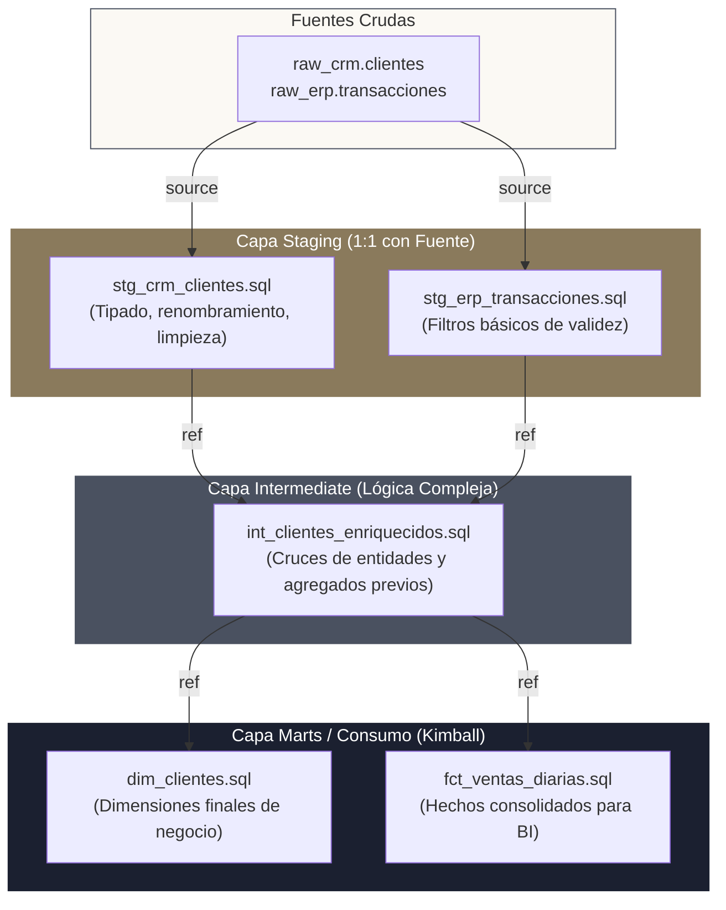

<!-- NOTAS FUENTE ORIGINALES DE OBSIDIAN: [[dbt]], [[Idempotencia en Data Pipelines]], [[dbt Snapshots]], [[SCD Type 2]] -->

# Capítulo 24: Transformación Modular con dbt, Snapshots e Idempotencia [NÚCLEO EMPLEABILIDAD]

> *"La capa de transformación en el Lakehouse no debe ser un laberinto artesanal de scripts SQL dispersos y procedimientos almacenados opacos. dbt traslada los principios consagrados de la ingeniería de software —control de versiones en Git, modularidad, pruebas automatizadas, integración continua y documentación viva— al núcleo del modelado analítico de datos."*

---

## Objetivos de Aprendizaje
Al finalizar este capítulo, el lector será capaz de:
* Comprender la evolución paradigmática de ETL a **ELT** y el rol de **dbt (*data build tool*)** en la capa de transformación del almacén analítico.
* Estructurar proyectos modulares organizados en capas estándar: Fuentes (*Sources*), *Staging*, *Intermediate* y *Marts* (Hechos y Dimensiones).
* Dominar las materializaciones de dbt: `view`, `table`, `incremental` y `ephemeral`.
* Implementar modelos incrementales de alto rendimiento utilizando la estrategia `merge` y la macro `is_incremental()`.
* Automatizar el versionado histórico de Dimensiones Lentamente Cambiantes (*SCD Tipo 2*) mediante **dbt Snapshots**.
* Formular y defender la propiedad de **idempotencia** en pipelines de datos con rigor matemático.

---

> **Definición 24.1 (Idempotencia en Ingeniería de Datos)**
>
> En ciencias de la computación, una función u operación de transformación $f(x)$ se define como **estrictamente idempotente** si su aplicación reiterada sobre un estado inicial determinado produce exactamente el mismo resultado final que una única ejecución:
>
> $$f(f(x)) = f(x) \quad \forall x$$
>
> En el contexto de los pipelines analíticos, esto garantiza que si una ejecución falla a medio camino, se reintenta por el orquestador o se vuelve a disparar manualmente para corregir un incidente, las tablas de destino convergen a un estado idéntico y consistente, sin duplicar registros, alterar métricas agregadas ni requerir intervenciones manuales de purga.

---

## 24.1 El Paradigma ELT y la Arquitectura Modular de dbt

En el modelo ETL tradicional, los datos se extraían de las fuentes operacionales y se transformaban en servidores intermedios antes de cargarse en el almacén de datos. En el paradigma moderno **ELT**, los datos se cargan primero en su estado crudo en el Lakehouse o almacén cloud (Snowflake, BigQuery, Databricks, Redshift), y **dbt orquesta las transformaciones directamente dentro del motor de cómputo columnar**, aprovechando su escalabilidad masiva mediante sentencias `SELECT` puras.



### La Tríada Modular de dbt
1. **Capa Staging (`stg_`):** Mapeo 1:1 con las tablas de origen. Aplica limpieza cosmética: renombra columnas según convenciones corporativas, castea tipos de datos primitivos y elimina espacios en blanco sin realizar cruces complejos.
2. **Capa Intermediate (`int_`):** Resuelve lógica de negocio compleja, cruces entre múltiples modelos de staging y cálculos intermedios que no deben exponerse directamente a los analistas de negocio.
3. **Capa Marts (`fct_`, `dim_`):** Estructuras dimensionales finales conformadas bajo la metodología Kimball (tablas de hechos y dimensiones) preparadas para ser consultadas por herramientas de visualización o analistas.

---

## 24.2 Materializaciones en dbt

La configuración `materialized` define cómo dbt compila el código SQL en la base de datos subyacente:

* **`view`:** Crea una vista SQL ordinaria. No consume almacenamiento físico; reejecuta la consulta en cada lectura. Ideal para la capa Staging o transformaciones ligeras.
* **`table`:** Descarta la tabla anterior y la reconstruye por completo en cada ejecución (`DROP TABLE ... CREATE TABLE AS SELECT`). Garantiza consistencia pero resulta prohibitivamente costosa en tablas con cientos de millones de registros.
* **`ephemeral`:** No crea ningún objeto en la base de datos; interpola el modelo como una expresión de tabla común (*Common Table Expression - CTE*) directamente en los modelos que lo referencian.
* **`incremental`:** Inserta únicamente las filas nuevas o actualizadas desde la última corrida del pipeline, minimizando el escaneo de datos y el gasto de cómputo en tablas masivas.

---

## 24.3 Modelado Incremental e Idempotente con la Estrategia `merge`

Para que un modelo incremental sea eficiente e idempotente, se combina la configuración de materialización con la macro `is_incremental()`:

```sql
-- models/marts/fct_pagos_recientes.sql
{{ config(
    materialized='incremental',
    unique_key='pago_id',
    incremental_strategy='merge',
    file_format='delta',
    on_schema_change='sync_all_columns'
) }}

WITH fuente_staging AS (
    SELECT 
        pago_id,
        cuenta_id,
        monto_centavos,
        moneda,
        estado_pago,
        fecha_transaccion,
        fecha_actualizacion_sistema
    FROM {{ ref('stg_pasarela_pagos') }}
    
    
        -- En ejecuciones subsecuentes, filtrar únicamente los registros modificados
        -- Se añade una ventana de seguridad de 3 días para mitigar eventos desordenados
        WHERE fecha_actualizacion_sistema >= (
            SELECT dateadd(day, -3, coalesce(max(fecha_actualizacion_sistema), '1970-01-01')) 
            FROM {{ this }}
        )
    
)

SELECT * FROM fuente_staging
```

### Mecanismo de Fusión Atómica
Cuando dbt compila este modelo en una ejecución incremental:
1. Crea una tabla temporal ligera con las filas filtradas por la cláusula `is_incremental()`.
2. Ejecuta una sentencia `MERGE INTO` nativa:
   * Si el `pago_id` ya existe en la tabla de destino, actualiza sus campos con los valores recientes.
   * Si el `pago_id` no existe, inserta la nueva fila.
3. El resultado es **estrictamente idempotente**: ejecutar el comando `dbt run --select fct_pagos_recientes` tres veces consecutivas deja la tabla en el mismo estado sin generar duplicados.

---

## 24.4 Historial Automatizado: dbt Snapshots para SCD Tipo 2 (Sintaxis Clásica vs. YAML 1.9+)

Gestionar Dimensiones Lentamente Cambiantes (*SCD Tipo 2*) manualmente mediante complejos procedimientos almacenados suele generar inconsistencias y roturas de linaje.

**dbt Snapshots** permite capturar el estado histórico de una tabla mutable de manera puramente declarativa. A partir de dbt 1.9+, es posible definirlos tanto en archivos SQL como en archivos YAML declarativos centralizados:

#### 1. Sintaxis Declarativa en YAML (dbt 1.9+ / Recomendada)
```yaml
# snapshots/snapshots.yml
snapshots:
  - name: snp_clientes
    relation: source('crm_operacional', 'clientes')
    config:
      target_schema: snapshots
      unique_key: cliente_id
      strategy: check
      check_cols:
        - direccion
        - segmento_riesgo
        - telefono
        - correo_electronico
      invalidate_hard_deletes: true
```

#### 2. Sintaxis Clásica en Archivo SQL
```sql
-- snapshots/snp_clientes.sql


{{
    config(
      target_schema='snapshots',
      unique_key='cliente_id',
      strategy='check',
      check_cols=['direccion', 'segmento_riesgo', 'telefono', 'correo_electronico'],
      invalidate_hard_deletes=True
    )
}}

SELECT 
    cliente_id,
    nombre_completo,
    direccion,
    segmento_riesgo,
    telefono,
    correo_electronico
FROM {{ source('crm_operacional', 'clientes') }}


```

### Estrategias de Snapshot: `check` vs. `timestamp`
* **Estrategia `check`:** dbt compara los valores de una lista explícita de columnas (`check_cols`). Si alguno cambia, dbt genera una nueva versión histórica. Si la base de datos de origen carece de una columna confiable de marca temporal de actualización, `check` es la estrategia idónea.
* **Estrategia `timestamp`:** Requiere una columna como `updated_at`. Si el valor de `updated_at` es más reciente que el registrado en la última ejecución, dbt asume que el registro mutó.

### Columnas Meta Añadidas Automáticamente por dbt
Cada vez que se ejecuta el comando `dbt snapshot`, dbt gestiona de forma transparente cuatro columnas meta de control histórico:
* **`dbt_scd_id`:** Hash único que identifica la versión histórica del registro.
* **`dbt_updated_at`:** Marca temporal en la que ocurrió el snapshot.
* **`dbt_valid_from`:** Fecha/hora de inicio de validez de esta versión del registro.
* **`dbt_valid_to`:** Fecha/hora de finalización de validez. Si el registro es la versión actualmente activa, este campo se mantiene en `NULL`.

---

## 24.5 Macros Jinja, Calidad Automatizada y Documentación Viva

dbt no es solo un compilador SQL; es un entorno completo de ingeniería de software que traslada prácticas de desarrollo al almacén analítico:

### 1. Reutilización de Lógica mediante Macros Jinja
Las macros permiten encapsular fragmentos de SQL repetitivos en funciones parametrizadas:

```sql
-- macros/convertir_moneda.sql

    ROUND(CAST({{ columna_monto }} AS NUMERIC) / 100.0, {{ decimales }})

```

Uso directo dentro de cualquier modelo:
```sql
SELECT 
    pago_id,
    {{ convertir_centavos_a_dolares('monto_centavos') }} AS monto_usd
FROM {{ ref('stg_pasarela_pagos') }}
```

### 2. Pruebas Automáticas: Genéricas vs. Singulares
* **Pruebas Genéricas (YAML):** Declaradas en `models/schema.yml` para validar restricciones estructurales:
```yaml
version: 2
models:
  - name: fct_pagos_recientes
    description: "Tabla de hechos de transacciones de pago verificadas"
    columns:
      - name: pago_id
        tests:
          - unique
          - not_null
      - name: estado_pago
        tests:
          - accepted_values:
              values: ['COMPLETADO', 'PENDIENTE', 'FALLIDO']
      - name: cuenta_id
        tests:
          - relationships:
              to: ref('dim_cuentas')
              field: cuenta_id
```

* **Pruebas Singulares (SQL):** Consultas personalizadas guardadas en `tests/assert_monto_total_positivo.sql`. Si la consulta retorna una o más filas, **el test falla**:
```sql
-- Si existen pagos completados con saldo negativo, la prueba detiene el pipeline
SELECT pago_id, monto_centavos
FROM {{ ref('fct_pagos_recientes') }}
WHERE estado_pago = 'COMPLETADO' AND monto_centavos < 0;
```

### 3. Documentación y Linaje Interactivo
Al ejecutar `dbt docs generate && dbt docs serve`, dbt compila los metadatos de los modelos, descripciones, tipos de datos y genera el grafo interactivo de linaje (*DAG View*), permitiendo a ingenieros y analistas auditar el origen exacto de cada columna sin inspeccionar manualmente el código fuente.

---

## 24.5 Criterios de Fiabilidad y Anti-Patrones en Producción

**Anti-patrón 1: Referencias Rígidas (*Hardcoded Names*) sin la Función `{{ ref(...) }}`**
Escribir `FROM analytics_prod.staging.stg_clientes` en lugar de `FROM {{ ref('stg_clientes') }}` destruye el grafo acíclico de dependencias de dbt. Al omitir `ref()`, dbt no puede deducir el orden de compilación, provocando que los modelos dependientes se ejecuten antes de que sus tablas fuentes hayan sido creadas o actualizadas.

**Anti-patrón 2: Consultar la Tabla de Destino sin Coalesce en Modelos Incrementales**
Escribir `WHERE updated_at > (SELECT max(updated_at) FROM {{ this }})` sin envolver el `max()` en un `coalesce()` provocará que la consulta retorne `NULL` en la primera ejecución incremental si la tabla está vacía, impidiendo la carga de los datos iniciales.

**Anti-patrón 3: Modelos Gigantescos Monolíticos en la Capa Marts**
Diseñar un único script SQL de 1.500 líneas con 20 subconsultas acopladas para generar una tabla analítica viola el principio de modularidad. Se debe descomponer la lógica en modelos intermedios reutilizables, permitiendo que cada etapa sea testeada de forma aislada.

---

## Preguntas de Revisión y Ejercicios Prácticos
**Ejercicio 24.1 (Diagnóstico de Duplicidad en Modelos Incrementales):**  
Un ingeniero de datos observa que tras un reintento manual de un pipeline de dbt, la tabla de hechos `fct_pedidos` presenta registros duplicados para el mismo `pedido_id`.
Al inspeccionar el bloque de configuración del modelo, encuentra:
```sql
{{ config(
    materialized='incremental',
    incremental_strategy='append'
) }}
```
1. ¿Por qué la estrategia `append` rompe la propiedad de idempotencia?
2. ¿Cómo debe modificarse la configuración para corregir el incidente de forma permanente?

**Solución 24.1:**
1. *Causa:* La estrategia `append` simplemente ejecuta sentencias `INSERT INTO` acumulativas con los nuevos registros encontrados. Si el job falla a medio camino o se reejecuta para el mismo periodo temporal, la estrategia vuelve a insertar las filas sin verificar si ya existían previamente en la tabla de destino, duplicando los datos.
2. *Corrección:* Se debe migrar a la estrategia `merge` definiendo la clave primaria unívoca en `unique_key`:
```sql
{{ config(
    materialized='incremental',
    unique_key='pedido_id',
    incremental_strategy='merge'
) }}
```
Con esta configuración, dbt aplicará una sentencia transaccional `MERGE INTO`, asegurando que registros reinsertados actualicen la fila existente en lugar de duplicarla.

---

**Ejercicio 24.2 (Consulta de Auditoría sobre dbt Snapshots):**  
A partir de la tabla de snapshots generada por `snp_clientes`, escribe una consulta SQL analítica que permita conocer cuál era la dirección residencial exacta que tenía el cliente `'C-842'` el día **15 de marzo de 2025 a las 10:00:00 UTC**.

**Solución 24.2:**
```sql
SELECT 
    cliente_id,
    nombre_completo,
    direccion,
    dbt_valid_from,
    dbt_valid_to
FROM {{ ref('snp_clientes') }}
WHERE cliente_id = 'C-842'
  AND dbt_valid_from <= TIMESTAMP '2025-03-15 10:00:00'
  AND (dbt_valid_to > TIMESTAMP '2025-03-15 10:00:00' OR dbt_valid_to IS NULL);
```
*Fundamento:* Esta consulta filtra la versión del registro cuyo intervalo de validez `[dbt_valid_from, dbt_valid_to)` abarcaba el instante temporal exacto solicitado, reconstruyendo el estado del negocio en el pasado sin importar cuántas mutaciones haya sufrido posteriormente.

---

## 24.6 Resumen y Puntos Clave

* **Transformación modular con ELT:** dbt traslada la lógica de modelado al interior del almacén de datos, desacoplando la ingestión del cómputo analítico mediante código SQL declarativo versionado en Git.
* **Linaje y orden topológico con `ref()`:** La interpolación dinámica de modelos permite a dbt calcular automáticamente el DAG de compilación y validar dependencias antes de la ejecución.
* **Idempotencia mediante `merge`:** La combinación de materializaciones incrementales con `unique_key` y la macro `is_incremental()` asegura que las ejecuciones reiteradas converjan al mismo estado sin duplicación.
* **Auditoría histórica con dbt Snapshots:** Implementa Dimensiones Lentamente Cambiantes (*SCD Tipo 2*) de forma declarativa mediante estrategias `check` o `timestamp`, manteniendo campos de vigencia `dbt_valid_from` y `dbt_valid_to`.

---

## Lecturas Recomendadas
1. **dbt Labs Technical Staff (2024).** *The dbt Viewpoint: What is dbt and Why ELT Matters.* dbt Documentation (`https://docs.getdbt.com/`).
2. **Freeman, M. (2024).** *Modern Data Modeling with dbt: Building Scalable Analytics Engineering Pipelines.* O'Reilly Media.
3. **Stonebraker, M. & Cetintemel, U. (2005).** *“One Size Fits All”: An Idea Whose Time Has Come and Gone.* Proceedings of the 21st International Conference on Data Engineering (ICDE).
