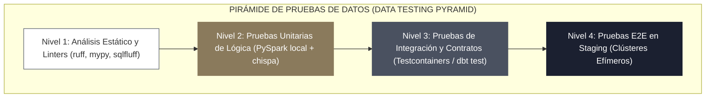

<!-- NOTAS FUENTE ORIGINALES DE OBSIDIAN: [[CI/CD]], [[Portabilidad de Pipelines Spark]], [[DataOps]], [[PySpark Testing]] -->

# Capítulo 26: Integración y Despliegue Continuo (CI/CD) para Pipelines de Datos [RECOMENDADO]

> *"Un pipeline analítico es software de misión crítica gobernando las decisiones estratégicas de una organización. Si el código de transformación de datos no cuenta con pruebas unitarias deterministas, análisis estático automatizado y un flujo de entrega continua, cada paso a producción se convierte en un riesgo inaceptable de corrupción silenciosa de datos."*

---

## Objetivos de Aprendizaje
Al finalizar este capítulo, el lector será capaz de:
* Comprender los principios de **DataOps** y la pirámide de pruebas aplicada a pipelines analíticos distribuidos.
* Implementar pruebas unitarias sobre DataFrames de PySpark utilizando `pytest` y la librería `chispa` para validaciones independientes del orden físico de filas.
* Diseñar un flujo de trabajo completo de **Integración y Despliegue Continuo (CI/CD)** en GitHub Actions con análisis léxico (`ruff`), validación de SQL (`sqlfluff`) y empaquetado automático.
* Asegurar la **portabilidad absoluta** de los artefactos de datos desacoplando la lógica de negocio de las rutas físicas de almacenamiento mediante contenedores Docker y configuraciones parametrizadas.
* Automatizar la promoción segura de código entre entornos (`dev` $\rightarrow$ `staging` $\rightarrow$ `prod`) sin intervención manual.

---

> **Definición 26.1 (DataOps y CI/CD en Plataformas de Datos)**
>
> **DataOps** es una disciplina metodológica y cultural que traslada las prácticas consolidadas de la ingeniería de software y DevOps al ciclo de vida de los datos. 
> 
> La **Integración Continua (CI)** compila, valida estáticamente y somete a prueba cada cambio de código en ramas de desarrollo de forma automática y aislada. El **Despliegue Continuo (CD)** empaqueta los artefactos validados (paquetes Wheel de Python, plantillas de dbt compiladas, imágenes Docker, DAGs de Airflow) y los promueve deterministamente hacia los entornos de cómputo en la nube, garantizando reproducibilidad y reversibilidad inmediata ante fallos (*Rollback*).

---

## 26.1 La Pirámide de Pruebas en Ingeniería de Datos

A diferencia de las aplicaciones web tradicionales, los pipelines de datos enfrentan dos fuentes de fallo independientes: **errores en el código** (lógica algorítmica defectuosa) y **errores en los datos** (anomalías de esquema, nulos imprevistos, distribuciones estadísticas corruptas).

La pirámide de pruebas de datos estructura la validación en cuatro niveles progresivos:



1. **Nivel 1: Análisis Estático y Linters (Milisegundos):** Valida estilo de código, adherencia a PEP 8, tipado estático con `mypy`, sintaxis de SQL mediante `sqlfluff` y prevención de vulnerabilidades de seguridad.
2. **Nivel 2: Pruebas Unitarias de Transformación (Segundos):** Aísla funciones individuales de transformación pura en PySpark utilizando sesiones locales ligeras (`local[2]`) con datasets sintetizados en memoria.
3. **Nivel 3: Pruebas de Integración y Contratos (Minutos):** Valida la interacción entre módulos, cruces con bases de datos simuladas mediante `Testcontainers` (ej. PostgreSQL temporal en Docker) y pruebas de contratos de esquemas.
4. **Nivel 4: Pruebas de Aceptación End-to-End (E2E):** Ejecuta el pipeline completo sobre un clúster efímero en el entorno de pruebas (*Staging*) utilizando una muestra representativa y enmascarada de datos reales.

---

## 26.2 Pruebas Unitarias en PySpark con la Librería `chispa`

Probar DataFrames distribuidos en pruebas unitarias convencionales suele fallar si se compara con simples cadenas de texto o bucles artesanales, ya que los motores distribuidos no garantizan el orden físico de las particiones ni de las filas.

La librería especializada **`chispa`** proporciona comparaciones de igualdad profunda entre DataFrames, soportando diferencias de orden e inspeccionando esquemas con mensajes de error legibles:

```python
# tests/test_transformaciones_clientes.py
import pytest
from pyspark.sql import SparkSession
import pyspark.sql.functions as F
from chispa.dataframe_comparer import assert_df_equality

# Fixture de sesión Spark local para toda la suite de pruebas
@pytest.fixture(scope="session")
def spark():
    return SparkSession.builder \
        .master("local[2]") \
        .appName("PruebasUnitariasPySpark") \
        .config("spark.sql.shuffle.partitions", "2") \
        .config("spark.ui.enabled", "false") \
        .getOrCreate()

def estandarizar_clientes(df_entrada):
    """Función pura de transformación de negocio que se somete a prueba."""
    return df_entrada \
        .withColumn("nombre_limpio", F.upper(F.trim(F.col("nombre_crudo")))) \
        .withColumn("es_activo", F.when(F.col("estado") == "A", F.lit(True)).otherwise(F.lit(False))) \
        .select("cliente_id", "nombre_limpio", "es_activo")

def test_estandarizar_clientes_transforma_correctamente(spark):
    # 1. Dataset de entrada sintético en memoria
    datos_origen = [
        ("C-001", "   juan perez  ", "A"),
        ("C-002", "MARIA GOMEZ", "I"),
        ("C-003", " carlos silva ", "A")
    ]
    df_entrada = spark.createDataFrame(datos_origen, ["cliente_id", "nombre_crudo", "estado"])

    # 2. Ejecución de la transformación
    df_resultado = estandarizar_clientes(df_entrada)

    # 3. Dataset esperado de referencia
    datos_esperados = [
        ("C-001", "JUAN PEREZ", True),
        ("C-002", "MARIA GOMEZ", False),
        ("C-003", "CARLOS SILVA", True)
    ]
    df_esperado = spark.createDataFrame(datos_esperados, ["cliente_id", "nombre_limpio", "es_activo"])

    # 4. Afirmación estricta ignorando el orden físico de las filas
    assert_df_equality(df_resultado, df_esperado, ignore_row_order=True)
```

---

## 26.3 Pipeline Completo de CI/CD en GitHub Actions

El siguiente manifiesto en YAML define el flujo de trabajo moderno en GitHub Actions, empleando las acciones oficiales `v4` y `v5`, caché acelerado con `uv` y empaquetado de artefactos:

```yaml
# .github/workflows/data_pipeline_ci_cd.yml
name: CI/CD Data Engineering Platform

on:
  push:
    branches: [main]
  pull_request:
    branches: [main]

concurrency:
  group: ${{ github.workflow }}-${{ github.ref }}
  cancel-in-progress: true

jobs:
  lint-and-quality:
    name: 1. Análisis Estático y Linting
    runs-on: ubuntu-latest
    steps:
      - name: Descargar Código Fuente
        uses: actions/checkout@v4

      - name: Configurar Entorno Python con uv (Ultra-rápido)
        uses: astral-sh/setup-uv@v5
        with:
          enable-cache: true
          python-version: "3.11"

      - name: Instalar Herramientas de Calidad con uv
        run: uv pip install ruff sqlfluff mypy

      - name: Ejecutar Linter de Python (Ruff)
        run: uv run ruff check .

      - name: Validación de Tipado Estático (MyPy)
        run: uv run mypy pipelines/ --ignore-missing-imports

      - name: Linting de Modelos SQL (SQLFluff)
        run: uv run sqlfluff lint models/ --dialect databricks

  unit-tests:
    name: 2. Pruebas Unitarias PySpark con Cobertura
    needs: lint-and-quality
    runs-on: ubuntu-latest
    steps:
      - uses: actions/checkout@v4

      - name: Configurar Java 17 (Requerido por Spark)
        uses: actions/setup-java@v4
        with:
          distribution: "temurin"
          java-version: "17"

      - name: Configurar Python con uv
        uses: astral-sh/setup-uv@v5
        with:
          enable-cache: true
          python-version: "3.11"

      - name: Instalar Dependencias de Prueba y Cobertura
        run: uv pip install pytest pytest-cov pyspark chispa

      - name: Ejecutar Suite de PyTest con Reporte de Cobertura Estricto
        run: uv run pytest tests/ -v --cov=pipelines --cov-report=term-missing --junitxml=junit/test-results.xml

  build-and-package:
    name: 3. Empaquetado y Publicación de Artefactos
    needs: unit-tests
    if: github.ref == 'refs/heads/main' && github.event_name == 'push'
    runs-on: ubuntu-latest
    steps:
      - uses: actions/checkout@v4

      - name: Configurar Python con uv
        uses: astral-sh/setup-uv@v5
        with:
          python-version: "3.11"

      - name: Construir Paquete Wheel de Python
        run: uv build --wheel

      - name: Publicar Artefacto Wheel en GitHub Releases / Storage
        uses: actions/upload-artifact@v4
        with:
          name: data-pipelines-wheel
          path: dist/*.whl

  deploy-production:
    name: 4. Despliegue Continuo con Databricks Asset Bundles (DABs)
    needs: build-and-package
    if: github.ref == 'refs/heads/main' && github.event_name == 'push'
    runs-on: ubuntu-latest
    environment: production
    steps:
      - uses: actions/checkout@v4

      - name: Configurar Databricks CLI Oficial (Go)
        uses: databricks/setup-cli@v0.229.0

      - name: Validar y Desplegar Databricks Asset Bundle (DAB)
        env:
          DATABRICKS_HOST: ${{ secrets.DATABRICKS_HOST }}
          DATABRICKS_TOKEN: ${{ secrets.DATABRICKS_TOKEN }}
        run: |
          databricks bundle validate --target prod
          databricks bundle deploy --target prod
          echo "[CD] Despliegue de Databricks Asset Bundle completado exitosamente en producción."
```

---

## 26.4 Portabilidad Absoluta y Contenerización

Un pipeline de datos es **completamente portátil** si puede ejecutarse de manera idéntica en el equipo portátil del desarrollador, en un contenedor de integración continua en GitHub Actions, en un clúster de Amazon EMR o en Databricks sobre Azure, sin cambiar una sola línea de código fuente.

### Principios para Garantizar Portabilidad
1. **Desacoplamiento de Rutas de Almacenamiento:** Está estrictamente prohibido utilizar rutas hardcodeadas como `s3://bucket-prod/ventas.parquet`. Las rutas deben construirse dinámicamente inyectando prefijos mediante variables de entorno (`DATA_LAKE_BASE_PATH`) o archivos de configuración jerárquicos:

```python
import os

def obtener_ruta_tabla(capa, nombre_tabla):
    base_uri = os.getenv("DATA_LAKE_BASE_PATH", "file:///tmp/lakehouse")
    return f"{base_uri}/{capa}/{nombre_tabla}"

# En local:    file:///tmp/lakehouse/silver/clientes
# En Prod AWS: s3://prod-lakehouse-corp/silver/clientes
# En Prod Az:  abfss://silver@stlakehouse.dfs.core.windows.net/clientes
```

2. **Empaquetado en Imágenes Docker:** Para pipelines basados en Kubernetes (Spark on K8s), todas las dependencias de Python y binarios del sistema se congelan en una imagen Docker inmutable, eliminando discrepancias del tipo *"en mi máquina funcionaba"*:

```dockerfile
# Dockerfile para Spark en Kubernetes y Databricks Container Services (Databricks Runtime 15.4+ LTS)
FROM apache/spark:3.5.2-python3

USER root
WORKDIR /opt/spark/work-dir

# Instalar dependencias congeladas con uv para builds reproducibles
COPY requirements.txt .
RUN pip install --no-cache-dir uv && \
    uv pip install --system --no-cache -r requirements.txt

# Copiar el código del paquete de la aplicación
COPY pipelines/ /opt/spark/work-dir/pipelines/

USER spark
ENTRYPOINT ["/opt/spark/bin/spark-submit", "--master", "k8s://...", "pipelines/main.py"]
```

---

## 26.5 Criterios de Fiabilidad y Anti-Patrones en Producción

**Anti-patrón 1: Pruebas en Producción con Datos Reales sin Aislamiento de Entornos**
Permitir que los ingenieros prueben código nuevo directamente sobre las tablas de producción arriesga la integridad de los datos. Toda modificación debe promoverse a través de ramas de Git (`feature` $\rightarrow$ `pull request` $\rightarrow$ `main`) y validarse en un entorno de staging con datos anonimizados.

**Anti-patrón 2: Pruebas Unitarias Dependientes de Recursos Externos Activos**
Diseñar pruebas unitarias que intenten conectarse a un clúster de Kafka en vivo o a un bucket real de S3 en la nube causa que las pruebas fallen por problemas transitorios de red o credenciales expiradas. Las pruebas unitarias deben ser deterministas y ejecutarse 100% desconectadas (*offline*).

**Anti-patrón 3: Despliegue Manual de Cambios Mediante Copiado de Archivos por SSH**
Subir archivos modificados a mano al servidor de producción eludiendo el pipeline de CI/CD rompe la trazabilidad y garantiza que el repositorio de Git no refleje el estado real desplegado.

---

## Preguntas de Revisión y Ejercicios Prácticos
**Ejercicio 26.1 (Determinismo en Pruebas Unitarias de Spark):**  
Un ingeniero diseña una prueba unitaria para una transformación de enriquecimiento y escribe la siguiente validación en `pytest`:
```python
def test_enriquecimiento(spark):
    df_salida = enriquecer_datos(df_entrada)
    assert df_salida.collect() == df_esperado.collect()
```
¿Por qué esta afirmación fallará intermitentemente (*Flaky Test*) en un clúster o máquina multinúcleo a pesar de que los datos sean matemáticamente correctos? ¿Cómo debe solucionarse?

**Solución 26.1:**
1. *Causa:* La función `.collect()` de Spark descarga todas las filas en una lista nativa de Python respetando el orden físico en que fueron generadas por las particiones. Debido a que las transformaciones distribuidas no garantizan el orden de ejecución entre hilos paralelos, el orden relativo de las filas puede variar entre corridas consecutivas. Comparar dos listas con `==` en Python exige coincidencia estricta de orden posicional, provocando fallos aleatorios.
2. *Solución:* Emplear `assert_df_equality` de la librería `chispa` configurando `ignore_row_order=True`:
```python
from chispa.dataframe_comparer import assert_df_equality

def test_enriquecimiento(spark):
    df_salida = enriquecer_datos(df_entrada)
    assert_df_equality(df_salida, df_esperado, ignore_row_order=True)
```
Esta función compara los esquemas de ambas tablas y evalúa la equivalencia multiconjunto de los registros sin importar su posición física en el arreglo.

---

**Ejercicio 26.2 (Diseño de Estrategia de Rollback Inmediato):**  
Un nuevo despliegue de código promovido a producción introduce una regresión no detectada en una fórmula de cálculo tributario en la capa Silver de Delta Lake.
Describe la estrategia de recuperación en dos pasos que debe ejecutarse para restaurar la operación:
1. Nivel de Código (Software).
2. Nivel de Datos (Storage).

**Solución 26.2:**
1. *Nivel de Código (Software):* En el repositorio Git, el equipo revierte el commit causante (`git revert HEAD`) y dispara el pipeline de CI/CD para compilar y desplegar nuevamente la versión anterior del paquete Wheel a producción.
2. *Nivel de Datos (Storage):* Como la tabla Silver utiliza Delta Lake, los datos erróneos no requieren una reconstrucción manual lenta. El ingeniero ejecuta un comando de **Time Travel Restore** en SQL:
```sql
RESTORE TABLE prod_lakehouse.silver.facturacion TO VERSION AS OF 142;
```
Esto restaura de inmediato el estado de la tabla a la versión 142 (el commit inmediatamente anterior al despliegue defectuoso) en una única transacción atómica de milisegundos.

---

## 26.6 Resumen y Puntos Clave

* **DataOps y rigor de ingeniería:** Traslada las mejores prácticas de software (CI/CD, pruebas automatizadas y despliegues deterministas) a los activos de datos.
* **Pirámide de pruebas:** Desde el análisis estático rápido con linters (`ruff`, `sqlfluff`) hasta pruebas unitarias locales en PySpark con `chispa` y pruebas de integración.
* **Automatización con GitHub Actions:** Orquesta la validación léxica, la ejecución de suites de pruebas con Java y Python, el empaquetado en archivos Wheel y el despliegue automático hacia entornos seguros.
* **Portabilidad mediante desacoplamiento:** Las rutas de almacenamiento y configuraciones de entorno deben inyectarse mediante variables externas y empaquetarse en contenedores Docker para garantizar reproducibilidad total.

---

## Lecturas Recomendadas
1. **Forsgren, N., Humble, J., & Kim, G. (2018).** *Accelerate: The Science of Lean Software and DevOps (Building and Scaling High Performing Technology Organizations).* IT Revolution Press.
2. **Ebert, C., Gallardo, G., Hernantes, J., & Serrano, N. (2016).** *DevOps: Principles, Practices, and Challenges.* IEEE Software, 33(3), 94-100.
3. **Powers, M. (2023).** *Testing PySpark Applications with Chispa: Fast, Expressive Unit Testing for Distributed DataFrames.* GitHub Documentation (`https://github.com/MrPowers/chispa`).
