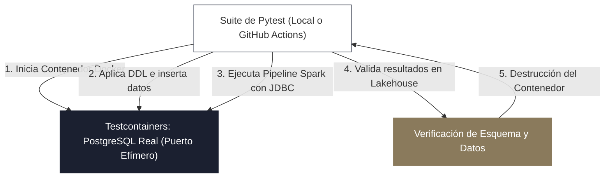

<!-- NOTAS FUENTE ORIGINALES DE OBSIDIAN: [[Data Testing]], [[Pytest]], [[Chispa]], [[Testcontainers]], [[Quality Assurance]] -->

# Capítulo 26A: Pruebas de Software en Datos: Pytest, Chispa y Testcontainers [RECOMENDADO]

> *"Durante años, la ingeniería de datos toleró una práctica que avergonzaría a cualquier equipo serio de desarrollo de software: probar los pipelines directamente sobre los datos de producción. Si una transformación no cuenta con pruebas unitarias deterministas que se ejecuten en segundos en el entorno de desarrollo local y en el pipeline de CI/CD, cada despliegue no es una actualización de ingeniería, sino una apuesta a ciegas con el patrimonio de la empresa."*

---

## Objetivos de Aprendizaje
Al finalizar este capítulo, el lector será capaz de:
* Diseñar una estrategia integral de aseguramiento de calidad aplicando la **Pirámide de Pruebas de Ingeniería de Datos**.
* Escribir pruebas unitarias rápidas y deterministas para transformaciones de PySpark utilizando **`pytest`** y **`chispa`**.
* Resolver los desafíos específicos de comparación de DataFrames distribuidos: orden no determinista de filas, tolerancia numérica en flotantes y comparación de esquemas.
* Configurar **fixtures de PySpark** optimizados en memoria para ejecuciones ultrarrápidas en entornos de CI/CD.
* Implementar pruebas de integración aisladas y reproducibles utilizando **Testcontainers** para levantar bases de datos PostgreSQL y buckets S3 efímeros.
* Detectar regresiones de esquema y romper el build antes de desplegar código defectuoso a producción.

---

> **Definición 26A.1 (La Pirámide de Pruebas para Pipelines de Datos)**
> A diferencia del desarrollo de software convencional donde solo se prueba la lógica del código, en la ingeniería de datos se debe probar **el código de transformación** y **la validez del dato**:
> 
> 1. **Pruebas Unitarias (*Unit Tests - Base de la Pirámide*):** Validan funciones de transformación puras utilizando DataFrames sintéticos mínimos en memoria. Se ejecutan en milisegundos sin depender de infraestructura externa.
> 2. **Pruebas de Integración (*Integration Tests - Centro*):** Validan la interacción física con almacenes de datos reales (lecturas JDBC, escrituras Delta Lake) utilizando contenedores efímeros aislados (*Testcontainers*).
> 3. **Pruebas de Calidad y Contrato (*Data Quality Tests - Cúspide*):** Validan que los datos reales en producción cumplan las expectativas estadísticas y reglas de negocio declaradas (Great Expectations, dbt tests).

---

## 26A.1 El Desafío de Probar Transformaciones Distribuidas

Probar código de datos en PySpark o SQL presenta obstáculos particulares que no existen en el software tradicional:
* **No determinismo en el orden de las filas:** Debido a la naturaleza distribuida y el particionamiento de Spark, el resultado de una transformación puede devolver las mismas tuplas en diferente orden físico entre ejecuciones consecutivas. Comparar DataFrames con `df_esperado.collect() == df_real.collect()` produce fallos falsos recurrentes.
* **Sobrecosto de arranque de la sesión Spark:** Inicializar una sesión `SparkSession` tarda entre 3 y 5 segundos. Si cada prueba unitaria crea y destruye su propio contexto Spark, una suite de 50 tests tardaría varios minutos.
* **Precisión de punto flotante:** Operaciones matemáticas con decimales y promedios sobre ejecutores distribuidos pueden generar diferencias insignificantes a nivel de micro-redondeo (ej. `0.10000000000000002` frente a `0.1`), haciendo fallar aserciones estrictas de igualdad.

---

## 26A.2 Pruebas Unitarias de PySpark con `pytest` y `chispa`

La biblioteca de código abierto **Chispa** es el estándar de la industria para escribir aserciones de igualdad entre DataFrames de Spark con mensajes de error visuales y detallados.

### 1. Configuración de Fixture Compartido de Spark (`conftest.py`)
Para evitar el sobrecosto de arranque, se configura una única sesión de Spark en memoria local para toda la sesión de pruebas:

```python
# tests/conftest.py
import pytest
from pyspark.sql import SparkSession

@pytest.fixture(scope="session")
def spark():
    """Sesión Spark local optimizada y compartida para toda la suite de pruebas."""
    spark_session = SparkSession.builder \
        .appName("Pytest-Data-Suite") \
        .master("local[2]") \
        .config("spark.sql.shuffle.partitions", "1") \
        .config("spark.default.parallelism", "1") \
        .config("spark.ui.enabled", "false") \
        .getOrCreate()
    
    yield spark_session
    
    spark_session.stop()
```

### 2. Implementación de Transformaciones Puras
El código de producción debe desacoplar la lógica de negocio de la lectura física de disco:

```python
# src/transformations/clientes_enrichment.py
from pyspark.sql import DataFrame
from pyspark.sql import functions as F

def clasificar_segmento_clientes(df_ventas: DataFrame) -> DataFrame:
    """Clasifica a los clientes según su volumen total de consumo."""
    return df_ventas.withColumn(
        "segmento_valor",
        F.when(F.col("monto_usd") >= 1000.0, "ALTO VALOR")
         .when(F.col("monto_usd") >= 200.0, "MEDIO VALOR")
         .otherwise("ESTANDAR")
    )
```

### 3. Prueba Unitaria con Aserciones de `chispa`
```python
# tests/test_clientes_enrichment.py
import pytest
from chispa.dataframe_comparer import assert_df_equality
from src.transformations.clientes_enrichment import clasificar_segmento_clientes
from pyspark.sql.types import StructType, StructField, StringType, DoubleType

def test_clasificar_segmento_clientes(spark):
    # 1. Datos de entrada sintéticos mínimos
    esquema_entrada = StructType([
        StructField("cliente_id", StringType(), False),
        StructField("monto_usd", DoubleType(), False)
    ])
    datos_entrada = [
        ("C1", 1500.0), # Debe clasificar ALTO VALOR
        ("C2", 200.0),  # Límite inclusivo MEDIO VALOR
        ("C3", 50.0),   # ESTANDAR
    ]
    df_entrada = spark.createDataFrame(datos_entrada, esquema_entrada)

    # 2. Ejecutar la función pura
    df_resultado = clasificar_segmento_clientes(df_entrada)

    # 3. DataFrame con la verdad esperada
    esquema_esperado = StructType([
        StructField("cliente_id", StringType(), False),
        StructField("monto_usd", DoubleType(), False),
        StructField("segmento_valor", StringType(), False)
    ])
    datos_esperados = [
        ("C1", 1500.0, "ALTO VALOR"),
        ("C2", 200.0, "MEDIO VALOR"),
        ("C3", 50.0, "ESTANDAR"),
    ]
    df_esperado = spark.createDataFrame(datos_esperados, esquema_esperado)

    # 4. Aserción formal ignorando el orden físico de las filas
    assert_df_equality(
        df_resultado,
        df_esperado,
        ignore_row_order=True,
        ignore_column_order=False,
        ignore_nullable=True
    )
```

---

## 26A.3 Pruebas de Integración Aisladas con Testcontainers

Las pruebas unitarias validan la lógica interna, pero los pipelines de datos deben interactuar con sistemas de almacenamiento externos: bases relacionales operacionales (PostgreSQL, MySQL) o almacenes de objetos S3.

**Testcontainers** permite instanciar contenedores de Docker reales desde el código de Python durante la ejecución de las pruebas, garantizando un entorno 100% aislado que se destruye automáticamente al terminar el test:



### Prueba de Ingesta JDBC contra un Contenedor de PostgreSQL Real
```python
# tests/integration/test_jdbc_ingestion.py
import pytest
import psycopg2
from testcontainers.postgres import PostgresContainer
from src.ingestion.jdbc_reader import extraer_tabla_jdbc

@pytest.fixture(scope="module")
def postgres_contenedor():
    """Levanta un contenedor real de PostgreSQL en Docker y lo expone a la prueba."""
    with PostgresContainer("postgres:16-alpine") as postgres:
        # Inicializar esquema y datos de prueba en la base de datos efímera
        conexion = psycopg2.connect(
            dbname=postgres.dbname,
            user=postgres.username,
            password=postgres.password,
            host=postgres.get_container_host_ip(),
            port=postgres.get_exposed_port(5432)
        )
        cursor = conexion.cursor()
        cursor.execute("""
            CREATE TABLE transacciones_origen (
                id SERIAL PRIMARY KEY,
                cliente_id INT NOT NULL,
                monto NUMERIC(10,2) NOT NULL
            );
            INSERT INTO transacciones_origen (cliente_id, monto) VALUES 
                (101, 450.00),
                (102, 120.50),
                (103, 890.00);
        """)
        conexion.commit()
        cursor.close()
        conexion.close()
        
        yield postgres

def test_ingesta_jdbc_exitosa(spark, postgres_contenedor):
    url_jdbc = postgres_contenedor.get_connection_url().replace("postgresql+psycopg2://", "jdbc:postgresql://")
    
    # Ejecutar la función de ingesta de producción contra el contenedor efímero
    df_extraido = spark.read \
        .format("jdbc") \
        .option("url", url_jdbc) \
        .option("dbtable", "transacciones_origen") \
        .option("user", postgres_contenedor.username) \
        .option("password", postgres_contenedor.password) \
        .option("driver", "org.postgresql.Driver") \
        .load()

    assert df_extraido.count() == 3
    assert "cliente_id" in df_extraido.columns
```

---

## 26A.4 Pruebas de Regresión de Esquemas y Contratos de Datos

Uno de los fallos más destructivos en producción ocurre cuando una actualización altera silenciosamente los tipos de datos de salida (por ejemplo, convertir `monto_usd` de `DoubleType` a `StringType`), rompiendo dashboards y modelos downstream.

Las pruebas de regresión de esquemas garantizan que cualquier cambio no intencionado rompa la suite de pruebas inmediatamente:

```python
# tests/test_schema_regression.py
from chispa.schema_comparer import assert_basic_rows_equality

def test_estabilidad_esquema_salida(spark):
    df_actual = ejecutar_pipeline_limpieza(spark)
    
    # Esquema contractual innegociable
    esquema_esperado = {
        "transaccion_id": "string",
        "cliente_id": "bigint",
        "monto_usd": "double",
        "fecha": "date"
    }
    
    esquema_real = {campo.name: campo.dataType.simpleString() for campo in df_actual.schema.fields}
    assert esquema_real == esquema_esperado, f"Discrepancia en contrato de datos: {esquema_real} != {esquema_esperado}"
```

---

## 26A.5 Criterios de Fiabilidad y Anti-Patrones en Producción

**Anti-patrón 1: Conectar las Pruebas Unitarias a Bases de Datos o Buckets de Producción/Staging**  
Ejecutar suites de pruebas que lean de `s3://bucket-staging/` hace que los tests sean lentos, dependan de conectividad a internet y fallen si otro ingeniero modifica los datos en la nube.  
*Corrección:* Las pruebas unitarias deben utilizar datos sintéticos locales en memoria; las pruebas de integración deben usar contenedores locales efímeros con Testcontainers.

**Anti-patrón 2: Pruebas Lentas que Bloquean el Ciclo de Desarrollo**  
Una suite de pruebas que tarda 45 minutos desalienta a los desarrolladores de ejecutarla localmente antes de hacer commit.  
*Corrección:* Configure la sesión Spark de pruebas con `master("local[2]")`, deshabilite la UI de Spark (`spark.ui.enabled=false`) y fije `spark.sql.shuffle.partitions=1`. La suite completa debe ejecutarse en menos de 20 segundos.

---

## Preguntas de Revisión y Ejercicios Prácticos
**Ejercicio 26A.1 (Diseño de Prueba Unitaria para Deduplicación con Chispa):**  
Se tiene una función `deduplicar_novedades(df: DataFrame) -> DataFrame` que recibe registros duplicados y conserva únicamente el de mayor `fecha_actualizacion` por cada `cliente_id`.  
Escriba una prueba unitaria completa con `pytest` y `chispa` que verifique que, ante dos registros con el mismo `cliente_id` pero fechas distintas, la función descarta el registro antiguo y preserva el más reciente.

**Solución 26A.1:**
```python
import pytest
from chispa.dataframe_comparer import assert_df_equality
from pyspark.sql import functions as F
from pyspark.sql.window import Window

def deduplicar_novedades(df):
    w = Window.partitionBy("cliente_id").orderBy(F.col("fecha_actualizacion").desc())
    return df.withColumn("rn", F.row_number().over(w)).filter(F.col("rn") == 1).drop("rn")

def test_deduplicar_novedades_conserva_mas_reciente(spark):
    datos_entrada = [
        (101, "Bogota", "2026-01-01"),
        (101, "Medellin", "2026-02-15"), # Registro más reciente que debe conservarse
        (102, "Cali", "2026-01-10"),
    ]
    df_in = spark.createDataFrame(datos_entrada, ["cliente_id", "ciudad", "fecha_actualizacion"])
    
    df_out = deduplicar_novedades(df_in)
    
    datos_esperados = [
        (101, "Medellin", "2026-02-15"),
        (102, "Cali", "2026-01-10"),
    ]
    df_expected = spark.createDataFrame(datos_esperados, ["cliente_id", "ciudad", "fecha_actualizacion"])
    
    assert_df_equality(df_out, df_expected, ignore_row_order=True)
```

---

## 26A.6 Resumen y Puntos Clave

* **Pirámide de pruebas:** La base son pruebas unitarias rápidas de funciones puras en memoria; el centro, pruebas de integración con Testcontainers; la cúspide, pruebas de calidad de datos en producción.
* **Chispa y Pytest:** Permiten comparar DataFrames distribuidos de forma tolerante a orden de filas y diferencias de precisión numérica.
* **Sesión Spark optimizada:** Fijar `local[2]` y `spark.sql.shuffle.partitions=1` permite ejecutar decenas de pruebas unitarias en cuestión de segundos en CI/CD.
* **Aislamiento con Testcontainers:** Permite probar código de ingesta JDBC y CDC contra bases relacionales reales sin ensuciar servidores compartidos.

---

## Lecturas Recomendadas
1. **Powers, M. (2020).** *Testing PySpark Applications with Chispa and Pytest.* Leanpub.
2. **Beck, K. (2002).** *Test-Driven Development: By Example.* Addison-Wesley.
3. **Testcontainers Authors (2024).** *Testcontainers Python: Native Docker Testing for Data Engineers.* Testcontainers.org.
