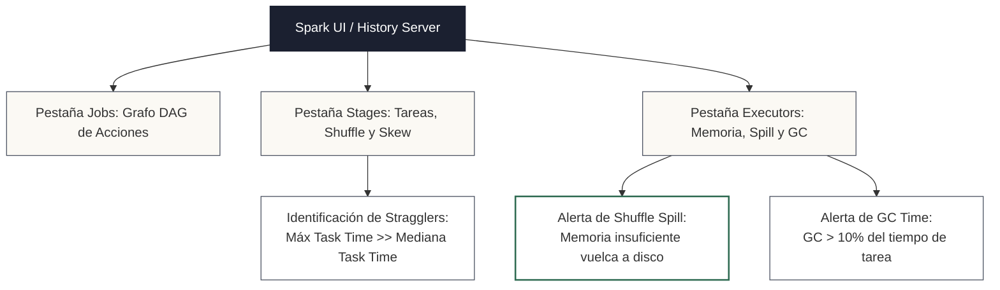

<!-- NOTAS FUENTE ORIGINALES DE OBSIDIAN: [[Observabilidad y Monitoreo]], [[Logging y Trazabilidad]], [[Spark UI]] -->

# Capítulo 27: Observabilidad, Monitoreo y Logging en Sistemas Distribuidos [RECOMENDADO]

> *"Si un pipeline de datos falla en la mitad de la noche y ningún sistema genera una alerta correlacionada, los datos no existen para el negocio. La observabilidad moderna no consiste únicamente en detectar si un proceso terminó con código cero; exige medir la latencia, la frescura, el volumen, el linaje y la salud de la memoria en cada nodo del clúster."*

---

## Objetivos de Aprendizaje
Al finalizar este capítulo, el lector será capaz de:
* Comprender los tres pilares de la observabilidad distribuidos aplicados a plataformas de datos: **Métricas**, **Logs Estructurados** y **Trazas Distribuidas**.
* Diagnosticar y resolver cuellos de botella críticos en la **Spark UI**: *Data Skew*, *Shuffle Spill* y presión de *Garbage Collection (GC)*.
* Implementar **trazabilidad distribuida con OpenTelemetry** y propagación de contexto W3C (*Trace Context* / `traceparent`) en pipelines de PySpark.
* Auditar la ejecución de flujos continuos en tiempo real mediante **`StreamingQueryListener`** y exportación de métricas a Prometheus.
* Diseñar alertas operacionales basadas en **Acuerdos de Nivel de Servicio (Data SLAs)** para detectar fallos silenciosos (*Soft Failures*).

---

> **Definición 27.1 (Los Tres Pilares de la Observabilidad de Datos)**
>
> La **observabilidad de sistemas de datos** es la capacidad de inferir el estado interno de pipelines distribuidos y almacenes analíticos a partir de sus señales externas de telemetría:
> 1. **Métricas:** Valores numéricos agregados a lo largo del tiempo (por ejemplo, registros procesados por segundo, bytes de shuffle, tiempo de GC de la JVM, uso de CPU en los Workers).
> 2. **Logs Estructurados:** Registros de eventos serializados en formato JSON con metadatos contextuales estandarizados (nivel, timestamp UTC, nombre de pipeline, identificador de partición).
> 3. **Trazas Distribuidas (Distributed Tracing):** Trazabilidad continua de una unidad de trabajo a través de múltiples fronteras de red y sistemas heterogéneos (Airflow $\rightarrow$ Kafka $\rightarrow$ Spark $\rightarrow$ Delta Lake) mediante identificadores de correlación propagados (*Trace IDs* y *Span IDs*).

---

## 27.1 Diagnóstico de Clústeres con Spark UI

La **Spark UI** (accesible en el puerto `4040` del nodo Driver durante la ejecución o a través del *Spark History Server* tras finalizar) es el instrumento fundamental para auditar el desempeño de cómputo distribuido.



### 1. Pestaña Stages: Detección de Asimetría (Data Skew)
En la tabla de resumen de métricas de tareas (*Task Metrics*), examine los percentiles:
* **Síntoma:** El percentil 75% o la mediana (*50th percentile*) de las tareas dura 2 segundos, pero la tarea máxima dura 42 minutos.
* **Diagnóstico:** Asimetría severa de datos (*Data Skew*). Un único ejecutor procesa una partición desproporcionada generada por una clave dominante o nula.

### 2. Pestaña Executors: Detección de Desbordamiento de Memoria (Shuffle Spill)
* **Spill (Memory):** Volumen de datos deserializados en memoria que no cupieron en el espacio de ejecución (*Execution Memory*) del ejecutor.
* **Spill (Disk):** Volumen de datos serializados y comprimidos que Spark se vio forzado a escribir en los discos locales de los Workers.
* **Impacto:** Si el Spill supera varios gigabytes, el rendimiento cae abruptamente debido a la alta latencia de I/O en disco.

### 3. Pestaña Executors: Presión de Garbage Collection (GC)
* Si la columna **Task Deserialization / GC Time** supera el **10%** del tiempo total de cómputo del ejecutor, la JVM pasa demasiado tiempo deteniendo los hilos de trabajo para liberar objetos en el heap (*Stop-the-World pauses*).
* **Mitigación:** Incrementar `spark.executor.memory`, utilizar estructuras columnares compactas y aprovechar la memoria binaria de Tungsten.

---

## 27.2 Trazabilidad Distribuida con OpenTelemetry en PySpark

El estándar de facto en la industria para propagar contexto distribuido a través de pipelines es **OpenTelemetry (OTel)**. Utilizando el formato estándar W3C (*Trace Context*), una cabecera `traceparent` generada por un orquestador (como Apache Airflow) se inyecta en las tareas de Spark para correlacionar todas las señales en plataformas como Datadog, Grafana Tempo o Jaeger:

```python
import json
import logging
import sys
from datetime import datetime, timezone
from opentelemetry import trace
from opentelemetry.sdk.trace import TracerProvider
from opentelemetry.sdk.trace.export import BatchSpanProcessor, ConsoleSpanExporter
from opentelemetry.trace.propagation.tracecontext import TraceContextTextMapPropagator

# 1. Inicialización del proveedor de trazas de OpenTelemetry
provider = TracerProvider()
processor = BatchSpanProcessor(ConsoleSpanExporter())
provider.add_span_processor(processor)
trace.set_tracer_provider(provider)
tracer = trace.get_tracer("pipeline.lakehouse.silver")

# 2. Formateador JSON que correlaciona logs con el Trace ID activo de OpenTelemetry
class OTelJSONFormatter(logging.Formatter):
    def format(self, record):
        current_span = trace.get_current_span()
        ctx = current_span.get_span_context() if current_span else None
        
        trace_id = format(ctx.trace_id, "032x") if ctx and ctx.is_valid else "N/A"
        span_id = format(ctx.span_id, "016x") if ctx and ctx.is_valid else "N/A"

        log_record = {
            "timestamp": datetime.now(timezone.utc).isoformat(),
            "level": record.levelname,
            "message": record.getMessage(),
            "trace_id": trace_id,
            "span_id": span_id,
            "pipeline": getattr(record, "pipeline_name", "lakehouse_etl"),
        }
        if hasattr(record, "extra_fields"):
            log_record.update(record.extra_fields)
        return json.dumps(log_record)

logger = logging.getLogger("LakehouseLogger")
logger.setLevel(logging.INFO)
handler = logging.StreamHandler(sys.stdout)
handler.setFormatter(OTelJSONFormatter())
logger.addHandler(handler)

# 3. Ejecución del pipeline dentro de un Span contextualizado
# Si Airflow envió el contexto W3C, se extrae mediante TraceContextTextMapPropagator
carrier = {"traceparent": "00-4bf92f3577b34da6a3ce929d0e0e4736-00f067aa0ba902b7-01"}
contexto_extraido = TraceContextTextMapPropagator().extract(carrier=carrier)

with tracer.start_as_current_span("procesar_ventas_silver", context=contexto_extraido) as span:
    span.set_attribute("dataset.name", "ventas")
    span.set_attribute("environment", "prod")
    
    logger.info("Iniciando transformación Silver con contexto propagado", extra={"pipeline_name": "ventas_silver"})
    
    # Simulación de cómputo en Spark...
    filas_procesadas = 500000
    span.set_attribute("dataset.rows_processed", filas_procesadas)
    
    logger.info("Transformación finalizada exitosamente", extra={"pipeline_name": "ventas_silver", "extra_fields": {"rows": filas_procesadas}})
```

---

## 27.3 Monitoreo en Tiempo Real: `StreamingQueryListener` y Prometheus

En pipelines de streaming continuo, los logs estándar no bastan para auditar caídas de rendimiento. Apache Spark expone la interfaz **`StreamingQueryListener`**, que captura eventos del ciclo de vida de los micro-lotes y permite enviar métricas en tiempo real a Prometheus o Datadog:

```python
from pyspark.sql.streaming import StreamingQueryListener

class ObservabilidadStreaming(StreamingQueryListener):
    def onQueryStarted(self, event):
        print(f"[STREAMING INICIADO] Query ID: {event.id}, Nombre: {event.name}")

    def onQueryProgress(self, event):
        progreso = event.progress
        query_name = progreso.name or str(progreso.id)
        
        # Extracción de métricas operacionales clave
        input_rate = progreso.inputRowsPerSecond
        process_rate = progreso.processedRowsPerSecond
        batch_id = progreso.batchId
        duration_total = progreso.durationMs.get("total", 0)
        
        print(f"[MICRO-LOTE {batch_id}] Stream: {query_name} | "
              f"Entrada: {input_rate:.1f} filas/s | "
              f"Procesamiento: {process_rate:.1f} filas/s | "
              f"Duración: {duration_total} ms")
        
        # Alerta: Si la tasa de entrada supera sistemáticamente la de procesamiento,
        # la cola de eventos en Kafka comenzará a acumular retraso (Consumer Lag).
        if input_rate > process_rate and duration_total > 10000:
            print(f"[ALERTA OPERACIONAL] Lag detectado en el stream {query_name}")

    def onQueryTerminated(self, event):
        if event.exception:
            print(f"[STREAMING FALLIDO] Query ID: {event.id} terminó con error: {event.exception}")
        else:
            print(f"[STREAMING DETENIDO] Query ID: {event.id} finalizó normalmente")

# Registro del listener en la SparkSession activa
spark.streams.addListener(ObservabilidadStreaming())
```

---

## 27.4 Fallos Suaves (*Soft Failures*) y Acuerdos de Nivel de Servicio (Data SLAs)

Un error crítico en la ingeniería de datos es suponer que el sistema está sano porque no hubo excepciones técnicas (`exit code 0`).

Un pipeline puede concluir exitosamente sin errores de compilación pero experimentar un **fallo suave (*Soft Failure*)**:
* El pipeline procesó **0 filas** debido a que la fuente no generó el archivo esperado.
* La tasa de valores nulos en la columna `cliente_id` subió repentinamente del **0.01% al 45%**.
* El volumen total cayó un **80%** en comparación con el promedio de los últimos 30 días.

```
┌────────────────────────────────────────────────────────┐
│             ACUERDOS DE SERVICIO DE DATOS (SLAs)       │
├────────────────────┬───────────────────────────────────┤
│ 1. Frescura (SLA)  │ Máximo retraso aceptable: 30 min  │
│ 2. Volumen (SLA)   │ Desviación máxima tolerada: ±20%  │
│ 3. Completitud     │ Nulos en claves de negocio = 0%   │
│ 4. Linaje          │ Trazabilidad 100% hasta Bronze    │
└────────────────────┴───────────────────────────────────┘
```

Las alertas operacionales deben configurarse sobre métricas estadísticas de calidad y frescura, notificando a través de Slack o PagerDuty antes de que los reportes ejecutivos del negocio resulten afectados.

---

## 27.5 Criterios de Fiabilidad y Anti-Patrones en Producción

**Anti-patrón 1: Logging Masivo en Nivel DEBUG Dentro de Bucles de Ejecutores**  
Emitir mensajes de log dentro de una función UDF aplicada a millones de registros genera millones de líneas de log por segundo, saturando los discos locales de los nodos de trabajo y degradando la red del clúster. Reserve `DEBUG` para pruebas locales y use `INFO` con resúmenes agregados en el Driver.

**Anti-patrón 2: Alertamiento Basado Exclusivamente en Códigos de Retorno del Proceso**  
Depender únicamente del éxito técnico del script oculta caídas drásticas en el volumen de datos o tablas vacías. Toda compuerta de observabilidad debe auditar métricas semánticas (conteo de filas y frescura temporal).

**Anti-patrón 3: Utilizar `coalescePartitions` para Resolver Problemas de Spill**  
Creer erróneamente que activar la fusión de particiones de AQE solucionará un problema de desbordamiento de memoria (*Shuffle Spill*). La fusión consolida múltiples particiones pequeñas en una sola partición más grande, lo que satura aún más la memoria del ejecutor y empeora drásticamente el spill.

---

## Preguntas de Revisión y Ejercicios Prácticos
**Ejercicio 27.1 (Diagnóstico y Mitigación de Shuffle Spill en Spark UI):**  
Durante la ejecución de un cruce entre dos tablas de 500 millones de registros, un trabajo en Spark muestra los siguientes síntomas en la pestaña *Executors*:
* Memoria total asignada por ejecutor: 16 GB.
* Shuffle Spill (Memory): 120 GB.
* Shuffle Spill (Disk): 45 GB.
* Tiempo total del Stage: 35 minutos.
1. ¿Qué fenómeno físico está ocurriendo en los nodos ejecutores?
2. Mencione dos configuraciones de Spark que mitiguen este cuello de botella y explique por qué **no se debe** utilizar la fusión de particiones (`coalescePartitions`).

**Solución 27.1:**
1. *Diagnóstico:* La memoria asignada para operaciones de ejecución de shuffle (`Execution Memory`) en los ejecutores resultó insuficiente para almacenar en memoria RAM las particiones intermedias generadas por el algoritmo de ordenamiento y cruce. Spark se vio forzado a volcar (*spill*) 120 GB de estructuras deserializadas hacia los discos locales de los Workers, comprimiéndolas en 45 GB de almacenamiento físico temporal. El tiempo de ejecución se disparó debido a la alta latencia de I/O de lectura y escritura repetida en disco.
2. *Soluciones de configuración:*
   * **Incrementar el particionamiento de shuffle:** Aumentar `spark.sql.shuffle.partitions` de su valor predeterminado (200) a un valor sensiblemente superior (por ejemplo, 1.000 o 2.000). Al dividir el mismo volumen global de datos en más particiones, el tamaño de cada partición individual disminuye proporcionalmente, permitiendo que quepa holgadamente en la memoria RAM del ejecutor sin derramarse a disco.
   * **Clarificación sobre `coalescePartitions` vs. Mitigación Real:** La directiva `spark.sql.adaptive.coalescePartitions.enabled = true` fusiona dinámicamente particiones pequeñas post-shuffle hasta alcanzar el umbral de `spark.sql.adaptive.advisoryPartitionSizeInBytes` (por defecto 64 MB), con el fin de evitar la sobrecarga de programar tareas insignificantes. Sin embargo, **no resuelve por sí sola el problema de spill** cuando el origen es un desbalance de datos (*data skew*) o un tamaño objetivo demasiado grande para la memoria disponible. Para resolver el spill, se debe activar la detección de sesgo (`spark.sql.adaptive.skewJoin.enabled = true`), reducir el tamaño objetivo recomendado (`advisoryPartitionSizeInBytes`), o aplicar una técnica de salting en la clave de unión.

---

**Ejercicio 27.2 (Diseño de Alerta de Frescura de Datos):**  
Escriba una consulta SQL para verificar si una tabla Silver particionada cumple un SLA de frescura de **no más de 4 horas de retraso** respecto al tiempo actual UTC.

**Solución 27.2:**
```sql
SELECT 
    max(timestamp_evento) AS ultima_marca_tiempo,
    current_timestamp() AS tiempo_actual_utc,
    round((unix_timestamp(current_timestamp()) - unix_timestamp(max(timestamp_evento))) / 3600, 2) AS horas_retraso,
    CASE 
        WHEN (unix_timestamp(current_timestamp()) - unix_timestamp(max(timestamp_evento))) / 3600 > 4.0 
        THEN 'SLA_VIOLADO_CRITICO'
        ELSE 'SLA_CUMPLIDO'
    END AS estado_sla
FROM lakehouse.silver.facturacion;
```
*Mecanismo:* Si el campo `estado_sla` retorna `'SLA_VIOLADO_CRITICO'`, el orquestador o la herramienta de observabilidad (Monte Carlo, DataHub, Great Expectations) dispara una alerta inmediata a los canales de guardia de ingeniería.

---

## 27.6 Resumen y Puntos Clave

* **Tríada de observabilidad:** Métricas para cuantificar tendencias, logs estructurados JSON para auditoría granular y trazas distribuidas para seguir el flujo de datos entre sistemas heterogéneos.
* **Spark UI como herramienta diagnóstica:** Permite identificar sesgos de datos observando percentiles de tareas en *Stages* y detectar saturación de memoria mediante métricas de *Shuffle Spill* y tiempos de *Garbage Collection*.
* **Trazabilidad con OpenTelemetry:** La propagación del estándar W3C `traceparent` asegura la correlación unívoca de logs entre Airflow, Kafka y Spark.
* **Mitigación rigurosa del Spill:** Exige aumentar el número de particiones de shuffle o la memoria de los ejecutores, evitando expresamente la fusión de particiones.

---

## Lecturas Recomendadas
1. **Sridharan, C. (2018).** *Distributed Systems Observability: A Guide to Building Robust Systems.* O'Reilly Media.
2. **Moses, B., Gavish, L., & Vorwerck, K. (2022).** *Data Quality Fundamentals: A Practitioner's Guide to Building Trust in Data.* O'Reilly Media.
3. **OpenTelemetry Authors (2024).** *OpenTelemetry Specification: Trace Context and Logging Standards.* Cloud Native Computing Foundation (`https://opentelemetry.io/docs/`).
