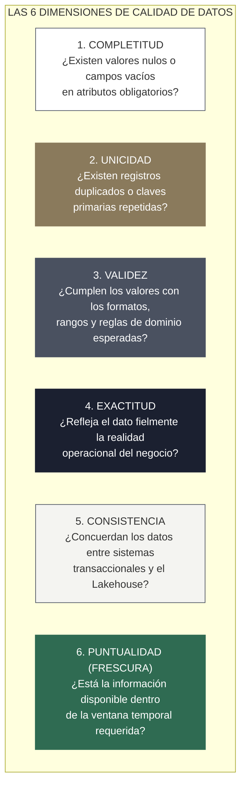
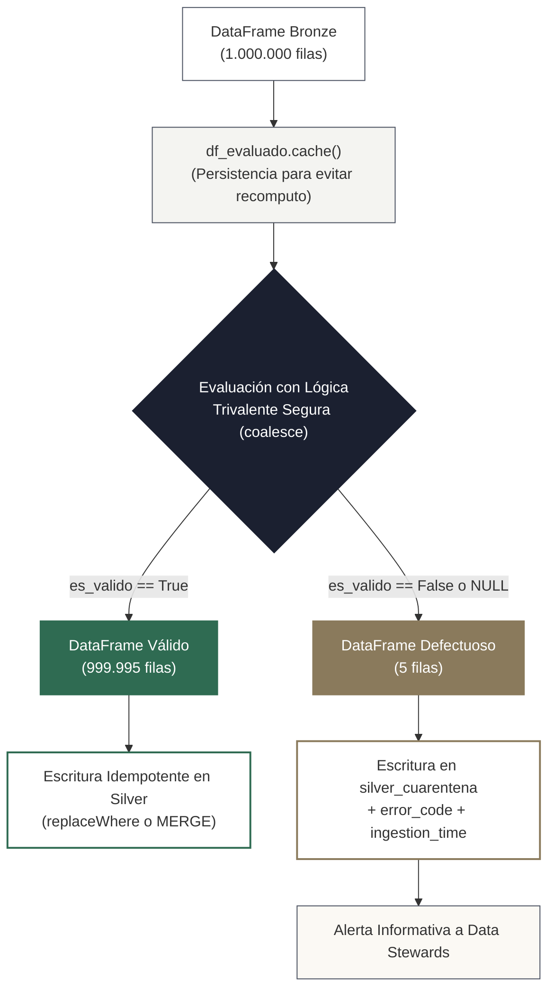

<!-- NOTAS FUENTE ORIGINALES DE OBSIDIAN: [[Data Quality]], [[Great Expectations]], [[Quarantine Pattern]] -->

# Capítulo 28: Calidad de Datos (Data Quality) y Validación Automatizada [RECOMENDADO]

> *"Procesar datos corruptos con alta velocidad computacional no es una ventaja competitiva; es la forma más rápida y costosa de tomar decisiones empresariales catastróficas. La calidad de datos no se inspecciona al final sobre los tableros ejecutivos de BI; se valida como una compuerta innegociable (*Quality Gate*) en cada etapa del pipeline analítico."*

---

## Objetivos de Aprendizaje
Al finalizar este capítulo, el lector será capaz de:
* Comprender y medir las **seis dimensiones formales de la calidad de datos**: Completitud, Unicidad, Validez, Exactitud, Consistencia y Puntualidad.
* Dominar la API moderna de **Great Expectations (GX 1.x)** basada en fuentes de datos, activos, definiciones de validación (*Validation Definitions*) y suites de expectativas.
* Diseñar compuertas de calidad estrictas (*Hard Gates*) y compuertas informativas (*Soft Gates*) en la transición entre las capas Bronze y Silver.
* Implementar el **Patrón de Cuarentena de Datos (*Data Quarantine Pattern*)** en PySpark resolviendo rigurosamente la lógica booleana trivalente y garantizando idempotencia.
* Aplicar el **Teorema del Límite Central (TLC)** y el Error Estándar de la Media para definir umbrales estadísticos matemáticamente válidos en compuertas de calidad.

---

> **Definición 28.1 (Calidad de Datos y Great Expectations)**
>
> **Great Expectations (GX)** es el estándar de código abierto líder para la validación declarativa, documentación viva y perfilado estadístico de conjuntos de datos en ingeniería. 
> 
> Permite a los equipos declarar afirmaciones computables y verificables denominadas **Expectations** sobre columnas, tablas y distribuciones de probabilidad, ejecutándolas automáticamente contra DataFrames distribuidos en Apache Spark, motores SQL o almacenes analíticos cloud.

---

## 28.1 Las Seis Dimensiones Universales de la Calidad de Datos

Toda estrategia formal de gobierno analítico debe evaluar los datos frente a seis dimensiones axiomáticas:



* **Completitud (*Completeness*):** Proporción de valores no nulos en columnas obligatorias (ej. `email IS NOT NULL`).
* **Unicidad (*Uniqueness*):** Ausencia de multiplicidad en identificadores primarios (`COUNT(DISTINCT id) == COUNT(id)`).
* **Validez (*Validity*):** Conformidad con esquemas, expresiones regulares y conjuntos canónicos (ej. código de país ISO 3166-1 alfa-2).
* **Exactitud (*Accuracy*):** Grado de concordancia con la fuente de verdad (ej. conciliación de saldos contables con la pasarela de pagos).
* **Consistencia (*Consistency*):** Ausencia de contradicciones lógicas entre tablas vinculadas (ej. no pueden existir órdenes con fechas anteriores a la fecha de creación del cliente).
* **Puntualidad (*Timeliness*):** Tiempo transcurrido entre el evento de negocio y su disponibilidad en la capa Gold para analítica.

---

## 28.2 Implementación con la API Moderna de Great Expectations (GX 1.x)

En versiones recientes de Great Expectations (especificación 1.x), la API fue completamente modernizada para desacoplar las fuentes de cómputo de las reglas de validación:

```python
import great_expectations as gx
from pyspark.sql import SparkSession

spark = SparkSession.builder \
    .appName("Capitulo28-GX1-QualityGate") \
    .master("local[*]") \
    .getOrCreate()

# 1. Cargar el DataFrame de la capa Bronze
df_transacciones_bronze = spark.read.parquet("lakehouse/bronze/transacciones/")

# 2. Inicializar el contexto de Great Expectations
contexto = gx.get_context()

# 3. Registrar la fuente de datos Spark y el activo en memoria
fuente_datos = contexto.data_sources.add_spark(name="spark_engine_lakehouse")
activo_datos = fuente_datos.add_dataframe_asset(name="activo_transacciones")

# Definición de lote para el DataFrame en memoria
definicion_lote = activo_datos.add_batch_definition_whole_dataframe(name="lote_completo")
lote_datos = definicion_lote.get_batch(batch_parameters={"dataframe": df_transacciones_bronze})

# 4. Declaración de la Suite de Expectativas de Negocio
suite = contexto.suites.add(gx.ExpectationSuite(name="suite_calidad_silver_transacciones"))

suite.add_expectation(gx.expectations.ExpectColumnValuesToNotBeNull(column="transaccion_id"))
suite.add_expectation(gx.expectations.ExpectColumnValuesToBeUnique(column="transaccion_id"))
suite.add_expectation(gx.expectations.ExpectColumnValuesToBeBetween(
    column="monto_usd", min_value=0.01, max_value=1000000.00
))
suite.add_expectation(gx.expectations.ExpectColumnValuesToBeInSet(
    column="moneda", value_set=["USD", "EUR", "COP", "MXN"]
))

# 5. Definición y ejecución de la compuerta de validación
validacion = contexto.validation_definitions.add(
    gx.ValidationDefinition(name="compuerta_silver", data=definicion_lote, suite=suite)
)

resultado = validacion.run(batch_parameters={"dataframe": df_transacciones_bronze})

print(f"¿Aprobó la compuerta de calidad?: {resultado.success}")
```

---

## 28.3 El Patrón de Cuarentena de Datos: Lógica Trivalente e Idempotencia

En sistemas de producción a escala de gigabytes o terabytes, aplicar una política binaria de *"todo o nada"* (*Hard Stop*) es inaceptable: si un archivo contiene **1.000.000 de filas válidas** y **5 filas corruptas** (por ejemplo, un código postal con formato incorrecto), abortar todo el pipeline bloquea las operaciones del negocio y detiene los tableros analíticos.

El **Patrón de Cuarentena** segrega condicionalmente el lote en dos flujos divergentes:
1. **Flujo Conforme:** Los registros válidos continúan su tránsito hacia la capa Silver.
2. **Flujo de Cuarentena:** Las filas defectuosas se bifurcan hacia una tabla dedicada `silver_cuarentena`, enriquecidas con columnas de auditoría que explican la regla exacta violada, notificando al equipo sin interrumpir la operación:



### El Peligro de la Lógica Booleana Trivalente en SQL y Spark
En álgebra booleana tradicional existen dos estados (`True`, `False`). En SQL y Apache Spark rige la **lógica trivalente** con valores nulos:
* Si la columna `monto_usd` es `NULL`, la expresión `monto_usd > 0.0` evalúa a **`NULL`**, no a `False`.
* Si se evalúa `df.filter(F.col("es_valido") == True)`, la fila con `NULL` **se descarta**.
* Pero si luego se filtra `df.filter(F.col("es_valido") == False)`, **la fila con `NULL` también se descarta**, ¡porque `NULL == False` no es verdadero!
* **Consecuencia:** Esas filas corruptas se evaporan por completo de ambos flujos, perdiéndose en el vacío sin llegar ni a Silver ni a la cuarentena.

Para evitar este grave fallo de datos, se debe envolver la condición global con `coalesce` o forzar el manejo explícito de nulos:

```python
import pyspark.sql.functions as F

# 1. Reglas atómicas de validez manejando nulos de forma explícita
regla_id_valido = F.col("transaccion_id").isNotNull()
regla_monto_positivo = F.col("monto_usd").isNotNull() & (F.col("monto_usd") > 0.0)
regla_moneda_valida = F.col("moneda").isNotNull() & F.col("moneda").isin("USD", "EUR", "COP", "MXN")

# 2. Condición global protegida con coalesce (nunca evalúa a NULL)
condicion_validez_global = F.coalesce(
    regla_id_valido & regla_monto_positivo & regla_moneda_valida,
    F.lit(False)
)

# 3. Clasificación y persistencia en caché para evitar re-escaneo
df_evaluado = df_transacciones_bronze.withColumn(
    "es_valido", condicion_validez_global
).withColumn(
    "motivos_cuarentena",
    F.concat_ws(", ",
        F.when(~regla_id_valido, F.lit("ID_NULO")),
        F.when(~regla_monto_positivo, F.lit("MONTO_INVALIDO_O_NULO")),
        F.when(~regla_moneda_valida, F.lit("MONEDA_NO_AUTORIZADA_O_NULA"))
    )
).cache()  # Caching indispensable para no recomputar en isEmpty, count y writes

try:
    # 4. Bifurcación física segura
    df_validos = df_evaluado.filter(F.col("es_valido") == True).drop("es_valido", "motivos_cuarentena")
    
    # Se capturan tanto los Falses explícitos como cualquier posible residuo nulo
    df_cuarentena = df_evaluado.filter((F.col("es_valido") == False) | F.col("es_valido").isNull()).withColumn(
        "fecha_cuarentena", F.current_timestamp()
    )

    # 5. Escritura idempotente en la capa Silver mediante replaceWhere
    # (Evita inserciones duplicadas ante reintentos del pipeline para la fecha del lote)
    fecha_lote = 20261012
    df_validos.write \
        .format("delta") \
        .mode("overwrite") \
        .option("replaceWhere", f"fecha_id = {fecha_lote}") \
        .save("lakehouse/silver/transacciones")

    # 6. Almacenamiento en cuarentena con append auditable
    if not df_cuarentena.isEmpty():
        conteo_corruptos = df_cuarentena.count()
        print(f"[ALERTA DE CALIDAD] Desviando {conteo_corruptos} filas defectuosas a cuarentena.")
        df_cuarentena.write \
            .format("delta") \
            .mode("append") \
            .save("lakehouse/silver/transacciones_cuarentena")

finally:
    df_evaluado.unpersist()
```

---

## 28.4 Criterios de Fiabilidad y Anti-Patrones en Producción

**Anti-patrón 1: Validaciones Mediante Scripts SQL Ad-Hoc Desconectados**
Escribir consultas manuales dispersas del tipo `SELECT COUNT(*) WHERE id IS NULL` en notebooks de Jupyter genera deuda técnica masiva y carece de integración con el linaje de la plataforma. La calidad debe gobernarse mediante frameworks declarativos integrados (Great Expectations, Soda Core o dbt test).

**Anti-patrón 2: Desactivar Compuertas de Calidad Durante Cierres Contables o Picos de Carga**
Eliminar las validaciones para "acelerar el procesamiento" cuando el pipeline sufre retrasos garantiza la contaminación de los modelos de machine learning y la emisión de reportes financieros inconsistentes.

**Anti-patrón 3: Carencia de Mecanismos de Reingesta desde Cuarentena**
Almacenar registros en tablas de cuarentena sin diseñar un proceso de remediación y reprocesamiento convierte la cuarentena en un cementerio de datos inerte. Todo registro en cuarentena debe contar con un ciclo de vida definido para su corrección y reingreso a la capa Silver.

---

## Preguntas de Revisión y Ejercicios Prácticos
**Ejercicio 28.1 (Diferenciación entre Hard Gates y Soft Gates):**  
En el diseño de una compuerta de calidad de datos, explica la diferencia entre una compuerta estricta (*Hard Gate*) y una compuerta informativa (*Soft Gate*). Proporciona un ejemplo empresarial concreto para cada una.

**Solución 28.1:**
1. **Compuerta Estricta (Hard Gate):**
   * *Mecanismo:* Si la aserción de calidad falla, la ejecución del pipeline **se aborta inmediatamente** lanzando una excepción fatal. Ningún dato del lote es promovido a la siguiente capa.
   * *Caso de uso:* Detección de duplicados en la clave primaria (`orden_id`) o montos de transacciones monetarias nulos. Promover estos datos corrompería el libro mayor contable y los balances tributarios de la compañía.
2. **Compuerta Informativa (Soft Gate):**
   * *Mecanismo:* Si la aserción falla, el pipeline registra una advertencia (*Warning*), emite una notificación al canal de observabilidad pero **continúa su ejecución**, permitiendo que los datos fluyan.
   * *Caso de uso:* El porcentaje de usuarios que no diligenciaron su número telefónico de contacto supera el 5% habitual y sube al 8%. Aunque la anomalía amerita investigación por el equipo de CRM, no compromete la integridad matemática de las transacciones de ventas.

---

**Ejercicio 28.2 (Umbrales Estadísticos y el Teorema del Límite Central):**  
Un pipeline procesa lotes de $n = 10.000$ transacciones financieras diarias. Se conoce históricamente que el monto individual de una transacción tiene una media poblacional $\mu = \$150.00 \text{ USD}$ y una desviación estándar poblacional $\sigma = \$30.00 \text{ USD}$.
1. ¿Por qué es un error estadístico grave fijar un umbral de calidad sobre la **media del lote** en el rango $[\mu - \sigma, \mu + \sigma] = [120, 180]$?
2. Aplicando el **Teorema del Límite Central (TLC)**, calcula el Error Estándar de la Media ($\text{SEM}$) y define el intervalo de control al $99.7\%$ ($\pm 3 \cdot \text{SEM}$).
3. Escribe la expectativa formal de Great Expectations con el umbral matemáticamente riguroso.

**Solución 28.2:**
1. *Error del umbral $[\mu - \sigma, \mu + \sigma]$:*
   La desviación estándar poblacional $\sigma = 30$ mide la variabilidad de **transacciones individuales**, no de la **media de un lote de 10.000 registros**. Fijar un rango de $[120, 180]$ es un umbral excesivamente holgado que permitiría que la media del lote se desvíe en más de 100 errores estándar sin disparar ninguna alarma, tolerando que el 80% de los datos estén corruptos.
2. *Cálculo del Error Estándar de la Media (SEM):*
   De acuerdo con el Teorema del Límite Central, la distribución muestral de la media $\bar{X}$ tiene una desviación típica dada por:
   $$\text{SEM} = \frac{\sigma}{\sqrt{n}} = \frac{30.00}{\sqrt{10\,000}} = \frac{30.00}{100} = \mathbf{0.30 \text{ USD}}$$
   Para un intervalo de confianza al $99.73\%$ (regla empírica de $\pm 3\sigma$):
   $$\text{Límite Inferior} = \mu - 3 \times \text{SEM} = 150.00 - 3(0.30) = \mathbf{149.10 \text{ USD}}$$
   $$\text{Límite Superior} = \mu + 3 \times \text{SEM} = 150.00 + 3(0.30) = \mathbf{150.90 \text{ USD}}$$
3. *Expectativa en Great Expectations:*
```python
suite.add_expectation(
    gx.expectations.ExpectColumnMeanToBeBetween(
        column="monto_usd",
        min_value=149.10,
        max_value=150.90
    )
)
```
Si un fallo operacional provoca que las transacciones se carguen en centavos en lugar de dólares (media $\approx 15.000$), o si la fuente experimenta una anomalía severa, la media muestral violará el intervalo $[149.10, 150.90]$ instantáneamente, activando la compuerta de seguridad.

---

## 28.5 Resumen y Puntos Clave

* **Seis dimensiones de calidad:** Completitud, unicidad, validez, exactitud, consistencia y puntualidad constituyen la base para certificar la fiabilidad de los datos.
* **API moderna de Great Expectations (GX 1.x):** Estructura la validación desacoplando motores de datos, definiciones de lotes y suites declarativas de expectativas.
* **Lógica trivalente en cuarentena:** Toda regla de clasificación debe protegerse con `coalesce` y pruebas explícitas de nulos para garantizar que las filas defectuosas no se evaporen de ambos flujos.
* **Idempotencia y Caching:** El DataFrame clasificado debe cachearse en memoria antes de evaluar bifurcaciones múltiples, y los datos válidos deben persistirse con `replaceWhere` en Delta Lake.
* **Rigor estadístico del TLC:** Las compuertas de calidad sobre medias agregadas deben dimensionarse según el Error Estándar de la Media ($\sigma / \sqrt{n}$), nunca según la dispersión de filas individuales.

---

## Lecturas Recomendadas
1. **Moses, B., Gavish, L., & Vorwerck, K. (2022).** *Data Quality Fundamentals: A Practitioner's Guide to Building Trust in Data.* O'Reilly Media.
2. **Great Expectations Project Documentation (2024).** *GX 1.0 Core Architecture and Validation Workflows.* (`https://docs.greatexpectations.io/docs/core/`).
3. **Casella, G. & Berger, R. L. (2002).** *Statistical Inference (2nd Edition).* Duxbury Press. (Capítulo 5: Properties of a Random Sample and the Central Limit Theorem).
