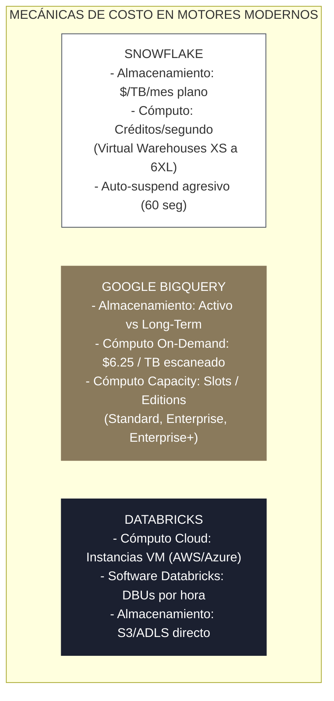

<!-- NOTAS FUENTE ORIGINALES DE OBSIDIAN: [[Cloud Architecture]], [[FinOps]], [[Cloud Pricing Models]] -->

# Capítulo 29: Cloud Data Architecture y Optimización de Costos FinOps [RECOMENDADO]

> *"La nube pública promete escalabilidad elástica y capacidad computacional infinita, pero esa misma elasticidad puede desencadenar facturas astronómicas si la arquitectura no está gobernada por principios rigurosos de eficiencia algorítmica y FinOps. En la ingeniería de datos senior, el rendimiento técnico y la viabilidad financiera son dos caras inseparables de la misma moneda."*

---

## Objetivos de Aprendizaje
Al finalizar este capítulo, el lector será capaz de:
* Diseñar arquitecturas analíticas desacopladas comparando los ecosistemas de **AWS**, **Microsoft Azure** (incluyendo **Microsoft Fabric** y OneLake) y **Google Cloud Platform (GCP)**.
* Desglosar con precisión matemática los modelos de tarificación de cómputo y almacenamiento en **Snowflake**, **Google BigQuery** y **Databricks**.
* Identificar y mitigar los costos ocultos de transferencia de red entre regiones y zonas de disponibilidad (*Data Egress*).
* Implementar estrategias de optimización **FinOps** para reducir drásticamente el gasto en clústeres distribuidos mediante instancias *Spot/Preemptible* y clústeres efímeros.
* Configurar políticas de ciclo de vida de almacenamiento (*Storage Tiering*) preservando acuerdos regulatorios.

---

> **Definición 29.1 (FinOps en Plataformas de Datos)**
>
> **FinOps** (*Financial Operations*) es la disciplina operativa y cultural que promueve la responsabilidad financiera compartida en el consumo de recursos computacionales en la nube. 
> 
> En la ingeniería de datos, articula el balance óptimo entre latencia, rendimiento analítico y costo de infraestructura, asegurando que cada dólar invertido en cómputo distribuido y almacenamiento de petabytes genere un retorno medible y justificado de valor para la organización.

---

## 29.1 Mapeo de Servicios entre Hiperescaladores y la Llegada de Microsoft Fabric

La arquitectura de datos moderna converge en la separación estricta entre **almacenamiento de objetos inmutable** y **cómputo elástico bajo demanda**:

| Componente Arquitectónico | Amazon Web Services (AWS) | Microsoft Azure / Microsoft Fabric | Google Cloud Platform (GCP) |
| :--- | :--- | :--- | :--- |
| **Almacenamiento de Objetos (Data Lake)** | Amazon S3 | Azure ADLS Gen2 / **Fabric OneLake** | Google Cloud Storage (GCS) |
| **Formato de Almacenamiento Predeterminado** | Parquet / Iceberg / Delta | **Delta Lake (Nativo en Fabric)** | Parquet / BigLake / Iceberg |
| **Motor de Cómputo Spark Distribuido** | Amazon EMR / Databricks | Azure Databricks / **Fabric Synapse** | Google Cloud Dataproc |
| **Almacén Analítico (Data Warehouse)** | Redshift (Serverless / Prov.) | Azure Synapse / **Fabric Warehouse** | Google BigQuery |
| **Plataforma de Streaming** | Amazon MSK (Kafka) / Kinesis | Azure Event Hubs / Kafka | Google Cloud Pub/Sub |
| **Orquestador Administrado** | Amazon MWAA (Airflow) | Azure Data Factory / Fabric Data Factory | Google Cloud Composer (Airflow) |
| **Gobernanza y Metadatos** | AWS Glue / Lake Formation | **Microsoft Purview** / Unity Catalog | Google Dataplex |

### Microsoft Fabric y el Concepto de OneLake
En el ecosistema de Azure, **Microsoft Fabric** representa la unificación *SaaS* de todas las cargas de trabajo analíticas sobre un único lago lógico denominado **OneLake** (*"el OneDrive para los datos"*). Utiliza Delta Lake sobre Parquet como formato de almacenamiento universal nativo, permitiendo que múltiples motores (T-SQL, Spark, KQL, Power BI Direct Lake) consulten las mismas tablas sin duplicación de archivos (*Zero-Copy Architecture*).

---

## 29.2 Modelos de Tarificación y Mecánica Financiera de Motores Analíticos

Comprender la fórmula exacta mediante la cual cada motor factura el consumo es indispensable para evitar sorpresas presupuestarias:



### 1. Snowflake: Desacoplamiento por Créditos y Micro-particionamiento
* **Almacenamiento:** Tarifa mensual fija por terabyte (~$23 USD/TB/mes en almacenamiento comprimido). Snowflake organiza los datos internamente en **micro-particiones** inmutables y comprimidas (50 a 500 MB de datos sin comprimir).
* **Clustering y Clustering Keys:** Snowflake no utiliza índices tradicionales B-Tree ni particionamiento físico manual por directorios. En su lugar, utiliza metadatos de rango (mínimos y máximos por columna en cada micro-partición) para podar datos (*partition pruning*). Cuando una tabla supera los terabytes de volumen y las consultas filtran recurrentemente por dimensiones de alta cardinalidad, se define una **Clustering Key**:
  ```sql
  -- Definición de clave de agrupamiento para optimizar micro-particiones en Snowflake
  ALTER TABLE analitica.fact_transacciones CLUSTER BY (fecha_transaccion, pais_id);
  ```
  Snowflake cuenta con un servicio de **Automatic Clustering** en segundo plano que reordena las micro-particiones para minimizar el solapamiento de rangos, consumiendo créditos de cómputo dedicados.
* **Vistas Materializadas (Materialized Views):** Almacenan físicamente el resultado precomputado de una consulta. Snowflake mantiene automáticamente sincronizada la vista ante inserciones y cambios en la tabla base mediante su servicio de mantenimiento serverless:
  ```sql
  CREATE OR REPLACE MATERIALIZED VIEW analitica.mv_ventas_diarias AS
  SELECT 
      fecha_transaccion,
      pais_id,
      COUNT(transaccion_id) AS total_operaciones,
      SUM(monto_usd) AS volumen_total_usd
  FROM analitica.fact_transacciones
  GROUP BY fecha_transaccion, pais_id;
  ```
* **Cómputo:** Se factura mediante **Créditos Snowflake por segundo** de ejecución de los *Virtual Warehouses*:
  * Talla XS: 1 crédito/hora.
  * Talla S: 2 créditos/hora.
  * Talla M: 4 créditos/hora (y así sucesivamente duplicándose hasta 6XL).
* **Palanca FinOps:** Configurar `AUTO_SUSPEND = 60` (suspensión automática tras 60 segundos de inactividad) y `AUTO_RESUME = TRUE`. Si ningún usuario o reporte está consultando el almacén, el costo de cómputo cae a cero de inmediato.

### 2. Google BigQuery: Facturación por Escaneo vs. Slots Dedicados
* **Modelo Bajo Demanda (*On-Demand*):** BigQuery factura típicamente **$6.25 USD por cada Terabyte de datos escaneados** por la consulta.
  * *Riesgo Financiero:* Una consulta analítica mal optimizada del tipo `SELECT * FROM tabla_eventos` que lea una tabla de 80 TB costará **$500 USD en una sola ejecución de 15 segundos**.
  * *Particionamiento y Clustering:* BigQuery permite particionar por fecha, marca de tiempo (`TIMESTAMP`/`DATETIME`) o rango entero (hasta un límite de 10.000 particiones por tabla), y hasta 4 columnas de agrupamiento (*clustering*):
  ```sql
  -- Creación de tabla particionada y clusterizada en Google BigQuery
  CREATE OR REPLACE TABLE `proyecto_prod.analitica.eventos_telemetria`
  (
      evento_id STRING NOT NULL,
      usuario_id INT64,
      tipo_evento STRING,
      monto_usd NUMERIC,
      fecha_hora_evento TIMESTAMP
  )
  PARTITION BY DATE(fecha_hora_evento)
  CLUSTER BY tipo_evento, usuario_id
  OPTIONS(
      partition_expiration_days = 730,
      description = "Tabla de telemetría optimizada con partición diaria y clustering"
  );
  ```
  * *Vistas Materializadas:* BigQuery optimiza automáticamente las consultas hacia tablas base redirigiéndolas a la vista materializada (*Smart Tuning*) si detecta que la vista cubre la consulta:
  ```sql
  CREATE MATERIALIZED VIEW `proyecto_prod.analitica.mv_resumen_eventos`
  PARTITION BY fecha
  CLUSTER BY tipo_evento
  AS
  SELECT
      DATE(fecha_hora_evento) AS fecha,
      tipo_evento,
      COUNT(1) AS cantidad_eventos,
      SUM(monto_usd) AS suma_usd
  FROM `proyecto_prod.analitica.eventos_telemetria`
  GROUP BY 1, 2;
  ```
* **Modelo por Capacidad (*Editions / Reservations*):** Para empresas con alto volumen predecible, se contratan **Slots** dedicados por hora/mes (ediciones Standard, Enterprise, Enterprise Plus), desacoplando el costo del volumen de bytes escaneados.

### 3. Amazon Redshift: Arquitectura MPP Clásica y Distribución Física
Amazon Redshift es un motor MPP (*Massively Parallel Processing*) basado en PostgreSQL optimizado para almacenamiento columnar:
* **Estilos de Distribución de Datos (Distribution Styles):** Determinan cómo se distribuyen los bloques de datos entre los nodos de cómputo (*Compute Slices*):
  * `AUTO`: Redshift asigna `ALL` inicialmente a tablas pequeñas y migra automáticamente a `EVEN` a medida que la tabla crece.
  * `KEY`: Las filas se asignan a nodos según el hash de una columna. Crucial para unir grandes tablas de hechos con dimensiones sin provocar redistribución por red (*Broadcast/Hash Shuffle*):
  * `ALL`: Copia la tabla completa en cada uno de los nodos. Ideal para dimensiones pequeñas (menos de unos pocos millones de filas).
  * `EVEN`: Distribución equitativa mediante *Round-Robin*. Usado cuando no hay una clave de unión evidente.
* **Claves de Ordenamiento (Sort Keys):** Determinan el orden físico de los bloques en disco, permitiendo al motor saltar bloques de 1 MB enteros con base en metadatos de zona (*Zone Maps*):
  * `COMPOUND SORTKEY`: Clave compuesta jerárquica (óptima cuando las consultas filtran por el primer prefijo de la clave).
  * `INTERLEAVED SORTKEY`: Pesa igual todas las columnas de la clave, útil cuando las consultas filtran por combinaciones arbitrarias de columnas.
```sql
-- Creación de tabla en Amazon Redshift con Distribution Key y Compound Sort Key
CREATE TABLE analitica.fact_ventas_redshift
(
    venta_id BIGINT IDENTITY(1,1),
    cliente_id INT NOT NULL,
    tienda_id INT NOT NULL,
    fecha_venta DATE NOT NULL,
    monto_total NUMERIC(12,2)
)
DISTSTYLE KEY
DISTKEY (cliente_id)
COMPOUND SORTKEY (fecha_venta, tienda_id);
```

### 4. Databricks: Fórmula Híbrida de Dos Capas
El costo total por hora de un clúster Databricks se compone de:
$$\text{Costo Total} = \text{Costo de Instancias Cloud (VMs AWS/Azure)} + (\text{DBUs consumidas} \times \text{Tarifa DBU})$$

* **Job Clusters vs. All-Purpose Clusters:** Un clúster interactivo (*All-Purpose*) cuesta aproximadamente **$0.40 - $0.55 USD por DBU**. Un clúster de trabajo automatizado (*Job Cluster*, creado exclusivamente para ejecutar un pipeline y apagarse) cuesta entre **$0.15 y $0.20 USD por DBU**. Ejecutar pipelines de producción programados en clústeres All-Purpose representa un sobrecosto directo del 60% al 70%.

---

## 29.3 Palancas FinOps Clave para Reducción de Costos

### 1. Nodos Worker en Instancias Spot / Preemptible
Los nodos Worker de un clúster de Spark procesan tareas idempotentes y sin estado persistente (*stateless*). En caso de que el proveedor cloud reclame una máquina Spot, el Driver simplemente reasigna las tareas pendientes a otros Workers.
* **Ahorro:** Las instancias Spot ofrecen descuentos de entre el **60% y el 80%** frente al precio On-Demand.
* **Regla de Oro:** El **nodo Driver debe permanecer estrictamente en On-Demand**. Si la máquina del Driver es reclamada por la nube, toda la aplicación Spark colapsa inmediatamente.

### 2. Supresión de Costos de Red (*Data Egress*)
Mover datos a través de los límites de una región en AWS o Azure genera tarifas de transferencia de salida (*Egress*) que van desde $0.02 hasta $0.09 USD por GB.
* Si el bucket de almacenamiento está en `us-east-1` y el clúster de Spark se despliega en `us-west-2`, cada terabyte leído y escrito incurrirá en costos de transferencia de red recurrentes y latencia innecesaria.
* **Regla de Oro:** Todos los componentes del pipeline (fuentes, motores de cómputo, sumideros y orquestadores) deben residir estrictamente en la misma región cloud y, si es posible, dentro de la misma zona de disponibilidad.

### 3. Ciclo de Vida de Almacenamiento (*Storage Tiering*) y el Peligro de Glacier en Lakehouses
El 90% de las consultas analíticas consultan datos generados en los últimos 30 a 90 días. Mantener terabytes de datos históricos de la capa Bronze en almacenamiento caliente (*Hot Tier*) desperdicia presupuesto:

```
[ Capa Bronze: Día 0 a 90 ] ──> Amazon S3 Standard ($0.023 / GB)
                                       │
                         [ Tras 90 días de inactividad ]
                                       ▼
[ Transición a Nivel Frío ] ──> Amazon S3 Glacier Instant Retrieval ($0.004 / GB)
                                       │ (Ahorro del 82% en costo de almacenamiento)
                         [ Tras 365 días de retención legal ]
                                       ▼
[ Archivado Profundo ]      ──> Amazon S3 Glacier Deep Archive ($0.00099 / GB)
                                       (Ahorro del 95% preservando cumplimiento)
```

> **PELIGRO CRÍTICO DE ARQUITECTURA: Reglas de Ciclo de Vida en Tablas Delta Lake e Iceberg**
> 
> Aplicar reglas automáticas de ciclo de vida de S3 (o Blob Lifecycle Management en Azure) hacia niveles de almacenamiento asíncrono (**Amazon S3 Glacier Flexible** o **Glacier Deep Archive**) sobre directorios que albergan tablas **Delta Lake** o **Apache Iceberg** es un **error catastrófico en producción**.
> 
> 1. **Fallo Inmediato de Consultas (`InvalidObjectState`):** Los motores Spark, Trino y DuckDB esperan acceso síncrono por HTTP `GET` a todos los archivos Parquet referenciados en el registro de transacciones (*Delta Log* o *Manifest Files*). Si una regla de S3 envió archivos de datos a Glacier Flexible, cualquier consulta que requiera leer dichos archivos fallará instantáneamente con la excepción `InvalidObjectState: The operation is not valid for the object's storage class`.
> 2. **Ruptura de Comandos de Mantenimiento (`VACUUM`):** El comando `VACUUM` inspecciona el almacenamiento físico para determinar qué archivos están huérfanos. Al toparse con objetos en Glacier, el comando colapsa o no puede comprobar sus metadatos.
> 3. **Costos Ocultos y Latencia de Restauración:** Restaurar millones de archivos Parquet archivados en Glacier requiere emitir peticiones de restauración que tardan entre 3 y 12 horas por lote y conllevan cobros por cada 1.000 solicitudes ($0.03 a $0.05 USD por millar), eliminando cualquier supuesto ahorro en almacenamiento.
> 
> **Práctica Recomendada:** En tablas Lakehouse, el ciclo de vida debe gestionarse a nivel lógico de partición (por ejemplo, archivando particiones enteras en un bucket secundario desacoplado del catálogo) o utilizando únicamente **S3 Glacier Instant Retrieval**, asegurándose de que la tabla esté compactada previamente, dado que Glacier penaliza severamente archivos menores a 128 KB.

---

## 29.4 Criterios de Fiabilidad y Anti-Patrones en Producción

**Anti-patrón 1: Mantener Clústeres Fijos Encendidos 24/7 para Trabajos por Lotes Diarios**
Dejar un clúster de 16 nodos encendido continuamente para procesar una carga que solo tarda 2 horas durante la madrugada significa pagar por 22 horas de máquinas completamente ociosas. Se deben utilizar siempre clústeres efímeros creados y destruidos por el orquestador (*Ephemeral Job Clusters*).

**Anti-patrón 2: Consultar Motores Serverless con `SELECT *` y Formatos de Texto Plano (CSV/JSON)**
Consultar archivos CSV sin comprimir mediante Amazon Athena o BigQuery fuerza el escaneo completo de cada carácter del archivo. Almacenar en Parquet con compresión Snappy/ZSTD reduce el volumen de bytes leídos hasta en un 85%, reduciendo directamente la factura en la misma proporción.

**Anti-patrón 3: Políticas de Retención Indefinidas en la Capa Bronze sin Reglas de Purgado**
Conservar todos los archivos crudos de telemetría de forma indefinida en el nivel de almacenamiento más costoso infla linealmente el costo mensual de la cuenta de almacenamiento año tras año.

---

## Preguntas de Revisión y Ejercicios Prácticos
**Ejercicio 29.1 (Cálculo Financiero Comparativo en BigQuery):**  
Una compañía almacena una tabla analítica de registros de navegación web de **50 Terabytes**. Un analista programa un dashboard en Power BI que ejecuta una consulta cada 15 minutos (96 veces al día).
* *Consulta A (Incipiente):* `SELECT * FROM tabla_logs WHERE user_agent LIKE '%Android%'` (Sin particionar, escanea la tabla completa).
* *Consulta B (Optimizada):* La tabla se particiona por fecha (`fecha_evento`) y se aplica clusterización por `user_agent`. La consulta optimizada solo escanea **200 Gigabytes** por ejecución.
Calcula el costo diario y mensual de ambas consultas bajo el modelo bajo demanda de BigQuery ($6.25 USD por TB escaneado).

**Solución 29.1:**
1. **Cálculo para Consulta A (No optimizada):**
   * Bytes por ejecución: $50 \text{ TB}$.
   * Costo por ejecución: $50 \text{ TB} \times \$6.25 = \$312.50 \text{ USD}$.
   * Costo diario (96 ejecuciones): $96 \times \$312.50 = \$30.000 \text{ USD/día}$.
   * **Costo mensual (30 días):** $\$30.000 \times 30 = \mathbf{\$900.000 \text{ USD/mes}}$ *(Gasto catastrófico).*
2. **Cálculo para Consulta B (Optimizada con particionamiento y clúster):**
   * Bytes por ejecución: $200 \text{ GB} = 0.2 \text{ TB}$.
   * Costo por ejecución: $0.2 \text{ TB} \times \$6.25 = \$1.25 \text{ USD}$.
   * Costo diario (96 ejecuciones): $96 \times \$1.25 = \$120 \text{ USD/día}$.
   * **Costo mensual (30 días):** $\$120 \times 30 = \mathbf{\$3.600 \text{ USD/mes}}$.
* **Conclusión:** La optimización arquitectónica produce un **ahorro de más de $896.000 USD mensuales (99.6% de reducción)** demostrando el impacto directo del diseño de ingeniería en el balance financiero.

---

**Ejercicio 29.2 (Dimensionamiento de Clúster Spark con Instancias Spot):**  
Se debe procesar un trabajo batch nocturno que requiere 10 nodos de cómputo durante 4 horas.
* Instancia On-Demand: $1.20 USD / hora.
* Instancia Spot: $0.30 USD / hora (75% de descuento).
Diseña la distribución recomendada entre Driver y Workers y calcula el ahorro económico total frente a una configuración 100% On-Demand.

**Solución 29.2:**
1. **Configuración Segura Recomendada:**
   * **1 Nodo Driver:** Asignado a **On-Demand** ($1.20/h) para garantizar que el trabajo no colapse si la nube reclama capacidad.
   * **9 Nodos Worker:** Asignados a **Spot** ($0.30/h) para máxima eficiencia.
2. **Comparativa de Costo (4 horas de ejecución):**
   * *Costo 100% On-Demand (10 nodos):*
     $$\text{Costo} = 10 \times \$1.20 \times 4 = \$48.00 \text{ USD}$$
   * *Costo Híbrido Recomendado (1 On-Demand + 9 Spot):*
     $$\text{Costo} = (1 \times \$1.20 \times 4) + (9 \times \$0.30 \times 4) = \$4.80 + \$10.80 = \$15.60 \text{ USD}$$
   * **Ahorro Absoluto:** $\$48.00 - \$15.60 = \$32.40 \text{ USD}$ (**67.5% de ahorro** con tolerancia total a fallos).

---

## 29.5 Resumen y Puntos Clave

* **Desacoplamiento fundamental:** La nube analítica moderna separa el almacenamiento de objetos masivo (S3, ADLS Gen2, OneLake) del cómputo elástico efímero.
* **Mecánica financiera de motores:** Comprender las fórmulas de créditos (Snowflake), escaneo de bytes (BigQuery) y DBUs con instancias cloud (Databricks) es imperativo para evitar desbordamientos presupuestarios.
* **Clústeres efímeros y Workers Spot:** El uso de Job Clusters con trabajadores en instancias Spot reduce el gasto de cómputo en más de un 60% sin comprometer la estabilidad del nodo Driver.
* **Ciclo de vida de almacenamiento:** La transición automática de datos fríos hacia niveles de archivo (*Glacier / Cool Tier*) reduce drásticamente el costo de retención de petabytes a largo plazo.

---

## Lecturas Recomendadas
1. **Storment, J. R. & Fuller, M. (2023).** *Cloud FinOps: Collaborative, Real-Time Cloud Value Decision Making (2nd Edition).* O'Reilly Media.
2. **Google Cloud Architecture Center (2024).** *BigQuery Cost Optimization Best Practices: Storage and Query Partitioning.* Google Documentation.
3. **Snowflake Computing (2024).** *Managing Costs in Snowflake: Resource Monitors, Warehouse Scaling, and Auto-Suspend.* Snowflake Documentation.
