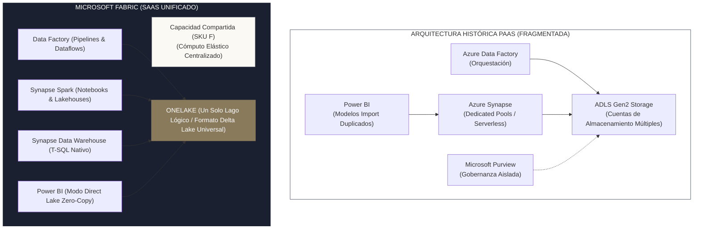
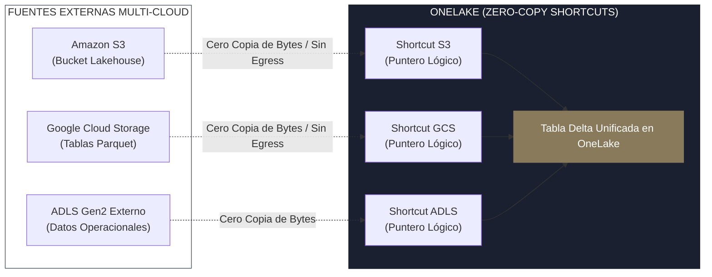
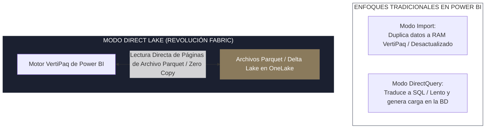

<!-- NOTAS FUENTE ORIGINALES DE OBSIDIAN: [[Microsoft Fabric]], [[OneLake]], [[Azure Data]], [[Direct Lake]], [[DP-700]] -->

# Capítulo 29A: Microsoft Fabric y OneLake: Arquitectura SaaS y el Futuro Analítico en Azure [RECOMENDADO]

> *"La evolución de las plataformas de datos en la nube ha transitado desde la infraestructura como servicio (IaaS) y los servicios administrados fragmentados (PaaS) hacia la consolidación del Software como Servicio (SaaS). En el ecosistema de Microsoft Azure, Microsoft Fabric representa la convergencia total: un único lago lógico de datos —OneLake— gobernado por el formato abierto Delta Lake, donde múltiples motores computacionales (Spark, T-SQL, KQL y Power BI) interoperan sobre los mismos archivos físicos sin duplicar un solo byte."*

---

## Objetivos de Aprendizaje
Al finalizar este capítulo, el lector será capaz de:
* Comprender la transición arquitectónica desde servicios PaaS fragmentados (Azure Synapse Analytics, Azure Data Factory tradicional) hacia la plataforma unificada SaaS **Microsoft Fabric**.
* Analizar la estructura interna de **OneLake** y su adopción del estándar **Delta Lake sobre Parquet** como formato de almacenamiento universal.
* Implementar **Accesos Directos (*Shortcuts*) Zero-Copy** para virtualizar datos residentes en Amazon S3, Google Cloud Storage o ADLS Gen2 sin mover archivos.
* Distinguir y orquestar las diferentes cargas de trabajo: **Data Engineering** (Apache Spark), **Data Warehouse** (T-SQL relacional) y **Real-Time Intelligence** (KQL/Eventstream).
* Explicar el funcionamiento revolucionario del modo **Direct Lake** de Power BI frente a los modos tradicionales *Import* y *DirectQuery*.
* Preparar el mapa de competencias técnicas requerido para la certificación oficial **Microsoft Certified: Fabric Data Engineer Associate (Examen DP-700)**.

---

> **Definición 29A.1 (Microsoft Fabric y OneLake)**
> **Microsoft Fabric** es una plataforma analítica integral todo-en-uno entregada bajo el modelo SaaS, que unifica el movimiento de datos, el procesamiento distribuido, la ingeniería analítica, el almacenamiento masivo, la inteligencia en tiempo real y la visualización empresarial.
> 
> En su núcleo reside **OneLake** (*"el OneDrive para los datos analíticos de la empresa"*): un lago lógico único por cada organización (*tenant*), construido automáticamente sobre Azure Data Lake Storage (ADLS) Gen2, que erradica los silos departamentales forzando a todos los motores a consultar y escribir tablas en formato **Delta Lake**.

---

## 29A.1 De la Fragmentación PaaS a la Unificación SaaS

Históricamente, construir una arquitectura analítica moderna en Azure requería aprovisionar y entrelazar múltiples servicios independientes:



### Problemas Críticos del Enfoque PaaS Tradicional:
1. **Silos y Duplicación Masiva de Datos:** Finanzas creaba su propio Data Lake; Marketing exportaba datos hacia Synapse; y Power BI importaba copias en memoria RAM (*archivos PBIX*), multiplicando los costos de almacenamiento por cuatro.
2. **Complejidad de Red y Permisos:** Conectar un clúster de Spark a un Data Factory requería configurar Private Endpoints, identidades administradas, redes virtuales emparejadas (*VNet Peering*) y reglas complejas de cortafuegos.
3. **Facturación Fragmentada:** Pagar por vCores de Synapse, unidades de integración de datos (DIUs) en ADF y nodos dedicados de Power BI Premium generaba gastos impredecibles.

**La Solución de Fabric:** Se contrata una **Capacidad Fabric compartida (SKUs F2 a F2048)**. Toda la organización consume CPU y memoria de esa bolsa común de recursos, y todos los equipos leen y escriben sobre el mismo OneLake unificado.

---

## 29A.2 OneLake y la Arquitectura Zero-Copy con Shortcuts

OneLake elimina la necesidad de mover datos entre departamentos o incluso entre diferentes nubes públicas:



### Shortcuts (Accesos Directos Lógicos)
Un **Shortcut** es un puntero o enlace simbólico dentro de OneLake que apunta hacia ubicaciones de almacenamiento físicas externas (como un bucket de Amazon S3 o una cuenta externa de ADLS Gen2):
* **Cero Duplicación (*Zero-Copy*):** Los archivos permanecen en el almacenamiento de origen en AWS o GCP. Los motores de Fabric los consultan directamente a través del puntero de OneLake.
* **Interoperabilidad Automática:** Si los datos en Amazon S3 están en formato Delta Lake o Parquet, OneLake los expone instantáneamente como una tabla analítica consultable por T-SQL o Power BI sin necesidad de ejecutar un pipeline de ingesta ETL.

---

## 29A.3 Cargas de Trabajo y Motores Analíticos en Fabric

Dentro de un área de trabajo (*Workspace*) de Fabric, los ingenieros pueden combinar diferentes paradigmas computacionales sobre las mismas tablas Delta:

### 1. Data Engineering con Apache Spark
Provee clústeres de Apache Spark completamente administrados con arranque rápido (menos de 20 segundos) y entornos de ejecución optimizados:
```python
# Código PySpark en Notebook de Fabric escribiendo en Delta Lake nativo
from pyspark.sql import functions as F

df_ventas = spark.read.parquet("Files/raw/ventas_2026.parquet")

df_limpio = df_ventas \
    .filter(F.col("monto_usd") > 0) \
    .withColumn("fecha_proceso", F.current_date())

# Escritura directa en el catálogo gestionado de OneLake
df_limpio.write \
    .format("delta") \
    .mode("overwrite") \
    .saveAsTable("ventas_lakehouse.fact_ventas_conformadas")
```

### 2. Synapse Data Warehouse (Motor T-SQL Relacional)
A diferencia de los Data Warehouses tradicionales que utilizan formatos de almacenamiento binarios propietarios, el Data Warehouse de Fabric **escribe físicamente en archivos Delta Lake abiertos en OneLake**:
```sql
-- Consulta T-SQL ejecutada en el Data Warehouse de Fabric
-- Lee directamente los archivos Delta producidos por el notebook de Spark
SELECT 
    pais,
    COUNT(transaccion_id) AS total_operaciones,
    SUM(monto_usd) AS facturacion_total
FROM ventas_lakehouse.fact_ventas_conformadas
WHERE fecha_proceso >= '2026-01-01'
GROUP BY pais
ORDER BY facturacion_total DESC;
```

---

## 29A.4 Power BI Direct Lake: La Revolución del Consumo Analítico

Históricamente, los analistas de negocio se enfrentaban a una disyuntiva en Power BI:
* **Modo Import:** Copiaba terabytes de datos desde la base de datos hacia la memoria RAM de Power BI (*VertiPaq*). Ofrecía consultas rápidas, pero obligaba a programar recargas periódicas y duplicaba masivamente los datos.
* **Modo DirectQuery:** No copiaba datos, pero traducía cada clic en el dashboard a consultas SQL lentas hacia la base de datos, colapsando el rendimiento.



* **Modo Direct Lake:** Como las tablas de OneLake ya están almacenadas en formato columnar **Parquet** con compresión Snappy/ZSTD y diccionario, el motor VertiPaq de Power BI **mapea y lee las columnas directamente desde los archivos Parquet en disco a su memoria**.
* **Resultado:** Ofrece la misma velocidad instantánea del modo *Import* sin mover ni duplicar los datos, reflejando de forma inmediata cualquier actualización realizada por un pipeline de Spark o SQL.

---

## 29A.5 El Examen Oficial DP-700: Microsoft Fabric Data Engineer

Para los ingenieros de datos enfocados en el ecosistema de Microsoft, la certificación **Microsoft Certified: Fabric Data Engineer Associate (Examen DP-700)** valida las competencias técnicas del rol:

| Dominio Técnico | Peso Relativo | Temas Centrales Evaluados |
| :--- | :---: | :--- |
| **Implementar y Administrar una Solución Analítica** | **30–35%** | Configuración de capacidades Fabric (SKUs F), seguridad y RBAC en OneLake, administración de workspaces, gobierno con Purview y despliegues con Git y deployment pipelines. |
| **Ingestar y Cargar Datos** | **25–30%** | Ingesta con Data Factory Pipelines y Dataflows Gen2, configuración de Shortcuts hacia AWS S3 y ADLS, ingesta continua con streaming y CDC. |
| **Transformar y Optimizar Datos** | **30–35%** | Transformación distribuida con Apache Spark y Delta Lake, optimización con Z-Order y V-Order, modelado dimensional en Data Warehouses (T-SQL) y diseño de semantic models en Direct Lake. |
| **Monitorear y Asegurar la Plataforma** | **10–15%** | Monitoreo del consumo de capacidad con la aplicación *Fabric Capacity Metrics*, seguridad a nivel de filas y columnas (RLS/CLS) y alertas operacionales. |

---

## 29A.6 Criterios de Fiabilidad y Anti-Patrones en Producción

**Anti-patrón 1: Sobrecargar la Capacidad Compartida sin Monitorear los Límites de CPU (*Throttling*)**  
Al operar bajo una capacidad compartida (ej. SKU F64), si un ingeniero ejecuta un notebook con un bucle infinito o un join ineficiente, puede agotar las unidades de capacidad (*Capacity Units - CUs*), provocando que Microsoft limite (*throttle*) o pause temporalmente los reportes de Power BI y los pipelines de toda la empresa.  
*Corrección:* Supervise activamente la aplicación *Fabric Capacity Metrics* y configure políticas de límites de tiempo de ejecución para notebooks interactivos.

**Anti-patrón 2: Forzar el Uso de DirectQuery Habiendo Tablas Delta en OneLake**  
Conectar Power BI a tablas de Fabric utilizando conectores relacionales estándar con DirectQuery degrada el rendimiento de los reportes.  
*Corrección:* Utilice siempre modelos semánticos en modo **Direct Lake**, asegurándose de que las tablas Delta subyacentes estén compactadas y utilicen la optimización de lectura rápida **V-Order**.

---

## Preguntas de Revisión y Ejercicios Prácticos
**Ejercicio 29A.1 (Configuración de Arquitectura Multi-Cloud con Shortcuts):**  
Una empresa multinacional almacena su catálogo histórico de telemetría de 200 Terabytes en un bucket de Amazon S3 en formato Parquet (`s3://empresa-global-telemetria/historico/`).  
La junta directiva solicita que el equipo analítico en Azure construya dashboards en Power BI con latencia de consulta de menos de 2 segundos sin duplicar los 200 TB en Azure ni incurrir en costos recurrentes de transferencia de datos (*Egress*). Diseñe la solución técnica utilizando Microsoft Fabric.

**Solución 29A.1:**
1. **Creación del Shortcut en OneLake:**  
   En el Lakehouse de Microsoft Fabric, se crea un **OneLake Shortcut** apuntando al bucket `s3://empresa-global-telemetria/historico/`, autenticado de forma segura mediante un rol IAM de AWS con credenciales de confianza.
2. **Exposición de Metadatos:**  
   OneLake crea un puntero lógico que expone los archivos Parquet como una tabla analítica dentro del catálogo de Fabric sin transferir físicamente los 200 TB a través de internet.
3. **Capa Semántica en Direct Lake:**  
   Se crea un modelo semántico en Power BI configurado en modo **Direct Lake** vinculado a la tabla del Shortcut.
4. **Resultado de Rendimiento y Costo:**  
   Power BI lee las columnas requeridas bajo demanda directamente sobre el almacenamiento columnar sin duplicación física en Azure, cumpliendo con el SLA de 2 segundos y ahorrando decenas de miles de dólares en almacenamiento y ancho de banda.

---

## 29A.7 Resumen y Puntos Clave

* **Convergencia SaaS:** Microsoft Fabric elimina la fricción de aprovisionar infraestructura PaaS fragmentada, unificando cómputo elástico compartido y almacenamiento en un solo servicio.
* **OneLake y Delta Lake:** Un lago lógico único a nivel corporativo donde todos los motores (Spark, SQL, KQL) leen y escriben sobre el estándar abierto Delta Lake.
* **Shortcuts Zero-Copy:** Conectan almacenes de datos en AWS S3, Google Cloud Storage y ADLS Gen2 sin duplicar datos ni pagar costos de migración.
* **Direct Lake en Power BI:** Supera el dilema tradicional entre velocidad (Import) y frescura (DirectQuery), leyendo directamente desde los archivos Parquet en disco.
* **Certificación DP-700:** Valida formalmente el diseño, ingesta, optimización y gobierno de plataformas Lakehouse en Microsoft Fabric.

---

## Lecturas Recomendadas
1. **Microsoft Learn (2024).** *Microsoft Fabric Documentation: Architecture, Workspaces, and OneLake Storage.* Microsoft Docs.
2. **Microsoft Credentials (2024).** *Study Guide for Exam DP-700: Implementing an Enterprise Data Solution Using Microsoft Fabric.* Microsoft Learn.
3. **Ferrari, A. & Russo, M. (2023).** *Deep Dive into Direct Lake Mode in Microsoft Fabric and Power BI.* SQLBI Research (`https://www.sqlbi.com/articles/deep-dive-into-direct-lake-mode/`).
