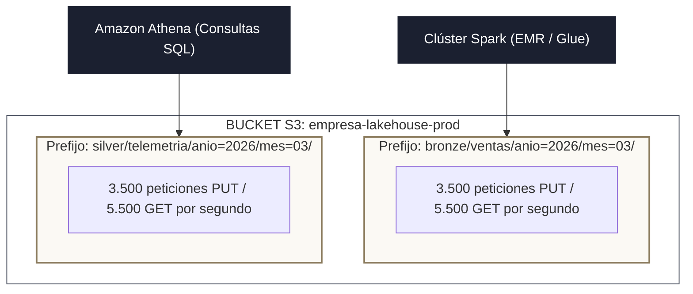
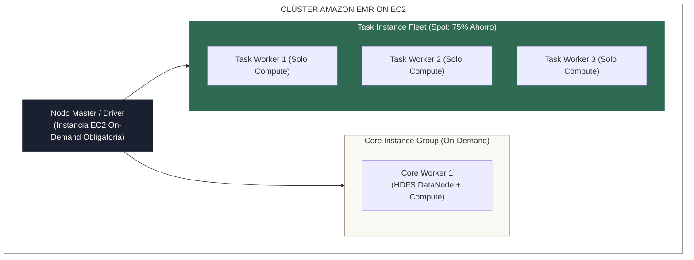
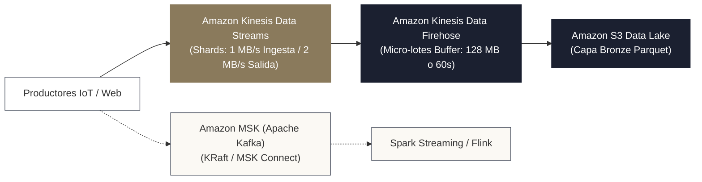

<!-- NOTAS FUENTE ORIGINALES DE OBSIDIAN: [[AWS Data Architecture]], [[Amazon S3]], [[AWS Glue]], [[Amazon EMR]], [[Amazon Athena]], [[Amazon Redshift]] -->

# Capítulo 29B: Arquitectura de Plataformas de Datos en AWS: S3 Data Lake, Glue, EMR, Athena y Redshift [RECOMENDADO]

> *"Amazon Web Services fue el pionero que definió la computación en la nube pública y continúa siendo la columna vertebral de la infraestructura tecnológica global. Construir una plataforma de datos a escala de petabytes en AWS exige dominar el desacoplamiento estricto entre almacenamiento inmutable en Amazon S3, catálogos de metadatos federados con AWS Glue, cómputo elástico en EMR, análisis interactivo serverless con Athena y almacenamiento masivo en Amazon Redshift."*

---

## Objetivos de Aprendizaje
Al finalizar este capítulo, el lector será capaz de:
* Diseñar un **Data Lakehouse de alto rendimiento sobre Amazon S3**, optimizando la estructura de prefijos para maximizar el throughput de operaciones de lectura y escritura.
* Implementar y optimizar el catálogo de metadatos universal mediante **AWS Glue Data Catalog**, evaluando las compensaciones de rendimiento de los *Glue Crawlers*.
* Construir pipelines de procesamiento distribuido serverless con **AWS Glue Jobs** y **Amazon EMR** (Serverless, on EC2 con instancias Spot, y on EKS).
* Optimizar consultas analíticas interactivas en **Amazon Athena**, minimizando los costos de escaneo por terabyte mediante particionado y formatos columnares.
* Diseñar esquemas relacionales MPP en **Amazon Redshift**, seleccionando estilos de distribución física (*Distribution Styles*) y claves de ordenamiento (*Sort Keys*) sobre nodos RA3.
* Ingestar flujos de eventos continuos en tiempo real utilizando **Amazon Kinesis Data Streams** y **Amazon MSK** (Apache Kafka gestionado).
* Blindar la seguridad de la plataforma mediante **AWS Lake Formation** y **VPC Endpoints** privados para evitar cargos de transferencia de red.

---

> **Definición 29B.1 (El Data Lakehouse Nativo en AWS)**
> En el ecosistema de Amazon Web Services, un **Data Lakehouse** es una arquitectura desacoplada donde **Amazon S3** actúa como la única fuente inmutable de verdad para el almacenamiento de objetos, **AWS Glue Data Catalog** centraliza los metadatos y esquemas de forma federada, y múltiples motores computacionales especializados (Athena para SQL interactivo, EMR/Glue para Apache Spark, Redshift para analítica dimensional y SageMaker para aprendizaje automático) operan simultáneamente sobre los mismos datos sin silos redundantes.

---

## 29B.1 Amazon S3 como Núcleo de Almacenamiento del Lakehouse

Amazon S3 (*Simple Storage Service*) ofrece durabilidad del 99.999999999% (11 nueves). En diciembre de 2020, AWS introdujo **consistencia fuerte de lectura tras escritura (*Strong Read-After-Write Consistency*)** sin sobrecosto, eliminando las complejidades de consistencia eventual que afectaban históricamente a los motores analíticos.

### 1. Throughput y Particionamiento por Prefijos
Amazon S3 escala el ancho de banda automáticamente por cada prefijo de clave:
* **Capacidad por Prefijo:** Cada prefijo independiente en un bucket soporta al menos **3.500 solicitudes `PUT/COPY/POST/DELETE`** y **5.500 solicitudes `GET/HEAD` por segundo**.
* **Diseño de Prefijos:** Un prefijo es cualquier cadena entre la raíz del bucket y el nombre del archivo (ej. `s3://bucket/capa/tabla/particion/`). Al particionar tablas por fechas o hashes, los ejecutores de Spark distribuyen las lecturas y escrituras a través de múltiples prefijos simultáneos, alcanzando cientos de miles de peticiones por segundo sin cuellos de botella de I/O.

### 2. Clases de Almacenamiento y FinOps en S3
* **S3 Standard:** Para datos de la capa Silver y Gold consultados frecuentemente ($0.023 USD/GB/mes).
* **S3 Intelligent-Tiering:** Monitorea los patrones de acceso y mueve automáticamente los objetos entre niveles caliente, tibio y frío sin penalizaciones de recuperación. Es la clase recomendada para la capa Bronze.
* **Advertencia Crítica:** Como se fundamentó en el Capítulo 29, **nunca aplique reglas de ciclo de vida hacia S3 Glacier Flexible o Deep Archive sobre tablas Delta Lake o Apache Iceberg activas**, ya que romperá inmediatamente las consultas y los comandos de mantenimiento (`VACUUM`) con excepciones `InvalidObjectState`.

---

## 29B.2 AWS Glue: Catálogo de Datos y Cómputo Serverless

AWS Glue proporciona tanto la capa de catálogo como el entorno de ejecución Spark serverless en AWS:

### 1. AWS Glue Data Catalog
Actúa como un **Hive Metastore universal administrado**:
* Permite que Amazon Athena, Amazon EMR, Amazon Redshift Spectrum y Amazon SageMaker compartan las mismas definiciones de tablas, particiones y tipos de datos.
* Almacena estadísticas de columnas (mínimos, máximos, valores nulos) utilizadas por los optimizadores de costos de los motores de consulta.

### 2. Glue Crawlers vs. Registro Basado en Eventos
* **Glue Crawlers:** Escanean periódicamente los prefijos de S3, infieren formatos y actualizan las particiones en el catálogo.
  * *Riesgo en Producción:* Escanear terabytes de datos con millones de archivos genera altos costos de DPU y puede alterar tipos de datos si un archivo nuevo contiene anomalías.
  * *Práctica Recomendada en Producción:* Utilizar **notificaciones de eventos de S3 (*S3 Event Notifications*)** conectadas a una función AWS Lambda que registre las nuevas particiones en el Glue Data Catalog mediante la llamada de API `CreateTable` o `BatchCreatePartition`, con costo casi nulo y latencia de segundos.

### 3. AWS Glue Jobs (Apache Spark Serverless)
Ejecuta scripts de PySpark o Scala sin necesidad de administrar instancias EC2 ni clústeres:
* Se dimensiona en **DPUs (*Data Processing Units*)**: 1 DPU equivale a 4 vCPUs y 16 GB de RAM.
* Tipos de trabajadores: `G.1X` (1 DPU), `G.2X` (2 DPU, óptimo para transformaciones con shuffle pesado y ML) y `G.025X` (para streaming ligero).
* **`DynamicFrame` frente a PySpark `DataFrame`:** La biblioteca de Glue proporciona la abstracción `DynamicFrame`, que tolera datos con esquemas anómalos o tipos inconsistentes en una misma columna sin fallar, permitiendo resolver conflictos con métodos como `.resolveChoice()`.

---

## 29B.3 Amazon EMR: Cómputo Distribuido a Gran Escala

Cuando las cargas analíticas exigen clústeres de gran envergadura (cientos de nodos) o requieren componentes de código abierto como Apache Flink, Trino o HBase, **Amazon EMR (*Elastic MapReduce*)** es la solución de cómputo por excelencia:

* **EMR Serverless:** Permite enviar jobs de Spark o Hive sin aprovisionar clústeres, escalando la capacidad de cómputo automáticamente de 0 a miles de vCPUs en segundos.
* **Estrategia FinOps en EMR on EC2:**
  * **Nodo Master (Driver):** Debe aprovisionarse estrictamente en **instancias On-Demand**. Si la nube reclama el nodo Master, la aplicación Spark colapsa por completo.
  * **Nodos Core:** Mantienen servicios de almacenamiento local; se recomiendan instancias On-Demand en número reducido.
  * **Nodos Task (*Task Instance Fleets*):** Ejecutan únicamente tareas computacionales de Spark sin almacenar estado crítico de HDFS. Deben configurarse **100% en instancias Spot**, reduciendo la factura de cómputo entre un **60% y un 80%** con tolerancia total a fallos.

---

## 29B.4 Amazon Athena: Consultas SQL Serverless sobre el Data Lake

Amazon Athena ejecuta consultas SQL estándar sobre Amazon S3 mediante el motor distribuido Trino/Presto sin requerir servidores:
* **Modelo Financiero:** Athena factura **$5.00 USD por cada Terabyte de datos escaneados**.
* **Reglas de Oro de Optimización en Athena:**
  1. *Convertir a Parquet con compresión Snappy o ZSTD:* Reduce el volumen de bytes escaneados en disco entre un 70% y un 85%.
  2. *Particionar físicamente en S3:* Usar particionado Hive (`anio=2026/mes=03/`) permite a Athena podar particiones completas (*Partition Pruning*).
  3. *Proyectar únicamente columnas requeridas:* Al ser Parquet un formato columnar, `SELECT cliente_id, monto` lee solo los bloques de esas dos columnas, mientras que `SELECT *` lee el archivo completo.

---

## 29B.5 Amazon Redshift: Arquitectura MPP y Almacenamiento Desacoplado

Amazon Redshift es el almacén de datos (*Data Warehouse*) relacional a escala de petabytes en AWS:

### 1. Arquitectura de Nodos RA3 y Redshift Managed Storage (RMS)
Los clústeres Redshift modernos utilizan instancias **RA3**, las cuales desacoplan por completo el cómputo de las máquinas del almacenamiento:
* El almacenamiento se delega a **Redshift Managed Storage (RMS)**, respaldado por SSDs de alta velocidad como caché local y Amazon S3 como almacenamiento inmutable masivo.
* Permite escalar el tamaño del clúster de cómputo de forma elástica sin tener que migrar ni reequilibrar petabytes de datos en disco.

### 2. Estilos de Distribución Física (*Distribution Styles*)
Determinan cómo se reparten las tuplas entre los nodos de cómputo (*Slices*):
* **`DISTSTYLE KEY`:** Distribuye las tuplas según el valor hash de una columna clave (ej. `cliente_id`). Crucial para unir grandes tablas de hechos con dimensiones sin provocar redistribución de datos por la red (*Colocated Joins*).
* **`DISTSTYLE ALL`:** Duplica la tabla completa en el primer slice de cada nodo. Óptimo para dimensiones pequeñas (menos de 3 millones de filas).
* **`DISTSTYLE EVEN`:** Distribuye mediante *Round-Robin* equitativo cuando no existe una clave de unión evidente.

### 3. Redshift Spectrum
Permite que consultas SQL ejecutadas en Redshift lean y crucen tablas locales con petabytes de archivos Parquet/Delta almacenados directamente en Amazon S3 sin cargarlos en el clúster (*External Tables*).

---

## 29B.6 Ingesta en Streaming con Kinesis y Amazon MSK

Para canalizaciones de eventos en tiempo real, AWS ofrece dos alternativas principales:

* **Amazon Kinesis Data Streams:** Almacén de streaming basado en fragmentos (*Shards*). Cada fragmento garantiza 1 MB/segundo (o 1.000 registros/segundo) de escritura y 2 MB/segundo de lectura.
* **Amazon Kinesis Data Firehose:** Es un servicio totalmente serverless que ingesta eventos de streaming, los agrupa en buffers temporales (ej. cada 60 segundos o 128 MB), los convierte automáticamente a formato Parquet mediante esquemas de Glue y los deposita directamente en S3 sin escribir una sola línea de código de consumidor.
* **Amazon MSK (*Managed Streaming for Apache Kafka*):** Clústeres de Apache Kafka administrados con soporte para almacenamiento escalable, autenticación IAM y migración moderna a KRaft sin Zookeeper.

---

## 29B.7 Seguridad y Redes Privadas con VPC Endpoints y Lake Formation

En una arquitectura de datos corporativa segura en AWS:
1. **AWS Lake Formation:** Reemplaza las complejas políticas IAM directas en S3 por un modelo de gobernanza centralizado. Permite otorgar permisos de consulta granulares a nivel de **tabla, columna e incluso filtros de fila** (*Row-Level Filtering*) sobre el catálogo de Glue.
2. **VPC Endpoints (Gateway Endpoints para S3):**  
   * **Problema:** Si los ejecutores de Spark en una subred privada se comunican con S3 a través de un *NAT Gateway*, cada gigabyte transferido paga tarifas de procesamiento de red de AWS ($0.045 USD/GB).
   * **Solución:** Configurar un **VPC Gateway Endpoint para Amazon S3** en la tabla de rutas. El tráfico entre los nodos de cómputo y el bucket viaja de forma segura por la red troncal interna de AWS **con costo de transferencia cero ($0.00 USD)** y latencia reducida.

---

## 29B.8 Criterios de Fiabilidad y Anti-Patrones en Producción

**Anti-patrón 1: Programar Glue Crawlers Diarios sobre Tablas Particionadas de Petabytes**  
Ejecutar un Crawler para que recorra millones de archivos existentes en un bucket cada noche gasta cientos de dólares en DPUs y puede introducir inconsistencias si detecta archivos temporales.  
*Corrección:* Registre las nuevas particiones programáticamente desde el pipeline de Spark o mediante eventos de S3 y Lambda.

**Anti-patrón 2: Ejecutar Consultas `SELECT *` Frecuentes en Amazon Athena**  
Consultar tablas en Athena sin especificar columnas o sin filtrar por la partición de fecha (`fecha = '2026-03-31'`) fuerza el escaneo de terabytes innecesarios, inflando la factura en cientos de dólares al día.

---

## Preguntas de Revisión y Ejercicios Prácticos
**Ejercicio 29B.1 (Cálculo de Shards en Amazon Kinesis Data Streams):**  
Una plataforma de comercio electrónico en AWS genera un pico de **12.000 transacciones por segundo** durante el Black Friday. Cada mensaje tiene un tamaño promedio de **1.5 Kilobytes**.  
1. Calcule el ancho de banda total de entrada en Megabytes por segundo.
2. Determine el número mínimo de *Shards* necesarios en el stream de Kinesis para soportar la carga sin rechazos por cuota (*ProvisionedThroughputExceededException*).

**Solución 29B.1:**
1. **Cálculo de Throughput de Entrada:**
   $$\text{Throughput} = 12.000 \text{ registros/s} \times 1.5 \text{ KB} = 18.000 \text{ KB/s} = 17.58 \text{ MB/s}$$
2. **Capacidad de un Shard de Kinesis:**
   * Límite de ancho de banda: $1 \text{ MB/s}$ por shard.
   * Límite de registros: $1.000 \text{ registros/s}$ por shard.
3. **Cálculo de Shards requeridos:**
   * Por volumen de datos: $\lceil 17.58 / 1 \rceil = 18 \text{ shards}$.
   * Por volumen de registros: $\lceil 12.000 / 1.000 \rceil = 12 \text{ shards}$.
* **Resultado:** Se requiere aprovisionar un mínimo de **18 Shards** (gobernado por la restricción de ancho de banda en MB/s) para procesar el tráfico pico sin degradación.

---

## 29B.9 Resumen y Puntos Clave

* **Amazon S3 es la base:** Provee almacenamiento inmutable masivo con consistencia fuerte, escalando throughput horizontalmente por cada prefijo independiente.
* **AWS Glue:** Centraliza metadatos mediante el Glue Data Catalog y provee cómputo Spark serverless dimensionado en DPUs.
* **FinOps en EMR:** El uso de nodos Worker en instancias Spot con Driver On-Demand reduce el costo de cómputo en más de un 60%.
* **Consultas en Athena:** El modelo serverless ($5/TB) exige compresión columnar Parquet y poda estricta de particiones.
* **Redshift RA3:** Desacopla cómputo de almacenamiento mediante RMS y optimiza cruces con claves de distribución física (`DISTSTYLE KEY`).
* **VPC Endpoints:** Eliminan los costos de transferencia de red hacia S3 y blindan el tráfico dentro del perímetro privado de AWS.

---

## Lecturas Recomendadas
1. **Amazon Web Services (2024).** *Big Data Analytics Options on AWS: Architectural Whitepaper.* AWS Architecture Center.
2. **Reis, J. & Housley, M. (2022).** *Fundamentals of Data Engineering (Cloud Ecosystems: AWS).* O'Reilly Media.
3. **AWS Documentation (2024).** *Amazon EMR Best Practices: Spot Instance Resiliency and S3 Optimization.*
