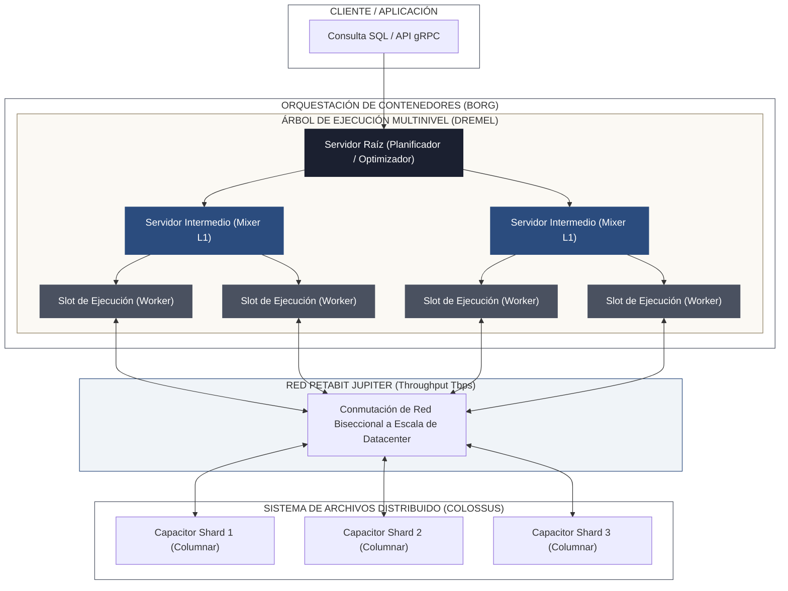
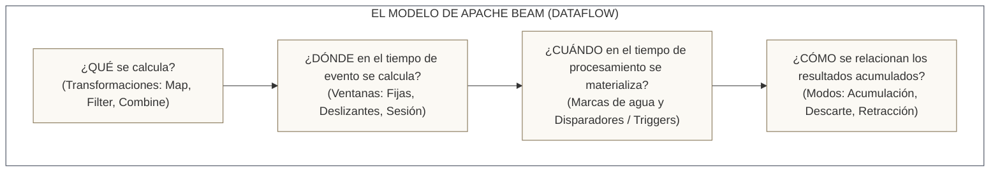
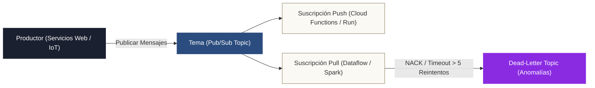

<!-- NOTAS FUENTE ORIGINALES DE OBSIDIAN: [[GCP Data Architecture]], [[Google BigQuery]], [[Google Cloud Dataflow]], [[Apache Beam]], [[Cloud PubSub]], [[Dataproc]], [[Dataplex]] -->

# Capítulo 29C: Arquitectura de Plataformas de Datos en Google Cloud (GCP): BigQuery, Dataflow, Pub/Sub y Dataproc [RECOMENDADO]

> *"Google Cloud Platform nació de la necesidad de procesar los datos de toda la web indexada. Sus contribuciones —desde MapReduce y Bigtable hasta Dremel, MillWheel y FlumeJava— definieron el estado del arte de la computación distribuida global. Dominar GCP exige comprender la separación radical entre almacenamiento y cómputo que hace posible BigQuery, el modelo unificado de streaming y batch de Apache Beam en Dataflow, la mensajería elástica de Pub/Sub y el tejido de gobernanza federada de Dataplex."*

---

## Objetivos de Aprendizaje
Al finalizar este capítulo, el lector será capaz de:
* Analizar los componentes arquitectónicos internos de **Google BigQuery** (Dremel, Colossus, Jupiter y Borg) y su impacto en el rendimiento de consultas a escala de petabytes.
* Optimizar la distribución física de tablas en BigQuery mediante **particionamiento por tiempo/rango** y **agrupamiento (*clustering*) multinivel**, minimizando los bytes escaneados y los costos operativos.
* Implementar ingesta de alto rendimiento con **BigQuery Storage Write API** y extracción masiva vectorizada con **BigQuery Storage Read API** y Apache Arrow.
* Diseñar pipelines unificados de batch y streaming en **Google Cloud Dataflow** utilizando el modelo formal de **Apache Beam** (ventanas de tiempo de evento, marcas de agua y disparadores).
* Orquestar mensajería distribuida asíncrona a nivel global con **Cloud Pub/Sub**, aplicando claves de ordenamiento (*ordering keys*) y colas de mensajes fallidos (*Dead-Letter Topics*).
* Desplegar cargas de trabajo de Apache Spark administrado con **Cloud Dataproc** (usando instancias *Spot* y clústeres efímeros) y **Dataproc Serverless**.
* Implementar gobernanza y linaje automatizado sobre el Data Lakehouse de GCP utilizando **Dataplex** y **Cloud Composer**.

---

> **Definición 29C.1 (El Data Cloud Nativo en GCP)**
> En Google Cloud Platform, la plataforma de datos opera bajo un modelo de desacoplamiento absoluto de tres capas:
> 1. **Almacenamiento de Objetos y Tablas:** Google Cloud Storage (GCS) y el sistema de almacenamiento columnar *Capacitor* en *Colossus*.
> 2. **Red de Comunicación Petabit:** La topología de red *Jupiter*, que conecta miles de ranuras de procesamiento (*slots*) al almacenamiento compartido con ancho de banda biseccional prácticamente ilimitado.
> 3. **Motores de Ejecución Serverless:** BigQuery para SQL analítico e interactivo, Dataflow (Apache Beam) para procesamiento unificado orientado a eventos, y Dataproc Serverless para transformaciones masivas en Apache Spark.

---

## 29C.1 Arquitectura Interna de Google BigQuery: Dremel, Colossus y Jupiter

A diferencia de los almacenes de datos tradicionales o de clústeres MPP que mantienen discos locales en cada nodo (como AWS Redshift con nodos densos clásicos), BigQuery implementa una arquitectura completamente desagregada:



### 1. Los Cuatro Pilares Fundamentales
1. **Dremel:** El motor de ejecución de consultas distribuido introducido por Google en 2010. Dremel compila las consultas SQL en un árbol de ejecución jerárquico (*Execution Tree*). El servidor raíz coordina la consulta, los servidores intermedios (*Mixers*) agregan resultados parciales y miles de hojas computacionales (*Slots*) leen y procesan datos en paralelo.
2. **Slots de BigQuery:** Un *slot* es la unidad virtual de cómputo en BigQuery (aproximadamente equivalente a 0.5 vCPUs y memoria asociada). BigQuery asigna dinámicamente cientos o miles de slots por consulta en milisegundos.
3. **Colossus y Capacitor:** Los datos no residen en los slots. Residen en **Colossus** (el sucesor de Google File System - GFS), replicados en múltiples zonas de disponibilidad con codificación de borrado (*erasure coding*). El formato de almacenamiento interno es **Capacitor**, un formato columnar altamente optimizado que precede a Apache Parquet y almacena estructuras anidadas y repetidas sin necesidad de aplanar tablas.
4. **Red Jupiter:** Permite que los slots lean datos desde los discos de Colossus a velocidades de petabits por segundo. Esto elimina la necesidad de localidad de datos (*data locality*) y hace posible que miles de núcleos procesen terabytes de datos sin transferencias de disco lentas.

---

## 29C.2 Optimización Física: Particionamiento y Clustering

En BigQuery, el rendimiento y el costo financiero de las consultas están directamente vinculados al volumen de bytes escaneados desde Colossus.

### 1. Particionamiento (Partitioning)
Divide una tabla física en segmentos basados en:
* **Tiempo de Ingesta:** Mediante la pseudocolumna `_PARTITIONTIME` o `_PARTITIONDATE`.
* **Columna de Fecha o Marca de Tiempo:** Una columna `DATE`, `DATETIME` o `TIMESTAMP` explícita en la tabla (ej. `fecha_venta`).
* **Rango de Enteros:** Por ejemplo, `id_cliente` particionado con inicio, fin e intervalo.

> **Regla de Producción:** BigQuery admite un límite máximo de **10.000 particiones por tabla**. Intentar particionar por una marca de tiempo con granularidad de hora a lo largo de varios años provocará un error inmediato de cuota.

### 2. Agrupamiento (Clustering)
Dentro de cada partición (o en una tabla sin particionar), el clustering ordena los datos físicamente por hasta **cuatro columnas** en orden jerárquico.
* A diferencia del particionamiento, el agrupamiento es ideal para **alta cardinalidad** (identificadores de usuario, códigos postales, estados de orden).
* BigQuery ejecuta **eliminación de bloques (*Block Pruning*)**: cuando una consulta incluye filtros con `WHERE` en las columnas clusterizadas, BigQuery omite la lectura de bloques completos de Capacitor, reduciendo drásticamente los bytes leídos y el tiempo de respuesta.
* **Auto-Reclustering:** BigQuery reordena los datos en segundo plano de manera autónoma sin costo computacional adicional para el usuario.

```sql
-- Creación de tabla optimizada con particionamiento diario y clustering jerárquico
CREATE OR REPLACE TABLE `proyecto_prod.gold.fact_transacciones`
(
    id_transaccion STRING NOT NULL,
    id_cliente INT64 NOT NULL,
    codigo_pais STRING NOT NULL,
    monto_usd NUMERIC(15, 2) NOT NULL,
    fecha_transaccion DATE NOT NULL,
    timestamp_creacion TIMESTAMP NOT NULL
)
PARTITION BY fecha_transaccion
CLUSTER BY codigo_pais, id_cliente
OPTIONS (
    description = "Tabla de hechos de transacciones globales optimizada para poda de bloques",
    require_partition_filter = TRUE
);
```

> **Buenas Prácticas:** La opción `require_partition_filter = TRUE` es fundamental en entornos corporativos. Evita que consultas analíticas ad-hoc o herramientas de BI ejecuten escaneos accidentales de toda la tabla (*Full Table Scan*), lo que podría costar miles de dólares en una sola ejecución bajo el modelo de facturación On-Demand.

---

## 29C.3 Ingesta y Extracción de Alto Rendimiento: Storage APIs

Históricamente, la ingesta en streaming hacia BigQuery utilizaba la API REST `tabledata.insertAll`, la cual presentaba latencias elevadas, carecía de semántica de escritura transaccional estricta y conllevaba costos adicionales por megabyte. En la actualidad, el estándar de ingeniería es la **BigQuery Storage API**:


### 1. BigQuery Storage Write API
* Utiliza conexiones bidireccionales **gRPC** con serialización binaria mediante **Protocol Buffers (Proto3)**.
* Proporciona **semántica exactamente una vez (*Exactly-Once Semantics*)** mediante offsets de flujo (*stream offsets*). Si la red se interrumpe y el cliente reintenta enviar el mismo registro con el mismo offset, BigQuery descarta el duplicado a nivel del motor.
* Admite flujos comprometidos (*Committed Streams*) para streaming continuo de baja latencia o flujos pendientes (*Pending Streams*) para transacciones multi-lote que se consolidan atómicamente con un *Commit*.

### 2. BigQuery Storage Read API
* Permite leer datos directamente desde Colossus en formato **Apache Arrow**, evitando la sobrecarga de serialización JSON y pasando por alto el motor SQL de Dremel.
* Divide la tabla en múltiples flujos de lectura paralelos que pueden ser consumidos concurrentemente por ejecutores de Spark, DuckDB o scripts de Python sin degradar el rendimiento del clúster.

```python
# Ejemplo de lectura masiva vectorizada con Storage Read API y Apache Arrow
from google.cloud import bigquery_storage
import pyarrow as pa

client = bigquery_storage.BigQueryReadClient()

# Definir la sesión de lectura sobre una tabla particionada
table = "projects/empresa-datos-prod/datasets/gold/tables/fact_transacciones"
read_options = bigquery_storage.types.ReadSession.TableReadOptions(
    selected_fields=["id_transaccion", "id_cliente", "monto_usd"],
    row_restriction="fecha_transaccion >= '2026-03-01' AND codigo_pais = 'CO'"
)

session = client.create_read_session(
    parent="projects/empresa-datos-prod",
    read_session=bigquery_storage.types.ReadSession(
        table=table,
        data_format=bigquery_storage.types.DataFormat.ARROW,
        read_options=read_options
    ),
    max_stream_count=4  # Dividir la lectura en 4 flujos paralelos
)

print(f"Sesión creada con {len(session.streams)} streams paralelos.")

# Consumir el primer stream en formato PyArrow Table (Zero-Copy)
stream_reader = client.read_rows(session.streams[0].name)
pages = stream_reader.rows(session)
tabla_arrow = pages.to_arrow()
print(f"Filas leídas en stream 0: {tabla_arrow.num_rows}")
```

---

## 29C.4 BigLake y Formatos Abiertos de Lakehouse

Para evitar la duplicación de datos entre almacenes relacionales y lagos de datos basados en objetos, Google Cloud ofrece **BigQuery BigLake**:
* **Abstracción Unificada:** Permite consultar tablas en formatos abiertos (**Apache Iceberg, Delta Lake y Apache Parquet**) almacenadas en Google Cloud Storage, AWS S3 o Microsoft Azure ADLS Gen2 mediante tablas externas federadas.
* **Seguridad y Control de Acceso Fino:** Aplica seguridad a nivel de filas, enmascaramiento dinámico de columnas y políticas de control de acceso (*IAM*) sin otorgar permisos directos sobre los buckets de almacenamiento a los analistas.
* **Caché de Metadatos:** Almacena en caché las estadísticas y la lista de archivos de Iceberg/Parquet en BigQuery, acelerando los tiempos de planificación de consultas en más de un 80%.

---

## 29C.5 Google Cloud Dataflow y el Modelo Formal de Apache Beam

**Google Cloud Dataflow** es el servicio serverless administrado para la ejecución de pipelines de procesamiento distribuido definidos mediante el SDK de **Apache Beam**.

El modelo de Apache Beam (formalizado por Tyler Akidau et al. en 2015) unifica el procesamiento de datos por lotes (*Batch*) y en tiempo real (*Streaming*) alrededor de cuatro interrogantes fundamentales:



### 1. Conceptos Fundamentales de Beam
* **`PCollection`:** Representa un conjunto de datos distribuido e inmutable. Puede ser acotado (*Bounded*, batch) o desacotado (*Unbounded*, streaming).
* **`PTransform`:** Una operación que toma una o más `PCollection` y produce nuevas `PCollection` (ej. `beam.Map`, `beam.Filter`, `beam.ParDo`, `beam.GroupByKey`).
* **`DoFn`:** La clase base donde el ingeniero implementa lógica personalizada elemento a elemento mediante el método `process()`.
* **Tiempo de Evento (*Event Time*) vs. Tiempo de Procesamiento (*Processing Time*):** El tiempo de evento es el momento en que ocurrió la acción en el mundo real (registrado en el evento). El tiempo de procesamiento es el reloj de la máquina que procesa el evento en Dataflow.

### 2. Ventanas y Marcas de Agua (Watermarks)
* **Ventana Fija (*Fixed Window*):** Intervalos de tiempo uniformes y disjuntos (ej. bloques de 5 minutos).
* **Ventana Deslizante (*Sliding Window*):** Intervalos continuos superpuestos (ej. una ventana de 1 hora calculada cada 10 minutos).
* **Ventana de Sesión (*Session Window*):** Agrupa eventos separados por períodos de inactividad específicos (ej. una sesión de navegación de usuario que expira tras 30 minutos sin clics).
* **Marca de Agua (*Watermark*):** Una noción temporal que estima hasta qué punto se han recibido los eventos de un determinado tiempo de evento. Cuando el watermark sobrepasa el final de una ventana, el motor asume que no llegarán más datos para dicha ventana y emite los resultados.

### 3. Pipeline Productivo de Streaming en Apache Beam (Python)

A continuación se presenta un pipeline completo de Dataflow que lee eventos desde Cloud Pub/Sub, extrae marcas de tiempo de evento, agrupa en ventanas fijas de 2 minutos, tolera datos tardíos (*late data*) durante 1 minuto adicional y escribe los resultados agregados en BigQuery:

```python
import apache_beam as beam
from apache_beam.options.pipeline_options import PipelineOptions, StandardOptions
import json

class ParseAndExtractTimestampDoFn(beam.DoFn):
    """ParDo para deserializar JSON y adjuntar Event Time explícito."""
    def process(self, element):
        try:
            payload = json.loads(element.decode("utf-8"))
            event_timestamp = payload["timestamp_evento"]  # Epoch en segundos
            yield beam.window.TimestampedValue(payload, event_timestamp)
        except Exception:
            # Enrutamiento hacia Dead Letter Topic en producción
            pass

class CalcularMetricasDoFn(beam.DoFn):
    """Calcula agregaciones sobre la ventana temporal consolidada."""
    def process(self, element, window=beam.DoFn.WindowParam):
        codigo_pais, transacciones = element
        total_monto = sum(t["monto"] for t in transacciones)
        conteo = len(transacciones)
        
        yield {
            "pais": codigo_pais,
            "total_monto": float(total_monto),
            "cantidad_transacciones": conteo,
            "ventana_inicio": window.start.to_utc_datetime().isoformat(),
            "ventana_fin": window.end.to_utc_datetime().isoformat()
        }

def run_pipeline():
    options = PipelineOptions()
    options.view_as(StandardOptions).streaming = True

    with beam.Pipeline(options=options) as p:
        (
            p
            | "LeerDePubSub" >> beam.io.ReadFromPubSub(
                subscription="projects/empresa-prod/subscriptions/sub-transacciones"
            )
            | "ParsearYAsignarTimestamp" >> beam.ParDo(ParseAndExtractTimestampDoFn())
            | "VentanaFija2Minutos" >> beam.WindowInto(
                beam.window.FixedWindows(120),  # 2 minutos en segundos
                allowed_lateness=60,            # Tolerar hasta 1 minuto de retraso
                accumulation_mode=beam.trigger.AccumulationMode.ACCUMULATING
            )
            | "ClavePorPais" >> beam.Map(lambda x: (x["pais"], x))
            | "AgruparPorPais" >> beam.GroupByKey()
            | "CalcularMetricas" >> beam.ParDo(CalcularMetricasDoFn())
            | "EscribirBigQuery" >> beam.io.WriteToBigQuery(
                table="empresa-prod:gold.metricas_tiempo_real_pais",
                schema="pais:STRING,total_monto:FLOAT,cantidad_transacciones:INTEGER,ventana_inicio:TIMESTAMP,ventana_fin:TIMESTAMP",
                write_disposition=beam.io.BigQueryDisposition.WRITE_APPEND,
                create_disposition=beam.io.BigQueryDisposition.CREATE_IF_NEEDED
            )
        )

if __name__ == "__main__":
    run_pipeline()
```

---

## 29C.6 Cloud Pub/Sub: Mensajería Global Asíncrona

Cloud Pub/Sub proporciona desacoplamiento horizontal entre productores y consumidores con disponibilidad multi-zona nativa.



### Características Clave en Arquitecturas de Datos
* **Claves de Ordenamiento (*Ordering Keys*):** Por defecto, Pub/Sub no garantiza el orden estricto de entrega. Si un conjunto de mensajes comparte la misma `ordering_key` (por ejemplo, el ID de una transacción bancaria), Pub/Sub los entrega en el orden exacto de publicación al consumidor.
* **Dead-Letter Topics (DLT):** Cuando un mensaje falla repetidamente durante el procesamiento (superando el límite configurado de reintentos o el tiempo de espera de acuse de recibo `ack_deadline`), Pub/Sub lo redirige a un tema secundario de descarte para análisis forense, impidiendo que bloquee la suscripción principal.
* **Pub/Sub Lite vs. Standard:** Pub/Sub Lite es un servicio particionado basado en capacidad fija (similar a Apache Kafka o AWS Kinesis), que reduce los costos hasta en un 80% para flujos de telemetría masiva con volumen predecible y retención por partición.

---

## 29C.7 Dataproc y Dataproc Serverless: Apache Spark en GCP

Para organizaciones con código base existente en Apache Spark, Presto o Trino, **Google Cloud Dataproc** ofrece dos modelos operativos:

### 1. Dataproc en Compute Engine (Clústeres Efímeros)
* Se provisiona en menos de 90 segundos.
* **Optimización de Costos:** Se recomienda configurar el nodo maestro (*Master*) con instancias estándar y los nodos de trabajo (*Workers*) como **Compute Engine Spot VMs**, reduciendo los costos computacionales hasta en un 80%.
* **Patrón de Clúster Efímero:** El clúster se crea mediante Cloud Composer o un script bash únicamente durante la ejecución del job de Spark y se destruye inmediatamente al finalizar, almacenando los datos resultantes directamente en Google Cloud Storage mediante el conector `gcs-connector`.

### 2. Dataproc Serverless
* Elimina por completo la necesidad de configurar nodos, versiones de sistema operativo o ajustes de tamaño de máquinas virtuales.
* El ingeniero envía directamente el script de PySpark o el artefacto JAR. Google asigna dinámicamente los recursos (*Data Compute Units - DCU*) y escala automáticamente según la carga de trabajo.

```bash
# Envío de un job de PySpark directamente a Dataproc Serverless vía gcloud CLI
gcloud dataproc batches submit pyspark gs://empresa-codigo/scripts/etl_ventas.py \
    --project=empresa-datos-prod \
    --region=us-central1 \
    --deps-bucket=gs://empresa-artefactos-temp \
    --version=2.2 \
    --properties=spark.executor.instances=10,spark.driver.memory=4g,spark.executor.memory=8g
```

---

## 29C.8 Gobernanza con Dataplex y Cloud Composer

* **Google Cloud Dataplex:** Es una malla de datos inteligente (*Data Mesh*) que centraliza la catalogación, el linaje y las reglas de calidad de datos a través de buckets de GCS y conjuntos de datos de BigQuery sin mover los datos. Permite ejecutar **DataScans** periódicos que validan reglas de integridad, nulidad y unicidad de forma nativa.
* **Cloud Composer:** Servicio totalmente administrado de **Apache Airflow** desplegado sobre Google Kubernetes Engine (GKE). Sincroniza automáticamente los DAGs almacenados en un bucket de GCS con los *Schedulers* y *Workers* de Airflow, interactuando de forma nativa con los operadores de GCP (`BigQueryInsertJobOperator`, `DataflowCreatePythonJobOperator`, `DataprocSubmitJobOperator`).

---

## 29C.9 Anti-Patrones Comunes en GCP

### Anti-Patrón 1: Consultas `SELECT *` en Tablas Grandes con Facturación On-Demand
* **El Error:** Ejecutar consultas exploratorias con `SELECT *` o sin filtros sobre tablas de terabytes en proyectos con facturación por volumen escaneado ($6.25 USD por TB).
* **Impacto en Producción:** Una sola consulta sobre una tabla de 20 TB cuesta $125 USD; diez analistas ejecutando consultas similares repetidamente pueden agotar presupuestos en días.
* **Solución:** Utilizar `require_partition_filter = TRUE`, seleccionar exclusivamente las columnas necesarias y evaluar **BigQuery Editions** con reservas fijas de slots si el consumo es continuo.

### Anti-Patrón 2: Uso de `tabledata.insertAll` para Streaming Masivo
* **El Error:** Utilizar la API REST legacy de streaming para ingestar millones de eventos por segundo.
* **Impacto:** Costos elevados por megabyte insertado, ausencia de garantías transaccionales exactamente una vez (*duplicates on network retry*) y latencia de inserción subóptima.
* **Solución:** Migrar a **BigQuery Storage Write API** con flujos comprometidos o por lotes vía gRPC.

### Anti-Patrón 3: Particionado por Columnas de Muy Alta Cardinalidad
* **El Error:** Crear particiones en BigQuery utilizando una columna como `id_usuario` o marcas de tiempo con precisión de minutos.
* **Impacto:** Falla de creación por superación del límite estricto de 10.000 particiones por tabla.
* **Solución:** Particionar por `DATE` (granularidad diaria) y aplicar `CLUSTER BY id_usuario` para aprovechar la poda física de bloques sin generar sobrecarga de metadatos.

---

## Resumen del Capítulo

* **Arquitectura de BigQuery:** Separa radicalmente cómputo y almacenamiento. Dremel procesa las consultas en un árbol jerárquico de slots orquestado por Borg; Colossus almacena los datos en formato columnar Capacitor; y la red Jupiter proporciona ancho de banda petabit para unir ambas capas.
* **Optimización en BigQuery:** El particionamiento divide la tabla por tiempo o rango (máximo 10.000 particiones). El agrupamiento (*clustering*) ordena físicamente los datos por hasta 4 columnas, permitiendo poda de bloques en filtros de alta cardinalidad.
* **Storage APIs:** La Storage Write API ofrece streaming de baja latencia con semántica exactamente una vez vía gRPC y Protocol Buffers. La Storage Read API permite escaneos masivos en formato Apache Arrow con cero copia.
* **Apache Beam en Dataflow:** Responde formalmente a qué se computa, dónde en el tiempo de evento, cuándo en el tiempo de procesamiento y cómo se relacionan los resultados acumulados, gestionando marcas de agua y datos tardíos de forma nativa.
* **Pub/Sub y Dataproc:** Pub/Sub resuelve la mensajería asíncrona global con claves de ordenamiento y colas de descarte. Dataproc permite ejecutar clústeres efímeros de Spark con instancias Spot y Dataproc Serverless elimina la administración de infraestructura.

---

## Preguntas de Revisión y Ejercicios Prácticos
### Pregunta 1: Análisis de Costos y Poda de Bloques en BigQuery
Una tabla de BigQuery contiene 15 TB de transacciones distribuidas en 3 años. La tabla está particionada por `fecha_transaccion` (diaria) y clusterizada por `codigo_pais` y `id_tienda`. Un analista ejecuta la siguiente consulta:
```sql
SELECT SUM(monto) 
FROM `empresa.gold.transacciones`
WHERE fecha_transaccion BETWEEN '2026-03-01' AND '2026-03-07'
  AND id_tienda = 4521;
```
1. ¿Cómo opera la poda de datos en esta consulta?
2. ¿Por qué el agrupamiento por `id_tienda` es menos eficiente en esta consulta que si se hubiera filtrado también por `codigo_pais`?

#### Solución Detallada:
1. **Poda de Particiones:** BigQuery utiliza la cláusula `BETWEEN '2026-03-01' AND '2026-03-07'` para podar las particiones físicas en Colossus. De los 3 años de datos (1.095 particiones), BigQuery únicamente lee 7 particiones diarias, reduciendo el escaneo inicial de 15 TB a aproximadamente 96 GB.
2. **Poda de Bloques en Clustering:** El agrupamiento se definió jerárquicamente como `CLUSTER BY codigo_pais, id_tienda`. Al igual que en un índice compuesto de base de datos relacional, los datos se ordenan primero por `codigo_pais` y luego por `id_tienda`. Como la consulta omite el filtro de `codigo_pais` y filtra directamente por `id_tienda`, el optimizador de BigQuery no puede saltar rangos contiguos con máxima eficiencia, debiendo escanear más bloques de Capacitor dentro de cada una de las 7 particiones que si se hubiera incluido el país o si `id_tienda` fuera la primera columna del clustering.

---

### Pregunta 2: Manejo de Datos Tardíos en Apache Beam / Dataflow
Explique la diferencia entre una ventana fija de 5 minutos con `allowed_lateness = 0` y una con `allowed_lateness = 10 minutos`. ¿Qué ocurre con un evento que ocurrió a las `12:02:00` pero llega a Dataflow a las `12:09:00` debido a una desconexión de red en el cliente?

#### Solución Detallada:
1. **Con `allowed_lateness = 0`:** La ventana de tiempo de evento correspondiente es `[12:00:00, 12:05:00)`. Cuando el *Watermark* de Dataflow supera las `12:05:00`, la ventana se evalúa, se emite el resultado y se destruye el estado de la ventana en memoria. Si el evento llega a las `12:09:00` (tiempo de procesamiento), el evento se considera **dato tardío (*droppped late data*)** y se descarta silenciosamente.
2. **Con `allowed_lateness = 10 minutos`:** El estado de la ventana `[12:00:00, 12:05:00)` se mantiene activo en el *Streaming Engine* hasta que el Watermark alcanza las `12:15:00`. Cuando el evento tardío llega a las `12:09:00`, Dataflow reactiva la ventana, computa la actualización y emite una nueva versión corregida del resultado acumulado según el modo de acumulación configurado (`ACCUMULATING` o `RETRACTING`).

---

## Lecturas Recomendadas
* Melnik, S., Gubarev, A., Long, J. J., Romer, G., Shivakumar, S., Tolton, M., & Vassilakis, T. (2010). *Dremel: Interactive Analysis of Web-Scale Datasets*. Proceedings of the VLDB Endowment (PVLDB), 3(1-2), 330-339.
* Akidau, T., Bradshaw, R., Chambers, C., Chernyak, S., Fernández-Moctezuma, R. J., Lax, R., McVeety, S., Mills, D., Perry, F., Schmidt, E., & Whittle, S. (2015). *The Dataflow Model: A Practical Approach to Balancing Correctness, Latency, and Cost in Massive-Scale, Unbounded, Out-of-Order Data Processing*. Proceedings of the VLDB Endowment (PVLDB), 8(12), 1792-1803.
* Akidau, T., Chernyak, S., & Lax, R. (2018). *Streaming Systems: The What, Where, When, and How of Large-Scale Data Processing*. O'Reilly Media.
* Kleppmann, M. (2017). *Designing Data-Intensive Applications*. O'Reilly Media.
