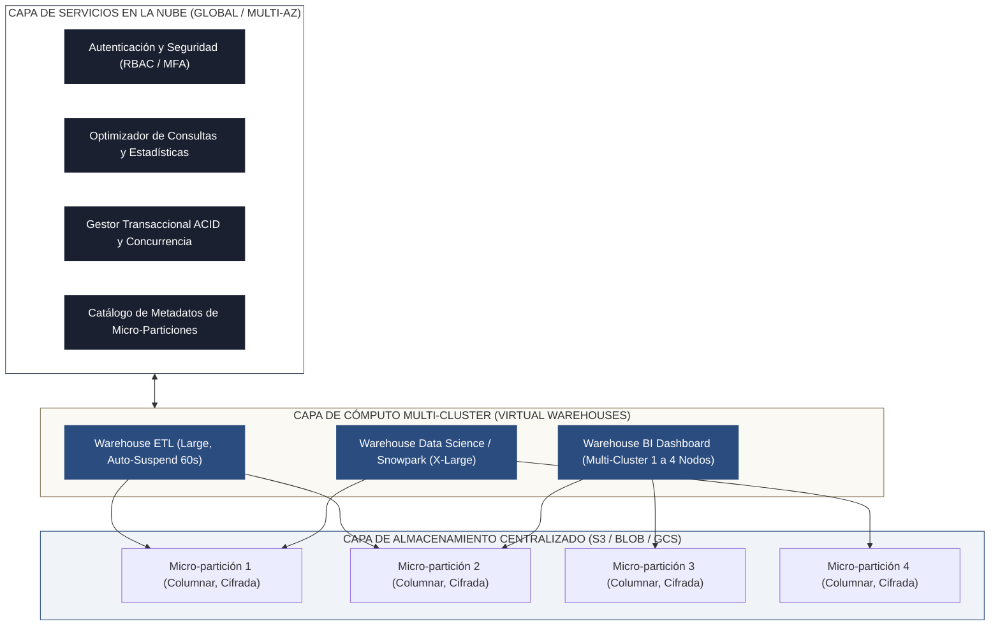
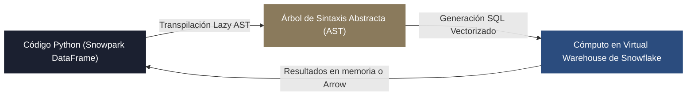
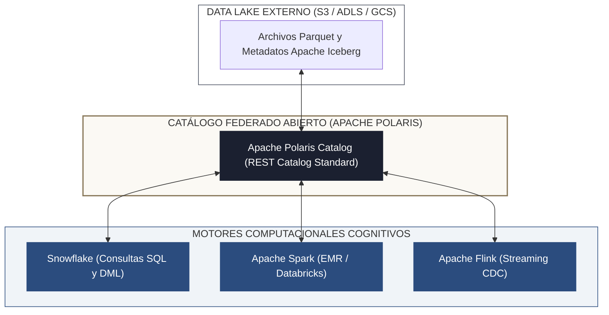

<!-- NOTAS FUENTE ORIGINALES DE OBSIDIAN: [[Snowflake Architecture]], [[Snowpark]], [[Dynamic Tables]], [[Snowpipe Streaming]], [[Apache Polaris]] -->

# Capítulo 29D: Plataforma Snowflake Empresarial: Arquitectura Multi-Cluster, Snowpark, Dynamic Tables, Snowpipe y Polaris Catalog [RECOMENDADO]

> *"Snowflake revolucionó la industria analítica al ser el primer almacén de datos diseñado desde cero para la nube pública bajo una arquitectura de datos compartidos multi-clúster. Desacopló el cómputo del almacenamiento y automatizó la gestión de infraestructura con micro-particiones transparentes. Dominar Snowflake a nivel senior requiere trascender el SQL interactivo para dominar Snowpark, el modelado declarativo con Dynamic Tables, la ingesta de subsegundos con Snowpipe Streaming y la convergencia abierta del Lakehouse mediante Apache Iceberg y Apache Polaris Catalog."*

---

## Objetivos de Aprendizaje
Al finalizar este capítulo, el lector será capaz de:
* Analizar los fundamentos de la **arquitectura multi-clúster de datos compartidos (*Multi-Cluster Shared Data*)** de Snowflake y la separación entre *Cloud Services*, *Virtual Warehouses* y almacenamiento centralizado.
* Evaluar el funcionamiento interno del **micro-particionamiento automático** y optimizar la poda de particiones mediante *Clustering Keys* y el servicio de *Automatic Clustering*.
* Implementar operaciones de recuperación histórica con **Time Travel** y clonación sin duplicación física mediante **Zero-Copy Cloning**.
* Construir pipelines de datos programáticos utilizando **Snowpark Python**, ejecutando transformaciones vectorizadas directamente en el motor de Snowflake.
* Diseñar flujos continuos de ingesta en tiempo real con **Snowpipe Streaming**, reduciendo la latencia de ingestión de minutos a milisegundos.
* Desarrollar arquitecturas de transformación declarativa utilizando **Dynamic Tables** y evaluar sus diferencias frente a la orquestación clásica de *Streams & Tasks*.
* Integrar Snowflake con el ecosistema de Lakehouse abierto mediante **tablas Apache Iceberg** y el catálogo federado **Apache Polaris Catalog**.

---

> **Definición 29D.1 (La Arquitectura Multi-Cluster Shared-Data)**
> Snowflake implementa una arquitectura híbrida entre los sistemas de disco compartido (*Shared-Disk*) y los sistemas sin recursos compartidos (*Shared-Nothing*). Se compone de tres capas desacopladas:
> 1. **Capa de Almacenamiento Centralizado (Storage Layer):** Almacena todos los datos en almacenamiento de objetos (Amazon S3, Azure Blob o GCS) organizados en micro-particiones inmutables y columnarizadas.
> 2. **Capa de Cómputo Elástico (Multi-Cluster Compute Layer):** Clústeres de cómputo independientes (*Virtual Warehouses*) que operan bajo un modelo *Shared-Nothing* sobre los mismos datos compartidos sin contención entre consultas.
> 3. **Capa de Servicios en la Nube (Cloud Services Layer):** Coordina transacciones ACID, optimización de consultas, control de acceso basado en roles (RBAC) y el catálogo global de metadatos.

---

## 29D.1 Las Tres Capas Arquitectónicas de Snowflake

A diferencia de los almacenes MPP heredados donde agregar capacidad computacional obligaba a redistribuir físicamente los datos en disco, Snowflake separa completamente el cómputo del almacenamiento:



### 1. Virtual Warehouses y Dimensionamiento
* Cada *Virtual Warehouse* es un clúster de máquinas virtuales asignadas dinámicamente.
* Se dimensionan en tallas *T-Shirt* (`X-Small`, `Small`, `Medium`, `Large`, `X-Large`, etc.), donde cada salto de talla duplica el número de nodos y la potencia computacional (y por ende el consumo de créditos por hora: 1, 2, 4, 8, 16 créditos).
* **Multi-Cluster Warehouses:** Permiten que Snowflake agregue automáticamente clústeres adicionales en paralelo cuando el número de consultas concurrentes excede la capacidad de un solo warehouse, evitando la degradación de dashboards ejecutivos.

---

## 29D.2 Micro-Particionamiento y Poda de Consultas

En Snowflake, el usuario no define particiones manuales en el disco. Todas las tablas se dividen automáticamente en **micro-particiones**:
* Cada micro-partición contiene entre **50 MB y 500 MB** de datos no comprimidos.
* Los datos se almacenan de forma columnar y están fuertemente comprimidos.
* **Inmutabilidad:** Las micro-particiones nunca se modifican en el sitio (*In-Place*). Cualquier actualización (`UPDATE`), eliminación (`DELETE`) o inserción (`INSERT`) genera nuevas micro-particiones y marca las anteriores como históricas para el control de versiones.

```sql
-- Creación de tabla y definición de clave de agrupamiento (Clustering Key)
CREATE OR REPLACE TABLE empresa_dw.gold.fact_ordenes (
    id_orden STRING NOT NULL,
    id_cliente INT64 NOT NULL,
    pais_origen STRING NOT NULL,
    monto_total_usd NUMBER(12, 2) NOT NULL,
    fecha_orden DATE NOT NULL,
    timestamp_creacion TIMESTAMP_NTZ NOT NULL
)
CLUSTER BY (fecha_orden, pais_origen);

-- Consulta de verificación de la profundidad de clustering
SELECT SYSTEM$CLUSTERING_INFORMATION('empresa_dw.gold.fact_ordenes', '(fecha_orden, pais_origen)');
```

### Poda de Micro-Particiones (Partition Pruning)
La capa de *Cloud Services* mantiene metadatos exhaustivos de cada micro-partición:
* Valores mínimos y máximos de cada columna.
* Número de valores distintos (NDV).
* Recuento de valores nulos.

Cuando una consulta ejecuta un filtro `WHERE fecha_orden >= '2026-03-01'`, el optimizador consulta los metadatos y **omite el 95% de las micro-particiones sin leerlas de disco**.

---

## 29D.3 Time Travel y Zero-Copy Cloning

### 1. Snowflake Time Travel
Permite consultar datos históricos en cualquier instante dentro del período de retención (hasta 90 días en la edición Enterprise):

```sql
-- Consultar una tabla tal como existía hace exactamente 2 horas
SELECT * 
FROM empresa_dw.gold.fact_ordenes 
AT (OFFSET => -60*120);

-- Consultar el estado de los datos antes de la ejecución de una consulta errónea
SELECT * 
FROM empresa_dw.gold.fact_ordenes 
BEFORE (STATEMENT => '01b7a2d3-0001-4f9a-0000-0002568a9b12');

-- Restaurar una tabla accidentalmente borrada con UNDROP
UNDROP TABLE empresa_dw.gold.fact_ordenes;
```

### 2. Zero-Copy Cloning
Permite clonar instantáneamente una tabla, esquema o base de datos completa de petabytes mediante la directiva `CLONE`:
* No se copian los datos en disco; solo se duplican los metadatos de las micro-particiones.
* La operación se completa en menos de un segundo y tiene costo cero de almacenamiento en el momento de creación.
* A medida que el entorno clonado sufre modificaciones, solo las nuevas micro-particiones modificadas generan costos adicionales.

```sql
-- Clonación instantánea de una base de datos de producción hacia un entorno de staging
CREATE DATABASE empresa_dw_staging CLONE empresa_dw;
```

---

## 29D.4 Snowpark Python: Computación Distribuida Nativa

**Snowpark** proporciona una API de programación en Python, Scala y Java que traslada la comodidad de bibliotecas como Pandas y PySpark directamente al motor elástico de Snowflake:



* **Evaluación Perezosa (*Lazy Evaluation*):** Las operaciones sobre DataFrames de Snowpark no mueven datos a la máquina local del cliente; se traducen a SQL optimizado y se ejecutan vectorialmente en los nodos del Virtual Warehouse.
* **Integración con Anaconda:** Permite ejecutar paquetes como `numpy`, `scipy` y `scikit-learn` en funciones definidas por el usuario (UDFs) y procedimientos almacenados sin necesidad de gestionar entornos virtuales en los nodos.

```python
# Pipeline de enriquecimiento con Snowpark Python
from snowflake.snowpark import Session
from snowflake.snowpark.functions import col, when, sum as _sum

def procesar_metricas_ventas(session: Session):
    df_ordenes = session.table("empresa_dw.gold.fact_ordenes")
    
    df_metricas = (
        df_ordenes
        .filter(col("fecha_orden") >= "2026-01-01")
        .group_by("pais_origen")
        .agg(_sum("monto_total_usd").alias("total_usd"))
        .with_column(
            "categoria_mercado",
            when(col("total_usd") > 1_000_000, "Mercado Tier 1")
            .otherwise("Mercado Tier 2")
        )
    )
    
    # Escribir de vuelta a una tabla gestionada con sobreescritura
    df_metricas.write.mode("overwrite").save_as_table("empresa_dw.gold.metricas_pais_2026")
```

---

## 29D.5 Ingesta Continua: Snowpipe y Snowpipe Streaming

| Característica | Snowpipe Clásico | Snowpipe Streaming |
| :--- | :--- | :--- |
| **Mecanismo de Ingesta** | Basado en archivos escenificados en Stage (S3 / GCS / Azure) | API SDK gRPC que envía filas de datos en memoria |
| **Latencia Típica** | 1 a 5 minutos | **200 a 1.000 milisegundos (Subsegundo)** |
| **Costo de Ingesta** | Cargo por archivo notificado + cómputo serverless | Cargo directo por gigabyte transferido en memoria |
| **Garantías de Entrega** | Consistencia eventual basada en eventos de archivos | **Exactly-Once Semantics** mediante control de offsets |

Snowpipe Streaming permite a conectores de Kafka, Flink y microservicios escribir flujos de eventos directamente en tablas de Snowflake sin la sobrecarga de escribir y consolidar micro-archivos intermedios en S3.

---

## 29D.6 Transformación Declarativa: Dynamic Tables vs. Streams & Tasks

Durante años, la implementación de CDC en Snowflake requería combinar **Streams** (que capturan cambios DML con metadatos de inserción, actualización y borrado) y **Tasks** (que ejecutan sentencias programadas):

```sql
-- Creación de una Dynamic Table con actualización incremental declarativa
CREATE OR REPLACE DYNAMIC TABLE empresa_dw.gold.resumen_clientes_activo
    TARGET_LAG = '5 MINUTES'
    WAREHOUSE = wh_transformacion
AS
SELECT 
    c.id_cliente,
    c.nombre,
    c.pais,
    COUNT(o.id_orden) AS total_ordenes,
    COALESCE(SUM(o.monto_total_usd), 0) AS total_gastado_usd,
    MAX(o.fecha_orden) AS ultima_compra
FROM empresa_dw.silver.clientes c
LEFT JOIN empresa_dw.gold.fact_ordenes o ON c.id_cliente = o.id_cliente
GROUP BY c.id_cliente, c.nombre, c.pais;
```

* **`TARGET_LAG`:** El ingeniero no especifica *cuándo* debe correr la consulta, sino *qué tan frescos* deben ser los datos (ej. `5 MINUTES`, `1 HOUR` o `DOWNSTREAM`).
* **Actualización Incremental Autónoma:** El motor de Snowflake analiza el plan de consulta y aplica únicamente los cambios delta desde la última ejecución, calculando el grafo de dependencias acíclico (DAG) entre tablas dinámicas automáticamente.

---

## 29D.7 Snowflake y el Lakehouse Abierto: Apache Iceberg y Apache Polaris

Para evitar el bloqueo de proveedor (*Vendor Lock-in*), Snowflake introdujo el soporte nativo de **tablas Apache Iceberg**:



* **Tablas Iceberg en Snowflake:** Permiten almacenar los datos en formato Parquet estándar dentro de los buckets de S3 propios del cliente, manteniendo el catálogo y las operaciones transaccionales sincronizadas.
* **Apache Polaris Catalog:** En 2024, Snowflake liberó como proyecto de código abierto **Polaris**, un catálogo federado basado en la especificación de API REST de Apache Iceberg. Permite que Snowflake, Apache Spark, Trino y Flink lean y escriban concurrentemente sobre las mismas tablas Iceberg sin fricciones ni silos propietarios.

---

## 29D.8 Anti-Patrones Comunes en Snowflake

### Anti-Patrón 1: Configurar Warehouses con Suspensión Desactivada (`AUTO_SUSPEND = 0`)
* **El Error:** Dejar los clústeres de cómputo encendidos indefinidamente para evitar latencias de encendido de 2 segundos.
* **Impacto en Producción:** Un warehouse de talla `Large` (8 créditos/hora a ~$3 USD/crédito) encendido 24/7 sin ejecutar consultas cuesta más de **$17.000 USD al mes** en recursos ociosos.
* **Solución:** Configurar siempre `AUTO_SUSPEND = 60` (1 minuto para cargas interactivas) y `AUTO_RESUME = TRUE`.

### Anti-Patrón 2: Un Único Warehouse Sobredimensionado para Todas las Cargas
* **El Error:** Utilizar un warehouse `2X-Large` tanto para tareas de ETL pesadas como para dashboards de BI y consultas ad-hoc de analistas.
* **Impacto:** Consultas simples de dashboards pagan tarifas de 32 créditos/hora innecesariamente y bloquean recursos de ETL.
* **Solución:** Aplicar segregación funcional de warehouses: un warehouse dedicado para ingestión, otro para transformaciones nocturnas y un multi-cluster warehouse para consumo de usuarios.

---

## Resumen del Capítulo

* **Arquitectura Multi-Cluster:** Desacopla almacenamiento centralizado en objetos, cómputo en Virtual Warehouses elásticos y servicios en la nube globales, eliminando la contención de recursos.
* **Micro-Particiones:** Bloques inmutables de 50 a 500 MB con metadatos automáticos que permiten poda masiva de consultas sin particionamiento físico manual.
* **Time Travel y Zero-Copy Cloning:** Permiten viajar en el tiempo hasta por 90 días y clonar bases de datos completas en segundos sin duplicar almacenamiento físico.
* **Snowpark y Dynamic Tables:** Modernizan el desarrollo de pipelines mediante ejecución vectorizada en Python y transformaciones incrementales declarativas con `TARGET_LAG`.
* **Convergencia Abierta:** El soporte de tablas Apache Iceberg y la liberación de **Apache Polaris Catalog** integran a Snowflake en el estándar universal de Lakehouse multi-motor.

---

## Preguntas de Revisión y Ejercicios Prácticos
### Pregunta 1: FinOps y Selección de Warehouses
Una empresa procesa un trabajo de transformación de datos una vez al día. En un warehouse `Small` (2 créditos/hora), el trabajo tarda **60 minutos**. En un warehouse `Medium` (4 créditos/hora), el trabajo tarda **30 minutos**. En un warehouse `Large` (8 créditos/hora), el trabajo tarda **25 minutos**. ¿Cuál configuración es óptima desde la perspectiva de costo y por qué?

#### Solución Detallada:
1. **Cálculo de Consumo de Créditos:**
   * `Small`: 2 créditos/hora × (60/60 horas) = **2.0 créditos**.
   * `Medium`: 4 créditos/hora × (30/60 horas) = **2.0 créditos**.
   * `Large`: 8 créditos/hora × (25/60 horas) = **3.33 créditos**.
2. **Evaluación:**
   * La opción `Medium` duplica la velocidad respecto a `Small` (30 min vs 60 min) consumiendo exactamente los mismos **2.0 créditos**, debido al paralelismo lineal perfecto.
   * La opción `Large` solo reduce el tiempo a 25 min (retornos decrecientes por sobrecarga de coordinación) y aumenta el costo en un **66.5%** (3.33 créditos).
   * **Conclusión:** La configuración óptima es el warehouse **`Medium`**, ya que maximiza la reducción de latencia sin incurrir en ningún sobrecosto crediticio.

---

### Pregunta 2: Mecánica de Zero-Copy Cloning y Almacenamiento
Si se ejecuta `CREATE TABLE ordenes_qa CLONE fact_ordenes;` sobre una tabla de producción de 10 TB, y posteriormente se insertan 500 GB de nuevos registros en `ordenes_qa`, ¿cuánto almacenamiento factura Snowflake por la tabla clonada?

#### Solución Detallada:
1. Al momento de la clonación, Snowflake genera una nueva entrada en el catálogo de metadatos apuntando a las mismas micro-particiones de `fact_ordenes`. El almacenamiento facturado atribuible al clon es **0 bytes**.
2. Cuando se insertan 500 GB de datos nuevos en `ordenes_qa`, Snowflake escribe nuevas micro-particiones exclusivas para el clon.
3. El almacenamiento total facturado por `ordenes_qa` es exactamente **500 GB**, manteniendo los 10 TB originales compartidos sin duplicación.

---

## Lecturas Recomendadas
* Dageville, B., Cruanes, T., Zukowski, M., Antonov, V., Avanes, A., Bock, P., Claybaugh, B., Engovatov, D., Hentschel, M., Huang, J., Lee, A. W., Motivala, A., Munir, A. Q., Pelley, S., Povinec, P., Rahn, G., Triantafyllis, S., & Unterbrunner, P. (2016). *The Snowflake Elastic Data Warehouse*. Proceedings of the 2016 International Conference on Management of Data (SIGMOD '16), 215-226.
* Avila, J. K. (2022). *Snowflake: The Definitive Guide: Architecting, Designing, and Deploying on the Snowflake Data Cloud*. O'Reilly Media.
* Kleppmann, M. (2017). *Designing Data-Intensive Applications*. O'Reilly Media.
