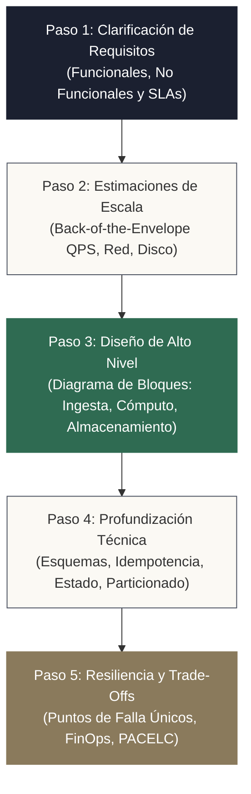
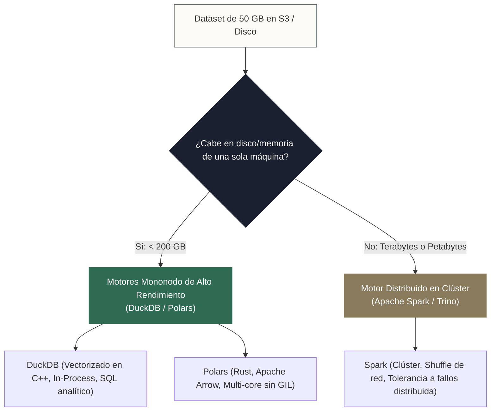
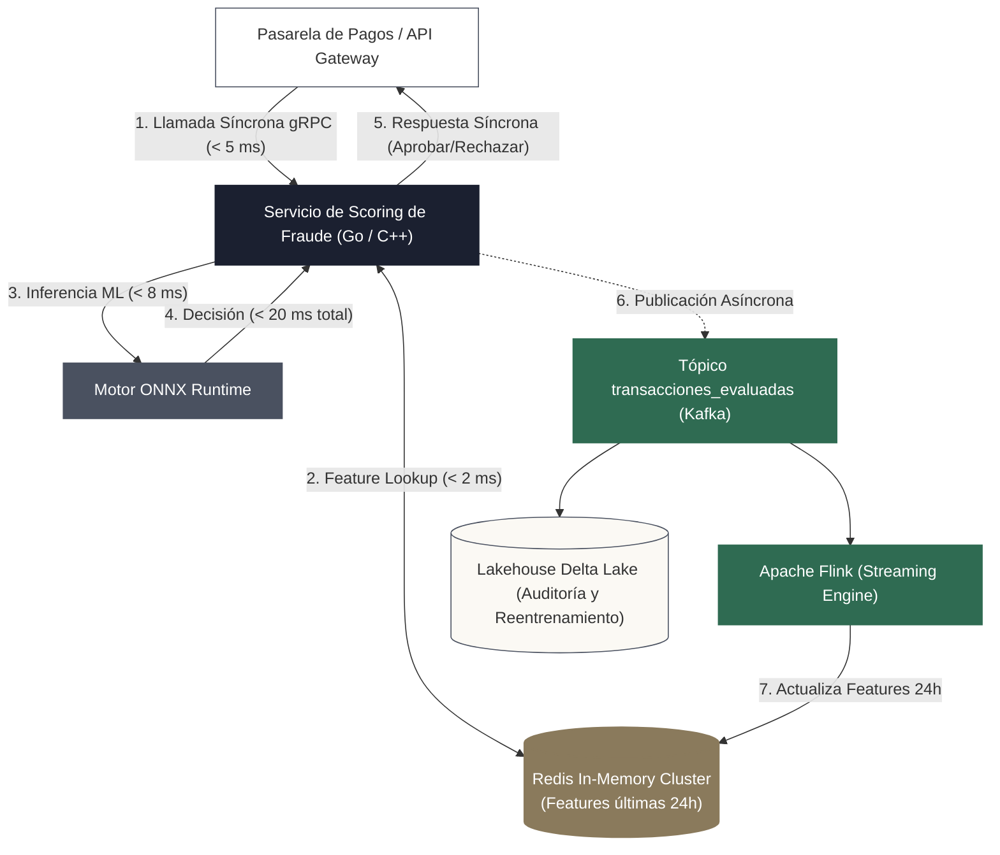
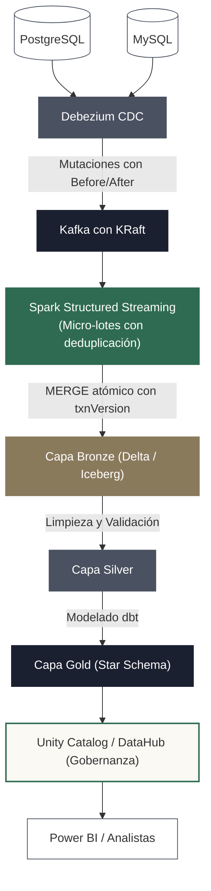

<!-- NOTAS FUENTE ORIGINALES DE OBSIDIAN: [[System Design en Datos]], [[Entrevistas Senior]], [[Sizing y FinOps]] -->

# Capítulo 30: System Design para Data Engineers y Preparación para Roles Senior [AVANZADO]

> *"Un ingeniero junior se enfoca en hacer que el código funcione. Un ingeniero intermedio se enfoca en optimizar la consulta y reducir los tiempos de ejecución. Un ingeniero senior se enfoca en el diseño del sistema: analiza los trade-offs entre latencia, consistencia, costo y mantenibilidad, sabiendo con precisión cuándo usar una herramienta masiva y, más importante aún, cuándo evitarla."*

---

## Objetivos de Aprendizaje
Al finalizar este capítulo, el lector será capaz de:
* Aplicar el marco metodológico de 5 pasos para resolver entrevistas y proyectos de **System Design** en ingeniería de datos.
* Ejecutar estimaciones rápidas de escala y volumetría (*Back-of-the-Envelope Calculations*) para justificar decisiones de arquitectura.
* Dominar los fundamentos teóricos distribuidos: **Teorema CAP**, **Teorema PACELC** y la consistencia ajustable de bases NoSQL.
* Discernir con criterio cuantitativo **cuándo NO usar Apache Spark**, evaluando motores modernos sobre un solo nodo como **DuckDB** y **Polars**.
* Diseñar arquitecturas de referencia desacoplando rutas síncronas de baja latencia frente a rutas asíncronas de streaming y analítica.
* Defender decisiones arquitectónicas ante comités técnicos senior mediante la transcripción simulada de una entrevista de diseño.

---

> **Definición 30.1 (System Design en Ingeniería de Datos)**
> 
> El **System Design para Data Engineering** es la disciplina arquitectónica orientada a definir la topología, componentes, protocolos de comunicación, modelos de almacenamiento y estrategias de particionamiento necesarios para satisfacer requisitos analíticos y operacionales a escala, equilibrando explícitamente los compromisos entre:
> * **Disponibilidad vs. Consistencia** (Teorema CAP y PACELC).
> * **Latencia de procesamiento vs. Rendimiento global (Throughput)**.
> * **Costo financiero en la nube (FinOps) vs. Complejidad operativa**.

---

## 30.1 Los Teoremas CAP y PACELC en Sistemas Distribuidos

Para justificar la elección de almacenes de datos ante un comité técnico, el ingeniero debe dominar los modelos formales de consistencia distribuida:

### 1. El Teorema CAP (Brewer)
En un sistema distribuido con particiones de red inevitables ($P$):
* **Consistencia ($C$):** Toda lectura recibe la escritura más reciente o un error.
* **Disponibilidad ($A$):** Toda petición no defectuosa recibe una respuesta (sin garantía de ser la más reciente).
* **Tolerancia a Particiones ($P$):** El sistema sigue funcionando a pesar de pérdidas o retrasos arbitrarios de mensajes en la red.
Dado que la red física siempre puede particionarse, un sistema debe elegir entre **CP** (abortar peticiones para evitar datos inconsistentes) o **AP** (responder con datos potencialmente obsoletos para mantener la disponibilidad).

### 2. El Teorema PACELC (Abadi)
El Teorema CAP solo describe el comportamiento del sistema cuando ocurre una partición de red. Daniel Abadi formuló el **Teorema PACELC** para modelar también el estado de operación normal:

> **Si hay una Partición ($P$):** ¿Cómo elige el sistema entre Disponibilidad ($A$) y Consistencia ($C$)?  
> **Else ($E$, en operación normal sin fallos):** ¿Cómo elige entre Latencia ($L$) y Consistencia ($C$)?

```
                            [ TEOREMA PACELC ]
                                    │
           ┌────────────────────────┴────────────────────────┐
   [ Si hay Partición (P) ]                         [ En Estado Normal (E) ]
           │                                                 │
     ┌─────┴─────┐                                     ┌─────┴─────┐
  [ AP ]       [ CP ]                               [ EL ]       [ EC ]
(Prioriza   (Prioriza                             (Prioriza   (Prioriza
Disponib.)  Consistencia)                         Latencia)  Consistencia)
```

* **Sistemas PC/EC (ej. Bigtable, MongoDB primario):** En partición priorizan consistencia; en operación normal pagan mayor latencia sincrónica para asegurar réplicas consistentes.
* **Sistemas PA/EL (ej. Amazon Dynamo, Cassandra predeterminado):** En partición priorizan disponibilidad; en operación normal priorizan mínima latencia mediante escrituras asíncronas y consistencia eventual.

---

## 30.2 Marco Metodológico de 5 Pasos para System Design

Ante una pregunta abierta de diseño arquitectónico, el peor error es comenzar enumerando herramientas (por ejemplo: *"usaría Kafka, Flink y Spark"*). El estándar para roles Senior y Staff exige estructurar la respuesta en cinco fases:



1. **Clarificación de Requisitos:** Delimite el alcance funcional (qué queries se responderán) y no funcional (latencia requerida, frescura de datos, presupuesto mensual, durabilidad).
2. **Estimaciones de Escala (Back-of-the-Envelope):** Calcule transacciones por segundo (QPS), ancho de banda de red en MB/s y volumen acumulado de almacenamiento a 1 y 3 años.
3. **Diseño de Alto Nivel:** Trace el flujo continuo de extremo a extremo desacoplando capas.
4. **Profundización Técnica granular:** Justifique formatos de archivo, particionamiento de tópicos, algoritmos de deduplicación y garantías transaccionales.
5. **Resiliencia, Cuellos de Botella y FinOps:** Identifique puntos únicos de falla (*SPOF*), estrategias de reintento (*Circuit Breakers*) y optimización de costos.

---

## 30.3 Cálculos Rápidos de Escala (Back-of-the-Envelope)

Un ingeniero senior no adivina el hardware; lo calcula en una servilleta en 60 segundos utilizando órdenes de magnitud:

### Constantes de Referencia Esenciales
* **Segundos en un día:** $86.400 \approx 10^5 \text{ segundos}$ (para cálculos mentales rápidos).
* **Throughput de red por nodo moderno:** $\approx 1 \text{ a } 10 \text{ Gbps}$ ($\approx 125 \text{ MB/s a } 1.25 \text{ GB/s}$).
* **Lectura secuencial SSD NVMe:** $\approx 3.000 \text{ MB/s}$; Lectura en red S3 por prefijo: $\approx 100 \text{ a } 200 \text{ MB/s}$.

### Fórmula de Caudal (Throughput)
$$\text{QPS Promedio} = \frac{\text{Eventos Diarios}}{86.400} \approx \frac{\text{Eventos Diarios}}{100.000}$$
$$\text{QPS Pico} \approx 2\times \text{ a } 3\times \text{ el QPS Promedio}$$

$$\text{Ancho de Banda (MB/s)} = \text{QPS} \times \text{Tamaño Medio del Evento (KB)} / 1.024$$

---

## 30.4 Cuándo NO Usar Apache Spark: Motores Mononodo (DuckDB y Polars)

El mayor anti-patrón de la industria es desplegar un clúster distribuido de Spark para procesar datasets de unos pocos gigabytes. El costo de inicialización de la JVM, serialización de shuffle y latencia de red hace que Spark sea órdenes de magnitud más lento que un motor columnar sobre un único nodo:



### 1. DuckDB: El SQLite de la Analítica Columnares
* **Vectorización y Procesamiento Fuera de Núcleo (*Out-of-Core*):** Puede procesar datasets de cientos de gigabytes que superan la memoria RAM disponible haciendo streaming eficiente contra discos SSD/NVMe locales.
* **Cero Dependencias Externas:** Se ejecuta como una librería embebida en Python (`import duckdb`) o como binario independiente sin requerir la JVM ni configuración de clústeres.
* **Lectura Directa:** Consulta directamente archivos Parquet, Delta Lake o Iceberg en Amazon S3 mediante sentencias SQL estándar a velocidades de gigabytes por segundo.

```python
import duckdb

# Ejecución analítica instantánea sobre Parquet en S3 sin necesidad de clúster Spark
con = duckdb.connect()
df_resumen = con.execute("""
    SELECT 
        date_trunc('day', fecha_transaccion) AS dia,
        pais,
        count(*) AS total_ventas,
        sum(monto) AS facturacion_total
    FROM read_parquet('s3://lakehouse-corp/gold/fact_ventas/*.parquet')
    WHERE fecha_transaccion >= '2026-01-01'
    GROUP BY 1, 2
    ORDER BY facturacion_total DESC
""").df()
```

### 2. Polars: Rendimiento Extremo con Rust y Apache Arrow
* **Escrito en Rust:** Aprovecha la memoria compartida de Apache Arrow con tipado estricto y paralelismo sin bloqueos sobre todos los núcleos de la CPU sin interferencia del GIL de Python.
* **Motor Perezoso (*Lazy API*):** Optimiza planes de consulta mediante empuje de predicados (*Predicate Pushdown*) y poda de proyecciones antes de la ejecución física.
* **Velocidad:** En volúmenes de 1 GB a 100 GB, Polars procesa agrupaciones entre 10 y 30 veces más rápido que Pandas y con latencias de arranque de microsegundos en comparación con los minutos de un clúster Spark.

---

## 30.5 Tres Arquitecturas Empresariales de Referencia

### Arquitectura 1: Motor de Detección de Fraude en Tiempo Real (< 60 ms)
En sistemas de pagos, la ruta de autorización debe responder de forma estrictamente síncrona dentro del presupuesto temporal del datáfono. **Apache Kafka no se sitúa en la ruta de request/response síncrona**, sino en la ruta asíncrona de auditoría y alimentación de características:



* **Ruta Síncrona Crítica (< 20 ms):** La pasarela invoca el microservicio de scoring mediante gRPC. El servicio consulta el perfil en Redis en microsegundos, corre la inferencia con ONNX Runtime y responde al comercio antes de agotar el SLA de 60 ms.
* **Ruta Asíncrona Continua:** El evento evaluado se publica en Kafka. Apache Flink procesa la ventana deslizante de las últimas 24 horas y actualiza los agregados en Redis para la siguiente transacción. Paralelamente, los datos se almacenan en el Lakehouse para auditorías y reentrenamiento.

---

### Arquitectura 2: Plataforma Lakehouse CDC Multi-Fuente



* **Flujo Operacional:** Debezium captura mutaciones transaccionales sin impacto sobre las bases relacionales. Kafka asegura el desacoplamiento. Spark procesa micro-lotes aplicando deduplicación y `MERGE` atómico con `txnVersion` sobre Delta Lake. dbt modela las capas Silver y Gold, y Unity Catalog gobierna el linaje y permisos.

---

### Arquitectura 3: Analítica de Clickstream a Escala de Petabytes

```mermaid
graph LR
    Users["Millones de Usuarios<br/>(Web y Móvil)"] --> CDN["Global Edge CDN<br/>(Cloudflare / CloudFront)"]
    CDN --> Gateway["API Gateway de Ingesta<br/>(Validación de Schema Avro)"]
    Gateway --> Kafka["Clúster Kafka KRaft<br/>(64 Particiones)"]
    Kafka --> S3["Amazon S3 / Iceberg Sink<br/>(Particionado por hora)"]
    S3 --> Trino["Motor Trino / ClickHouse<br/>(Consultas SQL Interactivas)"]
    Trino --> Dashboards["Dashboards de Producto"]
    style Users fill:#ffffff,stroke:#4a5160,stroke-width:1px
    style CDN fill:#f4f4f1,stroke:#4a5160,stroke-width:1px
    style Gateway fill:#4a5160,color:#ffffff,stroke:#4a5160,stroke-width:2px
    style Kafka fill:#1b2030,color:#ffffff,stroke:#1b2030,stroke-width:2px
    style S3 fill:#8a7a5c,color:#ffffff,stroke:#8a7a5c,stroke-width:2px
    style Trino fill:#2f6b52,color:#ffffff,stroke:#2f6b52,stroke-width:2px
    style Dashboards fill:#ffffff,stroke:#4a5160,stroke-width:1px
```



* **Flujo Operacional:** Eventos masivos son recibidos en el borde por la CDN y derivados a Kafka. Se consolidan en tablas Apache Iceberg particionadas por hora y optimizadas con Z-Order / Liquid Clustering. Un motor MPP como Trino o ClickHouse permite consultas analíticas interactivas en segundos sobre miles de millones de eventos.

---

## 30.6 Transcripción Simulada: Entrevista Técnica de System Design Senior

> **Entrevistador:** *"Nuestra plataforma procesa transacciones bancarias. Requerimos diseñar un sistema que detecte fraudes en tiempo real. La latencia total desde que el usuario desliza su tarjeta hasta la respuesta debe ser menor a 200 milisegundos. El volumen es de 50 millones de transacciones diarias. ¿Cómo lo estructurarías?"*

> **Candidato Senior:** *"Excelente desafío. Antes de proponer componentes, me gustaría clarificar los límites y restricciones:
> 1. ¿Qué datos incluye la transacción y qué enriquecimiento requiere el modelo (por ejemplo, transacciones de las últimas 24 horas y promedio histórico)?
> 2. Respecto a la latencia: ¿Los 200 ms corresponden a todo el viaje de red del datáfono o al presupuesto interno de nuestra plataforma de datos?
> 3. En caso de una falla en nuestros servicios internos, ¿la política de negocio favorece 'aprobar por omisión' para no degradar la experiencia, o 'bloquear por omisión'?"*

> **Entrevistador:** *"1. Sí, el modelo compara la transacción con las compras de las últimas 24 horas y el promedio histórico. 2. Los 200 ms son de extremo a extremo; nuestro presupuesto interno es de **máximo 60 milisegundos**. 3. Negocio prefiere aprobar por omisión transacciones menores a $50 USD y bloquear montos superiores si el sistema no responde en 60 ms."*

> **Candidato Senior:** *"Perfecto. Con esos límites claros, permítame realizar una estimación rápida de escala:
> * 50 millones de transacciones diarias equivalen a $\approx 578 \text{ transacciones/seg}$ promedio, con picos de $3\times \approx 1.800 \text{ QPS}$.
> * A 1.800 QPS con eventos de 1 KB, el caudal de red es ligero ($\approx 2 \text{ MB/s}$). El desafío técnico no radica en el ancho de banda, sino en la **latencia determinista estricta** para cumplir el presupuesto de 60 ms.
> 
> Esta restricción descarta de inmediato ubicar brokers de mensajería asíncronos o micro-lotes de Spark en la ruta de decisión síncrona.
> 
> Propongo la siguiente arquitectura desacoplada:
> 1. **Ruta Síncrona de Scoring (< 25 ms):** La pasarela invoca mediante gRPC un servicio de evaluación de fraude de alta concurrencia (en Go o C++).
> 2. **Almacén de Características en Memoria (Feature Store):** El servicio consulta un clúster de **Redis en memoria** con particionamiento por `cliente_id`, recuperando en $< 2 \text{ ms}$ el número de transacciones y el monto acumulado en las últimas 24 horas.
> 3. **Inferencia del Modelo:** El servicio ejecuta la inferencia localmente mediante ONNX Runtime en C++ en $\approx 8 \text{ ms}$, emitiendo la decisión de Aprobar o Bloquear a la pasarela en menos de 25 ms totales.
> 4. **Ruta Asíncrona (Auditoría y Streaming):** El servicio emite la transacción evaluada de forma asíncrona a un tópico de **Apache Kafka**. Un pipeline de **Apache Flink** consume el tópico para recalcular ventanas deslizantes y actualizar Redis, mientras que un conector persiste los datos en el Lakehouse (Delta Lake sobre S3) para reentrenamiento."*

> **Entrevistador:** *"Excelente desacoplamiento. ¿Qué ocurre si el nodo de Redis que contiene las features del cliente colapsa en el instante en que llega la transacción?"*

> **Candidato Senior:** *"En términos del Teorema PACELC, para la capa de servicio priorizamos latencia sobre consistencia estricta. Redis estará configurado con réplicas activas en la misma zona de disponibilidad. Si una réplica no responde dentro de un timeout estricto de **5 milisegundos**, el cliente activa un disyuntor (*Circuit Breaker*): evalúa la transacción utilizando reglas heurísticas locales mínimas (monto menor a $50) y aprueba preventivamente, registrando un log estructurado con el trace_id de OpenTelemetry para auditoría posterior, garantizando que el usuario no espere indefinidamente en la caja registradora."*

---

## 30.7 Criterios de Fiabilidad y Anti-Patrones en System Design

**Anti-patrón 1: Ubicar Brokers Asíncronos en la Ruta Síncrona de Baja Latencia**  
Diseñar pasarelas de pago que intentan publicar un mensaje en Kafka y esperar una respuesta en un tópico de retorno con presupuestos inferiores a 100 ms. Kafka es un registro de eventos distribuido optimizado para throughput asíncrono masivo, no un protocolo síncrono de llamada a procedimiento remoto (RPC).

**Anti-patrón 2: Sobreingeniería Guiada por Currículum (*Resume-Driven Development*)**  
Desplegar clústeres distribuidos de Kafka, Flink y Kubernetes para un requerimiento de negocio donde la gerencia únicamente necesita consultar un reporte consolidado una vez por semana. Para volúmenes moderados, DuckDB o scripts programados en contenedores resuelven el problema con una fracción del costo y complejidad.

**Anti-patrón 3: Carencia de Planes de Recuperación ante Desastres (RPO y RTO Desconocidos)**  
Diseñar una plataforma sin definir el **RPO** (*Recovery Point Objective*: cuánto volumen de datos estamos dispuestos a perder ante un desastre) y el **RTO** (*Recovery Time Objective*: cuánto tiempo máximo puede estar la plataforma fuera de servicio).

---

## Preguntas de Revisión y Ejercicios Prácticos
**Ejercicio 30.1 (Estimaciones de Escala y Elección Arquitectónica):**  
Una empresa de comercio electrónico recibe 10 millones de pedidos al día. El equipo de marketing solicita un tablero para visualizar las ventas agregadas por categoría con actualización horaria.
1. Calcule el throughput de pedidos por segundo promedio.
2. Si el tablero requiere actualizarse cada 1 hora, ¿es necesario implementar Apache Flink o Kafka en tiempo real estricto? Justifique la respuesta desde una perspectiva FinOps y de mantenibilidad.

**Solución 30.1:**
1. *Throughput Promedio:*
   $$\text{QPS} = \frac{10\,000\,000 \text{ pedidos}}{86.400 \text{ segundos}} \approx 115.7 \text{ pedidos/segundo}$$
2. *Evaluación Arquitectónica:*
   * **No es necesario implementar streaming continuo.** Un caudal de 116 pedidos/segundo con un SLA de frescura de 1 hora es una carga de trabajo ideal para **procesamiento por lotes programado**.
   * *Justificación FinOps:* Mantener un clúster de Kafka y Flink encendido 24/7 para un requerimiento que el usuario solo consulta cada hora implica pagar por infraestructura permanente y complejidad operativa innecesaria. Un pipeline en dbt o DuckDB ejecutado cada hora mediante un job programado en Airflow resolverá el requerimiento a menos del 10% del costo computacional y con una mantenibilidad infinitamente superior.

---

**Ejercicio 30.2 (El Teorema CAP y la Consistencia Ajustable en Delta Lake vs. Apache Cassandra):**  
Explique cómo se manifiestan las garantías de consistencia y disponibilidad en la arquitectura de almacenamiento de **Delta Lake** frente a **Apache Cassandra**.

**Solución 30.2:**
1. **Delta Lake (Consistencia Estricta - Semántica CP):** Delta Lake garantiza transacciones ACID mediante su registro transaccional serializable (`_delta_log`) y operaciones atómicas de metadatos sobre el catálogo o almacenamiento de objetos. Si dos procesos intentan modificar concurrentemente los mismos datos bajo aislamiento `WriteSerializable`, Delta Lake **aborta una de las transacciones con un conflicto de concurrencia**, prefiriendo fallar antes que permitir inconsistencias en los datos.
2. **Apache Cassandra (Consistencia Ajustable / Tunable Consistency):** Clasificar a Cassandra estrictamente como "AP" es una simplificación inexacta. Cassandra opera con una topología descentralizada sin nodo maestro y permite definir el nivel de consistencia por consulta:
   * Si se configuran lecturas con consistencia `ONE` y escrituras con `ONE`, el sistema maximiza disponibilidad y latencia (AP / PA/EL), tolerando particiones a expensas de consistencia eventual.
   * Sin embargo, si se configuran lecturas y escrituras con `QUORUM` sobre un factor de replicación $N = 3$, la condición $R + W > N$ ($2 + 2 > 3$) garantiza matemáticamente que al menos un nodo en el quórum de lectura contenga la última escritura confirmada, alcanzando **consistencia fuerte configurable**.

---

**Ejercicio 30.3 (Estructuración de Respuesta en Entrevistas de System Design):**  
En una entrevista técnica para Senior Data Engineer, ¿cuál es la secuencia correcta de pasos recomendada para abordar el diseño de un pipeline de ingesta a escala de petabytes?

**Solución 30.3:**
1. **Paso 1: Clarificación de Requisitos:** Delimitar si el pipeline es batch o streaming, la latencia admisible, el formato de origen y las restricciones de presupuesto.
2. **Paso 2: Estimación de Escala:** Calcular el volumen diario en terabytes, el ancho de banda requerido en MB/s y los requerimientos de red y almacenamiento para los próximos 3 años.
3. **Paso 3: Arquitectura de Alto Nivel:** Dibujar el flujo lógico (Ingesta $\rightarrow$ Almacenamiento Medallón $\rightarrow$ Transformación $\rightarrow$ Servicio).
4. **Paso 4: Profundización Técnica:** Especificar el particionamiento de datos, el formato de tabla abierta (Delta/Iceberg), las políticas de deduplicación y el manejo de esquemas.
5. **Paso 5: Resiliencia y Costos:** Identificar puntos únicos de falla, mecanismos de recuperación ante desastres y optimización FinOps de instancias reservadas y almacenamiento en capas frías.

---

## 30.8 Resumen y Puntos Clave

* **Metodología rigurosa:** Las entrevistas y proyectos de diseño deben comenzar siempre con la clarificación de requisitos y cálculos de escala antes de seleccionar herramientas concretas.
* **Teoremas CAP y PACELC:** Formalizan los compromisos entre consistencia, disponibilidad y latencia, permitiendo justificar por qué ciertas capas requieren consistencia estricta (Delta Lake) y otras priorizan latencia (Redis).
* **Consistencia ajustable:** Cassandra no es meramente un sistema "AP"; permite alcanzar consistencia fuerte cuando $R + W > N$.
* **Desacoplamiento síncrono/asíncrono:** Los sistemas de decisión de muy baja latencia (< 60 ms) operan mediante servicios síncronos y almacenes en memoria, relegando los buses de eventos (Kafka) a rutas asíncronas de auditoría y cálculo de estado.
* **Pragmatismo técnico:** Evalúe siempre alternativas mononodo como DuckDB y Polars antes de introducir la complejidad operativa de clústeres distribuidos.

---

## Lecturas Recomendadas
1. **Kleppmann, M. (2017).** *Designing Data-Intensive Applications: The Big Ideas Behind Reliable, Scalable, and Maintainable Systems.* O'Reilly Media.
2. **Abadi, D. J. (2012).** *Consistency Tradeoffs in Modern Distributed Database System Design: CAP is Only Part of the Story.* Computer, 45(2), 37-42. (El artículo científico seminal del Teorema PACELC).
3. **Xu, A. (2020).** *System Design Interview – An Insider's Guide.* ByteByteGo.
