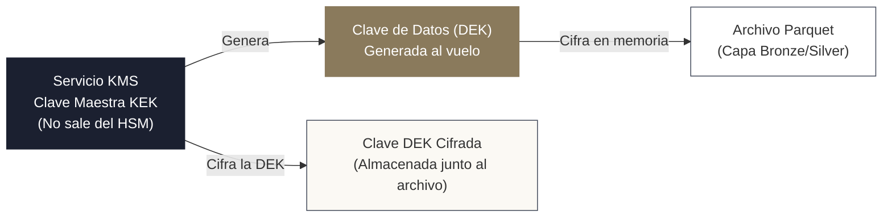

<!-- NOTAS FUENTE ORIGINALES DE OBSIDIAN: [[Data Security]], [[GDPR]], [[Ley 1581]], [[IAM]], [[KMS]] -->

# Capítulo 31: Seguridad, Privacidad y Gobernanza Regulatoria de Datos [AVANZADO]

> *"En la ingeniería de datos contemporánea, la seguridad y la privacidad no son parches que se añaden al final del desarrollo: son requisitos arquitectónicos fundamentales. Un pipeline capaz de transformar petabytes por hora carece de valor si expone información personal identificable (PII), viola la legislación de protección de datos o incumple el principio de mínimo privilegio en la nube."*

---

## Objetivos de Aprendizaje
Al finalizar este capítulo, el lector será capaz de:
* Diseñar políticas de control de acceso e identidades basadas en el **principio de mínimo privilegio** mediante **IAM** (*Identity and Access Management*), roles asumibles y credenciales temporales.
* Implementar mecanismos de cifrado de grado militar tanto en reposo (*Envelope Encryption* con **KMS** y CMEK) como en tránsito (**TLS 1.3 / mTLS**).
* Integrar sistemas de gestión centralizada de secretos de producción (AWS Secrets Manager, HashiCorp Vault, Azure Key Vault, Databricks Secrets), erradicando credenciales en texto plano.
* Aplicar técnicas criptográficas de **tokenización**, seudonimización y enmascaramiento dinámico sobre Información Personal Identificable (**PII**).
* Comprender y cumplir las exigencias del **Reglamento General de Protección de Datos (GDPR)** europeo, resolviendo el desafío arquitectónico del *Derecho al Olvido* sobre formatos inmutables de Lakehouse.
* Analizar y aplicar el régimen colombiano de protección de datos personales (**Ley 1581 de 2012 de Habeas Data**) y las directrices de la Superintendencia de Industria y Comercio (SIC) en arquitecturas analíticas.

---

> **Definición 31.1 (Información Personal Identificable - PII)**
> Se denomina **PII** (*Personally Identifiable Information*) a cualquier dato que permita identificar de manera unívoca a una persona física, directa o indirectamente (nombres, documentos de identidad, correos electrónicos, números telefónicos, direcciones IP, coordenadas geográficas o números de tarjetas financieras).
> 
> En plataformas analíticas, el acceso a la PII debe estar estrictamente restringido por defecto (*Zero Trust*), requiriendo tokenización unidireccional (hashing criptográfico con sal) antes de su promoción a las capas Silver y Gold del Lakehouse.

---

## 31.1 Gestión de Identidades y Mínimo Privilegio (IAM)

El control de acceso en la nube se rige por el modelo **IAM** (*Identity and Access Management*):

```mermaid
graph TD
    App["Pipeline de Ingesta (Spark / Airflow)"] -->|1. Asume Rol IAM| STS["Security Token Service (STS)"]
    STS -->|2. Emite Credenciales Temporales<br/>(Token válido por 1 hora)| App
    App -->|3. Petición autenticada con Token| S3["Bucket S3 / Data Lakehouse"]
    S3 -->|4. Valida Política de Mínimo Privilegio| Acceso{"¿Tiene permiso s3:GetObject<br/>sobre prefijo /silver/*?"}
    Acceso -->|Sí| OK["Operación Permitida"]
    Acceso -->|No| Deny["HTTP 403 Forbidden"]
    style App fill:#ffffff,stroke:#4a5160,stroke-width:1px
    style STS fill:#8a7a5c,color:#ffffff,stroke:#8a7a5c,stroke-width:2px
    style S3 fill:#1b2030,color:#ffffff,stroke:#1b2030,stroke-width:2px
    style OK fill:#fbf9f4,stroke:#4a5160,stroke-width:1px
    style Deny fill:#1b2030,color:#ffffff,stroke:#1b2030,stroke-width:2px
```

### 1. El Principio de Mínimo Privilegio (Least Privilege)
Una aplicación o usuario debe recibir exclusivamente los permisos mínimos e indispensables para desempeñar su tarea, durante el tiempo estrictamente necesario.
* **Anti-patrón:** Asignar `AdministratorAccess` o `AmazonS3FullAccess` a un clúster de Spark para "ahorrar tiempo".
* **Práctica Correcta:** Otorgar permisos delimitados al ARN exacto del bucket y prefijo requerido:
  ```json
  {
    "Version": "2012-10-17",
    "Statement": [
      {
        "Sid": "PermitirLecturaSoloSilver",
        "Effect": "Allow",
        "Action": [
          "s3:GetObject",
          "s3:ListBucket"
        ],
        "Resource": [
          "arn:aws:s3:::empresa-lakehouse-prod",
          "arn:aws:s3:::empresa-lakehouse-prod/silver/*"
        ]
      }
    ]
  }
  ```

### 2. Roles Asumibles (*IAM Roles*) frente a Claves Estáticas
En producción, **los servicios nunca deben utilizar claves estáticas** (`AWS_ACCESS_KEY_ID` y `AWS_SECRET_ACCESS_KEY`). Se deben emplear **IAM Roles** asociados a la instancia o pod de Kubernetes (ej. *IRSA: IAM Roles for Service Accounts* en EKS, o identidades administradas en Azure). El servicio asume el rol dinámicamente mediante el *Security Token Service* (STS), recibiendo credenciales que caducan automáticamente cada hora.

---

## 31.2 Cifrado en Reposo y en Tránsito (KMS y Envelope Encryption)

### 1. Cifrado en Reposo con Envelope Encryption
Para cifrar petabytes de datos en Amazon S3, ADLS Gen2 o Google Cloud Storage sin degradar el rendimiento, los proveedores utilizan el patrón criptográfico de **Cifrado de Sobre** (*Envelope Encryption*):



* **KEK (*Key Encryption Key*):** Clave maestra custodiada de forma segura dentro de módulos de seguridad de hardware (HSM) del servicio KMS (AWS KMS, Azure Key Vault). Nunca sale del HSM.
* **DEK (*Data Encryption Key*):** Clave simétrica efímera de un solo uso generada por el KMS para cifrar el archivo Parquet.
* **Mecánica:** El motor cifra el archivo Parquet con la DEK en memoria, el KMS cifra la DEK con la KEK maestra, la DEK en texto plano se destruye de la memoria RAM, y la DEK cifrada se adjunta a los metadatos del archivo en disco.

### 2. Claves Administradas por el Cliente (CMEK / BYOK)
Para cumplir con normativas financieras y de defensa, las organizaciones utilizan **CMEK** (*Customer-Managed Encryption Keys*), donde la empresa retiene la propiedad de la clave KMS y puede revocarla unilateralmente en cualquier instante, volviendo todos los datos del Lakehouse inmediatamente inaccesibles e ilegibles (*Crypto-Shredding*).

---

## 31.3 Gestión de Secretos de Producción

Los pipelines requieren credenciales para conectarse a bases relacionales, brokers de Kafka o APIs externas. Estas credenciales deben gestionarse a través de almacenes centralizados con rotación automática:

```python
# Ejemplo de consumo seguro de secretos en Databricks / PySpark
# Las credenciales NUNCA están escritas en el código
usuario_db = dbutils.secrets.get(scope="finanzas-prod", key="postgres-user")
password_db = dbutils.secrets.get(scope="finanzas-prod", key="postgres-password")

# En entornos agnósticos / Python estándar utilizando AWS Secrets Manager:
import boto3
import json

def obtener_secreto_db(nombre_secreto: str, region: str = "us-east-1") -> dict:
    cliente = boto3.client("secretsmanager", region_name=region)
    respuesta = cliente.get_secret_value(SecretId=nombre_secreto)
    return json.loads(respuesta["SecretString"])
```

---

## 31.4 Tokenización y Seudonimización de PII

Cuando un pipeline ingesta datos con nombres, cédulas o correos electrónicos, estos deben ser disociados antes de ser expuestos a científicos de datos o analistas:

### 1. Hashing Criptográfico con Sal (*Salted Hash*)
Convertir un identificador sensible (ej. número de documento) en un hash unidireccional determinista mediante SHA-256 o HMAC, añadiendo una "sal" criptográfica (*salt*) secreta custodiada en KMS para impedir ataques de diccionario (*Rainbow Tables*):

$$\text{Token} = \text{HMAC-SHA256}(\text{DocumentoIdentidad}, \text{SalKMS})$$

```python
import hmac
import hashlib
from pyspark.sql import functions as F

def tokenizar_pii(df, columna_origen: str, salt_secreto: str, columna_destino: str):
    # Generar UDF o expresión nativa de hashing salado
    salt_literal = F.lit(salt_secreto)
    return df.withColumn(
        columna_destino,
        F.sha2(F.concat(F.col(columna_origen), salt_literal), 256)
    )
```

### 2. Enmascaramiento Dinámico de Columnas (*Dynamic Column Masking*)
Permite que los usuarios con permisos ejecutivos visualicen el valor original, mientras que analistas generales visualicen una cadena enmascarada (ej. `ana.torres@empresa.com` se transforma en `a***s@empresa.com`). Esto se gobierna a nivel de catálogo centralizado (Unity Catalog, Snowflake o AWS Lake Formation).

---

## 31.5 Regulaciones Internacionales: GDPR y el Reto del Derecho al Olvido

El **Reglamento General de Protección de Datos (GDPR)** de la Unión Europea impone obligaciones severas:
1. **Consentimiento Explícito:** La base legal para recolectar y tratar cada atributo.
2. **Minimización de Datos:** Conservar únicamente los campos indispensables para el fin declarado.
3. **Derecho al Olvido (*Right to be Forgotten - Artículo 17*):** El titular de los datos puede solicitar la eliminación total e irreversible de toda su información personal en un plazo máximo de 30 días.

### El Desafío del Derecho al Olvido en Lakehouses
En formatos de solo adición (*Append-Only*) como Parquet en S3, los archivos son inmutables. Para "borrar" a un usuario en una tabla Lakehouse:
1. Se debe ejecutar un `DELETE FROM tabla WHERE usuario_id = 'XYZ'`.
2. **Impacto de Deletion Vectors:** Si la tabla tiene habilitados *Deletion Vectors* (estándar en Delta Lake 3.x y Databricks Runtime 14+), el `DELETE` **no reescribe los archivos Parquet físicos**; simplemente escribe un archivo bitmap `.bin` con las filas descartadas. Por ende, los datos del usuario siguen residiendo físicamente en el archivo Parquet original.
3. **El Purgado Físico Obligatorio (`REORG TABLE ... APPLY (PURGE)`):** Para eliminar físicamente las filas marcadas por los vectores de eliminación, se debe ejecutar una reescritura física de los archivos afectados:
   ```sql
   REORG TABLE lakehouse.silver_usuarios APPLY (PURGE);
   ```
4. **El Peligro del Historial (*Time Travel*) y Eliminación de Snapshots:** Una vez reescrito el archivo, el usuario ya no está en la versión activa, pero los archivos viejos continúan en las versiones históricas. Para cumplir formalmente con GDPR, se debe forzar la expiración de snapshots históricos (`VACUUM tabla RETAIN 0 HOURS` en una ventana de mantenimiento exclusiva para evitar `FileNotFoundException` en lectores concurrentes, tal como se advierte en el Cap. 18), o utilizar la técnica de **Crypto-shredding** (destruir la clave de cifrado simétrica asignada a ese usuario en KMS, haciendo que sus datos almacenados queden matemáticamente irrecuperables de forma instantánea).

---

## 31.6 Marco Regulatorio Colombiano: Ley 1581 de 2012 (Habeas Data)

En Colombia, el tratamiento de datos personales está regulado por la **Ley Estatutaria 1581 de 2012**, reglamentada por el Decreto 1377 de 2013 y fiscalizada por la **Superintendencia de Industria y Comercio (SIC)** a través de la Delegatura para la Protección de Datos Personales.

### 1. Principios Rectores Clave para Ingenieros de Datos
* **Principio de Legalidad:** El tratamiento es una actividad reglada que debe sujetarse a la Constitución y la ley.
* **Principio de Finalidad:** El tratamiento debe obedecer a una finalidad legítima de acuerdo con la Constitución y la ley, la cual debe ser informada al titular en la política de privacidad. No se pueden reutilizar datos para fines no autorizados.
* **Principio de Libertad:** Los datos personales solo pueden ser tratados con el **consentimiento previo, expreso e informado del titular**. Queda prohibido capturar o divulgar datos sin autorización.
* **Principio de Veracidad o Calidad:** La información debe ser veraz, completa, exacta, actualizada y comprobable. Está prohibido el tratamiento de datos fraccionados o que induzcan a error.
* **Principio de Seguridad:** Los datos deben ser manejados con las medidas técnicas, humanas y administrativas necesarias para otorgar seguridad a los registros, evitando su adulteración, pérdida o acceso no autorizado.
* **Principio de Confidencialidad:** Todas las personas que intervengan en el tratamiento de datos personales están obligadas a garantizar la reserva de la información.

### 2. Clasificación Legal de Datos en Colombia
* **Dato Público:** Aquel que la ley califica como tal (ej. estado civil, profesión, sentencias judiciales ejecutoriadas).
* **Dato Semiprivado:** No es íntimo pero interesa a cierto sector (ej. historial crediticio y financiero regulado por la Ley 1266 de 2008).
* **Dato Privado:** Información íntima que solo interesa al titular (ej. fotos personales, hábitos privados).
* **Dato Sensible:** Aquel que afecta la intimidad del titular o cuyo uso indebido puede generar discriminación (origen racial, orientación política, convicciones religiosas, datos de salud, datos biométricos como huellas dactilares o reconocimiento facial).
  * *Regla Estricta:* **El tratamiento de datos sensibles está prohibido por regla general**, salvo excepciones taxativas de ley con autorización explícita.

### 3. Registro Nacional de Bases de Datos (RNBD)
Las empresas en Colombia están obligadas a inscribir sus bases de datos ante el **RNBD** de la SIC, declarando:
* Nombre y ubicación física o cloud del repositorio (ej. nombre del bucket S3 o servidor).
* Política de tratamiento de datos aplicable.
* Medidas de seguridad y cifrado implementadas.
* Transferencia internacional de datos (enviar datos a servidores en el extranjero exige que el país receptor cuente con estándares adecuados de protección según la SIC, como Estados Unidos bajo ciertos acuerdos o la Unión Europea).

---

## 31.7 Criterios de Fiabilidad y Anti-Patrones en Producción

**Anti-patrón 1: Almacenar Cédulas y Nombres en Tablas de la Capa Gold de Analítica Abierta**  
Permitir que dashboards corporativos consulten directamente tablas con nombres, números de identificación o correos en texto plano expone a la compañía a sanciones millonarias de la SIC o autoridades de GDPR.  
*Corrección:* Reemplace los identificadores naturales por claves subrogadas tokenizadas y restrinja el acceso a la tabla de mapeo (*Lookup Table*) exclusivamente a personal autorizado de seguridad.

**Anti-patrón 2: Registros de Auditoría (*Logs*) que Imprimen Cargas Útiles con PII**  
Escribir `logger.info(f"Procesando evento: {payload}")` cuando el payload contiene tarjetas de crédito o contraseñas filtra datos sensibles a CloudWatch, Datadog o Splunk, violando los estándares PCI-DSS y las normativas de privacidad.  
*Corrección:* Configure filtros de saneamiento (*log sanitizers*) que detecten y enmascaren automáticamente patrones de tarjetas, correos y contraseñas antes de escribir en los flujos de log.

---

## Preguntas de Revisión y Ejercicios Prácticos
**Ejercicio 31.1 (Arquitectura de Cumplimiento de Derecho al Olvido):**  
Un usuario en Colombia solicita la supresión total de sus datos en ejercicio de su derecho de Habeas Data ante una fintech. La arquitectura de la fintech almacena los datos en una tabla Delta Lake particionada por mes en Amazon S3. Describa la secuencia técnica rigurosa de ingeniería para garantizar el borrado efectivo tanto en la capa lógica como física.

**Solución 31.1:**
1. **Ejecución de Borrado Lógico en Delta Lake:**
   ```sql
   DELETE FROM lakehouse.silver_usuarios WHERE cliente_id = 98124;
   ```
   Delta Lake escribe nuevos archivos Parquet excluyendo el registro del cliente y marca los archivos antiguos como eliminados en el Delta Log.
2. **Purgado Físico de Archivos con Deletion Vectors y de Instantáneas Históricas:**  
   Si la tabla utiliza *Deletion Vectors*, se debe purgar físicamente los archivos subyacentes antes de invocar la limpieza del catálogo:
   ```sql
   -- Paso A: Reescribir los archivos Parquet para expulsar físicamente las filas descartadas
   REORG TABLE lakehouse.silver_usuarios APPLY (PURGE);

   -- Paso B: En ventana de mantenimiento exclusiva (sin lectores concurrentes), purgar el historial
   SET spark.databricks.delta.retentionDurationCheck.enabled = false;
   VACUUM lakehouse.silver_usuarios RETAIN 0 HOURS;
   ```
3. **Propagación a Réplicas y Vistas Materializadas:**  
   Reconstruir o sincronizar vistas materializadas y tablas dimensionales en la capa Gold que contengan referencias desnormalizadas al cliente.
4. **Registro en Log de Auditoría Legal:**  
   Registrar la confirmación del borrado en una tabla de auditoría inmutable (indicando fecha, ID de solicitud de la SIC/titular y hash del usuario), sin registrar PII en el log.

---

## 31.8 Resumen y Puntos Clave

* **Mínimo privilegio:** Todo pipeline debe autenticarse mediante roles IAM asumibles con credenciales temporales y permisos delimitados al recurso exacto.
* **Cifrado de sobre (KMS):** Protege los datos en reposo combinando la eficiencia de claves DEK simétricas con la seguridad centralizada de claves maestras KEK en HSMs.
* **Gestión centralizada de secretos:** Las credenciales operacionales nunca se versionan en Git ni se escriben en Dockerfiles; se consumen en tiempo de ejecución desde almacenes seguros.
* **Tokenización salada:** Disocia la identidad del titular antes de transferir registros a capas de consumo analítico.
* **Cumplimiento GDPR y Ley 1581 de 2012:** Exige autorización previa del titular, delimitación de finalidad, registro ante el RNBD de la SIC y procedimientos técnicos verificables para el derecho a la supresión de datos en Lakehouses.

---

## Lecturas Recomendadas
1. **Amazon Web Services (2024).** *AWS Security Best Practices: Identity and Access Management (IAM) and AWS KMS Envelope Encryption.* AWS Whitepapers.
2. **Congreso de la República de Colombia (2012).** *Ley Estatutaria 1581 de 2012: Régimen General de Protección de Datos Personales (Habeas Data).* Diario Oficial No. 48.587.
3. **Superintendencia de Industria y Comercio - SIC (2023).** *Guía para la Gestión de Incidentes de Seguridad en el Tratamiento de Datos Personales.* Delegatura de Protección de Datos Personales.
4. **European Parliament and Council (2016).** *Regulation (EU) 2016/679 (General Data Protection Regulation - GDPR).* Official Journal of the European Union.
