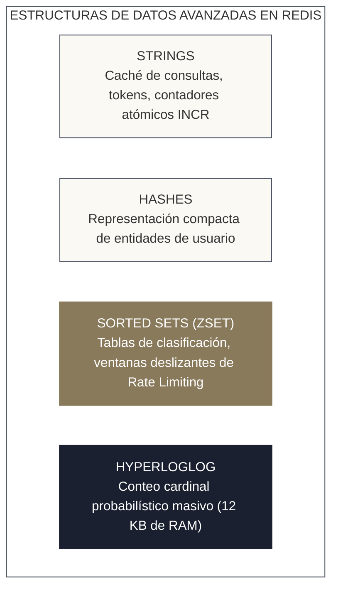
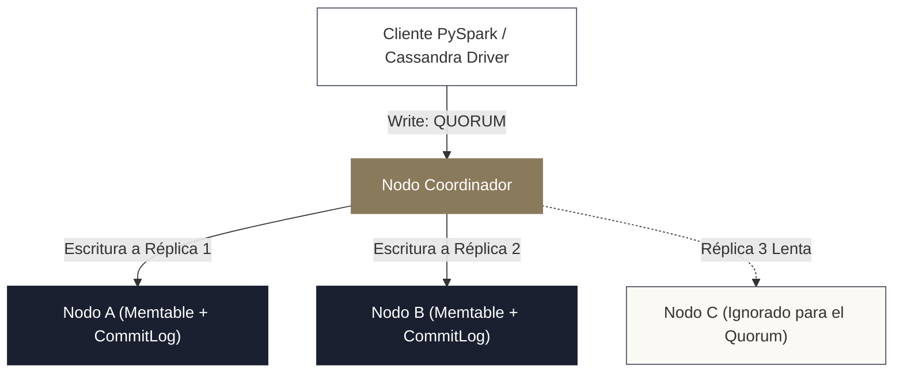
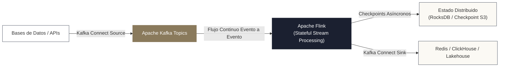

<!-- NOTAS FUENTE ORIGINALES DE OBSIDIAN: [[NoSQL]], [[Redis]], [[Cassandra]], [[DynamoDB]], [[MongoDB]], [[Flink]] -->

# Capítulo 32: Bases de Datos NoSQL y Motores Especializados [AVANZADO]

> *"La era del almacenamiento uniforme monolítico ha concluido. Ninguna tecnología aislada puede satisfacer simultáneamente los requerimientos de analítica masiva sobre petabytes, lecturas sub-milisegundas de perfiles de usuario, búsquedas jerárquicas y transacciones altamente concurrentes. El ingeniero de datos senior practica la persistencia políglota, seleccionando el motor óptimo según sus compensaciones entre consistencia, disponibilidad y latencia."*

---

## Objetivos de Aprendizaje
Al finalizar este capítulo, el lector será capaz de:
* Aplicar los teoremas **CAP** y **PACELC** para justificar técnicamente la selección de bases de datos NoSQL frente a motores relacionales y Lakehouses.
* Implementar patrones de ingeniería de alto rendimiento con **Redis** (caching de capas analíticas, control de cuotas y deduplicación con estructuras probabilísticas *HyperLogLog*).
* Diseñar modelos de datos en **Apache Cassandra** gobernados por claves de partición y columnas de agrupamiento (*Clustering Columns*), configurando su consistencia ajustable (*Tunable Consistency*).
* Modelar entidades en **Amazon DynamoDB** optimizando claves de partición/ordenación y capturando cambios continuos mediante **DynamoDB Streams**.
* Diseñar colecciones documentales en **MongoDB** mediante agregaciones analíticas complejas (*Aggregation Pipeline*).
* Comprender la arquitectura de **Apache Flink**, **Kafka Connect** y la semántica *Exactly-Once* (EOS) con transacciones distribuidas en dos fases (2PC).

---

> **Definición 32.1 (Persistencia Políglota en Arquitecturas Modernas)**
> La **persistencia políglota** (*Polyglot Persistence*) es el principio arquitectónico que postula que diferentes tipos de datos y patrones de acceso exigen diferentes motores de almacenamiento especializados:
> * Almacenes en Memoria (Redis): Latencias < 1 ms para contadores, colas y cachés.
> * Almacenes Columnares Anchos (Cassandra/DynamoDB): Alto throughput de escritura y consultas rápidas por clave primaria particionada.
> * Almacenes Documentales (MongoDB): Datos semiestructurados jerárquicos y catálogos de esquemas variables.
> * Data Lakehouses (Delta Lake/Iceberg): Análisis exploratorio, aggregaciones masivas y aprendizaje automático sobre petabytes históricos.

---

## 32.1 El Teorema PACELC: Más Allá de CAP

El clásico teorema CAP (*Consistencia, Disponibilidad, Tolerancia a Particiones*) afirma que en presencia de una partición de red ($P$), un sistema distribuido debe elegir entre consistencia ($C$) o disponibilidad ($A$). Sin embargo, la mayor parte del tiempo el sistema opera en condiciones normales sin fallos de red.

El teorema **PACELC** (formulado por Daniel Abadi) extiende formalmente CAP:
$$\mathbf{P} \ \Big( \mathbf{A} \lor \mathbf{C} \Big) \quad \mathbf{E} \text{lse} \quad \mathbf{L} \lor \mathbf{C}$$
* **Si hay una Partición ($P$):** ¿El sistema prefiere Disponibilidad ($A$) o Consistencia ($C$)?
* **En caso contrario (*Else - E*):** ¿El sistema prefiere baja Latencia ($L$) o Consistencia estricta ($C$)?

| Motor NoSQL | Clasificación PACELC | Compensación Arquitectónica Principal |
| :--- | :--- | :--- |
| **Apache Cassandra** | **PA/EL** | En partición prefiere Disponibilidad; en operación normal prioriza mínima Latencia (consistencia ajustable). |
| **Amazon DynamoDB** | **PA/EL** | Altísima disponibilidad y latencia predecible de un solo dígito de milisegundo. |
| **MongoDB** | **PC/EC** | Prioriza consistencia estricta por defecto (elección de líder primario mediante consenso). |
| **Redis** | **PC/EC** *(nodo primario)* | Persistencia en memoria ultrarrápida, pero replicación asíncrona por defecto hacia réplicas. |

---

## 32.2 Redis: Almacenamiento en Memoria y Patrones de Ingeniería

Redis (*Remote Dictionary Server*) almacena sus datos en memoria RAM, ofreciendo respuestas con latencias inferiores a un milisegundo:



### 1. Deduplicación y Conteo Cardinal Probabilístico con HyperLogLog
En telemetría de Big Data, contar usuarios únicos (*Count Distinct*) sobre miles de millones de eventos en tiempo real consume gigabytes de memoria en tablas hash convencionales. **HyperLogLog (HLL)** resuelve este cálculo utilizando una memoria fija de **12 KB con un error estándar inferior al 0.81%**:

```python
import redis

cliente_redis = redis.Redis(host="localhost", port=6379, db=0)

# Registro de eventos en tiempo real con HyperLogLog
def registrar_visita_usuario(fecha_iso: str, usuario_id: str) -> None:
    clave_hll = f"visitas_unicas:{fecha_iso}"
    # PFADD agrega el identificador al conjunto probabilístico
    cliente_redis.pfadd(clave_hll, usuario_id)

def estimar_usuarios_unicos(fecha_iso: str) -> int:
    clave_hll = f"visitas_unicas:{fecha_iso}"
    # PFCOUNT devuelve la estimación cardinal casi exacta
    return cliente_redis.pfcount(clave_hll)
```

### 2. Control de Cuotas con Ventana Deslizante en Sorted Sets
Para implementar *Rate Limiting* estricto (ej. permitir máximo 100 peticiones por minuto por usuario), se utilizan conjuntos ordenados puntuados por la marca de tiempo UNIX:

```python
import time

def validar_cuota_rate_limit(usuario_id: str, limite: int = 100, ventana_segundos: int = 60) -> bool:
    ahora = time.time()
    limite_ventana = ahora - ventana_segundos
    clave = f"rate_limit:{usuario_id}"

    pipeline = cliente_redis.pipeline()
    # 1. Eliminar peticiones que salieron de la ventana temporal
    pipeline.zremrangebyscore(clave, 0, limite_ventana)
    # 2. Agregar la petición actual con score = timestamp
    pipeline.zadd(clave, {str(ahora): ahora})
    # 3. Contar peticiones dentro de la ventana
    pipeline.zcard(clave)
    # 4. Establecer expiración para no acumular memoria
    pipeline.expire(clave, ventana_segundos + 5)
    
    _, _, total_peticiones, _ = pipeline.execute()
    return total_peticiones <= limite
```

---

## 32.3 Apache Cassandra: Almacén Columnar Ancho y Consistencia Ajustable

Apache Cassandra es un sistema distribuido sin nodo maestro (*Masterless Peer-to-Peer*), donde cada nodo del anillo tiene idénticas responsabilidades (*Consistent Hashing*).



### 1. El Modelo de Claves en Cassandra (CQL)
A diferencia de SQL tradicional donde el esquema se diseña alrededor de las entidades y se normaliza, en Cassandra **el modelo de datos se diseña estrictamente en función de las consultas que se van a ejecutar**:

```sql
-- Creación de tabla optimizada para consultar eventos de un sensor en un rango de fechas
CREATE TABLE telemetria_iot.lecturas_sensor (
    sensor_id UUID,
    anio_mes text,
    timestamp_evento timestamp,
    temperatura double,
    presion double,
    PRIMARY KEY ((sensor_id, anio_mes), timestamp_evento)
) WITH CLUSTERING ORDER BY (timestamp_evento DESC);
```
* **Partition Key `((sensor_id, anio_mes))`:** El hash de estos campos determina exactamente en qué nodo físico del anillo se alojará el dato. Incluir `anio_mes` evita que particiones de un solo sensor crezcan descontroladamente en el tiempo (*Evita particiones masivas mayores a 100 MB*).
* **Clustering Column `(timestamp_evento)`:** Determina el orden físico secuencial de las filas dentro de la partición en disco (*SSTables*).

### 2. Consistencia Ajustable (*Tunable Consistency*)
Cassandra permite al cliente definir el nivel de consistencia para cada operación de lectura ($R$) y escritura ($W$):
* **Fórmula de Consistencia Fuerte:** Si se cumple que:
  $$R + W > N \quad (\text{donde } N \text{ es el factor de replicación})$$
  se garantiza formalmente una lectura consistente de la última escritura (*Strong Consistency*).
* Si $N = 3$, configurando `WRITE = LOCAL_QUORUM` (2 nodos) y `READ = LOCAL_QUORUM` (2 nodos), $2 + 2 = 4 > 3$, garantizando que la lectura intersecte al menos un nodo con el dato actualizado, protegiendo contra nodos lentos en otras zonas de disponibilidad.

---

## 32.4 Amazon DynamoDB y DynamoDB Streams

DynamoDB es un servicio NoSQL clave-valor y documental totalmente administrado en AWS que garantiza latencia consistente de milisegundos a cualquier escala:

### 1. Estructura de Claves y Modos de Capacidad
* **Partition Key (PK) y Sort Key (SK):** Permiten modelar múltiples entidades en una única tabla (*Single-Table Design*).
* **Unidades de Capacidad:**
  * **RCU (*Read Capacity Unit*):** 1 lectura fuertemente consistente por segundo para elementos de hasta 4 KB.
  * **WCU (*Write Capacity Unit*):** 1 escritura por segundo para elementos de hasta 1 KB.

### 2. DynamoDB Streams para Ingesta y CDC Serverless
Toda mutación (`INSERT`, `MODIFY`, `REMOVE`) en una tabla DynamoDB se emite cronológicamente a un flujo **DynamoDB Streams**. Este flujo puede consumirse mediante AWS Lambda o procesarse directamente en micro-lotes de Spark Structured Streaming para alimentar la capa Bronze del Lakehouse en tiempo casi real sin sobrecargar la base operacional.

---

## 32.5 MongoDB y el Procesamiento Documental BSON

MongoDB organiza los datos en colecciones de documentos JSON binarios (**BSON**), permitiendo esquemas polimórficos:

```javascript
// Pipeline de Agregación Analítica en MongoDB
db.pedidos.aggregate([
    // 1. Filtrar pedidos confirmados en 2026
    { $match: { estado: "ENTREGADO", fecha: { $gte: ISODate("2026-01-01") } } },
    // 2. Desenrollar el array de líneas de producto
    { $unwind: "$lineas_items" },
    // 3. Agrupar por categoría y calcular métricas
    { $group: {
        _id: "$lineas_items.categoria",
        volumen_total_usd: { $sum: { $multiply: ["$lineas_items.cantidad", "$lineas_items.precio"] } },
        total_items_vendidos: { $sum: "$lineas_items.cantidad" }
    }},
    // 4. Ordenar descendentemente
    { $sort: { volumen_total_usd: -1 } }
]);
```

---

## 32.6 Procesamiento Stream-First: Apache Flink Internals

Mientras Apache Spark Structured Streaming procesa eventos agrupándolos en pequeños intervalos temporales (*micro-lotes de 100 ms a 1 segundo*), **Apache Flink** está diseñado para el **procesamiento continuo evento a evento nativo con latencias inferiores a 10 milisegundos**:



### 1. Estado con Clave (*Keyed State*) y RocksDB StateBackend
En Flink, el cálculo de ventanas deslizantes y agregaciones no se recalcula desde cero: se almacena en memoria o en disco local gestionado por **RocksDB** (una base de datos embebida LSM-Tree en C++). Esto permite manejar terabytes de estado activo en memoria sin sufrir las pausas de recolección de basura (*Garbage Collection*) de la JVM.

### 2. Tolerancia a Fallos: Barreras de Checkpoint (Chandy-Lamport)
Flink implementa el algoritmo de **instantáneas asíncronas con barreras (*Asynchronous Barrier Snapshotting*)**:
1. El coordinador inyecta marcas especiales (*Checkpoint Barriers*) en el flujo de datos de Kafka.
2. Cada operador procesa los datos y, al recibir la barrera, vuelca su estado local a almacenamiento de objetos persistente (S3/ADLS) de forma asíncrona sin detener el procesamiento de nuevos eventos.
3. Si un nodo colapsa, todos los operadores retroceden al último checkpoint validado y reanudan la lectura de Kafka desde ese offset exacto, logrando semántica **Exactly-Once estricta**.

### 3. Flink vs. Spark Structured Streaming: ¿Cuándo elegir cuál?
* **Elija Apache Flink si:** El requerimiento de negocio exige latencias de un solo dígito de milisegundo (detección de fraude en transacciones financieras bancarias, control de tráfico aéreo, alertas de monitoreo médico), procesamiento de eventos complejos (CEP) o ventanas de sesión dinámicas muy desordenadas.
* **Elija Spark Structured Streaming si:** La plataforma prioriza la unificación arquitectónica del código (mismo motor y API para batch nocturno, capas Medallón en Delta Lake y micro-lotes de streaming) y latencias de 500 ms a 2 segundos son plenamente aceptables para el caso de negocio.

---

## 32.7 Motores OLAP Especializados: Trino y ClickHouse

En plataformas maduras, el Lakehouse almacena la verdad histórica, pero las consultas interactivas de dashboards con miles de usuarios concurrentes requieren motores de consulta especializados:

### 1. Trino (anteriormente PrestoSQL): Cómputo Federado y Consultas Ad-Hoc
Trino es un motor de ejecución SQL distribuido masivamente paralelo (MPP) que **no almacena datos propios**:
* **Federación de Consultas (*Query Federation*):** Permite cruzar en una sola sentencia SQL una tabla de 100 TB en Delta Lake (S3), con una tabla operacional en PostgreSQL y un topic en Kafka:
  ```sql
  -- Consulta federada unificada en Trino
  SELECT 
      lake.transaccion_id,
      lake.monto_usd,
      pg.nombre_cliente,
      pg.scoring_crediticio
  FROM delta_lakehouse.silver.ventas AS lake
  JOIN postgres_crm.public.clientes AS pg 
    ON lake.cliente_id = pg.cliente_id
  WHERE lake.fecha = CURRENT_DATE;
  ```
* **Ejecución en Memoria Pura:** Trino canaliza los datos entre etapas a través de la red sin volcarlos a disco intermedio, logrando que consultas analíticas pesadas retornen en segundos.

### 2. ClickHouse: Rendimiento Columnar Extremo para Series Temporales y Telemetría
ClickHouse es un sistema gestor de bases de datos relacional columnar enfocado en analítica en tiempo real (OLAP):
* **Motor MergeTree:** Almacena los datos ordenados físicamente por clave primaria mediante un índice disperso (*Sparse Index*), permitiendo omitir el 99% de los bloques de disco en consultas con rangos temporales.
* **Vectorización SIMD en C++:** Las operaciones de filtrado y agregación se compilan directamente a instrucciones vectoriales de CPU, permitiendo escanear cientos de millones de filas por segundo por núcleo.
* **Casos de Uso Ideales:** Almacenamiento y consulta de telemetría de clústeres, logs de auditoría de red, análisis de tráfico web y métricas de IoT con compresión de hasta 10:1 frente a JSON.

---

## 32.7 Criterios de Fiabilidad y Anti-Patrones en Producción

**Anti-patrón 1: Tratar a Cassandra o DynamoDB como una Base de Datos Relacional**  
Diseñar tablas en Cassandra e intentar consultar utilizando filtros sobre columnas que no forman parte de la clave primaria mediante `ALLOW FILTERING` es una catástrofe de rendimiento. `ALLOW FILTERING` fuerza a Cassandra a escanear todos los nodos del anillo completo, degradando la disponibilidad del clúster.  
*Corrección:* Modele sus tablas alrededor de los requerimientos de lectura; si necesita una consulta distinta, cree una tabla secundaria desnormalizada o una vista materializada.

**Anti-patrón 2: Usar Redis sin Políticas de Desalojo de Memoria (*Eviction Policies*)**  
Utilizar Redis como caché sin configurar límites máximos de memoria (`maxmemory`) y políticas de desalojo (como `volatile-lru` o `allkeys-lru`) provoca que el servidor colapse por agotamiento de RAM cuando la carga de datos se incrementa imprevistamente.

---

## Preguntas de Revisión y Ejercicios Prácticos
**Ejercicio 32.1 (Cálculo de Consistencia en Clúster de Cassandra):**  
Se tiene un clúster de Apache Cassandra desplegado en AWS con un factor de replicación $N = 3$ distribuido en tres zonas de disponibilidad.
1. Si un pipeline de ingesta escribe transacciones con nivel de consistencia `ONE`, ¿qué nivel de consistencia debe emplear el consumidor de lectura para garantizar que siempre lea el valor más reciente?
2. Si la red entre dos zonas de disponibilidad sufre una partición, ¿qué ocurre si el escritor intenta utilizar `ALL`?

**Solución 32.1:**
1. Para garantizar lecturas consistentes de la última escritura, se debe cumplir $R + W > N$. Si $W = 1$ y $N = 3$, el nivel de lectura debe satisfacer:
   $$R + 1 > 3 \implies R > 2 \implies R = 3 \quad (\text{Nivel } \mathbf{ALL})$$
   Exigir `READ = ALL` significa que si un solo nodo se retrasa o cae, la lectura fallará, sacrificando disponibilidad. Por esta razón, la industria prefiere configurar `WRITE = QUORUM` (2) y `READ = QUORUM` (2), donde $2 + 2 = 4 > 3$.
2. Si el escritor exige `ALL`, requiere confirmación unánime de los 3 nodos. Ante una partición de red que aísle un solo nodo, la escritura **fallará inmediatamente con excepción `WriteTimeoutException`**, priorizando consistencia sobre disponibilidad (comportamiento $CP$).

---

## 32.8 Resumen y Puntos Clave

* **Persistencia políglota:** Cada motor NoSQL resuelve compensaciones específicas de escala, latencia y modelo de datos que las bases de datos relacionales tradicionales no pueden cubrir.
* **Teorema PACELC:** Clasifica los sistemas en función de su comportamiento tanto en partición de red como en operación normal de latencia.
* **Redis en memoria:** Estructuras probabilísticas como HyperLogLog optimizan cómputos analíticos de conteo masivo con solo 12 KB de RAM.
* **Modelado en Cassandra:** Diseñado en función estricta de las consultas de lectura, utilizando la consistencia ajustable ($R + W > N$) para balancear rendimiento y garantías ACID.
* **Flink y Kafka Connect:** Habilitan arquitecturas de eventos en tiempo real puro con latencias sub-milisegundas y semántica exactly-once mediante transacciones de dos fases.

---

## Lecturas Recomendadas
1. **Kleppmann, M. (2017).** *Designing Data-Intensive Applications (Chapter 3: Storage and Retrieval).* O'Reilly Media.
2. **Abadi, D. J. (2012).** *Consistency Tradeoffs in Modern Distributed Database System Design: CAP is Only Part of the Story.* IEEE Computer.
3. **Hewitt, E. & Carpenter, J. (2020).** *Cassandra: The Definitive Guide (3rd Edition).* O'Reilly Media.
4. **Carbone, P. et al. (2015).** *Apache Flink: Stream and Batch Processing in a Single Engine.* IEEE Data Engineering Bulletin.
