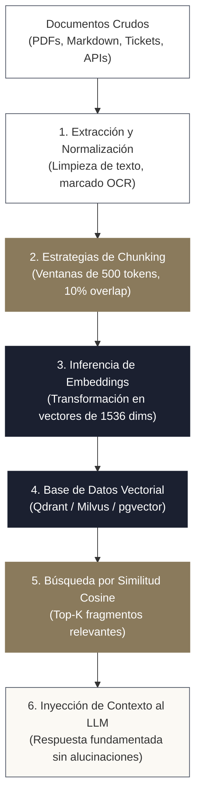
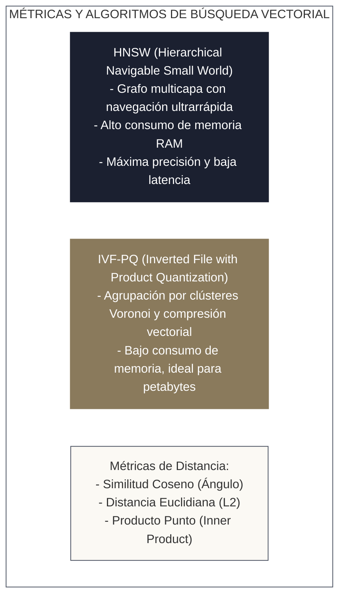
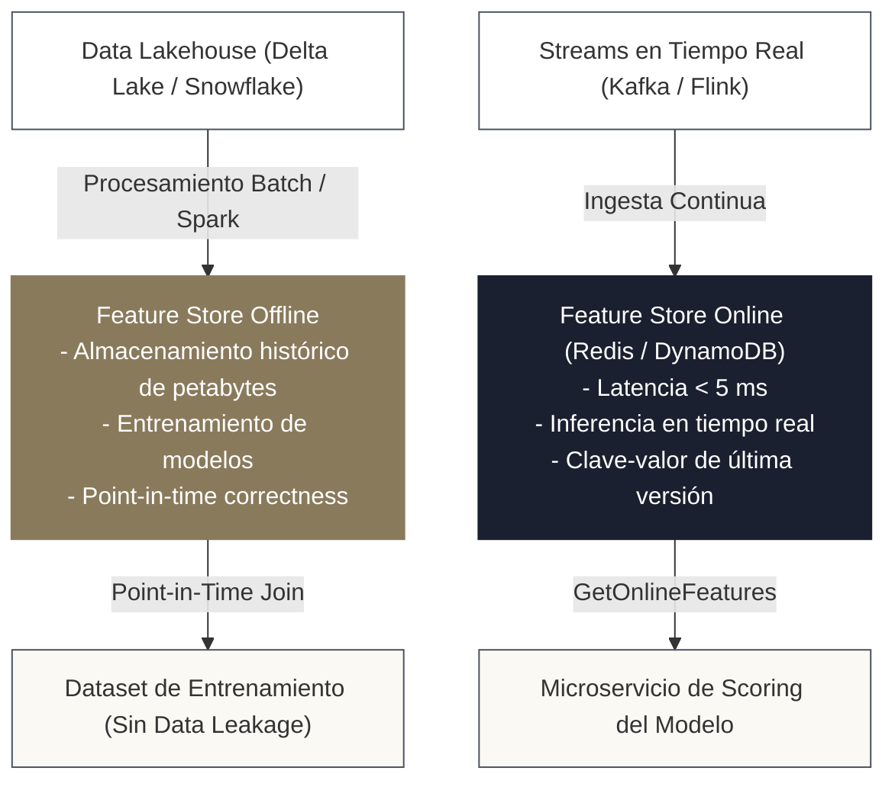
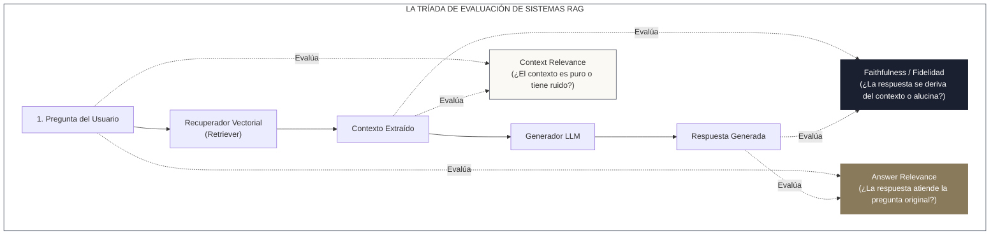

<!-- NOTAS FUENTE ORIGINALES DE OBSIDIAN: [[AI Data Engineering]], [[RAG]], [[Vector Databases]], [[Feature Stores]], [[Data Mesh]] -->

# Capítulo 33: Ingeniería de Datos para Inteligencia Artificial y LLMs [AVANZADO]

> *"En la era de los Grandes Modelos de Lenguaje (LLMs) y la Inteligencia Artificial generativa, la calidad y relevancia del modelo no están determinadas por su cantidad de parámetros, sino por la solidez de los pipelines de datos que alimentan su contexto. El ingeniero de datos es el arquitecto indispensable que transforma terabytes de documentos no estructurados en incrustaciones vectoriales limpias, gobierna las características analíticas en tiempo real y construye la capa semántica que conecta a la IA con los datos del negocio."*

---

## Objetivos de Aprendizaje
Al finalizar este capítulo, el lector será capaz de:
* Comprender la evolución del rol de Data Engineer hacia el soporte de arquitecturas de IA generativa y aprendizaje automático moderno (2026).
* Diseñar pipelines de datos de extremo a extremo para arquitecturas **RAG** (*Retrieval-Augmented Generation*), dominando estrategias de fragmentación (*chunking*) y enriquecimiento de metadatos.
* Ejecutar la vectorización de texto a gran escala mediante **embeddings** calculados en clústeres distribuidos de Apache Spark.
* Evaluar y operar **bases de datos vectoriales** (Qdrant, Pinecone, Milvus) e índices relacionales basados en similitud utilizando la extensión **`pgvector`** de PostgreSQL.
* Implementar **Feature Stores** (Almacenes de Características) con **Feast (LF AI & Data Foundation)**, distinguiendo el plano offline (entrenamiento histórico) del plano online (inferencia en tiempo real de baja latencia) con corrección temporal (*Point-in-Time Joins*).
* Dominar los principios de **Data Mesh**, productos de datos (*Data Products*) y la integración de la **Capa Semántica** (*dbt Semantic Layer*) con herramientas de inteligencia de negocios.

---

> **Definición 33.1 (Retrieval-Augmented Generation - RAG)**
> **RAG** es el patrón arquitectónico que optimiza la generación de un modelo de lenguaje (LLM) recuperando dinámicamente información veraz y actualizada desde una base de conocimiento externa indexada vectorialmente, inyectando dichos fragmentos en el contexto de la consulta (*prompt*) antes de emitir la respuesta.
> 
> En términos de ingeniería de datos, RAG es un **pipeline continuo de ETL no estructurado**: extrae documentos, los limpia, los fragmenta, calcula representaciones numéricas densas (vectores) y los sincroniza en almacenes de baja latencia con garantías de frescura y control de acceso.

---

## 33.1 Arquitectura de Pipelines para RAG

A diferencia de los pipelines tradicionales orientados a tablas columnares, un pipeline de RAG opera sobre datos textuales y no estructurados:



### 1. Estrategias de Fragmentación (*Chunking*)
Dividir un texto extenso en fragmentos requiere equilibrar especificidad semántica y contexto:
* **Fragmentación por Tamaño Fijo (*Fixed-size Chunking*):** Divide por un número exacto de palabras o tokens (ej. 512 tokens) con un porcentaje de solapamiento (*overlap*, típicamente 10% a 20%) para evitar que oraciones críticas queden cortadas entre dos fragmentos contiguos.
* **Fragmentación Estructural Semántica:** Respeta los límites jerárquicos del documento (secciones Markdown, encabezados H1/H2, párrafos completos o bloques de código), garantizando que las ideas complejas permanezcan unificadas.

### 2. Enriquecimiento de Metadatos
Cada fragmento indexado debe incluir metadatos estructurados (`documento_id`, `fecha_creacion`, `version`, `rol_minimo_requerido`). Esto permite aplicar **filtrado híbrido** antes o después de la búsqueda vectorial (*Pre-filtering / Post-filtering*), evitando que un usuario consulte información confidencial para la cual no tiene autorización.

---

## 33.2 Generación de Embeddings a Gran Escala con Apache Spark

Un **embedding** es una función que proyecta un fragmento de texto en un vector denso de números reales en un espacio de alta dimensionalidad (típicamente entre 384 y 1.536 dimensiones), donde la proximidad geométrica refleja afinidad semántica.

En pipelines con millones de documentos, la vectorización no puede realizarse de forma secuencial en una sola máquina. Se utiliza Apache Spark con **Pandas UDFs vectorizadas con aceleración GPU/CPU**:

```python
from pyspark.sql import SparkSession
from pyspark.sql.functions import pandas_udf
import pandas as pd
from typing import Iterator

spark = SparkSession.builder \
    .appName("Vectorizacion-Masiva-Embeddings") \
    .getOrCreate()

# Definición de Pandas UDF en modo iterador para reutilizar el modelo en memoria
@pandas_udf("array<float>")
def generar_embeddings_lote(textos_iter: Iterator[pd.Series]) -> Iterator[pd.Series]:
    # El modelo se carga UNA SOLA VEZ por ejecutor de Spark, amortizando el costo
    from sentence_transformers import SentenceTransformer
    modelo = SentenceTransformer("sentence-transformers/all-MiniLM-L6-v2")
    
    for lote_textos in textos_iter:
        # Codificación por lotes en memoria local del ejecutor
        vectores = modelo.encode(lote_textos.tolist(), batch_size=64, show_progress_bar=False)
        yield pd.Series(vectores.tolist())

# Aplicación distribuida sobre millones de fragmentos
df_fragmentos = spark.read.parquet("data/lakehouse/silver_documentos_chunks/")
df_con_vectores = df_fragmentos.withColumn("vector_embedding", generar_embeddings_lote("contenido_texto"))

df_con_vectores.write.format("delta").mode("append").save("data/lakehouse/gold_conocimiento_vectorizado/")
```

---

## 33.3 Bases de Datos Vectoriales e Indexación con `pgvector`

Para responder consultas en milisegundos sobre millones de vectores, los motores no calculan la distancia euclidiana o de coseno contra la totalidad de la base ($O(N)$ o fuerza bruta). Utilizan algoritmos de **Búsqueda del Vecino Más Cercano Aproximado** (*Approximate Nearest Neighbor - ANN*):



### Implementación en PostgreSQL con `pgvector`
Para organizaciones que ya operan bases de datos relacionales, la extensión **`pgvector`** permite almacenar y consultar vectores directamente junto con las tablas relacionales existentes mediante SQL estándar:

```sql
-- Habilitar extensión en PostgreSQL
CREATE EXTENSION IF NOT EXISTS vector;

-- Creación de tabla con columna vectorial de 1536 dimensiones
CREATE TABLE base_conocimiento.documentos_embeddings (
    documento_id BIGSERIAL PRIMARY KEY,
    titulo TEXT NOT NULL,
    contenido TEXT NOT NULL,
    metadatos JSONB,
    embedding VECTOR(1536)
);

-- Creación de índice HNSW para búsqueda por similitud de coseno en sub-milisegundos
CREATE INDEX idx_documentos_hnsw ON base_conocimiento.documentos_embeddings 
USING hnsw (embedding vector_cosine_ops)
WITH (m = 16, ef_construction = 64);

-- Consulta de los 5 fragmentos más cercanos semánticamente al vector de la consulta
SELECT 
    documento_id,
    titulo,
    contenido,
    1 - (embedding <=> '[0.015, -0.042, ... , 0.089]') AS similitud_coseno
FROM base_conocimiento.documentos_embeddings
WHERE metadatos->>'departamento' = 'Finanzas'
ORDER BY embedding <=> '[0.015, -0.042, ... , 0.089]' ASC
LIMIT 5;
```

---

## 33.4 Feature Stores: Almacenes de Características para Machine Learning

Un **Feature Store** centraliza el cálculo, almacenamiento y servicio de características analíticas (*features*) para modelos de ML, erradicando la duplicación de código y el desfase entre entrenamiento e inferencia:



### 1. Corrección Temporal (*Point-in-Time Correctness / As-Of Joins*)
El principal peligro al entrenar modelos predictivos es la **fuga de datos hacia el futuro (*Data Leakage*)**: utilizar el valor de una característica en una fecha posterior a la ocurrencia del evento que se intenta predecir. El Feature Store garantiza que al reconstruir el conjunto de entrenamiento para una transacción ocurrida el `2025-06-15 14:30:00`, se unan exactamente las características vigentes a esa microsegunda exacta (*As-Of Join*).

### 2. Implementación con Feast (LF AI & Data Foundation)
```python
# Definición declarativa de características con Feast (features.py)
from feast import Entity, FeatureView, Field, FileSource
from feast.types import Float32, Int64
from datetime import timedelta

cliente = Entity(name="cliente_id", join_keys=["cliente_id"])

origen_batch = FileSource(
    path="data/lakehouse/silver_features_clientes.parquet",
    timestamp_field="fecha_calculo",
    created_timestamp_field="fecha_creacion"
)

vista_features_cliente = FeatureView(
    name="caracteristicas_comportamiento_cliente",
    entities=[cliente],
    ttl=timedelta(days=30),
    schema=[
        Field(name="promedio_compras_30d", dtype=Float32),
        Field(name="cantidad_transacciones_rechazadas", dtype=Int64),
    ],
    online=True,  # Sincroniza automáticamente hacia Redis para inferencia rápida
    source=origen_batch,
)
```

---

## 33.5 Data Mesh, Productos de Datos y la Capa Semántica

Para organizaciones a escala empresarial, centralizar todo el procesamiento analítico en un único equipo de datos monolítico genera un cuello de botella organizacional. **Data Mesh** (formulado por Zhamak Dehghani) traslada la responsabilidad hacia dominios de negocio descentralizados mediante cuatro principios:

1. **Propiedad Orientada al Dominio (*Domain-Driven Ownership*):** Cada área de negocio (Ventas, Logística, Marketing) es dueña y responsable de sus propios datos.
2. **Los Datos como Producto (*Data as a Product*):** Los datos no son un subproducto residual; se exponen como productos con contratos de datos estrictos, documentación, SLAs de frescura y compatibilidad garantizada.
3. **Plataforma de Datos Autoservicio (*Self-serve Data Platform*):** El equipo central de infraestructura provee herramientas automatizadas (Terraform, plantillas de Spark, catálogos) para que los dominios construyan sus pipelines sin depender de un intermediario.
4. **Gobernanza Federada Computacional (*Federated Governance*):** Políticas globales de seguridad, cifrado y privacidad aplicadas automáticamente mediante código en toda la organización.

### La Capa Semántica (*Semantic Layer*)
Históricamente, el equipo de finanzas calculaba la *"Facturación Neta"* con una fórmula SQL, mientras que marketing la calculaba de forma distinta en un reporte de Power BI, provocando juntas directivas donde nadie confiaba en las cifras.

La **Capa Semántica** (implementada con herramientas como **dbt Semantic Layer** o **Cube.js**) centraliza las definiciones matemáticas de las métricas de negocio en un repositorio de código único, permitiendo que LLMs, dashboards de Power BI, Tableau y notebooks consuman exactamente la misma verdad matemática:

```yaml
# Definición de Métrica en dbt Semantic Layer (models/metrics/metricas_ventas.yml)
version: 2

metrics:
  - name: facturacion_neta_usd
    label: "Facturación Neta Consolidada (USD)"
    description: "Suma total de transacciones completadas deduciendo impuestos y descuentos."
    type: simple
    type_params:
      measure: monto_neto_transaccion
    filter: |
      estado_pago = 'COMPLETADO'
```

---

## 33.6 MLOps con MLflow y Evaluación de Pipelines RAG en Producción

El rol del Data Engineer en inteligencia artificial no culmina al escribir vectores en una base de datos: abarca garantizar la gobernanza del ciclo de vida del modelo (**MLOps**) y auditar de forma matemática la veracidad de los sistemas generativos (**Evaluación de RAG**).

### 1. MLOps con MLflow: Trazabilidad, Artefactos y Registro
**MLflow** es el estándar de código abierto (desarrollado por Databricks y parte de la Linux Foundation) para gobernar el ciclo de vida del aprendizaje automático:

* **MLflow Tracking:** Registra hiperparámetros, métricas de rendimiento y dependencias de entorno asociadas a cada corrida de entrenamiento.
* **Linaje de Datos y Modelos:** En un entorno Lakehouse, cada ejecución de entrenamiento vincula el ID del modelo con la versión exacta de la tabla Delta utilizada (`VERSION AS OF 42`), garantizando reproducibilidad forense absoluta.
* **MLflow Model Registry:** Repositorio centralizado para gobernar el versionado y la promoción de modelos entre etapas (*Staging $\rightarrow$ Production $\rightarrow$ Archived*):

```python
# pipelines/entrenamiento_y_registro_mlflow.py
import mlflow
import mlflow.sklearn
from sklearn.ensemble import RandomForestClassifier

mlflow.set_experiment("/Produccion/Scoring_Fraude_Clientes")

with mlflow.start_run(run_name="rf_modelo_v2") as run:
    # 1. Registrar metadatos de linaje de datos de entrada
    mlflow.set_tag("fuente_datos_delta", "lakehouse/gold/dim_clientes_scd2")
    mlflow.set_tag("delta_version_as_of", "15")
    
    # 2. Entrenar modelo
    params = {"n_estimators": 100, "max_depth": 10, "random_state": 42}
    mlflow.log_params(params)
    
    modelo = RandomForestClassifier(**params)
    modelo.fit(X_train, y_train)
    
    # 3. Registrar métricas de desempeño
    score_roc = 0.942
    mlflow.log_metric("roc_auc", score_roc)
    
    # 4. Registrar artefacto del modelo en el Registro Central
    mlflow.sklearn.log_model(
        sk_model=modelo,
        artifact_path="modelo_fraude",
        registered_model_name="DetectorFraudeCorporativo"
    )
```

---

### 2. Evaluación Formal de Pipelines RAG: La Tríada Ragas
Un pipeline tradicional de software se valida con pruebas unitarias deterministas (`assert resultado == esperado`). Un sistema RAG genera lenguaje natural no estructurado, por lo que su validación exige métricas declarativas especializadas:



1. **Fidelidad (*Faithfulness*):** Mide si todas las afirmaciones presentes en la respuesta generada pueden inferirse directamente del contexto recuperado. Una baja fidelidad indica **alucinación** del modelo de lenguaje.
2. **Relevancia del Contexto (*Context Relevance*):** Mide la relación señal/ruido del motor de búsqueda vectorial. Si se recuperan 5 fragmentos de texto pero solo uno contiene la respuesta, la relevancia es baja, aumentando costos de inferencia y confundiendo al modelo.
3. **Relevancia de la Respuesta (*Answer Relevance*):** Mide si la respuesta generada responde directamente la inquietud del usuario, sin divagaciones ni omisiones de información crítica.

#### Implementación del Pipeline de Evaluación (*LLM-as-a-Judge*)
En producción, se implementa un pipeline por lotes en Apache Spark que somete una muestra aleatoria de consultas del día a un modelo evaluador con rúbricas estrictas:

```python
# pipelines/evaluacion_rag_batch.py
from pyspark.sql import functions as F

def auditar_calidad_rag_batch(spark, ruta_telemetria_rag: str) -> None:
    df_logs_rag = spark.read.format("delta").load(ruta_telemetria_rag)
    
    # Prompt formal para evaluación con LLM-as-a-Judge
    prompt_fidelidad = """
    Analice el siguiente CONTEXTO y la RESPUESTA GENERADA.
    Determine si cada afirmación de la respuesta está respaldada por el contexto.
    Responda únicamente con un número decimal entre 0.0 (alucinación total) y 1.0 (100% veraz).
    Contexto: {contexto}
    Respuesta: {respuesta}
    """
    
    # En un clúster distribuido, se evalúa mediante Pandas UDF conectada a un endpoint local
    print("Ejecutando auditoría de fidelidad sobre el lote de inferencias RAG...")
    # Si la fidelidad promedio cae por debajo de 0.85, el pipeline emite una alerta a Slack/PagerDuty
```

---

## 33.7 Criterios de Fiabilidad y Anti-Patrones en Producción

**Anti-patrón 1: Cargar Modelos de Deep Learning Dentro de Bucles de Spark Fila a Fila**  
Invocar la carga de un modelo de PyTorch/TensorFlow dentro de una función regular `df.rdd.map(...)` provoca que Spark instancie el modelo de gigabytes una vez por cada fila de datos, provocando fallos inmediatos por agotamiento de memoria (*OOM*).  
*Corrección:* Utilice Pandas UDFs con iteradores (`Iterator[pd.Series]`) para que el modelo se cargue exactamente una sola vez en la memoria del ejecutor para miles de filas.

**Anti-patrón 2: Ausencia de Detección de Deriva de Datos (*Data Drift*)**  
Desplegar un modelo de scoring sin monitorear si la distribución estadística de las características de entrada ha cambiado con el tiempo provoca que las predicciones del modelo se degraden silenciosamente (*Model Decay*).

---

## Preguntas de Revisión y Ejercicios Prácticos
**Ejercicio 33.1 (Resolución de Point-in-Time Join para Prevención de Data Leakage):**  
Se tiene una tabla de transacciones etiquetadas para fraude: `fraudes(tx_id, cliente_id, timestamp_tx, es_fraude)`.  
Se tiene un histórico de características calculado diariamente: `features(cliente_id, fecha_calculo, score_riesgo_acumulado)`.  
Explique por qué hacer un `JOIN` tradicional por `cliente_id` es erróneo y cómo opera un *As-Of Join*.

**Solución 33.1:**
* Un `JOIN` relacional clásico uniría múltiples versiones del `score_riesgo_acumulado` para el mismo cliente o, si se une con la última versión actual, filtraría información del futuro que el modelo no conocía en el momento en que ocurrió la transacción (fuga de datos / *Data Leakage*).
* Un **As-Of Join** (unión temporal con corrección puntual) une cada fila de `fraudes` con el registro de `features` que tenga la marca de tiempo más reciente **estrictamente menor o igual** al `timestamp_tx` de la transacción:
  $$\text{Condición: } \max(\text{fecha\_calculo}) \quad \text{tal que} \quad \text{fecha\_calculo} \le \text{timestamp\_tx}$$
  Esto asegura que el dataset de entrenamiento refleje con exactitud matemática el estado real del mundo en el milisegundo exacto de la decisión.

---

## 33.7 Resumen y Puntos Clave

* **El Data Engineer es el cimiento de la IA:** RAG, agentes autónomos y modelos generativos exigen pipelines continuos de extracción, fragmentación y vectorización de alta disponibilidad.
* **Procesamiento de embeddings distribuido:** Las Pandas UDFs en Apache Spark permiten paralelizar la inferencia vectorial sobre millones de documentos con amortización de memoria del modelo.
* **Indexación ANN:** Algoritmos como HNSW e IVF-PQ permiten búsquedas de similitud sub-milisegundas sobre espacios vectoriales de alta dimensionalidad.
* **Feature Stores:** Desacoplan el almacenamiento masivo para entrenamiento offline del servicio de baja latencia online, garantizando consistencia temporal libre de fugas de datos.
* **Data Mesh y Capa Semántica:** Descentralizan la propiedad de los datos hacia dominios de negocio y unifican la definición matemática de las métricas para consumo consistente por analistas y modelos de IA.

---

## Lecturas Recomendadas
1. **Dehghani, Z. (2022).** *Data Mesh: Delivering Data-Driven Value at Scale.* O'Reilly Media.
2. **Malkov, Y. A. & Yashunin, D. A. (2020).** *Efficient and robust approximate nearest neighbor search using Hierarchical Navigable Small World graphs (HNSW).* IEEE Transactions on Pattern Analysis and Machine Intelligence (TPAMI), 42(4), 824-836.
3. **LF AI & Data Foundation (2024).** *Feast: Feature Store for Machine Learning Architecture and Specification.* Linux Foundation (`https://feast.dev/`).
4. **Lewis, P. et al. (2020).** *Retrieval-Augmented Generation for Knowledge-Intensive NLP Tasks.* Advances in Neural Information Processing Systems (NeurIPS).
