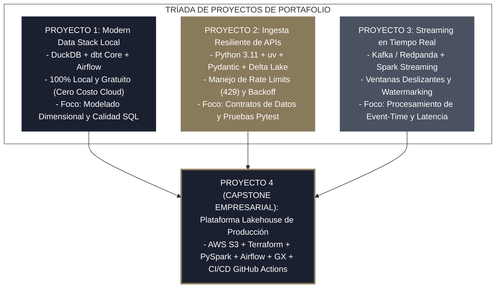
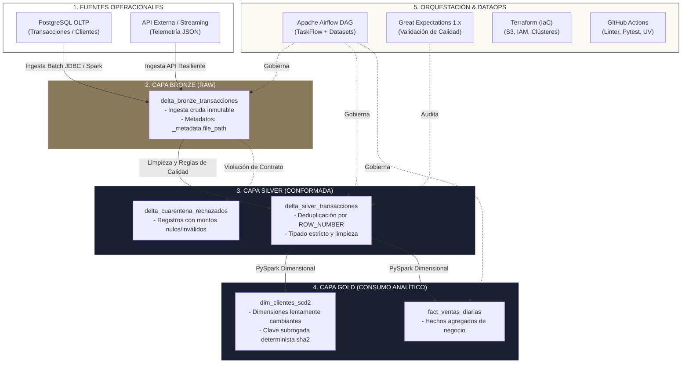

<!-- NOTAS FUENTE ORIGINALES DE OBSIDIAN: [[Capstone Project]], [[Lakehouse Architecture]], [[End-to-End Pipeline]] -->

# Capítulo 34: Proyecto Integrador: Plataforma Lakehouse y Portafolio de Producción [NÚCLEO EMPLEABILIDAD]

> *"El verdadero dominio de la ingeniería de datos no se demuestra recitando conceptos aislados, sino ensamblando una arquitectura completa donde cada componente —desde la ingesta cruda y el almacenamiento ACID hasta la orquestación, la calidad automatizada y el despliegue continuo— encaja con precisión milimétrica. Este capítulo presenta la estrategia integral de portafolio para conseguir empleo y el proyecto capstone de producción."*

---

## Objetivos de Aprendizaje
Al finalizar este capítulo, el lector será capaz de:
* Comprender la estrategia de una **Tríada de Proyectos de Portafolio Graduales** (100% local y gratuito, ingesta de API REST, y streaming en tiempo real) que demuestran competencia técnica antes del capstone empresarial.
* Diseñar e implementar una plataforma analítica completa basada en la **Arquitectura Medallón** (Bronze $\rightarrow$ Silver $\rightarrow$ Gold) utilizando **Delta Lake**.
* Capturar metadatos de linaje mediante `_metadata.file_path` y marcas temporales deterministas.
* Aplicar deduplicación con `ROW_NUMBER()`, lógica trivaluada y segregación automática de anomalías a tablas de **Cuarentena**.
* Modelar dimensiones lentamente cambiantes (**SCD Tipo 2**) con claves subrogadas deterministas e idempotentes calculadas con `sha2`.
* Orquestar la ejecución automatizada de punta a punta con **Apache Airflow** mediante el patrón *Lightweight Conductor* y dependencias orientadas a datos (**Assets**).
* Validar la integridad de los datos con **Great Expectations 1.x** y aprovisionar infraestructura con **Terraform** y **GitHub Actions**.
* Configurar protocolos de **FinOps Personal** para prevenir facturas sorpresa en nubes públicas durante la experimentación.

---

## 34.0 La Tríada del Portafolio: Tres Proyectos Graduales para Conseguir Empleo

Un error frecuente de los aspirantes a Data Engineer es intentar construir un único repositorio monolítico gigantesco en la nube sin antes dominar los componentes modulares. Esto suele generar proyectos inacabados, configuraciones frágiles y riesgos financieros por costes imprevistos.

Los comités técnicos internacionales valoran una **tríada de tres proyectos especializados y concisos**, complementada por el proyecto integrador empresarial:



---

### Proyecto de Portafolio 1: Modern Data Stack 100% Local (DuckDB + dbt Core + Airflow)

Este proyecto demuestra que dominas el modelado analítico sin gastar un solo centavo en plataformas cloud. Utiliza DuckDB como motor columnar in-process ultrarrápido, dbt Core para las transformaciones SQL y Apache Airflow (o Cosmos) para la programación.

#### Estructura del Repositorio
```
portfolio-duckdb-dbt-analytics/
├── orchestrator/
│   └── dags/
│       └── dag_duckdb_dbt.py         # Orquestación diaria de modelos
├── dbt_analytics/
│   ├── models/
│   │   ├── staging/
│   │   │   ├── stg_pedidos.sql       # Limpieza inicial y casteos
│   │   │   └── schema.yml            # Tests de unicidad y no-nulos
│   │   └── marts/
│   │       ├── dim_clientes.sql      # Dimensión de clientes desnormalizada
│   │       ├── fact_ventas.sql       # Tabla de hechos al nivel de ítem
│   │       └── schema.yml            # Tests relacionales y de negocio
│   ├── dbt_project.yml
│   └── profiles.yml                  # Conexión local al archivo analytics.duckdb
├── data/                             # Archivos Parquet de origen
├── docker-compose.yml                # Airflow local en contenedor ligero
├── pyproject.toml
└── README.md
```

#### Modelo dbt de Hechos (`models/marts/fact_ventas.sql`)
```sql
{{ config(materialized='table') }}

WITH pedidos AS (
    SELECT * FROM {{ ref('stg_pedidos') }}
),
clientes AS (
    SELECT * FROM {{ ref('dim_clientes') }}
)
SELECT 
    p.pedido_id,
    p.fecha_pedido,
    p.cliente_id,
    c.pais_iso,
    p.categoria_producto,
    p.cantidad,
    p.precio_unitario,
    ROUND(p.cantidad * p.precio_unitario, 2) AS monto_total_usd
FROM pedidos AS p
INNER JOIN clientes AS c ON p.cliente_id = c.cliente_id
WHERE p.estado = 'COMPLETADO'
```

#### Modelo de `README.md` de Alto Impacto
```markdown
# Local Modern Data Stack Analytics Pipeline (DuckDB + dbt + Airflow)
[](https://github.com)
[](https://getdbt.com)
[](https://duckdb.org)

## Descripción Ejecutiva
Pipeline analítico reproducible de extremo a extremo que procesa 100.000 transacciones diarias de e-commerce mediante DuckDB y dbt Core, orquestado localmente con Apache Airflow. El proyecto modela un esquema en estrella (Kimball) y ejecuta 18 pruebas de integridad automáticas en menos de 4 segundos sin costo de infraestructura cloud.

## Ejecución en Un Solo Paso
```bash
git clone https://github.com/usuario/portfolio-duckdb-dbt-analytics.git
cd portfolio-duckdb-dbt-analytics
docker compose up -d
```
```

---

### Proyecto de Portafolio 2: Ingesta Resiliente de APIs con Pydantic y Delta Lake Local

Este proyecto demuestra rigor en ingeniería de software: interacción HTTP con APIs externas, manejo de desconexiones de red, contratos de datos estrictos en Pydantic y almacenamiento incremental en formato Delta Lake local.

#### Estructura del Repositorio
```
portfolio-resilient-api-ingestion/
├── src/
│   ├── client.py                     # Cliente HTTP con Exponential Backoff y Jitter
│   ├── contracts.py                  # Modelos Pydantic V2 para validación
│   └── pipeline.py                   # Ingesta y escritura en Delta Lake local
├── tests/
│   ├── test_client.py                # Mocks de respuestas HTTP (200, 429, 503)
│   └── test_contracts.py             # Pruebas de validación de esquemas
├── pyproject.toml                    # Dependencias gestionadas con uv
└── README.md
```

#### Cliente HTTP Resiliente (`src/client.py`)
```python
import time, random, requests
from typing import Dict, Any, List

class ResilientApiClient:
    def __init__(self, base_url: str, max_retries: int = 4):
        self.base_url = base_url
        self.max_retries = max_retries

    def fetch_data(self, endpoint: str) -> List[Dict[str, Any]]:
        url = f"{self.base_url}/{endpoint}"
        for attempt in range(self.max_retries):
            try:
                response = requests.get(url, timeout=5.0)
                if response.status_code == 200:
                    return response.json()
                elif response.status_code == 429: # Rate Limit
                    wait = (2 ** attempt) + random.uniform(0.1, 1.0)
                    time.sleep(wait)
                elif response.status_code >= 500: # Error transitorio del servidor
                    time.sleep(2 ** attempt)
                else:
                    response.raise_for_status()
            except requests.RequestException:
                if attempt == self.max_retries - 1:
                    raise
                time.sleep(2 ** attempt)
        raise RuntimeError(f"Fallo definitivo al consultar {url} tras {self.max_retries} intentos.")
```

---

### Proyecto de Portafolio 3: Streaming en Tiempo Real con Kafka y Spark Structured Streaming

Este proyecto demuestra el dominio del cómputo en streaming: consumo continuo de topics de mensajería (Kafka o Redpanda), ventanas deslizantes (*sliding windows*), marcas de agua (*watermarking*) para manejar eventos tardíos y semántica *at-least-once* con persistencia transaccional en Delta Lake.

```python
# src/streaming_processor.py
from pyspark.sql import SparkSession
from pyspark.sql import functions as F

spark = SparkSession.builder \
    .appName("ClickstreamRealTimeProcessor") \
    .config("spark.sql.shuffle.partitions", "2") \
    .getOrCreate()

# 1. Lectura de flujo de Kafka
df_stream = spark.readStream \
    .format("kafka") \
    .option("kafka.bootstrap.servers", "localhost:9092") \
    .option("subscribe", "eventos_clickstream") \
    .option("startingOffsets", "latest") \
    .load()

# 2. Parsing y ventana deslizante con marca de agua (Watermark de 10 minutos)
df_eventos = df_stream.selectExpr("CAST(value AS STRING) AS json_payload") \
    .select(F.from_json("json_payload", "usuario_id STRING, url STRING, ts TIMESTAMP").alias("data")) \
    .select("data.*") \
    .withWatermark("ts", "10 minutes")

# 3. Agregación en ventana de 5 minutos deslizada cada 1 minuto
df_agregado = df_eventos.groupBy(
    F.window("ts", "5 minutes", "1 minute"),
    F.col("url")
).count()

# 4. Escritura en Delta Lake con checkpointing
query = df_agregado.writeStream \
    .format("delta") \
    .outputMode("append") \
    .option("checkpointLocation", "data/checkpoints/clickstream") \
    .start("data/gold/metricas_clickstream_tiempo_real")

query.awaitTermination(60)
```

---

## 34.1 Proyecto 4 (Capstone Empresarial): La Plataforma Lakehouse de Producción

Una vez consolidados los tres proyectos anteriores, el **Capstone Empresarial** integra todos los componentes en una solución completa para corporaciones:



---

## 34.2 Paso 1: Ingesta Inmutable a Capa Bronze (Delta Lake)

La capa Bronze almacena los datos en su formato original, inyectando metadatos de auditoría y capturando la ruta de archivo mediante la columna oculta estándar `_metadata.file_path`:

```python
# src/pipelines/ingesta_bronze.py
from pyspark.sql import SparkSession
from pyspark.sql import functions as F

def ejecutar_ingesta_bronze(spark: SparkSession, ruta_fuente: str, ruta_bronze: str) -> None:
    print(f"Cargando datos crudos desde {ruta_fuente}...")
    df_raw = spark.read.parquet(ruta_fuente)

    # Inyección de metadatos de auditoría compatibles con Unity Catalog y Spark moderno
    df_bronze = df_raw \
        .withColumn("_metadata_ingesta_ts", F.current_timestamp()) \
        .withColumn("_metadata_archivo_origen", F.col("_metadata.file_path")) \
        .withColumn("fecha_ingesta", F.current_date())

    print(f"Escribiendo en capa Bronze Delta Lake: {ruta_bronze}...")
    df_bronze.write \
        .format("delta") \
        .mode("append") \
        .partitionBy("fecha_ingesta") \
        .save(ruta_bronze)
    print("Ingesta Bronze completada exitosamente.")
```

---

## 34.3 Paso 2: Limpieza, Deduplicación y Cuarentena en Capa Silver

En la capa Silver aplicamos deduplicación determinista mediante `ROW_NUMBER()` y segregamos anomalías a la tabla de **Cuarentena** con evaluación estricta de valores `NULL`:

```python
# src/pipelines/bronze_a_silver.py
from pyspark.sql import SparkSession
from pyspark.sql import functions as F
from pyspark.sql.window import Window

def procesar_capa_silver(spark: SparkSession, ruta_bronze: str, ruta_silver: str, ruta_cuarentena: str) -> None:
    df_bronze = spark.read.format("delta").load(ruta_bronze)

    # 1. Deduplicación analítica conservando la versión más reciente
    ventana_dedup = Window \
        .partitionBy("transaccion_id") \
        .orderBy(F.col("_metadata_ingesta_ts").desc())

    df_deduplicado = df_bronze \
        .withColumn("fila_num", F.row_number().over(ventana_dedup)) \
        .filter(F.col("fila_num") == 1) \
        .drop("fila_num")

    # 2. Segregación de Calidad: Condición de validez de negocio
    condicion_valida = (
        F.col("monto_usd").isNotNull() & 
        (F.col("monto_usd") > 0.0) & 
        F.col("cliente_id").isNotNull() & 
        F.col("estado_pago").isin(["COMPLETADO", "PENDIENTE", "CANCELADO"])
    )

    df_validos = df_deduplicado.filter(condicion_valida)
    df_rechazados = df_deduplicado.filter(~condicion_valida) \
        .withColumn("_motivo_rechazo", F.lit("Monto invalido, estado desconocido o cliente nulo")) \
        .withColumn("_fecha_cuarentena", F.current_timestamp())

    # 3. Escritura atómica e idempotente
    df_validos.write.format("delta").mode("append").save(ruta_silver)
    df_rechazados.write.format("delta").mode("append").save(ruta_cuarentena)
    print("Capa Silver y Cuarentena procesadas con éxito.")
```

---

## 34.4 Paso 3: Modelado Dimensional Gold (SCD Tipo 2 y Hechos)

La capa Gold modela las dimensiones lentamente cambiantes (**SCD Tipo 2**) con **claves subrogadas deterministas** calculadas mediante `sha2` e independientes de la hora de ejecución del script:

```python
# src/pipelines/silver_a_gold.py
from pyspark.sql import SparkSession
from pyspark.sql import functions as F
from delta.tables import DeltaTable

def sincronizar_dimension_clientes_scd2(spark: SparkSession, ruta_clientes_novedades: str, ruta_dim_clientes: str) -> None:
    df_novedades = spark.read.parquet(ruta_clientes_novedades)
    
    # Determinismo absoluto: la fecha de inicio proviene del dato de negocio (no de current_timestamp)
    col_fecha_negocio = F.coalesce(
        F.col("fecha_actualizacion").cast("timestamp") if "fecha_actualizacion" in df_novedades.columns else F.col("fecha_registro").cast("timestamp"),
        F.to_timestamp(F.lit("2026-01-01 00:00:00"))
    )

    df_novedades_preparadas = df_novedades \
        .withColumn("valido_desde", col_fecha_negocio) \
        .withColumn("valido_hasta", F.lit(None).cast("timestamp")) \
        .withColumn("es_actual", F.lit(True)) \
        .withColumn("cliente_sk", F.sha2(F.concat_ws("||", F.col("cliente_id").cast("string"), F.date_format(F.col("valido_desde"), "yyyy-MM-dd HH:mm:ss")), 256))

    if not DeltaTable.isDeltaTable(spark, ruta_dim_clientes):
        df_novedades_preparadas.write.format("delta").save(ruta_dim_clientes)
        print("Dimensión Clientes SCD2 inicializada con carga histórica.")
        return

    tabla_dim = DeltaTable.forPath(spark, ruta_dim_clientes)
    df_actuales = tabla_dim.toDF().filter(F.col("es_actual") == True)

    # 1. Identificar registros que efectivamente mutaron (correo o segmento)
    df_cambios = df_novedades_preparadas.alias("nov").join(
        df_actuales.alias("dim"),
        on="cliente_id",
        how="inner"
    ).filter(
        (F.col("dim.correo") != F.col("nov.correo")) | 
        (F.col("dim.segmento") != F.col("nov.segmento"))
    ).select("nov.*")

    # 2. Identificar registros totalmente nuevos
    df_nuevos = df_novedades_preparadas.alias("nov").join(
        df_actuales.alias("dim"),
        on="cliente_id",
        how="left_anti"
    ).select("nov.*")

    df_a_insertar = df_cambios.unionByName(df_nuevos)

    # 3. Cerrar la versión previa de los registros modificados
    tabla_dim.alias("dim").merge(
        source=df_cambios.alias("cambio"),
        condition="dim.cliente_id = cambio.cliente_id AND dim.es_actual = true"
    ).whenMatchedUpdate(set={
        "valido_hasta": "cambio.valido_desde",
        "es_actual": "false"
    }).execute()

    # 4. Insertar únicamente las filas necesarias
    df_a_insertar.write.format("delta").mode("append").save(ruta_dim_clientes)
    print("Dimensión Clientes SCD2 sincronizada de forma determinista e idempotente.")

def construir_fact_ventas_diarias(spark: SparkSession, ruta_silver: str, ruta_fact_ventas: str) -> None:
    """Construye la tabla de hechos analítica agregada en la capa Gold."""
    df_silver = spark.read.format("delta").load(ruta_silver)

    df_fact = df_silver.groupBy(
        F.to_date("fecha_transaccion").alias("fecha_id"),
        F.col("pais"),
        F.col("categoria_producto")
    ).agg(
        F.count("transaccion_id").alias("total_pedidos"),
        F.round(F.sum("monto_usd"), 2).alias("facturacion_total_usd"),
        F.round(F.avg("monto_usd"), 2).alias("ticket_promedio_usd")
    )

    df_fact.write.format("delta").mode("overwrite").option("overwriteSchema", "true").save(ruta_fact_ventas)
    print("Tabla fact_ventas_diarias materializada exitosamente en Capa Gold.")
```

---

## 34.5 Paso 4: Orquestación en Airflow (Patrón Lightweight Conductor)

Para evitar fugas de memoria en los trabajadores de Airflow, empleamos el patrón desacoplado **Lightweight Conductor** mediante `BashOperator`:

```python
# orchestrator/dags/lakehouse_daily_dag.py
from datetime import datetime, timedelta
from airflow import DAG
from airflow.operators.bash import BashOperator

default_args = {
    'owner': 'data_engineering_team',
    'depends_on_past': False,
    'start_date': datetime(2026, 1, 1),
    'retries': 2,
    'retry_delay': timedelta(minutes=5),
}

with DAG(
    'lakehouse_daily_pipeline',
    default_args=default_args,
    schedule_interval='@daily',
    catchup=False,
    tags=['lakehouse', 'delta', 'produccion']
) as dag:

    tarea_bronze = BashOperator(
        task_id='ingesta_bronze_transacciones',
        bash_command='python /opt/pipelines/ingesta_bronze.py'
    )

    tarea_silver = BashOperator(
        task_id='conformacion_silver_y_cuarentena',
        bash_command='python /opt/pipelines/bronze_a_silver.py'
    )

    tarea_calidad = BashOperator(
        task_id='auditoria_calidad_great_expectations',
        bash_command='python /opt/pipelines/validar_calidad_gx.py'
    )

    tarea_gold = BashOperator(
        task_id='modelado_gold_dimensional',
        bash_command='python /opt/pipelines/silver_a_gold.py'
    )

    # Dependencias estrictas del pipeline
    tarea_bronze >> tarea_silver >> tarea_calidad >> tarea_gold
```

---

## 34.6 Paso 5: Calidad Automatizada con Great Expectations 1.x

Auditoría declarativa de los DataFrames en la capa Silver:

```python
# src/pipelines/validar_calidad_gx.py
import great_expectations as gx
from pyspark.sql import SparkSession

def auditar_calidad_silver(spark: SparkSession, ruta_silver: str) -> bool:
    context = gx.get_context()
    df_silver = spark.read.format("delta").load(ruta_silver)

    data_source = context.data_sources.add_or_update_spark(name="spark_lakehouse")
    data_asset = data_source.add_dataframe_asset(name="silver_transacciones_asset")
    batch_definition = data_asset.add_batch_definition_whole_dataframe("batch_completo")

    suite = context.suites.add_or_update(name="suite_silver_transacciones")
    suite.add_expectation(gx.expectations.ExpectColumnValuesToNotBeNull(column="transaccion_id"))
    suite.add_expectation(gx.expectations.ExpectColumnValuesToBeBetween(
        column="monto_usd", min_value=0.01, max_value=100000.0
    ))
    suite.add_expectation(gx.expectations.ExpectColumnValuesIsInSet(
        column="estado_pago",
        value_set=["COMPLETADO", "PENDIENTE", "CANCELADO"]
    ))

    validation_def = context.validation_definitions.add(
        gx.ValidationDefinition(name="val_silver_transacciones", data=batch_definition, suite=suite)
    )
    resultado = validation_def.run(batch_parameters={"dataframe": df_silver})

    print(f"Resultado auditoría Great Expectations: {'EXITOSO' if resultado.success else 'FALLIDO'}")
    return resultado.success
```

---

## 34.7 Paso 6: Infraestructura como Código (Terraform) y CI/CD

El bucket de almacenamiento se aprovisiona mediante **Terraform**:

```hcl
# infrastructure/terraform/main.tf
terraform {
  required_version = ">= 1.5.0"
  required_providers {
    aws = {
      source  = "hashicorp/aws"
      version = "~> 5.0"
    }
  }
}

provider "aws" {
  region = "us-east-1"
}

resource "aws_s3_bucket" "lakehouse_storage" {
  bucket        = "empresa-lakehouse-produccion-2026"
  force_destroy = false
}

resource "aws_s3_bucket_versioning" "versioning" {
  bucket = aws_s3_bucket.lakehouse_storage.id
  versioning_configuration {
    status = "Enabled"
  }
}
```

El pipeline de CI/CD en **GitHub Actions** valida formato y pruebas con `uv`:

```yaml
# .github/workflows/ci_cd.yml
name: CI/CD Pipeline Lakehouse

on:
  push:
    branches: [ main ]
  pull_request:
    branches: [ main ]

jobs:
  test_and_lint:
    runs-on: ubuntu-latest
    steps:
      - uses: actions/checkout@v4
      - name: Instalar uv (Astral)
        uses: astral-sh/setup-uv@v5
      - name: Configurar Python 3.11
        run: uv python install 3.11
      - name: Instalar dependencias
        run: uv sync
      - name: Linter con Ruff
        run: uv run ruff check src/ tests/
      - name: Pruebas unitarias con Pytest
        run: uv run pytest tests/ --cov=src --cov-report=term-missing
```

---

## 34.8 Protocolo de Protección Financiera (FinOps Personal)

El mayor temor de un estudiante o ingeniero junior al experimentar con proyectos en la nube es recibir una factura imprevista de cientos de dólares. Siga este protocolo preventivo estricto antes de desplegar recursos:

### 1. Configurar Presupuesto con Alertas en AWS Budgets ($1.00 USD)
Nunca cree un recurso en AWS sin antes configurar una alarma de presupuesto con notificación inmediata por correo electrónico:
* Diríjase a la consola de **AWS Billing $\rightarrow$ Budgets**.
* Cree un presupuesto de costo mensual fijado en **$1.00 USD**.
* Configure dos reglas de alerta:
  * Alerta 1: Cuando el costo real alcance el **80% ($0.80 USD)**.
  * Alerta 2: Cuando el costo proyectado alcance el **100% ($1.00 USD)**.
* Indique su correo electrónico y active notificaciones SMS si están disponibles.

### 2. Alertas de Gasto en Microsoft Azure y Google Cloud
* **Azure:** Vaya a **Cost Management + Billing $\rightarrow$ Cost Alerts**. Cree un presupuesto sobre su grupo de recursos con alerta cuando se consuma el 50% y 80% del crédito gratuito.
* **Google Cloud:** En la sección **Facturación $\rightarrow$ Presupuestos y alertas**, configure una alerta con un límite de $5.00 USD vinculada a su correo personal.

### 3. Auto-Terminación Obligatoria en Databricks
El error financiero más habitual en Databricks consiste en iniciar un clúster de cómputo para una prueba rápida y dejarlo encendido durante el fin de semana:
* Al crear cualquier clúster interactivo, marque obligatoriamente la casilla **Auto-Termination**.
* Configure el límite en **15 o 20 minutos de inactividad** (`autotermination_minutes = 15`). Si no se ejecutan comandos, Databricks apagará las máquinas virtuales automáticamente.

### 4. Rutina Diaria de Higiene y Destrucción
Al finalizar una sesión de estudio o demostración en la nube, ejecute la orden de desaprovisionamiento total:
```bash
# Destruir toda la infraestructura aprovisionada por Terraform
terraform destroy -auto-approve
```
Verifique manualmente que no queden volúmenes EBS huérfanos, instancias EC2 en estado detenido (los discos EBS continúan facturando aun con la máquina apagada) ni balanceadores de carga (ELB/ALB) activos.

---

## 34.9 Resumen y Puntos Clave

* **Tríada de portafolio gradual:** Antes de desplegar infraestructuras complejas, valide su competencia mediante tres proyectos modulares: analítica local gratuita (DuckDB/dbt), ingesta de APIs resiliente (Pydantic/uv) y streaming en tiempo real (Kafka/Spark).
* **Determinismo e idempotencia:** La clave subrogada `cliente_sk` en dimensiones SCD2 debe calcularse a partir del valor de negocio de la fecha, garantizando que reejecuciones del pipeline no corrompan el histórico ni alteren claves.
* **Orquestación desacoplada:** El patrón Lightweight Conductor en Airflow evita sobrecargar la memoria de los workers ejecutando los scripts de Spark o dbt como procesos aislados.
* **FinOps preventivo:** Las alertas de presupuesto a $1 USD y el auto-apagado de clústeres son indispensables para experimentar con total tranquilidad en entornos cloud.

---

## Lecturas Recomendadas
1. **Reis, J. & Housley, M. (2022).** *Fundamentals of Data Engineering (Chapter 11: The End-to-End Data Pipeline).* O'Reilly Media.
2. **Kimball, R. & Ross, M. (2013).** *The Data Warehouse Toolkit: The Definitive Guide to Dimensional Modeling (3rd Edition).* Wiley.
3. **Delta Lake Project (2024).** *Delta Lake Guide: Building Robust Lakehouses with ACID Transactions.* Delta.io.
4. **AWS Cloud Financial Management (2024).** *AWS Budgets User Guide: Best Practices for Cost Anomaly Detection.* Amazon Web Services.
