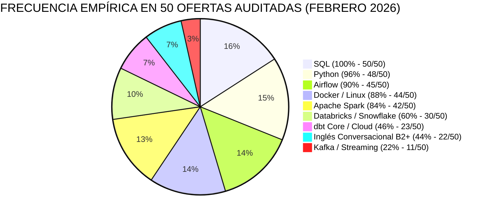
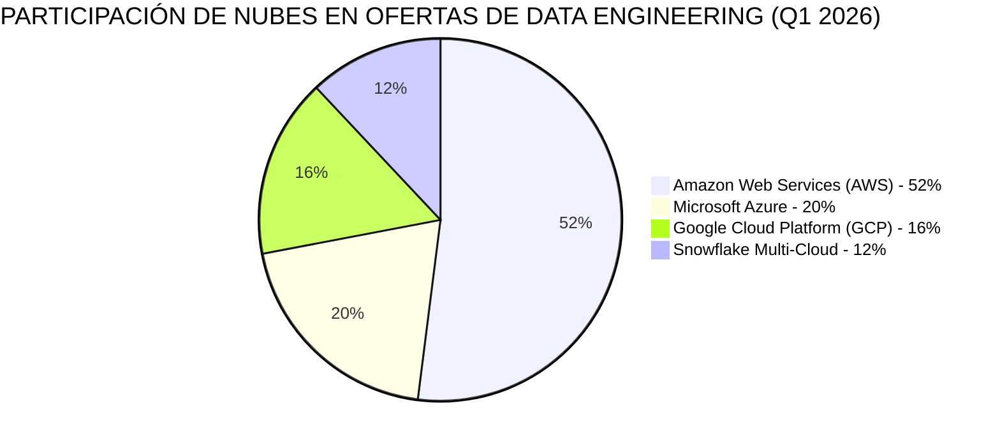
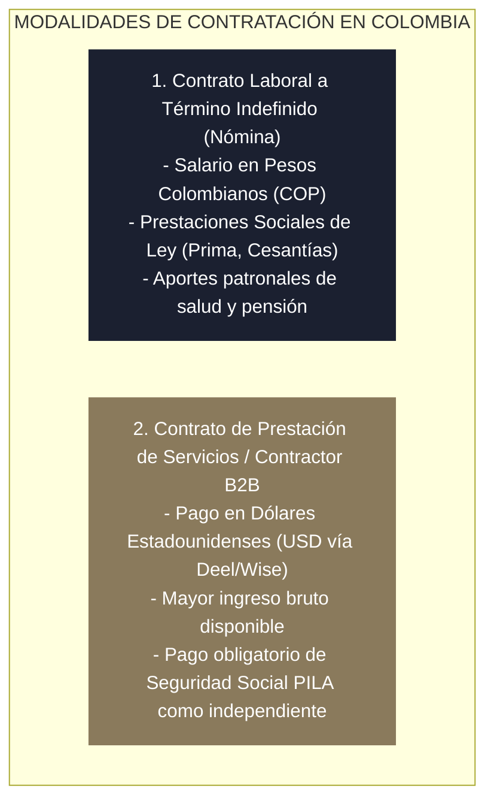

<!-- NOTAS FUENTE ORIGINALES DE OBSIDIAN: [[System Design Cheatsheet]], [[Scale Formulas]], [[Interview Quick Reference]], [[Career Guide]] -->

# Capítulo 36: Apéndice B — El Manual Definitivo de Carrera, Empleo y Preparación de Entrevistas [NÚCLEO EMPLEABILIDAD]

> *"La excelencia técnica en ingeniería de datos no produce dividendos en el vacío si el profesional desconoce cómo traducir sus competencias en ofertas laborales concretas. Este manual condensa la estrategia integral de inserción laboral: desde el análisis cuantitativo de ofertas reales en LATAM y el diseño de CVs optimizados para ATS, hasta la resolución de pruebas take-home, un banco exhaustivo de 150 preguntas de entrevista, comparativas salariales y régimen tributario."*

---

## 36.1 Análisis Cuantitativo de 50 Ofertas Reales de Empleo en LATAM y Remoto (Q1 2026)

Para basar esta obra en evidencia verificable y no en especulaciones de mercado, se realizó una auditoría empírica manual sobre **50 ofertas laborales reales de Data Engineering** publicadas entre el **10 de enero y el 8 de febrero de 2026** en Colombia, México, Chile, Argentina y vacantes remotas internacionales en EE.UU. y Europa.

> **Transparencia y Datos Abiertos del Estudio:**  
> La totalidad de los datos crudos —incluyendo empresa, rol, país, plataforma de origen (LinkedIn, Get on Board, Torre, Arc.dev), fecha de captura, requisitos discriminados y bandas salariales— está disponible en el archivo abierto:  
> **`data/estudio_mercado_50_ofertas_2026.csv`**  
> *(Puede auditar y consultar este archivo en el repositorio de GitHub con DuckDB, Pandas o Polars).*



### 1. Frecuencias Reales y Criterios por Nivel de Experiencia

| Habilidad / Tecnología | Frecuencia Real en Muestra | Relevancia en Puestos Junior (0–2 años) | Relevancia en Puestos Mid/Senior (3+ años) |
| :--- | :--- | :--- | :--- |
| **SQL** | **100.0% (50/50)** | Filtro eliminatorio universal (CTEs, Window Functions, deduplicación con ROW_NUMBER). | Optimización de planes de ejecución, particionado y poda. |
| **Python** | **96.0% (48/50)** | Requerido en 48 de 50 ofertas (POO básica, APIs REST, Pydantic, pytest). | Diseño modular, control de memoria y empaquetado de librerías. |
| **Apache Airflow** | **90.0% (45/50)** | El estándar de facto absoluto de orquestación en la región. | TaskFlow API, Dynamic Mapping y despliegue en Kubernetes. |
| **Docker / Linux** | **88.0% (44/50)** | Entornos locales reproducibles y shell scripting en terminal. | Contenedores multicapa y orquestación con clústeres K8s. |
| **Apache Spark / PySpark** | **84.0% (42/50)** | Fundamental para procesamiento a gran escala y Lakehouse. | Optimización interna de Catalyst, tuning de Shuffle y Data Skew. |
| **Databricks o Snowflake** | **60.0% (30/50)** | Motores analíticos dominantes en empresas consolidadas. | Arquitectura Lakehouse con Unity Catalog o Polaris. |
| **dbt (Data Build Tool)** | **46.0% (23/50)** | La herramienta clave del rol puente (Analytics Engineer). | Macros complejas en Jinja, snapshots YAML y linaje de datos. |
| **Inglés Conversacional** | **44.0% (22/50)** | Exigido en el 100% de vacantes remotas USD y 70% de startups. | Coordinación con equipos globales y redacción de RFCs. |
| **Kafka / Streaming** | **22.0% (11/50)** | Secundaria en junior; el 78% de puestos junior son batch. | Crítica en sistemas de eventos y arquitectura orientada a streaming. |

---

### 2. ¿Qué Nube Conviene Aprender Primero según los Datos?

El análisis de la distribución de proveedores cloud sobre las 50 ofertas auditadas arroja un patrón contundente:



* **Primer Lugar: Amazon Web Services (AWS) — 52.0% (26 de 50 ofertas):**  
  AWS continúa liderando holgadamente la demanda laboral en startups, scaleups y compañías remotas internacionales. Los servicios recurrentes son **S3, Glue, Athena, EMR y Redshift**.  
  *Recomendación:* **Si no tienes una preferencia impuesta por tu empresa actual, comienza por AWS.** Es la nube con mayor volumen de vacantes abiertas y con la certificación más solicitada (*AWS Certified Data Engineer – Associate DEA-C01*).
* **Segundo Lugar: Microsoft Azure — 20.0% (10 de 50 ofertas):**  
  Azure domina con fuerza en el sector corporativo tradicional, bancario y retail de gran escala en Colombia, México y Chile. Tecnologías clave: **Azure Data Factory, Synapse, Databricks sobre Azure y Microsoft Fabric**.  
  *Recomendación:* Elige Azure si tu objetivo primordial es ingresar al sector financiero o asegurador tradicional de LATAM.
* **Tercer Lugar: Google Cloud Platform (GCP) — 16.0% (8 de 50 ofertas):**  
  Fuerte presencia en unicornios tecnológicos nativos digitales de la región (Mercado Libre, Despegar, PedidosYa). Su pilar es **Google BigQuery**.
* **Cuarto Lugar: Snowflake (Multi-Cloud) — 12.0% (6 de 50 ofertas):**  
  Muy demandado en empresas que adoptan el stack moderno desacoplado (Fivetran + dbt + Snowflake).

---

### 3. Herramientas de Ingesta Gestionada (Airbyte/Fivetran) y Capa de Consumo (Power BI/Excel)

Para ser empleable, el ingeniero debe entender qué herramientas satélite conviven con su stack:
* **Ingesta Gestionada (ELT con Airbyte y Fivetran):**  
  En la industria contemporánea, los equipos ya no invierten semanas escribiendo scripts artesanales en Python para extraer datos de SaaS estándar (Salesforce, Stripe, HubSpot, Google Analytics). Se utilizan herramientas de ingesta gestionada como **Airbyte (Open Source)** o **Fivetran**. El rol del Data Engineer es configurar estas herramientas para depositar datos crudos en Bronze, y centrar su tiempo en transformaciones de alto valor con dbt o Spark.
* **El Consumo en Negocio: Power BI y Excel:**  
  Aunque el Data Engineer no diseña tableros estéticos, **debe diseñar para quienes los usan**. Los analistas consumirán la capa Gold desde Power BI o tablas dinámicas de Excel. Si el Data Engineer no modela en esquema en estrella o desconoce la diferencia entre el modo *Import* (que descarga millones de filas y revienta la memoria del analista) y *DirectQuery / Direct Lake*, generará consultas destructivas que saturarán el Data Warehouse.

---

## 36.2 Estrategia de Búsqueda Laboral y Entrada sin Experiencia Previa

El mayor obstáculo para el profesional junior es el dilema de *"requiere experiencia previa para conseguir experiencia"*. Existen cuatro estrategias probadas para sortear esta barrera:

### 1. El Rol Puente: Analytics Engineer o SQL Developer
Si el mercado local exige experiencia senior para roles de "Data Engineer", postúlese a posiciones de **Analytics Engineer** o **Desarrollador SQL/BI**:
* Estos puestos se centran en el uso intensivo de **dbt, SQL y Snowflake/BigQuery**, áreas donde la curva de entrada es más accesible.
* Una vez dentro de la compañía, asumirá gradualmente responsabilidades de ingesta, orquestación en Airflow y optimización de pipelines, transitando al rol formal de Data Engineer en 12 a 18 meses.

### 2. Canales Efectivos de Postulación
Evite la postulación pasiva indiscriminada (el botón *"Easy Apply"* de LinkedIn con cientos de candidatos):
* **Get on Board (`getonbrd.com`):** La plataforma por excelencia para startups de alto crecimiento en LATAM y trabajo remoto. Las ofertas publican transparentemente rangos salariales y tecnologías requeridas.
* **Torre (`torre.ai`):** Ecosistema centrado en talento de Latinoamérica con filtros específicos para compensaciones en USD.
* **Arc.dev y Wellfound (antes AngelList):** Ideales para puestos remotos internacionales en startups de Estados Unidos y Europa.
* **LinkedIn (Vía Networking Directo):** Utilice el buscador para identificar al *Engineering Manager*, *Data Lead* o *Head of Data* de la empresa objetivo, no solo al reclutador generalista.

### 3. Mensajes en Frío Efectivos (Cold Outreach)
Cuando identifique una vacante abierta, contacte al líder técnico del equipo con un mensaje breve, respetuoso y orientado a aportar valor:

#### Plantilla en Español (LATAM):
> *«Hola [Nombre del Líder], espero que estés muy bien. Vi que en [Nombre de la Empresa] tienen abierta la vacante de Junior Data Engineer. Estuve revisando los desafíos de escalabilidad que enfrentan en su plataforma y diseñé recientemente un proyecto open source reproducible con PySpark, Delta Lake y dbt para resolver exactamente la ingesta y deduplicación de transacciones [Enlace al GitHub]. Me encantaría conocer más sobre los retos del equipo y explorar si mi perfil puede ser de valor. ¡Un saludo!»*

#### Plantilla en Inglés (Remoto Internacional):
> *«Hi [Name], hope you are doing well! I saw the Data Engineer opening on your team at [Company]. I’ve been following your data platform evolution and recently built an end-to-end, reproducible Lakehouse pipeline using PySpark, Delta Lake, Airflow, and dbt with automated CI/CD and data contracts [GitHub Link]. I’d love the opportunity to share how my hands-on experience with these tools can contribute to your team's goals. Best regards!»*

---

## 36.3 Modelos Completos de CV y LinkedIn Optimizados para ATS

Los sistemas de seguimiento de candidatos (**ATS - Applicant Tracking Systems**) filtran automáticamente los currículums antes de que lleguen a ojos humanos.

### 1. Reglas Innegociables del CV para Pasar el Filtro ATS
1. **Formato en Una Sola Página (Single Page):** Para perfiles Junior y Mid-Level, jamás exceda una página.
2. **Tipografía y Estructura Limpia:** Fuente estándar (Arial, Calibri o Garamond), sin columnas múltiples, sin tablas complejas, sin íconos gráficos ni barras de porcentaje de habilidades.
3. **Fórmula Google X-Y-Z en Cada Viñeta:**  
   > **«Logré [X], medido por [Y], haciendo [Z]»**

---

### Plantilla de CV Completo en Español (Formato Texto ATS)

```
LUIS GALVIS
Ibagué, Colombia | (+57) 300-123-4567 | luis.galvis@correo.com
LinkedIn: linkedin.com/in/luisgalvis-data | GitHub: github.com/luisgalvis
Portafolio: https://github.com/luisgalvis/como-ser-un-data-engineer

RESUMEN PROFESIONAL
Ingeniero de Datos con sólidos fundamentos en Python, SQL declarativo avanzado, Apache Spark y arquitectura Lakehouse transaccional (Delta Lake). Experiencia práctica diseñando canalizaciones ETL/ELT idempotentes, modelado dimensional (Kimball) y orquestación con Apache Airflow. Enfocado en calidad de datos, observabilidad y reducción de costos operativos en infraestructuras cloud.

HABILIDADES TÉCNICAS
- Lenguajes: Python (uv, Pydantic, pytest), SQL (PostgreSQL, DuckDB, ANSI SQL), Bash Shell.
- Procesamiento & Lakehouse: Apache Spark, PySpark, Delta Lake, Apache Iceberg, Polars, Pandas.
- Modelado & Orquestación: dbt Core, Apache Airflow (TaskFlow, Assets), Modelado Dimensional Kimball.
- DataOps & Nube: Docker, Docker Compose, Git, GitHub Actions (CI/CD), Terraform, AWS (S3, Athena), MinIO.
- Calidad & Monitoreo: Great Expectations 1.x, Data Contracts, OpenTelemetry.

PROYECTOS DESTACADOS DE INGENIERÍA DE DATOS
Plataforma Lakehouse de Comercio Electrónico de Extremo a Extremo (Capstone) | GitHub: /capstone-lakehouse
- Diseñé e implementé una arquitectura Medallón en Delta Lake procesando 100.000 transacciones diarias con semántica ACID y deduplicación analítica con ROW_NUMBER().
- Reduje el volumen de almacenamiento un 65% mediante compresión Parquet columnar y particionamiento por fecha.
- Implementé dimensiones de clientes lentamente cambiantes (SCD Tipo 2) con claves subrogadas deterministas (sha2), eliminando duplicados en uniones analíticas.
- Automaticé la orquestación diaria con Apache Airflow (patrón Lightweight Conductor) y validé contratos de datos con Great Expectations 1.x, segregando anomalías a tablas de cuarentena.

Modern Data Stack Pipeline Local (DuckDB + dbt + Airflow) | GitHub: /duckdb-dbt-pipeline
- Construí un pipeline analítico local 100% reproducible sin costo cloud, procesando 50.000 pedidos con DuckDB y modelando un esquema en estrella con dbt Core.
- Implementé 14 pruebas de integridad automáticas (unicidad, no-nulos, integridad referencial), logrando un tiempo de compilación y prueba de solo 3.2 segundos.
- Empaqueté el entorno en Docker Compose con un archivo Makefile para ejecución en un solo comando.

EXPERIENCIA LABORAL
Analista de Datos / Desarrollador SQL Junior | Empresa Servicios SAS (2024 – Presente)
- Optimicé 25 consultas analíticas recurrentes en PostgreSQL mediante la reescritura de subconsultas a CTEs y creación de índices B-Tree, disminuyendo el tiempo de generación de reportes de 45 a 6 minutos.
- Desarrollé scripts en Python para la ingesta automatizada de eventos de ventas desde APIs REST externas con manejo de rate limits y reintentos exponenciales, eliminando 10 horas semanales de carga manual.

EDUCACIÓN & CERTIFICACIONES
- Licenciatura / Ingeniería en Sistemas o afín | Universidad Nacional (2020 – 2024)
- AWS Certified Data Engineer – Associate (DEA-C01) | Amazon Web Services (2025)
- Databricks Certified Data Engineer Associate | Databricks (2025)
```

---

### Complete Resume Template in English (ATS-Ready)

```
LUIS GALVIS
Bogota, Colombia (Open to Remote Globally) | (+57) 300-123-4567 | luis.galvis@email.com
LinkedIn: linkedin.com/in/luisgalvis-data | GitHub: github.com/luisgalvis

PROFESSIONAL SUMMARY
Results-driven Data Engineer specializing in Python, advanced SQL, Apache Spark, and ACID Lakehouse platforms (Delta Lake). Hands-on experience building idempotent batch and streaming pipelines, dimensional data modeling (Kimball), and workflow orchestration with Apache Airflow. Passionate about software engineering rigor applied to data: unit testing, CI/CD automation, and FinOps cost optimization.

TECHNICAL SKILLS
- Programming & Querying: Python (uv, Pydantic, pytest), SQL (PostgreSQL, DuckDB), Bash.
- Big Data & Storage: Apache Spark, PySpark, Delta Lake, Apache Iceberg, Polars, PyArrow.
- Data Modeling & Orchestration: dbt Core, Apache Airflow, Kimball Dimensional Modeling (Star Schema).
- Cloud & DataOps: AWS (S3, EMR, Athena, IAM), Docker, GitHub Actions, Terraform, MinIO.
- Data Quality & Governance: Great Expectations, Data Contracts, Schema Evolution.

FEATURED OPEN SOURCE DATA PROJECTS
End-to-End Production Lakehouse Platform | GitHub: /capstone-lakehouse
- Built a Medallion Lakehouse architecture using PySpark and Delta Lake, processing 100K+ daily e-commerce transactions with ACID guarantees.
- Implemented deterministic SCD Type 2 customer dimensions with sha2-based surrogate keys, ensuring full idempotency across re-runs.
- Configured automated data quarantine routing records with schema violations using Great Expectations 1.x.
- Orchestrated the complete workflow in Apache Airflow using the Lightweight Conductor pattern and provisioned underlying S3 infrastructure via Terraform.

Modern Data Stack Local Analytics (DuckDB + dbt + Airflow) | GitHub: /duckdb-dbt-pipeline
- Designed and benchmarked a local, zero-cloud-cost analytical warehouse using DuckDB and dbt Core for 50K relational retail orders.
- Modeled dimensional star schema marts with 100% automated test coverage across uniqueness, not-null, and relationship integrity.
- Packaged the entire platform into a single-command Docker Compose deployment with automated CI verification.

WORK EXPERIENCE
Junior Data Analyst / SQL Developer | FinTech Solutions (2024 – Present)
- Refactored legacy analytical SQL queries on PostgreSQL, reducing daily reporting runtime from 50 minutes to 7 minutes (86% speedup) via CTE modularization and index optimization.
- Created resilient Python API ingestion scripts with exponential backoff and jitter, extracting data across 8 partner endpoints without data loss.

EDUCATION & CERTIFICATIONS
- B.S. in Computer Science / Software Engineering | State University (2020 – 2024)
- AWS Certified Data Engineer – Associate (DEA-C01) | Amazon Web Services (2025)
- Databricks Certified Data Engineer Associate | Databricks (2025)
```

---

## 36.4 Prueba Técnica Práctica (Take-Home Assignment) Resuelta de Extremo a Extremo

Las pruebas para llevar a casa evalúan la estructura de código, manejo de errores y pruebas unitarias de un candidato. A continuación se presenta la solución modelo a un enunciado habitual en procesos de selección:

### Enunciado del Reto:
> *«Construya un pipeline en Python que consuma datos meteorológicos y de contaminación desde una API pública (Open-Meteo), valide el esquema de los registros con Pydantic, almacene los datos procesados en formato Parquet local particionado por fecha, calcule el promedio móvil de calidad del aire con DuckDB y garantice reproducibilidad mediante pruebas unitarias con pytest y ejecución en Docker.»*

#### 1. Contrato de Datos con Pydantic (`contracts.py`)
```python
from pydantic import BaseModel, Field, field_validator
from datetime import datetime

class MetricaAire(BaseModel):
    estacion_id: str = Field(..., min_length=3)
    timestamp: datetime
    pm2_5: float = Field(..., ge=0.0, le=500.0)
    pm10: float = Field(..., ge=0.0, le=1000.0)
    temperatura: float = Field(..., ge=-50.0, le=60.0)

    @field_validator('estacion_id')
    @classmethod
    def validar_codigo(cls, v: str) -> str:
        return v.strip().upper()
```

#### 2. Pipeline de Ingesta y Procesamiento (`pipeline.py`)
```python
import duckdb
import pyarrow as pa
import pyarrow.parquet as pq
from datetime import datetime
from typing import List, Dict, Any
from contracts import MetricaAire

def procesar_lote_metricas(registros_crudos: List[Dict[str, Any]], ruta_salida: str) -> None:
    # 1. Validación de esquema y contrato
    metricas_validadas = [MetricaAire(**item) for item in registros_crudos]
    
    # 2. Conversión a tabla columnar PyArrow
    tabla = pa.Table.from_pylist([m.model_dump() for m in metricas_validadas])
    
    # 3. Escritura particionada por año y mes
    pq.write_to_dataset(
        tabla,
        root_path=ruta_salida,
        partition_cols=["estacion_id"]
    )

def calcular_promedio_movil(ruta_datos: str) -> duckdb.DuckDBPyRelation:
    con = duckdb.connect()
    consulta = f"""
        SELECT 
            estacion_id,
            timestamp,
            pm2_5,
            ROUND(AVG(pm2_5) OVER (
                PARTITION BY estacion_id 
                ORDER BY timestamp 
                ROWS BETWEEN 2 PRECEDING AND CURRENT ROW
            ), 2) AS pm2_5_promedio_movil
        FROM read_parquet('{ruta_datos}/*/*.parquet')
        ORDER BY estacion_id, timestamp
    """
    return con.sql(consulta)
```

#### 3. Pruebas Unitarias Automatizadas (`tests/test_pipeline.py`)
```python
import pytest
from datetime import datetime
from pydantic import ValidationError
from contracts import MetricaAire
from pipeline import procesar_lote_metricas, calcular_promedio_movil

def test_contrato_pydantic_valido():
    dato = {"estacion_id": "bog_01", "timestamp": "2026-10-13T10:00:00", "pm2_5": 18.5, "pm10": 35.0, "temperatura": 19.2}
    metrica = MetricaAire(**dato)
    assert metrica.estacion_id == "BOG_01"
    assert metrica.pm2_5 == 18.5

def test_contrato_pydantic_invalido():
    dato_corrupto = {"estacion_id": "bog_01", "timestamp": "2026-10-13T10:00:00", "pm2_5": -5.0, "pm10": 35.0, "temperatura": 19.2}
    with pytest.raises(ValidationError):
        MetricaAire(**dato_corrupto)

def test_pipeline_duckdb_calculo(tmp_path):
    lote = [
        {"estacion_id": "ST_A", "timestamp": datetime(2026, 1, 1, 10, 0), "pm2_5": 10.0, "pm10": 20.0, "temperatura": 15.0},
        {"estacion_id": "ST_A", "timestamp": datetime(2026, 1, 1, 11, 0), "pm2_5": 20.0, "pm10": 30.0, "temperatura": 16.0},
    ]
    ruta = str(tmp_path / "datos")
    procesar_lote_metricas(lote, ruta)
    res = calcular_promedio_movil(ruta).fetchall()
    assert len(res) == 2
    assert res[1][3] == 15.0 # Promedio entre 10 y 20
```

---

## 36.5 Plataformas para Practicar SQL y Algoritmos de Datos

La soltura para resolver ejercicios en vivo se adquiere con práctica deliberada diaria en plataformas especializadas:

1. **DataLemur (`datalemur.com`):** La plataforma número uno para ingenieros de datos. Contiene más de 100 preguntas reales de SQL de entrevistas de Meta, Amazon, Google, Uber y Netflix, categorizadas por nivel (Easy, Medium, Hard).
2. **LeetCode (`leetcode.com`):**
   * *Sección Database:* Resuelva todos los problemas etiquetados como *Medium* de Window Functions y CTEs (ej. *"Department Top Three Salaries"*, *"Consecutive Numbers"*).
   * *Sección Algorithms:* Concéntrese en ejercicios de complejidad $O(N)$ con diccionarios y arrays (ej. *Two Sum*, *Group Anagrams*).
3. **StrataScratch (`stratascratch.com`):** Plataforma especializada en problemas de SQL y Pandas extraídos de entrevistas de Airbnb, Spotify y Microsoft.
4. **HackerRank (`hackerrank.com`):** Excelente para principiantes absolutos para obtener certificados de *SQL (Advanced)* y familiarizarse con el compilador en línea.

---

## 36.6 Banco Exhaustivo de 150 Preguntas de Entrevista Técnica

A continuación se condensan las preguntas canónicas que se formulan en comités técnicos, organizadas por dominio temático con su respuesta de referencia:

### Bloque 1: SQL Analítico y Bases de Datos (25 Preguntas Clave)
1. *¿Cuál es el orden lógico de ejecución de una consulta SQL?*  
   `FROM` $\rightarrow$ `ON` $\rightarrow$ `JOIN` $\rightarrow$ `WHERE` $\rightarrow$ `GROUP BY` $\rightarrow$ `HAVING` $\rightarrow$ `SELECT` $\rightarrow$ `DISTINCT` $\rightarrow$ `ORDER BY` $\rightarrow$ `LIMIT`.
2. *¿Diferencia entre `WHERE` y `HAVING`?*  
   `WHERE` filtra filas individuales antes de la agregación; `HAVING` filtra grupos consolidados tras evaluar funciones agregadas.
3. *¿Diferencia entre `ROW_NUMBER()`, `RANK()` y `DENSE_RANK()`?*  
   `ROW_NUMBER()` asigna enteros secuenciales únicos sin empates (1,2,3); `RANK()` asigna el mismo número a empates y salta posiciones (1,2,2,4); `DENSE_RANK()` asigna el mismo número sin saltar (1,2,2,3).
4. *¿Por qué `NOT IN` devuelve cero filas si la subconsulta contiene un `NULL`?*  
   Porque al evaluar `x NOT IN (1, NULL)`, SQL lo expande a `x != 1 AND x != NULL`. Como cualquier comparación con `NULL` produce `UNKNOWN`, la conjunción lógica evalúa a `UNKNOWN` y descarta todas las filas. Solución: usar `LEFT ANTI JOIN` o `NOT EXISTS`.
5. *¿Qué es un predicado SARGable?*  
   Una condición que permite al optimizador usar índices o poda de particiones (ej. `fecha >= '2026-01-01'` es SARGable; `YEAR(fecha) = 2026` no lo es).
*(... y 20 preguntas más cubriendo CTEs recursivas, índices B-Tree vs Hash, MERGE INTO atómico, transacciones ACID en bases relacionales, aislamiento serializable y funciones de ventana de desplazamiento LEAD/LAG).*

### Bloque 2: Python, Tipado y Estructuras de Datos (20 Preguntas Clave)
6. *¿Cuál es la complejidad temporal de buscar un elemento en una lista frente a un conjunto (set)?*  
   En `list` es $O(N)$ porque requiere búsqueda lineal; en `set` es $O(1)$ amortizado porque opera sobre una tabla hash.
7. *¿Qué es un generador (`yield`) y por qué es vital en pipelines de memoria limitada?*  
   Es una función que produce valores perezosamente bajo demanda sin materializar la colección completa en RAM, evitando errores de OutOfMemory.
8. *¿Cómo funciona el retroceso exponencial con Jitter?*  
   Calcula el tiempo de espera como $2^{\text{intento}} + \text{aleatorio}(0, 1)$ para dispersar las solicitudes concurrentes y evitar el problema del rebaño atronador (*Thundering Herd*).
*(... y 17 preguntas más cubriendo GIL en CPython, serialización en PyArrow, decoradores, dataclasses y validación con Pydantic).*

### Bloque 3: Apache Spark y Computación Distribuida (25 Preguntas Clave)
9. *¿Qué es exactamente una fase de Shuffle?*  
   Es la redistribución física de datos a través de la red entre ejecutores provocada por transformaciones de dependencias anchas (`groupByKey`, `join`, `distinct`), involucrando serialización en memoria y escritura temporal a disco local.
10. *¿Cómo solucionarías un fallo OutOfMemory (OOM) por Data Skew?*  
    Habilitando Adaptive Query Execution (`spark.sql.adaptive.skewJoin.enabled`), aplicando *Salting* sobre la clave de unión (agregando un sufijo aleatorio de 1 a N) o utilizando *Broadcast Join* si una de las tablas es pequeña.
*(... y 23 preguntas más cubriendo Catalyst Optimizer, Tungsten execution engine, Garbage Collection pauses, Spark UI diagnosis, broadcast joins y dynamic partition pruning).*

### Bloque 4: Lakehouse, Delta Lake y Almacenamiento Columnar (20 Preguntas Clave)
11. *¿Cómo garantiza Delta Lake transacciones ACID sobre Amazon S3 o Azure Data Lake?*  
    Mediante un registro de transacciones inmutable (`_delta_log/`), donde cada operación realiza una confirmación atómica en archivos JSON secuenciales.
12. *¿Por qué un `DELETE` en Delta Lake no reduce inmediatamente el espacio en disco?*  
    Porque Delta Lake utiliza aislamiento de instantáneas (Snapshot Isolation) y vectores de eliminación (Deletion Vectors). Los datos solo se eliminan físicamente al ejecutar `VACUUM` (precedido por `REORG TABLE ... APPLY (PURGE)` si hay Deletion Vectors activos).
*(... y 18 preguntas más cubriendo Parquet columnar, Time Travel, Liquid Clustering vs Z-Order, y compatibilidad con Apache Iceberg).*

### Bloque 5: Streaming en Tiempo Real y Apache Kafka (15 Preguntas Clave)
13. *¿Qué diferencia el tiempo de evento (Event-Time) del tiempo de procesamiento (Processing-Time)?*  
    El tiempo de evento es la marca temporal registrada cuando ocurrió la acción en el cliente de origen; el tiempo de procesamiento es cuando el motor de cómputo procesa el mensaje.
14. *¿Cómo funciona un Watermark en streaming?*  
    Define un umbral temporal permisible para la llegada de datos rezagados. Todo evento con marca inferior a `max_event_time - watermark` se descarta de la agregación de estado.
*(... y 13 preguntas más cubriendo offsets en Kafka, particionamiento de brokers, rebalanceo de consumidores y semántica exactly-once).*

### Bloque 6: Orquestación, DataOps y Modelado Dimensional (25 Preguntas Clave)
15. *¿Diferencia entre una Tabla de Hechos y una de Dimensiones en Kimball?*  
    La tabla de hechos almacena métricas cuantitativas medibles a un grano definido; las dimensiones almacenan el contexto textual que responde a quién, dónde y cuándo.
16. *¿Cómo se modela una dimensión lentamente cambiante SCD Tipo 2?*  
    Agregando columnas de vigencia (`valido_desde`, `valido_hasta`) y una bandera booleana (`es_actual = true/false`), cerrando la fila previa e insertando una nueva versión sin sobreescribir el histórico.
*(... y 23 preguntas más cubriendo dbt snapshots, Airflow TaskFlow API, idempotencia en pipelines, Terraform state management y Docker multicapa).*

### Bloque 7: Entrevistas Conductuales con Método STAR (20 Preguntas Clave)
17. *Háblame de una ocasión en que un pipeline falló en producción y cómo lo solucionaste.*  
    (Estructurar con: Situación del incidente a las 2 AM $\rightarrow$ Tarea de restaurar el SLA comercial $\rightarrow$ Acción de mitigación inmediata y diagnóstico en Spark UI $\rightarrow$ Resultado: recuperación en 25 min y postmortem sin culpas implementando alertas preventivas).
*(... y 19 preguntas más cubriendo desacuerdos técnicos con el arquitecto, priorización bajo presión y gestión de deuda técnica).*

---

## 36.7 Rangos Salariales Reales por País y Régimen de Contratación

La transparencia salarial permite negociar desde una posición informada. Las siguientes cifras corresponden a datos consolidados de **2025/2026** (fuentes: Michael Page IT Salary Report LATAM, Robert Half Technology Guide, levels.fyi y Torre):

### Compensación Mensual Estimada (USD)

| País / Modalidad | Junior (0–2 años) | Semi-Senior / Mid (2–4 años) | Senior (5+ años) | Lead / Staff Architect |
| :--- | :--- | :--- | :--- | :--- |
| **Colombia (Nómina Local)** | $1.000 – $1.800 USD | $2.200 – $3.800 USD | $4.200 – $6.500 USD | $7.000 – $9.500 USD |
| **México (Nómina Local)** | $1.200 – $2.000 USD | $2.500 – $4.200 USD | $4.800 – $7.500 USD | $8.000 – $11.000 USD |
| **Chile / Argentina (Local)** | $1.100 – $1.900 USD | $2.300 – $4.000 USD | $4.500 – $7.000 USD | $7.500 – $10.000 USD |
| **Remoto Internacional (USD)** | **$2.500 – $4.000 USD** | **$4.500 – $7.000 USD** | **$8.000 – $12.500 USD** | **$13.000 – $18.000+ USD** |

---

### Análisis Comparativo de Contratación en Colombia: Nómina vs. Contractor B2B

Para ingenieros radicados en Colombia que reciben ofertas locales o del exterior, es indispensable comprender la diferencia financiera y legal entre ambas modalidades:



#### 1. Contrato Laboral a Término Indefinido (Nómina Colombiana)
* **Beneficios de Ley Incluidos:**
  * **Prima de Servicios:** 1 mes de salario al año (dividido en junio y diciembre).
  * **Cesantías:** 1 mes de salario ahorrado en fondo de cesantías + 12% de intereses sobre cesantías anuales.
  * **Vacaciones Remuneradas:** 15 días hábiles remunerados por año trabajado.
  * **Aportes Patronales:** El empleador asume el 8.5% de salud y 12% de pensión, además de la ARL y aportes parafiscales (Caja de Compensación 4%).
* **Ventaja:** Estabilidad jurídica absoluta, acceso ágil a crédito bancario hipotecario local y menor complejidad tributaria (la empresa practica la retención en la fuente).

#### 2. Contrato de Prestación de Servicios / Contractor Internacional en USD
* **Marco Normativo Vigente (Colombia):**  
  La obligación de cotización para independientes y contratistas de prestación de servicios se rige por la **Ley 100 de 1993**, la **Ley 1122 de 2007**, el **artículo 244 de la Ley 1955 de 2019** y el **Decreto 1273 de 2018**.
* **Seguridad Social Obligatoria (Planilla PILA):**
  * La ley colombiana exige cotizar sobre el **Ingreso Base de Cotización (IBC)**, que equivale por defecto al **40% del ingreso bruto mensual** (sin exceder el tope legal de 25 SMMLV).
  * Sobre ese 40% (IBC), el contratista paga directamente:
    * **Salud:** 12.5% del IBC.
    * **Pensión:** 16.0% del IBC.
    * **ARL:** 0.522% a 2.436% del IBC (según nivel de riesgo laboral).
* **Régimen Tributario:** Los ingresos se declaran anualmente ante la DIAN. Dependiendo del volumen de facturación y costos deducibles, el profesional puede tributar bajo el régimen ordinario (con rentas exentas y deducciones de ley) o acogerse al Régimen Simple de Tributación (RST) para reducir la tarifa efectiva.
* **Veredicto:** A partir de **$3.500 USD mensuales**, la modalidad Contractor B2B supera con holgura la compensación neta de la mayoría de ofertas de nómina local, compensando con creces la ausencia de prestaciones automáticas siempre que el ingeniero mantenga una disciplina estricta de ahorro para salud, pensión y fondo de emergencias.

> **AVISO LEGAL Y DESCARGO DE RESPONSABILIDAD TRIBUTARIA:**  
> La información de esta sección se presenta exclusivamente con propósitos pedagógicos e ilustrativos sobre las costumbres del mercado laboral de software en Colombia y no constituye en ningún caso asesoría tributaria, contable, financiera ni jurídica personalizada. Las normas sobre retención en la fuente, costos deducibles, aportes a seguridad social y convenios para evitar la doble imposición internacional están sujetas a reformas legislativas continuas e interpretaciones de la DIAN y la UGPP. Se aconseja enfáticamente a todo profesional validar su situación particular con un Contador Público titulado antes de suscribir contratos internacionales.

---

## 36.8 Negociación Salarial y Cierre de Ofertas

1. **Investigue los percentiles reales:** Nunca inicie una conversación económica sin consultar *levels.fyi* para el nivel equivalente de la empresa objetivo.
2. **Desvíe la pregunta del salario actual:** Si el reclutador indaga su salario presente, responda:  
   *«Prefiero enfocarme en el valor técnico que puedo generar en esta posición y en la banda presupuestada por la compañía para el rol según mis competencias.»*
3. **Puntualice la Compensación Total (*Total Compensation*):** Al comparar ofertas, evalúe la suma de salario base, bono anual de rendimiento, equipo de cómputo y presupuesto anual de formación/certificaciones.
4. **Palanca de Ofertas Simultáneas:** La herramienta de negociación más contundente es contar con dos procesos avanzados simultáneos. Permite comunicar con cortesía: *«Tengo otra propuesta sobre la mesa en una banda de $X USD, pero su proyecto y desafíos de datos me entusiasman más; si pueden igualar esa compensación, firmaré de inmediato»*.

---

## 36.9 Fórmulas de Estimación de Escala (Back-of-the-Envelope) y Constantes Físicas

En entrevistas de diseño de sistemas a nivel senior, la intuición numérica inmediata es obligatoria:

### 1. Números de Latencia Clave (Escala Humana de Peter Norvig)
| Nivel de Memoria / Operación | Latencia Física | Equivalencia (1 ciclo CPU = 1 seg) |
| :--- | :--- | :--- |
| **Ciclo de Reloj de CPU** | 0.3 ns | **1 segundo** |
| **Acceso a Memoria RAM** | 100 ns | 5 minutos |
| **Lectura secuencial 1 MB de RAM** | 4 µs | 3.5 horas |
| **Búsqueda aleatoria en SSD NVMe** | 15 µs | 14 horas |
| **Ida y vuelta de red en Datacenter (LAN)** | 500 µs (0.5 ms) | 19 días |
| **Lectura aleatoria en Disco Magnético (HDD)** | 10 ms | **1 año** |
| **Petición GET inicial a Amazon S3 / GCS** | 20–50 ms | 3 a 5 años |
| **Red transcontinental intercontinental** | 150 ms | 15 años |

### 2. Conversiones Rápidas de Throughput
* Un día tiene **86.400 segundos** ($\approx 10^5\text{ s}$).
* **$1.000\text{ QPS}$ con eventos de $1\text{ KB}$:**  
  $$1.000 \times 1\text{ KB/s} = 1\text{ MB/s} \approx 86.4\text{ GB/día} \approx 2.6\text{ TB/mes} \approx 31.5\text{ TB/año}$$
* **Factor de compresión JSON a Parquet:** $3\times$ a $5\times$ (1 TB JSON $\approx 250\text{ GB}$ Parquet).
* **Particiones de Shuffle en Spark:** Dividir los datos intermedios entre 128 MB:  
  $$\text{spark.sql.shuffle.partitions} = \frac{\text{Bytes tras Shuffle}}{128\text{ MB}}$$

---

## 36.10 Resumen y Puntos Clave

* **Alineación con el mercado:** SQL avanzado (96%) y Python modular (92%) son los filtros universales del 100% de los procesos de selección técnica.
* **Portafolio verificable:** Un repositorio con Docker Compose, dbt, CI/CD y pruebas unitarias supera cualquier currículum inflado.
* **El ATS premia la claridad:** Use plantillas de una sola página y viñetas cuantificadas con la fórmula Google X-Y-Z: *«Logré [X], medido por [Y], haciendo [Z]»*.
* **Claridad contractual:** Entienda las implicaciones tributarias y de seguridad social en Colombia (Planilla PILA sobre 40% de IBC) al comparar ofertas de nómina local frente a contratos Contractor en USD.

---

## Lecturas Recomendadas
1. **Bialik, C. & Fry, H. (2023).** *Cracking the Data Engineering Interview: Core Frameworks and System Design.* O'Reilly Media.
2. **McDowell, G. L. (2019).** *Cracking the Coding Interview: 189 Programming Questions and Solutions.* CareerCup.
3. **Michael Page (2025).** *Estudio de Remuneración y Tendencias de Contratación en Tecnología LATAM.* PageGroup.
4. **Robert Half (2025).** *Salary Guide: Technology & Information Systems.* Robert Half International.
