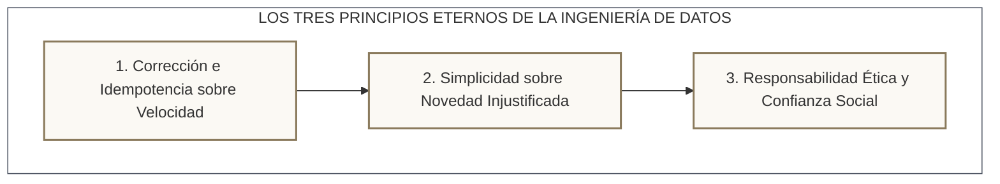

<!-- NOTAS FUENTE ORIGINALES DE OBSIDIAN: [[Epilogue]], [[Author Notes]], [[Data Engineering Future]] -->

# Capítulo 37: Epílogo — El Futuro de la Ingeniería de Datos y Conclusión de la Obra [RECOMENDADO]

> *"Las herramientas de software nacen, alcanzan su apogeo y son inevitablemente sustituidas por nuevas abstracciones. Lo que permanece inmutable a través de las décadas son las leyes fundamentales de la computación distribuida: la física de la transferencia de datos a través de una red, la necesidad de consistencia transaccional, la elegancia de las estructuras de datos y el valor innegociable de la verdad analítica."*

---

## 37.1 La Trayectoria Recorrida

A lo largo de los más de cincuenta capítulos, estudios de caso y apéndices de esta obra, hemos transitado un camino exhaustivo y riguroso. Comenzamos en los cimientos indispensables que sostienen la disciplina: la línea de comandos de Linux, el control de versiones con Git, la virtualización ligera con Docker, el modelado relacional transaccional y la matemática declarativa de SQL y el tipado estricto en Python. 

Posteriormente, desmitificamos la computación distribuida con Apache Spark, explorando su motor interno Catalyst, la gestión física de la memoria Tungsten y el comportamiento del particionamiento y el shuffle. Conquistamos la arquitectura Lakehouse a través de Delta Lake, Apache Iceberg, Apache Hudi y Databricks. Descendimos al procesamiento de flujos en tiempo real con Apache Kafka y Structured Streaming; formalizamos la orquestación con Apache Airflow, el modelado con dbt, la infraestructura declarativa con Terraform y las pruebas rigurosas con Testcontainers y Great Expectations. Finalmente, abordamos las nubes públicas líderes —AWS, Google Cloud Platform, Microsoft Fabric y Snowflake—, culminando en la ingeniería de datos orientada a inteligencia artificial, bases vectoriales y el diseño de sistemas de alta escala.

Este recorrido no fue concebido como una colección superficial de recetas de código, sino como un tratado de ingeniería destinado a forjar criterio técnico, intuición arquitectónica y solidez conceptual.

---

## 37.2 Los Tres Principios Eternos del Ingeniero de Datos

En una industria caracterizada por el ruido comercial y la proliferación vertiginosa de marcos de trabajo, el ingeniero distinguido se reconoce por su adhesión a principios que resisten el paso del tiempo:

### 1. Corrección e Idempotencia sobre Velocidad
Un pipeline de datos que procesa un terabyte por segundo pero produce datos duplicados, registros inconsistentes o agrega métricas distorsionadas es sustancialmente más peligroso que un sistema que no opera. La velocidad es una métrica de rendimiento; la corrección es una condición de existencia. Diseñe cada transformación asumiendo que la red fallará, los ejecutores se reiniciarán y los mensajes se reintentarán. La **idempotencia** y la **semántica exactamente una vez** no son lujos técnicos: son la única garantía de supervivencia de la plataforma analítica.

### 2. Simplicidad sobre Novedad Injustificada
El analista junior busca resolver cada problema mediante el despliegue del motor distribuido más complejo del mercado; el arquitecto senior resuelve el problema mediante la herramienta más simple que satisfaga las cotas de escala y el presupuesto financiero. Antes de encender un clúster de cincuenta máquinas en la nube, verifique si su volumen de datos cabe en la memoria de una instancia con DuckDB o PostgreSQL. La arquitectura más elegante es aquella que contiene la menor cantidad de piezas móviles susceptibles de fallar en la madrugada.

### 3. Responsabilidad Ética y Confianza Social
Los datos procesados por nuestras canalizaciones no son números abstractos en un archivo binario Parquet: representan historias médicas de pacientes, transacciones patrimoniales de familias, ubicaciones geográficas de personas e historiales que impactan directamente vidas humanas. La gobernanza de datos, la tokenización de información personal identificable (PII), el cumplimiento normativo (GDPR, Ley 1581) y la auditabilidad estricta son imperativos morales inalienables del ejercicio profesional.

---

## 37.3 El Ingeniero de Datos en la Era de la Inteligencia Artificial

Lejos de extinguir la necesidad de ingenieros de datos, el auge de los modelos fundacionales y la inteligencia artificial generativa ha elevado la disciplina a su punto de mayor relevancia histórica. 

Los modelos de lenguaje más sofisticados del planeta son completamente inútiles sin datos limpios, contextualizados y libres de alucinaciones. Las arquitecturas de generación aumentada por recuperación (RAG), la sincronización de almacenes de características (*Feature Stores*) de baja latencia, el particionamiento de grafos de conocimiento y el enriquecimiento continuo de flujos no son problemas de algoritmos de inteligencia artificial: **son problemas fundamentales de ingeniería de datos**. El ingeniero de datos contemporáneo es el arquitecto que alimenta, conecta y valida los sistemas cognitivos del futuro.

---

## 37.4 Mensaje Final del Autor

Llegar a ser un verdadero ingeniero de datos no consiste en acumular insignias de herramientas de moda en un currículum, sino en cultivar la disciplina del artesano: aquel que lee los planes de ejecución, que comprende por qué una consulta genera un cuello de botella de red, que respeta la física de los discos y la memoria, y que construye tuberías que operan de forma silenciosa, predecible e implacable durante años sin requerir intervención manual.

Espero que los conceptos, diagramas, demostraciones matemáticas y códigos contenidos en este libro le sirvan como una brújula confiable a lo largo de su carrera. Vaya adelante, construya sistemas que resistan el caos del mundo real y recuerde siempre que detrás de cada decisión de negocio informada y de cada avance tecnológico, late en silencio la infraestructura invisible construida por un ingeniero de datos.

*Luis Galvis*  
*Ibagué, Tolima, Colombia · 2026*
